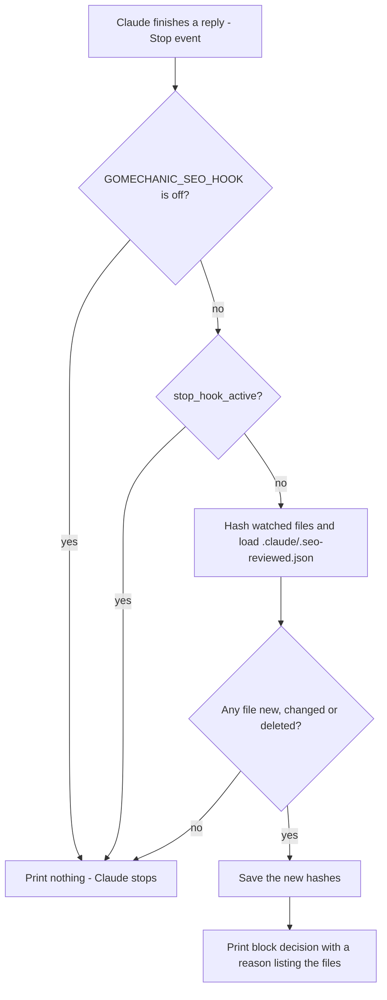
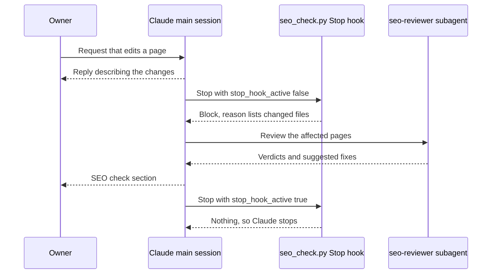

# SEO Reviewer Agent and Stop Hook - Plan

## Goal Capsule

- **Objective:** Whenever Claude changes the website's pages, the owner gets an SEO verdict and concrete suggested fixes for those pages in the same turn, without asking. Turns that don't touch pages are unaffected.
- **Means:** a read-only `seo-reviewer` subagent, triggered by a Stop hook that fingerprints page files (KTD1, KTD2).
- **Authority:** the master plan section "Automatic SEO review (task 08)" (see origin), then this plan. `CLAUDE.md` governs the workflow.
- **Execution profile:** one agent prompt, one stdlib Python script, a settings entry and docs. Prove the script with sample input first, then run one end-to-end check in a new session.
- **Stop conditions:** stop and tell the owner if, in a new session, Claude Code ignores the block decision or the hook blocks more than once per turn. Also stop if any step would need app code, which comes in task 09.
- **Who finishes:** the main session, on branch `08_seo_reviewer` (task `08_seo_reviewer`). Commit on that branch and stop. Merging happens only at `CLAUDE.md` Task workflow step 11.

## Product Contract

### Summary

Add a read-only `seo-reviewer` subagent and a Stop hook. When Claude ends a turn and page files have changed since the last review, the hook makes Claude run the agent and share its verdicts and suggested fixes before stopping. Document it in `CLAUDE.md`, `readme.md` and the task's learning doc. No app code: the hook stays quiet until task 09 creates pages.

### Problem Frame

The owner wants GoMechanic to be found in local search, and Claude sessions will build its pages across tasks 09–42. SEO mistakes are easy to make and invisible in a browser: a missing or duplicate title, two `<h1>`s, hero text that only appears after a GSAP animation, an admin page left indexable. The owner is learning and wouldn't catch these, and a manual check depends on someone remembering it. Setting the check up now, before task 09 scaffolds the app, means every page is reviewed from its first version. The explanations also teach SEO along the way.

### Key Decisions

- **Suggest, don't fix.** The owner chooses which fixes to make, which keeps page changes reviewable and turns each report into a lesson. Governs R5, R6. (see origin)
- **Automatic, with on-demand as a fallback.** The owner asked for a review after every page change, not one that has to be remembered. Governs R1, R7. (see origin)

### Requirements

**Automatic trigger**

- R1. When a turn ends with any watched file added, changed or deleted since the last SEO review, Claude doesn't stop. It runs `seo-reviewer` on the affected pages first.
- R2. Watched files are everything under `src/app/`, `src/components/`, `src/content/`, `src/i18n/`, `messages/` and `public/`, except files inside any `api` folder or `__tests__` folder, files ending `.test.ts`, `.test.tsx`, `.spec.ts` or `.spec.tsx`, and macOS `.DS_Store` files.
- R3. The hook blocks at most once per turn. It stays silent when nothing changed, when `stop_hook_active` is true, or when the environment variable `GOMECHANIC_SEO_HOOK=off` is set.
- R4. Changes are detected by file content, however they happened: Claude's edits, scripts, subagents or git operations.

**Review and report**

- R5. `seo-reviewer` never edits, commits, installs or changes settings. It checks the six areas listed in the origin section (metadata, structure, JSON-LD, crawling, Core Web Vitals, India local SEO), and reads the matching Next.js 16 guide in `node_modules/next/dist/docs/` before judging anything Next.js-specific.
- R6. The owner gets an "SEO check" section: what changed, a Pass / Needs work verdict for each affected page, and suggested fixes, each explained in plain words. Fixes are applied only when the owner asks.
- R7. The owner can ask for an SEO review at any time, without a page change.

**Repo rules and docs**

- R8. `CLAUDE.md` gets an "SEO review" section and a row in its Agents table, and its repo map lists the hook. `readme.md`'s repo map matches.
- R9. `document/learning/08_seo_reviewer.md` explains the task for a junior engineer, following `document/learning/TEMPLATE.md`.
- R10. The review state file `.claude/.seo-reviewed.json` is git-ignored and never committed.

### Success Criteria

- In a new session, a turn that changes a page file ends with an "SEO check" section the owner didn't ask for. A turn that touches no page files ends normally, with no extra round.

### Scope Boundaries

- Out of scope: page code; building metadata, sitemap, robots or JSON-LD (task `42_local_seo`); applying fixes automatically; Lighthouse or CI SEO gates; outside SEO services.
- Considered and not built:
  - **Detecting child `claude -p` sessions automatically.** The Stop hook input has no reliable signal for that, so the documented switch is the guard (KTD4). Revisit if a child run is seen taking a review.
  - **Asking again after a skipped review.** That needs a second "asked but not reviewed" state, and the on-demand review (R7) already covers it. Revisit if reviews get skipped in practice.
  - **Handling unreadable files.** A crash shows up as a visible hook error and doesn't block Claude's reply.
  - **Separate state per branch.** Switching branches costs at most one extra review.

### Open Questions

- Resolved: `src/content/` **is** watched (added to R2). Task 12 puts the placeholder garage details there, and the local-SEO check compares against them. `next.config.ts` and `src/proxy.ts` are not watched: they change rarely, and an on-demand review (R7) covers them.

## Planning Contract

### Key Technical Decisions

- KTD1. **Stop hook, not a per-edit hook.** One check when Claude ends a turn gives one review per turn, however many files changed. It also sees changes made by scripts, subagents and git, which a PostToolUse hook on Edit/Write would miss. A subagent finishing fires SubagentStop, not Stop, so the reviewer's own run doesn't re-trigger the hook. (see origin)
- KTD2. **SHA-256 hashes in a git-ignored state file, saved before the review runs.** Comparing content rather than timestamps means a file that was saved but not changed doesn't trigger a review, and git checkouts do. Saving first means a skipped or interrupted review can't make every later turn block. The cost: a skipped review isn't asked for again, and R7 covers that. (see origin)
- KTD3. **Guard on `stop_hook_active`.** When it is true, the hook prints nothing and leaves the state file alone. That keeps R3's once-per-turn limit, and edits made during the review are still caught the next turn.
- KTD4. **An environment switch for child sessions.** `GOMECHANIC_SEO_HOOK=off` silences the hook for one process. This repo starts `claude -p` child sessions: `code-reviewer` in `document/learning/04_agents.md` and `ce-compound` in `document/learning/06_compound_engineering.md`. A child started in the same turn as a page edit would otherwise take the review and save the state, and the owner would never see the SEO check.
- KTD5. **Watch the agreed folders plus `src/content/` (R2), and skip `api`, test and `.DS_Store` files.** Finder drops `.DS_Store` into folders such as `public/`; without the skip, that alone would trigger a review.
- KTD6. **The block reason is the instruction Claude follows.** It lists up to 20 changed files, adds "...and N more" when there are more, names `seo-reviewer`, asks for the R6 report and says not to apply fixes. The wording comes from the tested draft, which adds verdicts and fixes to the master plan's sample text.
- KTD7. **Read-only by instruction, with Bash kept.** The agent needs Bash to build the site and `curl` the real HTML, and a tool list can't express "read-only Bash". The rule therefore lives in the prompt, as it does in `.claude/agents/code-reviewer.md`. (see origin)
- KTD8. **Standard-library Python 3, run as `python3 "$CLAUDE_PROJECT_DIR/..."`.** `readme.md` already lists Python 3 as a prerequisite, so nothing needs installing. The project-directory variable lets the hook run from any working folder. The script needs Python 3.9 or newer; the owner's machine has 3.11.5.

### High-Level Technical Design

What the hook does each time Claude finishes a reply:

One turn that changes a page:

### Assumptions

These are bets made without the owner confirming them. Correct any that are wrong.

- Verification is manual: sample-input runs of the script plus one end-to-end check in a new session. Nothing is committed as a test file, because nothing else uses the hook and the repo has no Python test setup yet.
- The first turn after task 09 scaffolds the app will list every new starter file and review the starter page. That is accepted as the first real SEO run.
- `readme.md` is updated too (repo map and the Python prerequisite line), because the Definition of done in `CLAUDE.md` asks for it when the repo works differently.
- Claude Code loads hooks and agents when a session starts. It acts on `{"decision":"block","reason":...}` printed on stdout with exit code 0, and it passes `stop_hook_active` to Stop hooks. The end-to-end check confirms this. It hasn't been observed in this repo yet.
- The new `CLAUDE.md` section goes right after "Agents".

### Risks

- **A child `claude -p` started without the switch takes the review.** Mitigation: KTD4 plus a `CLAUDE.md` rule next to the existing `claude -p` usage. Recovery: ask for a review on demand (R7).
- **The session that installs the hook never triggers it,** because hooks load at session start. The end-to-end check therefore runs in a new session.
- **Extra reviews after branch switches or the first scaffold.** Harmless, and accepted.
- **The agent leaves a `next start` server running.** The prompt tells it to stop the server; the reviewers check that this instruction is there.

### Sources

- `document/plans/2026-10-24-gomechanic-master-plan.md`: "Automatic SEO review (task 08)" and "Verification", "SEO hook (task 08)".
- Draft `seo_check.py` and `seo-reviewer.md` from the planning session. They passed 8 sample-input cases. They live outside the repo in a temporary scratch folder that may be cleared, so U1 and U2 carry enough detail to rebuild them.
- `node_modules/next/dist/docs/01-app/01-getting-started/14-metadata-and-og-images.md` and `node_modules/next/dist/docs/01-app/02-guides/json-ld.md` exist in the leftover Next.js 16.4.3 install. Task 09 reinstalls it.
- The Compound Engineering plugin v3.32.0 has no `hooks/` folder, so this is the project's only Stop hook.
- Claude Code hooks reference: https://code.claude.com/docs/en/hooks

## Implementation Units

### U1. SEO reviewer agent

- **Goal:** Add the read-only subagent that judges changed pages and suggests fixes.
- **Requirements:** R5, R6, R7; KTD7
- **Dependencies:** none
- **Files:** create `.claude/agents/seo-reviewer.md`
- **Approach:**
  1. The frontmatter follows `code-reviewer.md`: name `seo-reviewer`; a description saying when to use it (after page changes, which the hook asks for automatically, or when the owner asks to "check SEO"); tools Read, Glob, Grep, Bash; `model: inherit`.
  2. Finding pages: start from the given file list, or from `git status` and the diff against `main`. Map the files to URLs. A `page.tsx` is one page; a layout, shared component, `messages/*.json` file or `public/` file can affect many.
  3. Checklist: the origin section's six areas, with three changes. Every finding gets a plain-words "why it matters". Name, address and phone are compared against wherever the garage details live at the time (`src/content/` placeholders until task 14, then `garage_settings`). `/login` and booking-confirmation pages must also be `noindex`.
  4. Evidence: read the source. When the site builds, also fetch the real HTML from a production build on a free port, then stop the server.
  5. **Before task 42:** missing page metadata, sitemap, robots file and JSON-LD go on one "Waiting for task 42" line and don't change a page's verdict. Things that are present but wrong (a duplicate title, two `<h1>`s) are still findings. Otherwise every early review would say "must fix" for planned work, and the owner would learn to ignore it.
  6. Report: one summary line ("N pages checked: X pass, Y need work"). Then, per page, a verdict and findings. Each finding gives What (with `file:line`), Why it matters and Fix, and is labelled must fix or nice to have. The report says what couldn't be checked and names one or two things done well.
- **Patterns to follow:** `.claude/agents/code-reviewer.md` (frontmatter, read-only wording, report shape)
- **Test scenarios:**
  - In a new session, `seo-reviewer` appears in the list of available agents.
  - Asked to check `/` while the repo has no app, it says it couldn't build the site or find the page, and `git status` is unchanged afterwards.
- **Verification:** the agent loads in a new session, returns the report shape, and changes no files.

### U2. Stop hook: script, state file and registration

- **Goal:** Make Claude run U1 automatically after any turn that changed page files.
- **Requirements:** R1, R2, R3, R4, R10; KTD1–KTD6, KTD8
- **Dependencies:** U1 (the reason names the agent)
- **Files:** create `.claude/hooks/seo_check.py`; modify `.claude/settings.json`; modify `.gitignore`
- **Approach:**
  1. The script reads the hook JSON from stdin and treats empty or invalid input as `{}`. It finds the repo root from `CLAUDE_PROJECT_DIR`, falling back to the input's `cwd`. It hashes the watched files, compares them with the state file and prints the block decision, or prints nothing. It always exits 0. A short module docstring explains it for a junior reader.
  2. Settings: load the `update-config` skill first. Add a `hooks.Stop` entry that runs the script with `python3`. Keep `extraKnownMarketplaces` and `enabledPlugins` exactly as they are.
  3. `.gitignore`: add `.claude/.seo-reviewed.json` to the "Personal Claude Code files" group.
- **Execution note:** Prove the script with sample stdin, pointing `CLAUDE_PROJECT_DIR` at a scratch folder, before registering it. That way testing never writes a state file into the real repo.
- **Test scenarios:**
  - No watched folders and no state file: no output, exit 0.
  - Add `src/app/page.tsx`: stdout is one JSON object with `"decision": "block"` and a reason that lists `src/app/page.tsx (new)`. The state file now exists.
  - Run again with nothing changed: no output.
  - Edit the file, then delete it: the reasons list it as `(changed)`, then `(deleted)`.
  - Change a file with `stop_hook_active: true`: no output and the state file is untouched, so the next normal run still reports the change.
  - Change a file with `GOMECHANIC_SEO_HOOK=off`: no output.
  - Add only `src/app/api/route.ts`, `src/components/Button.test.tsx` and `public/.DS_Store`: no output.
  - Add `src/content/garage.ts`: reported as `(new)`.
  - Empty stdin: no crash. A corrupt state file: treated as "nothing reviewed yet", so every file is reported.
  - 25 changed files: 20 are listed, followed by "...and 5 more".
  - `.claude/settings.json` still parses and keeps both plugin keys. `git check-ignore` matches the state file.
- **Verification:** every scenario behaves as listed, and `/hooks` in a new session shows the Stop hook. The end-to-end check is in the Verification Contract.

### U3. CLAUDE.md and readme

- **Goal:** Tell future sessions and the owner how the SEO review works and how to control it.
- **Requirements:** R6, R7, R8; KTD4
- **Dependencies:** U1, U2
- **Files:** modify `CLAUDE.md`, `readme.md`
- **Approach:**
  1. A new `CLAUDE.md` "SEO review" section covering:
     - what triggers the review
     - the R6 "SEO check" block
     - running it on demand
     - prefixing every `claude -p` the session starts with `GOMECHANIC_SEO_HOOK=off`
     - deleting `.claude/.seo-reviewed.json` to force a full re-review
     - running `seo-reviewer` in the foreground, not in the background, so it doesn't review half-finished pages while another agent is still building them
  2. `CLAUDE.md` tables: a `seo-reviewer` row in Agents (read-only), a `.claude/hooks/` row in the repo map, and the Stop hook added to the `.claude/settings.json` row.
  3. `readme.md`: the same repo-map changes, and the Python 3 prerequisite also names the SEO hook.
- **Patterns to follow:** the existing `CLAUDE.md` sections (short bullets with bold leads) and the existing table rows
- **Test expectation:** none -- documentation only. `code-reviewer` checks the links and that the text matches U2's behaviour.
- **Verification:** every path named exists, and the section describes what the script actually does.

### U4. Learning doc

- **Goal:** Teach the owner what this task built and why.
- **Requirements:** R9
- **Dependencies:** U1–U3 committed
- **Files:** create `document/learning/08_seo_reviewer.md`
- **Approach:**
  1. Draft it with the `learning-doc-writer` agent from `document/learning/TEMPLATE.md`. It answers Why, What and How.
  2. Explain each new term in plain words: hook, Stop event, hash or fingerprint, subagent, canonical URL, JSON-LD, Core Web Vitals.
  3. Paste real output from the U2 runs, following `document/solutions/conventions/run-commands-before-documenting-output.md`.
  4. Common mistakes: running `claude -p` without the switch, expecting the hook to fire in the session that installed it, and committing the state file.
  5. Add an exercise and links: Claude Code hooks and subagents docs, Google Search Central, and the Next.js metadata guide.
  6. Write the review verdicts and the compound decision only after those steps have really happened.
- **Patterns to follow:** `document/learning/07_website_plan.md` (latest example), `document/learning/TEMPLATE.md`
- **Test expectation:** none -- documentation. The reviewer spot-checks its commands.
- **Verification:** every output block comes from a real run, and no step is described before it happened.

## Verification Contract

There is no `npm run check` yet; task 09 adds it.

| Gate | Units | Command or action | Passes when |
| --- | --- | --- | --- |
| Hook scenarios | U2 | `python3 .claude/hooks/seo_check.py` with sample stdin JSON and `CLAUDE_PROJECT_DIR` pointing at a scratch folder | Every U2 scenario matches |
| Settings file | U2 | `python3 -m json.tool .claude/settings.json` | It parses, and `extraKnownMarketplaces`, `enabledPlugins` and `hooks.Stop` are all present |
| Ignore rule | U2 | `git check-ignore .claude/.seo-reviewed.json` | It prints the path |
| End to end | U1, U2 | In a new Claude Code session, create a throwaway file under `src/app/` and end the turn | Without being asked, Claude runs `seo-reviewer` and posts an "SEO check" section, in one round only. Afterwards, delete the throwaway file and the state file together so the next turn stays quiet |
| Review | all | `ce-code-review`, then the `code-reviewer` agent | "Ready to merge", or every must fix is fixed |

## Definition of Done

- R1–R10 hold, and every Verification Contract gate passes.
- `document/task/task.md` links this plan, and every 08 step is ticked except "Merge into `main`".
- Nothing is committed that shouldn't be: no state file, no throwaway probe file, no draft copies. Commits stay on `08_seo_reviewer`, and nothing is pushed.
- U1: the agent loads in a new session and changes no files.
- U2: every scenario passes, and the end-to-end check shows exactly one review round.
- U3: the docs match the script's real behaviour.
- U4: the doc's outputs are real, and its review section reports the actual verdicts.
