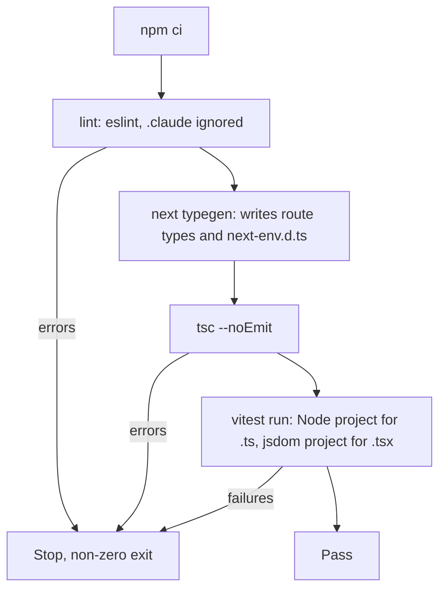

# Next.js App Setup - Plan

## Goal Capsule

- **Objective:** Anyone who clones the repo can install it, start the site and run one command that proves lint, types and tests pass, even on a fresh clone. Tasks 10–46 then build on a working, checked app instead of solving setup again.
- **Means:** the Next.js 16.4.3 scaffold copied in from a scratch folder, shadcn/ui on Radix, GSAP, Vitest and one Playwright smoke test, tied together by `npm run check` (KTD1–KTD9).
- **Authority:** the master plan's task 09 row and Architecture section (see origin), then this plan. `CLAUDE.md` governs the workflow. Both lessons in `document/solutions/conventions/` apply.
- **Execution profile:** mostly packaging and config. Prove each unit with real runs (install, build, lint, check). The only test files are the smoke tests R7 and R8 ask for.
- **Stop conditions:** stop and ask the owner when:
  - Q1 (Node version) has no answer yet. U1 can't start without it.
  - A step would install something globally or download Playwright browsers.
  - `shadcn init` asks an interactive question, or changes files other than those U2 lists.
  - A new dependency's npm metadata doesn't point at the project it claims to be.
- **Who finishes:** the main session on branch `09_app_setup`. Commit on that branch and stop. Merging happens only at `CLAUDE.md` Task workflow step 11.

---

## Product Contract

### Summary

Put a working Next.js 16.4.3 app at the repo root: TypeScript, Tailwind v4, ESLint, App Router in `src/`, Cache Components, shadcn/ui on the Radix base, and GSAP. Add Vitest unit tests, one Playwright smoke test and `npm run check`. Update `CLAUDE.md` and `readme.md` so people and future sessions know how to run it, and write the learning doc. The page stays a placeholder until tasks 12–13.

### Problem Frame

The repo has plans, rules, skills and agents, but no app. Every task from 10 on needs one to build on, plus a single command that says "everything still works": the master plan's Verification section asks every task to run `npm run check`.

An earlier attempt at this task was reverted after review. Type checking broke on a fresh clone, lint and type checks swept up third-party skill files in `.claude/`, and the font variable didn't match what shadcn's theme reads. Planning found one more problem: the latest Vitest and jsdom no longer run on Node 20. This machine runs Node 20.20.2, and Node 20 has been out of support since 2026-04-30. The owner is learning, so each setup choice has to be explained, not just made.

### Requirements

**App foundation**

- R1. The repo root holds the app made by `create-next-app@16.4.3` with TypeScript, Tailwind v4, ESLint, App Router, `src/`, the `@/*` alias, npm, Cache Components and `AGENTS.md`.
- R2. The ignored leftovers from the earlier scaffold (`node_modules/`, `.next/`, `next-env.d.ts`, `tsconfig.tsbuildinfo`) are deleted before the new app is installed.
- R3. `npm run dev` serves the home page and `npm run build` succeeds.
- R4. The repo names the Node version it needs, and every installed tool accepts that version.

**UI and motion libraries**

- R5. shadcn/ui is initialised through its CLI with the Radix base, and the `--font-sans` variable its theme reads resolves, so text is sans-serif.
- R6. `gsap` and `@gsap/react` are installed. No animation code yet.

**Tests and checks**

- R7. Vitest runs the unit tests in `src/`: at least one plain logic test and one React component test.
- R8. One Playwright smoke test loads the home page in a real browser, without downloading any browser.
- R9. `npm run check` runs lint, `next typegen`, `tsc --noEmit` and Vitest, stops at the first failure, and passes on a fresh clone without running `next dev` or `next build` first.
- R10. Lint and type checks cover the app's code and skip the third-party files in `.claude/`.

**Docs**

- R11. `CLAUDE.md` names the stack versions, lists the commands, states the code conventions and imports `AGENTS.md` with an `@AGENTS.md` line.
- R12. `readme.md` explains how to install, run, check and test the app.
- R13. `document/learning/09_app_setup.md` explains the task for a junior engineer, following `document/learning/TEMPLATE.md`.

### Success Criteria

- A fresh clone of the branch passes `npm run check` after `npm ci`, with no setup beyond the Node version the repo names.

### Scope Boundaries

- Later tasks own: i18n and `[locale]` routes (10); tokens, fonts and restyled controls (11); header, footer and layout (12); home page and animation (13); database and `env.ts` (14); hosting (20); metadata, sitemap and JSON-LD (42).
- No shadcn components are added. Task 11 adds and restyles them.
- Considered and not built:
  - **Playwright inside `npm run check`.** It needs a production build, which would slow every check. It runs as its own command before merge. Revisit if e2e failures start slipping through.
  - **A CI workflow.** No remote CI exists and task 20 sets up hosting. Revisit then.
  - **Prettier, Husky or lint-staged.** Not asked for; ESLint covers the rules. Revisit if formatting drift shows up in reviews.
  - **Enforcing the Node version (`engine-strict`).** npm already warns on a mismatch, and fnm picks the version from `.nvmrc`. Revisit if a wrong Node causes confusing errors.
  - **`.env.example`.** There are no environment variables yet. Task 14 adds the first ones.

### Open Questions

- Q1. **Blocking, owner decision before U1: which Node version?** Vitest 5.0.5 needs Node `^22.12 || ^24 || >=26`, and jsdom 30.1.3 needs `^22.22.2 || ^24.15 || >=26`. Installing a new Node through fnm is a machine-wide install, so `CLAUDE.md` says ask first.
  - **Recommended: Node 24 LTS through fnm**, pinned in `.nvmrc`. It gets security fixes until April 2028, and the current Vitest and jsdom work on it.
  - **Alternative: stay on Node 20.20.** Nothing to install, but the app starts on an unsupported runtime, and Vitest and jsdom stay pinned to older majors until someone upgrades.
  - KTD2 covers what changes in the repo for each answer.

---

## Planning Contract

### Key Technical Decisions

- KTD1. **Scaffold in a scratch folder, then copy the files in.** Copy only `package.json`, `package-lock.json`, `next.config.ts`, `tsconfig.json`, `eslint.config.mjs`, `AGENTS.md` and `src/app/`. Never copy `README.md`: macOS file names ignore case, so it would overwrite our `readme.md`. Don't copy `node_modules/`, `.next/` or `next-env.d.ts` either. Merge the scaffold's `.gitignore` into ours instead of replacing it. Ours keeps `!.env.example` and the Claude and Compound Engineering rules, and gains `*.pem` and `.vercel`. The scaffold was made without the master plan's `--no-agent-feedback` flag. That changes nothing: agent feedback stays off unless `experimental.agentFeedback` is set, and the scaffold's `next.config.ts` doesn't set it. (session-settled: user-directed — chosen over scaffolding at the repo root: create-next-app refuses a non-empty folder)
- KTD2. **Pin Node in `.nvmrc` and `package.json` `engines`, and pick package versions that fit it.** fnm reads `.nvmrc`, so the shell can switch on its own. With Node 24, install the current Vitest and jsdom, and move `@types/node` from the scaffold's `^20` to `^24`. Vitest 5's optional peer range for it is `^22 || >=24`, so `^20` would clash. With Node 20, pin Vitest `4.1.x` and the newest jsdom whose `engines` accept 20, and keep `@types/node` at `^20`. Either way, check each new package's `engines` with `npm view` before installing.
- KTD3. **`typecheck` runs `next typegen`, then `tsc --noEmit`.** Route type helpers such as `LayoutProps` are generated into git-ignored files, so plain `tsc` fails on a fresh clone. The bundled CLI docs show this exact pairing. (session-settled: user-directed — chosen over plain `tsc --noEmit`: it failed on a fresh clone in the reverted attempt)
- KTD4. **ESLint and TypeScript skip `.claude/` (and ESLint also skips `.worktrees/` and `.context/`, since it doesn't read `.gitignore`).** Add it to `globalIgnores` in `eslint.config.mjs` and to `exclude` in `tsconfig.json`, because `.claude/skills/` holds committed third-party code. (session-settled: user-directed — chosen over checking the whole tree: skill files broke lint and type checks in the reverted attempt)
- KTD5. **Tailwind looks for class names in `src/` only.** By default Tailwind v4 scans every file git doesn't ignore. `.claude/skills/` and `document/` are committed and full of class names (the ui-ux-pro-max data tables especially), so their classes would end up in the CSS every visitor downloads, and nobody would notice. Set the limit in `src/app/globals.css` after `shadcn init` has rewritten that file, with `@import "tailwindcss" source("../");` (the path is relative to the CSS file, so `../` from `src/app/` means `src/`). Check the installed Tailwind's docs for the exact syntax first.
- KTD6. **Tests sit next to the code as `*.test.ts` or `*.test.tsx` under `src/`. `.ts` tests run in Node and `.tsx` tests run in jsdom.** The master plan's domain tests and PGlite integration tests want Node; only component tests need a fake browser. Two Vitest projects split them by extension, so nobody has to remember a per-file comment. Tests import `test` and `expect` from `vitest` (no globals), so TypeScript needs no extra types. The rest follows the bundled Vitest guide: `@vitejs/plugin-react`, `@testing-library/react`, `@testing-library/dom` and `@/` alias resolution. Limiting `include` to `src/` keeps Vitest away from Playwright's `e2e/*.spec.ts` and from `.claude/`. The SEO hook already skips `*.test.ts(x)` files.
- KTD7. **Playwright drives the installed Google Chrome (`channel: 'chrome'`) against a production build on its own port.** Installing `@playwright/test` downloads no browsers (the package has no install script). `npx playwright install` would download them into a per-user cache, which counts as a global install under `CLAUDE.md`. The `webServer` builds and starts the app, as the bundled Playwright guide recommends, on a port other than 3000, so a running `npm run dev` is never tested by mistake. One browser project only.
- KTD8. **Scripts: `dev`, `build`, `start`, `lint`, `typecheck`, `test` (Vitest once), `test:watch`, `test:e2e` and `check`.** `check` runs `lint`, `typecheck` and `test` in that order and stops at the first failure, matching the master plan's Verification line. `test:e2e` stays outside `check` (see Scope Boundaries).
- KTD9. **`shadcn init` at the CLI version current when U2 runs (4.22.1 at planning), with `--base radix --preset nova --no-monorepo -y`.** Add `--pointer` only if `init --help` lists it: the installed shadcn skill's CLI reference doesn't mention it. Accept what init generates, including shadcn's own `cn` package (github.com/shadcn-ui/cn) and the `shadcn` runtime package. If init adds a font to the root layout, its CSS variable must be `--font-sans`. If it adds none, define `--font-sans` as a system font stack. Task 11 chooses the real font.
- KTD10. **A minimal placeholder page with honest metadata.** Replace the scaffold's "Create Next App" title, its description and its "Hello world!" text. Use the project name, one `<h1>` and one line saying the site is being built, and keep `lang="en"`. The smoke tests check that heading. Tasks 10, 12, 13 and 42 replace all of it.

### High-Level Technical Design

`npm run check`, as run on a fresh clone:



### Output Structure

New and changed files at the repo root (U-IDs say which unit creates them):

```text
.nvmrc                  U1  Node version for fnm
AGENTS.md               U1  from create-next-app; next dev manages its block
next.config.ts          U1  cacheComponents, partialPrefetching, Tailwind loader
tsconfig.json           U1  excludes .claude
eslint.config.mjs       U1  ignores .claude
package.json            U1  scripts, engines (later units add dependencies)
components.json         U2  shadcn config
vitest.config.mts       U3
playwright.config.ts    U4
e2e/
  smoke.spec.ts         U4
src/
  app/
    layout.tsx          U1
    page.tsx            U1
    page.test.tsx       U3  component test (jsdom)
    globals.css         U1, U2  Tailwind, shadcn theme, src-only sources
  lib/
    utils.ts            U2  cn() from shadcn init
    utils.test.ts       U3  logic test (Node)
```

### Assumptions

Bets made without the owner confirming them. Correct any that are wrong.

- The placeholder page and metadata (KTD10) are fine until tasks 12–13. The SEO hook's review of them counts as the first real SEO run: verdicts reported, fixes not applied.
- Running e2e on its own, outside `npm run check` (KTD8), is fine for everyday work.
- Splitting test environments by file extension (KTD6) suits later tasks. Task 14 can add a PGlite project if it needs one.
- Root config files (`vitest.config.mts`, `playwright.config.ts`, `components.json`, `.nvmrc`) are acceptable at the top level. The repo maps in `CLAUDE.md` and `readme.md` list them.
- The planning scaffold lives in a temporary folder that may be cleared. Re-running the command in Sources gives the same files.

### Deferred to Implementation

- How Vitest resolves `@/`: natively if the installed Vite supports tsconfig paths, otherwise with `vite-tsconfig-paths` as the bundled guide shows.
- The exact Vitest `projects` syntax and Tailwind source directive for the installed versions. Read their docs before writing them.
- Whatever `shadcn init` changes beyond KTD9's list, such as `next.config.ts` or a PostCSS config. Keep exactly one Tailwind pipeline: the scaffold's Turbopack loader.
- The Playwright port number.

### Risks

- **The Node decision holds up U1.** Ask Q1 first thing when work starts.
- **`shadcn init` rewrites more than expected.** Run it on a clean, committed tree so `git diff` shows exactly what changed, and review that diff before committing.
- **`next dev` rewrites the `AGENTS.md` block** when it detects an agent. Commit what it writes, as the bundled `agentRules` docs advise.
- **The SEO Stop hook fires on the first `src/app/` change.** That's expected. Run `seo-reviewer` in the foreground once the placeholder page is in place, and don't apply its fixes.
- **Machines without Google Chrome can't run e2e.** The readme names Chrome as an e2e prerequisite. CI will need its own browser setup.

### Sources

- Master plan: task 09 row, Architecture, Verification (see origin).
- `document/solutions/conventions/nextjs-16-read-bundled-docs-image-priority.md`: read the bundled Next.js docs before using an API. Deleting the leftover `node_modules/` removes them until the reinstall.
- `document/solutions/conventions/run-commands-before-documenting-output.md`: the learning doc pastes real output only.
- Bundled Next.js 16.4.3 docs under `node_modules/next/dist/docs/01-app/`:
  - `02-guides/testing/vitest.md` and `02-guides/testing/playwright.md`
  - `03-api-reference/06-cli/next.md` (`next typegen`)
  - `03-api-reference/05-config/01-next-config-js/agentRules.md` and `agentFeedback.md`
  - `02-guides/adopting-partial-prefetching.md`: `cacheComponents` warns unless `partialPrefetching` is set; both become the default in the next major
  - `02-guides/environment-variables.md`: `NEXT_PUBLIC_` values are inlined into browser code
- Scaffold command: `npx create-next-app@16.4.3 go-mechanic --ts --tailwind --eslint --app --src-dir --import-alias '@/*' --use-npm --cache-components --agents-md --disable-git --empty --yes`. It produces `src/app/{layout,page}.tsx`, `globals.css`, `AGENTS.md` and `next.config.ts` (`cacheComponents: true`, `partialPrefetching: true`, a Turbopack Tailwind loader), and no `public/` and no PostCSS config.
- npm registry on 2026-10-25:
  - vitest 5.0.5 (Node `^22.12 || ^24 || >=26`) and 4.1.12 (Node `^20 || ^22 || >=24`)
  - jsdom 30.1.3 (Node `^22.22.2 || ^24.15 || >=26`)
  - vite 8.3.5 and @vitejs/plugin-react 6.1.2 (Node `^20.19 || >=22.12`)
  - @playwright/test 1.64.1 (Node `>=20`); shadcn 4.22.1 (Node `>=20.18.1`)
  - gsap 3.15.0; @gsap/react 2.1.2; @testing-library/react 16.3.3
  - next 16.4.3 (Node `>=20.9`)
- This machine: Node v20.20.2 through fnm; Google Chrome installed.

---

## Implementation Units

### U1. Clean slate and scaffold copy-in

- **Goal:** The scaffolded app runs from the repo root on the chosen Node.
- **Requirements:** R1–R4, R10; KTD1–KTD4, KTD8, KTD10
- **Dependencies:** Q1 answered
- **Files:** delete `node_modules/`, `.next/`, `next-env.d.ts`, `tsconfig.tsbuildinfo` (all ignored and untracked); create `package.json`, `package-lock.json`, `next.config.ts`, `tsconfig.json`, `eslint.config.mjs`, `AGENTS.md`, `.nvmrc`, `src/app/layout.tsx`, `src/app/page.tsx`, `src/app/globals.css`; modify `.gitignore`
- **Approach:**
  1. Confirm that git ignores the four leftovers and tracks none of them, then delete them.
  2. Switch to the Node version Q1 chose. Re-create the scratch scaffold if it's gone.
  3. Copy in the KTD1 file list and merge `.gitignore`.
  4. Add `.nvmrc` and `engines`, and set `@types/node` (KTD2).
  5. Add the `.claude` ignores (KTD4) and the `lint` and `typecheck` scripts (KTD3, KTD8).
  6. Replace the placeholder metadata and page text (KTD10), then `npm install`.
- **Execution note:** Packaging work: prove it with real runs, not new tests.
- **Test expectation:** none -- scaffolding. U3 and U4 add the tests.
- **Verification:** `npm run dev` serves `/` with the heading, and `npm run build`, `npm run lint` and `npm run typecheck` pass. `node_modules/next/dist/docs/` exists again. `npm install` prints no `EBADENGINE` warning. `readme.md` is unchanged and no `README.md` exists.

### U2. shadcn/ui (Radix) and GSAP

- **Goal:** shadcn's theme and `cn()` helper are in place, and GSAP is ready for tasks 12–13.
- **Requirements:** R5, R6; KTD5, KTD9
- **Dependencies:** U1 committed, so init's changes show up as a clean diff
- **Files:** create `components.json`, `src/lib/utils.ts`; modify `src/app/globals.css`, `package.json`, `package-lock.json`, and `src/app/layout.tsx` only if init adds a font. If init touches `next.config.ts` or adds a PostCSS config, those changes are allowed only to undo a second Tailwind setup (keep the scaffold's Turbopack loader as the one pipeline).
- **Approach:**
  1. Check the flags with `init --help`, then run init as KTD9 says.
  2. Review the diff. Check each new dependency's npm `repository` field, including `cn` (expected: shadcn-ui) and `shadcn`.
  3. Make `--font-sans` resolve (KTD9) and limit Tailwind to `src/` (KTD5).
  4. Install `gsap` and `@gsap/react`.
- **Test expectation:** none -- config. U3 tests `cn()` and U4 checks the font.
- **Verification:**
  - `npm run build` passes, and the built CSS contains shadcn's theme variables.
  - A class name that appears only in `.claude/skills/` data is missing from the built CSS, while a class used in `src/app/page.tsx` is present.
  - `components.json` shows the Radix base, and `npm ls gsap @gsap/react` lists both.

### U3. Vitest and `npm run check`

- **Goal:** One command proves that lint, types and unit tests pass.
- **Requirements:** R7, R9, R10; KTD3, KTD6, KTD8
- **Dependencies:** U2 (the logic test covers `cn()`)
- **Files:** create `vitest.config.mts`, `vitest.setup.ts`, `src/lib/utils.test.ts`, `src/app/page.test.tsx`; modify `package.json`, `package-lock.json`
- **Approach:** Install Vitest and the guide's packages at the versions KTD2 allows. Configure the two projects (KTD6) and add the `test`, `test:watch` and `check` scripts (KTD8). Without Vitest globals, Testing Library doesn't clean up between tests, so `vitest.setup.ts` (jsdom project) registers `afterEach(cleanup)`.
- **Test scenarios:**
  - `cn("px-2", "px-4")` returns `"px-4"`: the later Tailwind class wins.
  - `cn("a", false, undefined, "b")` returns `"a b"`: falsy values are dropped.
  - The home page renders exactly one level-1 heading with the project name.
  - `utils.test.ts` sees no `document` global and `page.test.tsx` does, which proves the environment split.
  - Two component renders in one file don't see each other's output, which proves the cleanup runs.
- **Verification:**
  - `npm run test` runs exactly these two files and nothing from `e2e/` or `.claude/`.
  - Add one lint error, then one type error, then one failing assertion, one at a time. Each makes `npm run check` exit non-zero at its stage. Revert each one.
  - A fresh clone of the branch in a scratch folder passes `npm ci` and `npm run check` with no `.next/` folder.

### U4. Playwright smoke test

- **Goal:** A real browser proves the built site loads.
- **Requirements:** R8; KTD7
- **Dependencies:** U3
- **Files:** create `playwright.config.ts`, `e2e/smoke.spec.ts`; modify `package.json`, `package-lock.json`, `.gitignore` (add `test-results/`, `playwright-report/`, `blob-report/`, `playwright/.cache/`)
- **Approach:** Install `@playwright/test` only. Never run `npx playwright install`. Configure it as KTD7 says and add the `test:e2e` script.
- **Test scenarios:**
  - `/` responds with HTTP 200 and shows the level-1 heading.
  - `<html>` has `lang="en"`.
  - The body's computed font family is not the browser's default serif. This guards the `--font-sans` lesson.
  - Loading the page logs no console errors.
- **Verification:** `npm run test:e2e` passes with Google Chrome. The contents of `~/Library/Caches/ms-playwright` are the same before and after the run (the folder already exists from another project). `git status` shows no Playwright output.

### U5. CLAUDE.md and readme

- **Goal:** Future sessions and the owner know the stack, commands and conventions.
- **Requirements:** R11, R12
- **Dependencies:** U1–U4 (the documented commands must exist and pass)
- **Files:** modify `CLAUDE.md`, `readme.md`
- **Approach:**
  1. `CLAUDE.md`, top: an `@AGENTS.md` import line. "The project": exact stack versions and the Node version.
  2. `CLAUDE.md`: a "Commands" section listing the KTD8 scripts.
  3. `CLAUDE.md`: a "Code conventions" section:
     - Server Components by default; `'use client'` only when a component needs the browser
     - `@/` imports
     - the master plan's code layout (`src/domain/`, `src/server/`, `src/components/{ui,site,account,admin}`)
     - tests next to the code as `*.test.ts(x)`, browser tests in `e2e/`
     - read the bundled Next.js docs before using an API (link the lesson)
     - never put secrets in `NEXT_PUBLIC_` variables, because they are inlined into browser code
     - add shadcn components only through the CLI
     - animate with GSAP through `useGSAP`, and respect reduced motion
  4. `CLAUDE.md`: repo map rows for `src/`, `e2e/`, `AGENTS.md` and the root config files. Add "`npm run check` and `npm run test:e2e` pass" to the Definition of done, and say `test:e2e` must pass before every merge (it isn't part of `check`). Note that `.ts` tests run in Node and `.tsx` tests in jsdom. Don't repeat rules the Skills section already has (shadcn via CLI, `useGSAP`).
  5. `readme.md`: a "How to run" section (install, dev, check, e2e). The Node prerequisite points to `.nvmrc` instead of "Node.js 20 or newer". Add Google Chrome for e2e, and repo map rows that match `CLAUDE.md`.
- **Patterns to follow:** existing `CLAUDE.md` sections (short bullets with bold leads) and table rows.
- **Test expectation:** none -- documentation. `code-reviewer` checks that every command exists and every path resolves.
- **Verification:** every command in both files runs as described.

### U6. Learning doc

- **Goal:** Teach the owner what this task built and why.
- **Requirements:** R13
- **Dependencies:** U1–U5 committed
- **Files:** create `document/learning/09_app_setup.md`
- **Approach:**
  1. Draft it with the `learning-doc-writer` agent from `document/learning/TEMPLATE.md`. It answers Why, What and How, and explains the Node decision (Q1).
  2. Terms to explain:
     - scaffold, lockfile, `engines`, `.nvmrc` and fnm
     - Node LTS and end of life
     - Cache Components and partial prefetching (one line each)
     - route types and `next typegen`
     - Tailwind source detection
     - shadcn and Radix
     - unit, component and end-to-end tests; jsdom; a Playwright channel
  3. Paste real output (`npm run check`, the fresh-clone run, installed versions) as the run-commands lesson requires.
  4. Common mistakes:
     - copying `README.md` over `readme.md` on macOS
     - plain `tsc` on a fresh clone
     - linting `.claude/`
     - running `npx playwright install`
     - secrets in `NEXT_PUBLIC_` variables
  5. Add an exercise and links. Write the review verdicts and the compound decision only after they have happened.
- **Patterns to follow:** `document/learning/08_seo_reviewer.md`, `document/learning/TEMPLATE.md`
- **Test expectation:** none -- documentation.
- **Verification:** every output block comes from a real run, and no step is described before it happened.

---

## Verification Contract

| Gate | Units | Command or action | Passes when |
| --- | --- | --- | --- |
| Node | U1 | `node -v`, then `npm install` | The version matches `.nvmrc`; no `EBADENGINE` warning |
| Build and dev | U1, U2 | `npm run build`; `npm run dev`, then open `/` | Build succeeds; the heading shows in a sans-serif font |
| Tailwind sources | U2 | Search the built CSS | Skill-only class absent; page class present |
| Check | U3 | `npm run check` | Lint, typegen, `tsc` and Vitest all pass |
| Check fails loudly | U3 | One lint, type or test error at a time | Non-zero exit at that stage; each error reverted |
| Fresh clone | U3 | Clone the branch to a scratch folder, `npm ci`, `npm run check` | Passes without a prior dev or build |
| End to end | U4 | `npm run test:e2e` | Passes on the installed Chrome; no browser download |
| SEO | U1, U2 | The Stop hook asks; run `seo-reviewer` in the foreground | Report shared with the owner; fixes not applied |
| Review | all | `ce-code-review`, then the `code-reviewer` agent | "Ready to merge", or every must fix is fixed |

---

## Definition of Done

- R1–R13 hold and every Verification Contract gate passes.
- `document/task/task.md` links this plan, and every 09 step is ticked except "Merge into `main`".
- Committed: `package-lock.json`. Not committed: `node_modules/`, `.next/`, `next-env.d.ts`, `*.tsbuildinfo`, `README.md`, Playwright output, `.env` files.
- No leftovers from trying things out: the deliberate check failures are reverted, and no scratch configs or copies remain.
- Commits stay on `09_app_setup`, and Claude doesn't push.
- Per unit:
  - U1: dev and build work on the chosen Node.
  - U2: theme, `--font-sans` and the Tailwind limit are verified.
  - U3: `npm run check` passes locally and on a fresh clone.
  - U4: e2e passes without a browser download.
  - U5: the docs match the real commands.
  - U6: the outputs are real, and the review section reports the real verdicts.
