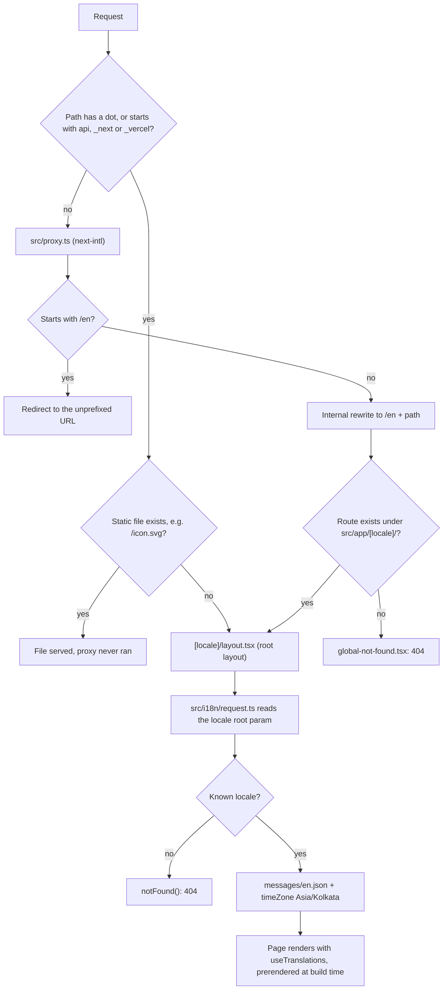

# i18n Foundation - Plan

## Goal Capsule

- **Objective:** Visitors keep the same clean English URLs (`/`, later `/services`). The garage can later add Hindi, then other Indian languages, by adding a locale and a message file instead of moving pages or rewriting text. Every price and time the site shows reads correctly for India (`₹1,23,456`, India time) wherever the server runs.
- **Means:** next-intl 4.14.9 with all routes under `src/app/[locale]/`, the locale read through `next/root-params`, and shared rupee, date and text helpers (KTD1–KTD9).
- **Authority:** the master plan (Architecture "Translations" row, Data rules, task 10 row, Risks; see origin), then this plan. `CLAUDE.md` governs the workflow. Both lessons in `document/solutions/conventions/` apply: read the bundled Next.js docs before using an API, and only document output you actually ran.
- **Execution profile:** U1 is a routing and config change, proven by a real build and the e2e tests. U2's helpers are pure functions: write their tests first.
- **Stop conditions:** stop and ask the owner when:
  - `npm run build` reports a Cache Components error (request-time data outside `<Suspense>`) that KTD2 can't fix. Don't fall back to `setRequestLocale`, `connection()` or a Suspense wrapper around the root layout.
  - `npm run check` or the build only passes after approving an npm install script (next-intl brings `@swc/core` and `@parcel/watcher`).
  - A step would install something globally or run `npx playwright install`.
  - Any existing public URL would change (`/` must stay `/`).
- **Who finishes:** the main session on branch `10_i18n_foundation`. Commit on that branch and stop. Merging happens only at `CLAUDE.md` Task workflow step 11.

---

## Product Contract

### Summary

Add next-intl and move every page under `src/app/[locale]/`, with `localePrefix: 'as-needed'` so English URLs stay unprefixed. All UI text moves into `messages/en.json`, `<html lang>` comes from the locale, and unknown URLs get a plain translated 404. Pure helpers format money (stored as paise) in rupees and dates and times in Asia/Kolkata, and a `LocalizedText` type is ready for database text. Lint rules keep text and links locale-aware, and tests prove it all still works with Cache Components.

### Problem Frame

The owner chose "English first, Hindi later without rework" (master plan, Decisions). Today the app has one root layout at `src/app/layout.tsx` with `lang="en"` and the home page text typed into the JSX. Adding Hindi later would mean moving every route under a locale folder and hunting down every hard-coded string, and the longer we wait, the more pages that touches. Tasks 11–13 start building real pages next, so the structure has to be in place first.

Two India-specific traps also need closing before any price or booking time is shown. `Intl` with plain `en` groups numbers the Western way (`₹123,456`), not the Indian way (`₹1,23,456`). And a server on Vercel runs in UTC, so a 10:00 IST booking would display as 04:30 unless the time zone is set on every call. The master plan's data rules already say money is integer paise and garage time is `Asia/Kolkata`. This task gives the rest of the app one correct way to display both.

The risky part is the library combination: next-intl, Next.js 16.4.3 and `cacheComponents: true`. The usual next-intl setup reads a request header, which turns static pages dynamic. Next.js 16.3 added `next/root-params` to fix this (master plan risk: "spike next-intl in 10").

### Requirements

**Routing and locale**

- R1. English URLs stay unprefixed. `/` serves the home page with status 200. `/en` and `/en/<path>` redirect to the unprefixed URL.
- R2. All pages live under `src/app/[locale]/`. Adding a language later means adding it to the locale list and adding `messages/<locale>.json`, with no route moves. Only `en` is enabled now, so `/hi` is a 404 until Hindi is added.
- R3. `<html lang>` comes from the active locale (`en` today).
- R4. Unknown URLs return a real 404 page: status 404, `lang` set, text from messages, one `<title>`. Never a 500.

**Text**

- R5. All UI text comes from `messages/en.json`, including page metadata and the 404 page. The brand name "GoMechanic" lives there too. Lint flags literal JSX text in app pages and site components.
- R6. Message keys are type-checked: a misspelled key fails `npm run typecheck`.

**Formatting**

- R7. Money arrives as integer paise and displays as rupees with Indian grouping: `12345600` paise shows as `₹1,23,456`. Input that isn't a safe integer is rejected with an error.
- R8. Dates and times display in Asia/Kolkata in Indian English style, whatever the server or browser time zone.
- R9. `LocalizedText` (`{ en: string; hi?: string }`) comes with a helper that returns the active locale's text, falling back to English when the translation is missing or empty.

**Compatibility**

- R10. It works with Cache Components: `npm run build` passes, and the home page is prerendered at build time, not rendered on every request.
- R11. The existing checks keep passing: one `h1` "GoMechanic", `lang="en"`, the theme font, no console errors, `npm run check`, `npm run test:e2e`.

### Success Criteria

- A future "add Hindi" task only needs to touch the locale list and Intl map (`src/i18n/config.ts`), add `messages/hi.json`, and flip the `/hi` e2e test. No page, layout or helper needs to move.

### Scope Boundaries

- Not in this task: Hindi text, `messages/hi.json`, a language switcher, `hreflang` alternates in metadata (task 42 and the Hindi backlog item), a Devanagari font (task 11), a designed 404 page (task 12).
- Not in this task: translating shadcn's built-in screen-reader strings in `src/components/ui/`. None are used yet.
- Considered and not built: tuning next-intl's locale detection and `NEXT_LOCALE` cookie. With one locale, nothing is ever detected. Revisit when Hindi lands, because redirecting `/` by `Accept-Language` can affect SEO.
- Considered and not built: a `[locale]/[...rest]` catch-all with `[locale]/not-found.tsx`. `global-not-found.tsx` already catches every unmatched URL (KTD5). Task 12 may add the localized pair when it designs the 404.
- Considered and not built: next-intl `formats` for currency. next-intl formats with the route locale `en`, which gives Western grouping, so money goes through our helper (KTD7).

#### Deferred to Follow-Up Work

- Task 12 builds its custom 404 on `src/app/global-not-found.tsx` (U5 rewords task 12's step, which still says root `not-found.tsx`).
- Hindi backlog item: add `hi` to the locale list, `messages/hi.json` and `hi-IN` to the Intl map, flip the `/hi` e2e test, decide locale detection, and add `hreflang` with task 42.
- Tasks 15 and later: Route Handlers and Server Actions can't read root params, so they pass the locale explicitly (KTD3).

---

## Planning Contract

### Key Technical Decisions

- KTD1. **next-intl 4.14.9, pinned exactly.** It is the latest 4.x on npm (October 2026), with peer dependencies `next ^16` and `react ^19`, and the master plan's risk list asks for pinned versions. It depends on `@swc/core` and `@parcel/watcher`, which only its message extractor uses (we don't turn that on). npm 11 will skip their install scripts and print a warning. Leave them unapproved, as `CLAUDE.md` says, unless something actually breaks.
- KTD2. **The locale comes from `next/root-params`, not `setRequestLocale`.** `src/i18n/request.ts` uses the `locale` argument when a caller passes one, and otherwise awaits the `locale` getter from `next/root-params`. An unknown value calls `notFound()`. Next.js tracks root params as part of the cache key and they need no `headers()`, so pages stay static. Rejected: `setRequestLocale` in every layout and page. next-intl calls it legacy, and one forgotten call makes that route dynamic. Rejected: `dynamicParams = false` to reject unknown locales, which next-intl says doesn't work with Cache Components.
- KTD3. **Explicit locale for code outside the locale tree.** `global-not-found.tsx` (KTD5), and later Route Handlers, Server Actions and notification code, pass the locale themselves. Root params throw in Server Actions and aren't supported in Route Handlers yet (`next-root-params.md`, Restrictions).
- KTD4. **No pass-through `src/app/layout.tsx`.** `src/app/[locale]/layout.tsx` is the only root layout, and its `generateStaticParams` returns every locale. A layout above `[locale]` would become the root layout, and `locale` would stop being a root param (next-intl's root-params post says to remove it). With Cache Components, every root param needs at least one static value or the build fails (`next-root-params.md`, `generate-static-params.md` "With Cache Components").
- KTD5. **Unmatched URLs use `src/app/global-not-found.tsx` with `experimental.globalNotFound: true`.** The Next.js docs name "root layout under a top-level dynamic segment" as the case it exists for. It returns its own `<html lang>` and `<body>`, imports `globals.css` and the shared font, and gets its text with `getTranslations` and an explicit default locale (KTD3). It is still experimental in 16.4.3 (`node_modules/next/dist/server/config-shared.d.ts`), so the U3 404 tests guard it.
- KTD6. **The proxy is `src/proxy.ts`: next-intl's `createMiddleware(routing)` as the default export, with matcher `'/((?!api|_next|_vercel|.*\\..*).*)'`.** Next.js 16 renamed middleware to proxy, and the file sits next to `app/` inside `src/`. The matcher skips API routes, Next.js internals and any path containing a dot (`/icon.svg`, later `/robots.txt` and `/sitemap.xml`), and it still matches unprefixed paths, which `as-needed` needs. Because of that dot rule, page slugs must never contain a dot. `(?!api)` also skips any top-level path that starts with "api" (such as `/apiary`). No such page is planned.
- KTD7. **Route locales and formatting locales are separate.** Routes use short codes (`en`, later `hi`). Formatting uses `en-IN` (later `hi-IN`) from a map in `src/i18n/config.ts`. Plain `en` gives `₹123,456` and US date order, while `en-IN` gives `₹1,23,456` and "25 Oct 2026". Rejected: `en-IN` as the route locale, which would make Hindi URLs `/hi-IN/...`. `<html lang>` stays the route locale (R3).
- KTD8. **Formatting helpers are plain functions in `src/i18n/format.ts`, with no next-intl or Next.js imports.** They take the locale as an argument and pass `GARAGE_TIME_ZONE` (`Asia/Kolkata`) explicitly on every date and time call. Plain functions work in Server and Client Components, in later SMS, email and CSV code (tasks 35 and 41), and in the Vitest node project. `request.ts` also sets next-intl's `timeZone` to `Asia/Kolkata`. That way dates inside messages and the server and browser renders agree, and `NextIntlClientProvider` inherits it.
- KTD9. **Messages and types.** `messages/en.json` sits at the repo root (the SEO hook already watches `messages/`), and `request.ts` loads it with a dynamic import keyed on the locale. `NextIntlClientProvider` wraps `<body>` content in the root layout and, in v4, inherits messages, locale and time zone from the server. `src/i18n/global.ts` adds next-intl's `AppConfig` type declarations for `Locale` and `Messages`, which gives R6. The provider sends every message to the browser. That's fine while the file is small, and later tasks can trim it with `pick`.
- KTD10. **Pages stay non-async and use `useTranslations`.** Unit tests can then render them inside `NextIntlClientProvider` with the real `messages/en.json`, the pattern next-intl's testing docs show. `src/i18n/test-utils.tsx` provides a `renderWithIntl` helper. The async server-only parts (root layout, `generateMetadata`, `global-not-found.tsx`) are covered by the U3 browser tests. next-intl is ESM-only. Add Vitest `server.deps.inline: ['next-intl']` only when a test that imports `@/i18n/navigation` fails to resolve.
- KTD11. **Lint enforces locale-aware links and translated text.** `src/i18n/navigation.ts` exports next-intl's `createNavigation(routing)`. In `eslint.config.mjs`:
  - `no-restricted-imports` blocks `next/link`, and `redirect`, `permanentRedirect`, `useRouter` and `usePathname` from `next/navigation`, pointing to `@/i18n/navigation`.
  - `react/jsx-no-literals` flags literal JSX text in `src/app/**` and `src/components/{site,account,admin}/**`, except test files and `src/components/ui/`.

  On an English-only site, a plain `next/link` that drops the `/hi` prefix fails silently until Hindi ships, so nobody would catch it in time (R5).
- KTD12. **Cache Components proof: the build plus one e2e check.** `next build` already fails when request-time data is read outside `<Suspense>`. On top of that:
  - The build's route list must show `/[locale]` prerendered with `/en`.
  - A U3 e2e test checks a response signal that tells a prerendered `/` apart from a per-request render (R10).

### High-Level Technical Design

How a request reaches a page, or a 404:



The left branch is why the e2e tests include a dotted path: `/foo.bar` skips the proxy, matches `[locale]` as `foo.bar`, and must end as a 404 from `request.ts`.

### Output Structure

```text
messages/
  en.json                 all UI text
src/
  proxy.ts                next-intl locale routing
  i18n/
    config.ts             locales, default locale, Intl locale map, garage time zone
    routing.ts            defineRouting with localePrefix 'as-needed'
    request.ts            getRequestConfig: locale, messages, timeZone
    navigation.ts         locale-aware Link, redirect, useRouter, usePathname
    global.ts             AppConfig types (Locale, Messages)
    format.ts             formatRupees, formatDate, formatTime
    format.test.ts
    localized-text.ts     LocalizedText, localize
    localized-text.test.ts
    messages.test.ts
    test-utils.tsx        renderWithIntl
  app/
    [locale]/layout.tsx   the root layout (replaces src/app/layout.tsx)
    [locale]/page.tsx     moved from src/app/page.tsx
    [locale]/page.test.tsx
    global-not-found.tsx
    fonts.ts              shared next/font definition
    globals.css           unchanged location
    icon.svg              unchanged location (see Deferred to Implementation)
e2e/
  smoke.spec.ts           heading text read from messages
  i18n.spec.ts            redirects, 404s, static files, prerendering
```

### Assumptions

Scoping confirmation was skipped (`confirm:auto`), so these are unconfirmed bets:

- A1. Only `en` is registered now. `hi` is not registered with an English fallback, so `/hi` is a 404.
- A2. Whole-rupee amounts show no decimals (`₹1,23,456`), other amounts show two (`₹499.50`), and negative amounts are allowed for later discounts.
- A3. Dates use the medium style (`25 Oct 2026`) and times the short 12-hour style (`10:30 am`), exactly as `Intl` prints them for `en-IN`.
- A4. `<html lang>` is `en`, not `en-IN`.
- A5. An empty or whitespace-only `hi` value counts as missing.
- A6. The 404 page is plain (heading, one line, a link home) until task 12.
- A7. next-intl's locale detection and cookie stay at their defaults.
- A8. The lint guards in KTD11 count as part of "no hard-coded UI strings", not extra scope.

### Deferred to Implementation

- The exact `Intl` output, such as the narrow no-break space before "am" and the form of the minus sign. Run the helpers first and put the real strings in the tests.
- Which response signal proves `/` is prerendered (KTD12). Try `Cache-Control` without `no-store` first, check what `next start` really sends, and record what was used in the learning doc.
- Whether `src/app/icon.svg` is still linked from `<head>` without a root `src/app/layout.tsx`. If not, move it into `src/app/[locale]/` and fix the e2e check.
- The redirect status for `/en` (307 or 308). Assert the observed one.
- Whether `getTranslations` with an explicit locale works inside `global-not-found.tsx`. If not, use next-intl's `createTranslator` with the imported `messages/en.json`.
- Whether `withNextIntl` keeps the existing `turbopack.rules` for Tailwind. The font e2e test fails if CSS stops loading.
- If `npm run dev` rewrites `AGENTS.md`, commit what it writes (`CLAUDE.md`).

### Risks

| Risk | Mitigation |
| --- | --- |
| next-intl with root params is new (Next.js 16.3; next-intl post from 2026-08-04) | Exact pin (KTD1), build plus e2e proof (KTD12), stop condition in the Goal Capsule |
| `global-not-found` is experimental | U3 404 tests on an unknown path, `/hi` and a dotted path |
| `notFound()` from `request.ts` lands on an unexpected boundary | U3 asserts 404, not 500, for `/foo.bar` |
| Install-script warnings for `@swc/core` and `@parcel/watcher` | Leave unapproved, stop if the build needs them (KTD1) |
| A route move leaves stale types in `.next/dev/types/` | Delete `.next/dev` and rerun `npm run typecheck` (`CLAUDE.md` Commands) |
| The SEO Stop hook fires on `src/app`, `src/i18n` and `messages` | Expected. Run `seo-reviewer` in the foreground and report. Missing metadata and `hreflang` go on its "Waiting for task 42" line |

### Sources

- `node_modules/next/dist/docs/01-app/02-guides/internationalization.md`: `[lang]` root layout, root params, static rendering.
- `node_modules/next/dist/docs/01-app/03-api-reference/04-functions/next-root-params.md`: `generateStaticParams` with Cache Components, caching behavior, restrictions.
- `node_modules/next/dist/docs/01-app/03-api-reference/04-functions/generate-static-params.md`, "With Cache Components": at least one param, empty array fails the build.
- `node_modules/next/dist/docs/01-app/03-api-reference/03-file-conventions/not-found.md`: `global-not-found.js` and the `globalNotFound` flag.
- `node_modules/next/dist/docs/01-app/03-api-reference/03-file-conventions/proxy.md` (Matcher, Negative matching) and `01-getting-started/16-proxy.md`.
- next-intl docs: https://next-intl.dev/docs/getting-started/app-router/with-i18n-routing, https://next-intl.dev/blog/nextjs-root-params, https://next-intl.dev/docs/routing/configuration, https://next-intl.dev/docs/environments/error-files, https://next-intl.dev/docs/environments/testing, https://next-intl.dev/docs/usage/configuration.
- `document/solutions/conventions/nextjs-16-read-bundled-docs-image-priority.md` and `document/solutions/conventions/run-commands-before-documenting-output.md`.

---

## Implementation Units

### U1. next-intl and locale routing

- **Goal:** `/` renders the same home page through next-intl, from under `src/app/[locale]/`, with its text from `messages/en.json`.
- **Requirements:** R1–R6, R10, R11
- **Dependencies:** none
- **Files:**
  - Modify: `package.json`, `package-lock.json`, `next.config.ts`
  - Create: `messages/en.json`, `src/proxy.ts`, `src/i18n/config.ts`, `src/i18n/routing.ts`, `src/i18n/request.ts`, `src/i18n/navigation.ts`, `src/i18n/global.ts`, `src/i18n/test-utils.tsx`, `src/i18n/messages.test.ts`, `src/app/[locale]/layout.tsx`, `src/app/global-not-found.tsx`, `src/app/fonts.ts`
  - Move (with `git mv`, to keep history): `src/app/page.tsx` to `src/app/[locale]/page.tsx`, and `src/app/page.test.tsx` to `src/app/[locale]/page.test.tsx`
  - Delete: `src/app/layout.tsx`
- **Approach:**
  1. Install `next-intl` at exactly 4.14.9 (KTD1).
  2. `config.ts` holds the locale list (`['en']`), the default locale, the `Locale` type, the Intl map (`en` to `en-IN`) and `GARAGE_TIME_ZONE`. `routing.ts` builds on it with `localePrefix: 'as-needed'`.
  3. `request.ts` follows KTD2: explicit locale or root param, `hasLocale` check, `notFound()`, the messages import, and `timeZone` (KTD8).
  4. Wrap `next.config.ts` with `createNextIntlPlugin()`, which finds `src/i18n/request.ts` by default. Add `experimental.globalNotFound: true` and keep `cacheComponents`, `partialPrefetching` and `turbopack.rules` as they are.
  5. `src/proxy.ts` per KTD6.
  6. Move the Geist definition into `src/app/fonts.ts` so the layout and `global-not-found.tsx` share one font instance (still the `--font-sans` variable).
  7. `[locale]/layout.tsx` (KTD4): `<html lang>` from `getLocale()`, the font class and `globals.css` as before, `NextIntlClientProvider` around the children, `generateStaticParams` from `routing.locales`, and `generateMetadata` reading title and description from the `Metadata` namespace.
  8. The page keeps one `h1` and a tagline, now from `useTranslations('HomePage')`, and stays non-async (KTD10).
  9. `global-not-found.tsx` per KTD5, with its text and `<title>` from the `NotFound` namespace and a link home.
  10. `messages/en.json` has three namespaces: `Metadata`, `HomePage`, `NotFound`. Copy today's text over exactly, so nothing a visitor sees changes.
- **Patterns to follow:** the code layout in `CLAUDE.md` (Code conventions). The comment style in `src/app/layout.tsx` and `vitest.config.mts` (short "why" comments for a junior reader). The `Home page (placeholder)` tests in `src/app/page.test.tsx`.
- **Test scenarios:**
  - `[locale]/page.test.tsx`: rendered with `renderWithIntl`, the page has exactly one `h1`, and its text equals `messages.HomePage.title` ("GoMechanic").
  - `[locale]/page.test.tsx`: the tagline paragraph shows `messages.HomePage.tagline`.
  - `[locale]/page.test.tsx`: the existing cleanup test still passes (the body is empty after each test).
  - `messages.test.ts`: every leaf value in `messages/en.json` is a non-empty string, and the `Metadata`, `HomePage` and `NotFound` namespaces exist.
- **Verification:**
  - `npm run check` passes. A misspelled key such as `t('titel')` fails `npm run typecheck` (try it, then revert).
  - `npm run build` passes with no Cache Components errors, and its route list shows `/[locale]` with `/en` prerendered.
  - `npm run dev` serves `/` with the same heading.

### U2. Rupee, date and localized-text helpers

- **Goal:** One correct, tested way to show paise as rupees, dates and times in IST, and database text in the visitor's language.
- **Requirements:** R7, R8, R9
- **Dependencies:** U1 (`src/i18n/config.ts`)
- **Files:** Create `src/i18n/format.ts`, `src/i18n/format.test.ts`, `src/i18n/localized-text.ts`, `src/i18n/localized-text.test.ts`
- **Approach:**
  1. `formatRupees(paise, locale)`: reject input that isn't a safe integer with a `RangeError`, convert to rupees, and format with `Intl.NumberFormat` (currency INR) using the mapped Intl locale (KTD7). Show no decimals for whole rupees and two otherwise (A2).
  2. `formatDate(date, locale)` and `formatTime(date, locale)`: `Intl.DateTimeFormat` with the mapped locale and `timeZone: GARAGE_TIME_ZONE` on every call (KTD8), medium date and short time (A3).
  3. `LocalizedText` and `localize(text, locale)`: take any locale string, return a trimmed non-empty translation for that locale, else `text.en` (A5).
  4. None of these files import next-intl or Next.js.
- **Execution note:** Write the tests first. Run them once to see the real `Intl` output, then pin those exact strings (lesson `run-commands-before-documenting-output.md`).
- **Patterns to follow:** `src/lib/utils.test.ts` (node project, `vitest` imports, no globals).
- **Test scenarios:**
  - `formatRupees(12345600, 'en')` gives `₹1,23,456`.
  - `formatRupees(1000000000, 'en')` (one crore) gives `₹1,00,00,000`.
  - `formatRupees(49950, 'en')` gives `₹499.50`.
  - `formatRupees(0, 'en')` gives `₹0`, and `formatRupees(100, 'en')` gives `₹1`.
  - `formatRupees(-10000, 'en')` gives a negative ₹100, with the sign form pinned from a real run.
  - `formatRupees` throws `RangeError` for `1.5`, `NaN`, `Infinity` and `2 ** 53`.
  - `formatDate(new Date('2026-10-25T20:00:00Z'), 'en')` gives 26 Oct 2026, because it is already 01:30 on the 26th in IST.
  - `formatDate(new Date('2026-10-25T18:29:59Z'), 'en')` gives 25 Oct 2026, the last second of the 25th in IST.
  - With `process.env.TZ` set to `America/Los_Angeles` inside the test (restored afterwards), `formatDate` and `formatTime` return the same strings as above.
  - `formatTime(new Date('2026-10-25T04:30:00Z'), 'en')` gives 10:00 am, and `formatTime(new Date('2026-10-25T12:45:00Z'), 'en')` gives 6:15 pm.
  - `formatDate(new Date('not a date'), 'en')` throws `RangeError`.
  - `localize({ en: 'Oil change' }, 'en')` returns `Oil change`.
  - `localize({ en: 'Oil change', hi: 'ऑयल चेंज' }, 'hi')` returns the Hindi text.
  - `localize({ en: 'Oil change' }, 'hi')` returns `Oil change`.
  - `localize({ en: 'Oil change', hi: '  ' }, 'hi')` returns `Oil change`.
  - `localize({ en: 'Oil change' }, 'mr')` (a locale not in the type) returns `Oil change`.
- **Verification:** `npm run test` passes in the node project, and the pinned strings came from a real run.

### U3. Browser tests for routing, 404s and prerendering

- **Goal:** Prove in a real browser, on a production build, that URLs, 404s, static files and prerendering behave as R1–R4 and R10 say.
- **Requirements:** R1, R2, R3, R4, R10, R11
- **Dependencies:** U1
- **Files:** Modify `e2e/smoke.spec.ts`. Create `e2e/i18n.spec.ts`.
- **Approach:** `smoke.spec.ts` keeps its four tests and reads the expected heading from `messages/en.json` instead of a literal. `i18n.spec.ts` imports `messages/en.json` the same way. Use `page.request` with redirects turned off wherever a test checks a status code or header.
- **Test scenarios:**
  - Covers R1. `/en` answers with a redirect whose `location` is `/`, and opening `/en` in the browser ends on `/` with the home heading.
  - Covers R4. `/this-page-does-not-exist` returns 404 with `html[lang="en"]`, an `h1` equal to `messages.NotFound.title`, exactly one `<title>` element, and a `noindex` robots meta tag.
  - Covers R2. `/hi` returns 404, because Hindi is not enabled yet (flip this test when it is).
  - Covers R4. `/foo.bar` (skips the proxy, reaches `[locale]` with an unknown locale) returns 404, not 500.
  - `/icon.svg` returns 200 with an SVG content type, and `/` has a `link[rel="icon"]` in `<head>` (KTD6).
  - Covers R10. `/` carries the signal chosen in Deferred to Implementation showing it was prerendered, not rendered per request.
- **Verification:** `npm run test:e2e` passes: the four smoke tests plus the new ones.

### U4. Lint guards for text and links

- **Goal:** Lint fails when someone types UI text into JSX or uses a link or router that drops the locale (KTD11).
- **Requirements:** R5
- **Dependencies:** U1 (`src/i18n/navigation.ts` must exist for the message to point at)
- **Files:** Modify `eslint.config.mjs`
- **Approach:** Add one config block for `no-restricted-imports`, whose message names `@/i18n/navigation`, and one for `react/jsx-no-literals`, scoped to the KTD11 globs with test files ignored. Explain each with a one-line comment, like the existing ignore comments.
- **Test expectation:** none -- this is lint configuration. Check it by hand: add `import Link from "next/link"` and a literal `<p>Hello</p>` to `src/app/[locale]/page.tsx`, confirm `npm run lint` reports both, then revert.
- **Verification:** `npm run lint` passes on the real code and fails on the deliberate violations.

### U5. CLAUDE.md, readme and tracker

- **Goal:** Future sessions and the owner know where text, locales and formatters live, and the rules that keep the site Hindi-ready.
- **Requirements:** R2, R5, R7, R8, R9
- **Dependencies:** U1–U4
- **Files:** Modify `CLAUDE.md`, `readme.md`, `document/task/task.md`
- **Approach:**
  1. `CLAUDE.md` repo map: add `messages/`, `src/i18n/`, `src/proxy.ts`, `src/app/[locale]/` and `src/app/global-not-found.tsx`. Move next-intl from "planned" to "installed" in the stack line.
  2. `CLAUDE.md` Code conventions: add short rules.
     - UI text goes in `messages/en.json` and is read with `useTranslations`. Async server code uses `getTranslations`.
     - Links and redirects come from `@/i18n/navigation`.
     - Money is passed as paise and shown with `formatRupees`.
     - Dates and times are shown with `formatDate` and `formatTime` (IST).
     - Database text uses `LocalizedText` with `localize`.
     - Route Handlers and Server Actions pass the locale explicitly.
     - Page slugs never contain a dot.
  3. `readme.md`: one line on languages and where the text lives.
  4. `task.md`: link this plan from task 10's plan step. Reword task 12's 404 step to name `src/app/global-not-found.tsx`.
- **Test expectation:** none -- documentation only.
- **Verification:** every path named in the new text exists on the branch.

---

## Verification Contract

| Gate | Command | Proves |
| --- | --- | --- |
| Lint, types, unit tests | `npm run check` | R5, R6, R7, R8, R9, R11; U4's guards |
| Production build | `npm run build` | R10: no Cache Components errors, `/[locale]` with `/en` prerendered in the route list |
| Browser tests | `npm run test:e2e` | R1, R2, R3, R4, R10, R11 |
| Dev server | `npm run dev`, then open `/`, `/en` and `/nope` | Turbopack dev works too. Commit `AGENTS.md` if `next dev` rewrote it |
| SEO | `seo-reviewer` agent, in the foreground, when the Stop hook asks | `CLAUDE.md` "SEO review". Report the verdicts, don't apply fixes unless asked |

## Definition of Done

- U1–U5 are on branch `10_i18n_foundation` in small Conventional Commits: `chore` for the dependency and lint config, `feat` for routing, the 404 page and the formatters, `test` and `docs` where they fit.
- Every gate in the Verification Contract passes, run for real. The learning doc quotes real output, including the build's route list.
- No `src/app/layout.tsx` or `src/app/page.tsx` remains, and no UI text is left in JSX outside `messages/en.json`.
- No leftover experiments: a dropped `setRequestLocale` attempt, debug logs or a temporary lint violation must not stay in the diff.
- `CLAUDE.md` Task workflow steps 8–11 follow: learning doc `document/learning/10_i18n_foundation.md`, `ce-code-review` then `code-reviewer`, the compound question, then merge and the `docs(10): mark task 10 done` commit.

| Unit | Done when |
| --- | --- |
| U1 | `/` renders from `[locale]` with text from messages, check and build pass, `/en` is prerendered |
| U2 | Helper tests pass with output strings pinned from a real run |
| U3 | All e2e tests pass on a production build |
| U4 | Lint passes, and rejects the two deliberate violations |
| U5 | `CLAUDE.md`, `readme.md` and `task.md` describe the new layout and rules |
