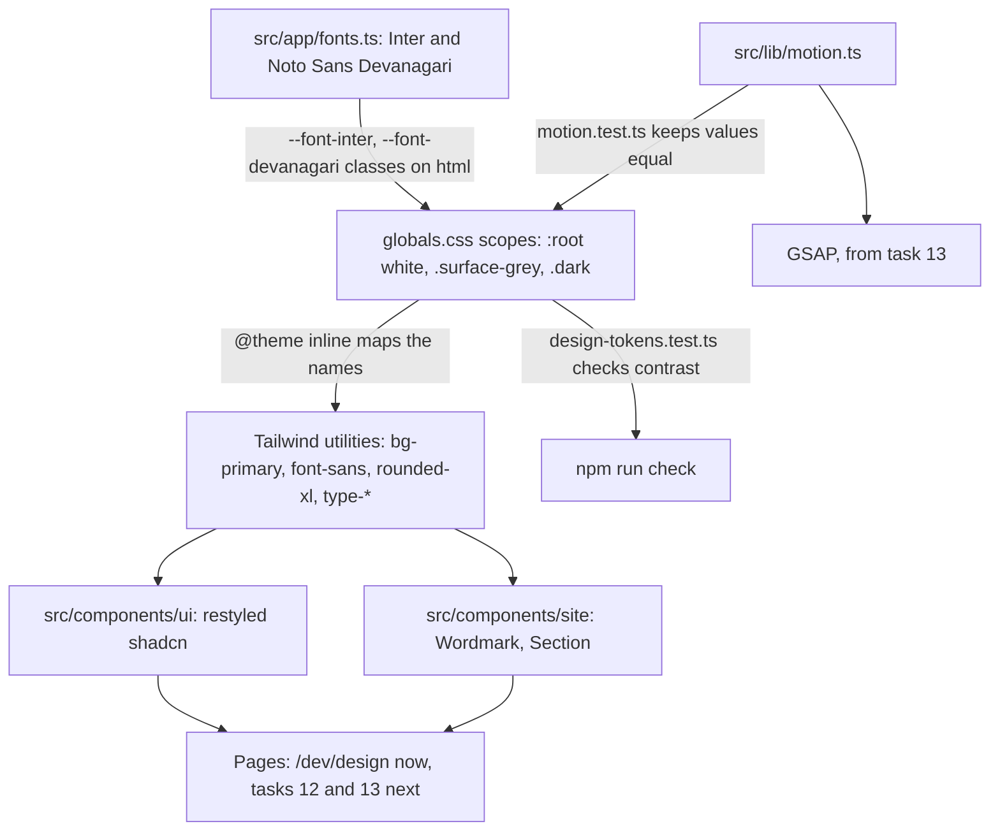
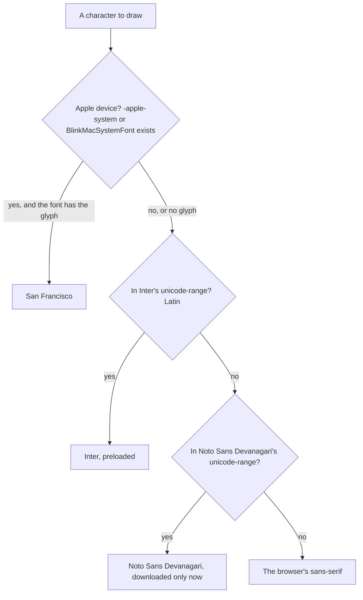

# Design System - Plan

## Goal Capsule

- **Objective:** Visitors on any phone get one calm, Apple-like look: readable type, AA contrast, controls big enough for a thumb, and motion that respects their settings. Tasks 12 and 13 can build the header, footer and home page from shared pieces without inventing new styles. The owner has seen and approved the look before it ships.
- **Means:** Tailwind 4 tokens in `src/app/globals.css` on shadcn's variable names, Inter and Noto Sans Devanagari through `next/font`, restyled shadcn components, and a development-only `/dev/design` preview (KTD1–KTD15).
- **Authority:** the owner's decisions (Key Decisions below) and `document/website/features.md` "Design direction", then the master plan's task 11 row (see origin), then this plan. `CLAUDE.md` governs the workflow and the skill rules. All three lessons in `document/solutions/conventions/` apply: read the bundled Next.js docs before using an API, test lint guards against real code shapes, and only document output you actually ran.
- **Execution profile:** mostly CSS and config, proven by a real build and browser tests. The pure helpers (contrast, motion sync, `devOnly`) and the lint carve-out are written test-first.
- **Stop conditions:** stop and ask the owner when:
  - A colour pair can only pass contrast by leaving the brief's palette (white, `#f5f5f7` grey, near-black, one blue, black). A darker or lighter shade of the same colour is fine.
  - A shadcn component needs more than the edits KTD9 allows (class changes plus Sheet's label prop).
  - `npm run build` fails because of the dev page and `devOnly()` can't fix it. Don't switch to `pageExtensions` or a proxy rule without asking.
  - A step would install something globally, run `npx playwright install`, approve an npm install script, or use paid 21st.dev generation.
  - The owner has not approved the look (U10). No push or pull request before that.
- **Who finishes:** the main session on branch `11_design_system`. Commit on that branch and stop. Pushing and the pull request happen only at `CLAUDE.md` Task workflow step 11, after the owner's approval and when they ask.

---

## Product Contract

### Summary

Turn the "Design direction" in `features.md` into code: fonts, colour, type, radius, shadow, spacing and motion tokens on shadcn's variable names, seven restyled shadcn components, a `Wordmark`, a `Section` component and a new site icon. A development-only `/dev/design` page shows all of it, with live contrast numbers, and the owner approves the look there before the pull request. `design-system/go-mechanic/MASTER.md` describes every token and rule for people.

### Problem Frame

Tasks 12 and 13 build the first pages visitors see. Without a shared system, each section would pick its own colours, sizes and spacing, and the look would drift from page to page. Today the app still runs shadcn's neutral defaults (`src/app/globals.css`, including an unused `.dark` theme) and a placeholder Geist font that has no Hindi letters (SEO check in task 09). The owner asked for an Apple-like site and decides on a look by seeing it.

Three local facts shape the work. Android has most of India's phone market and many visitors are on 4G, so fonts must stay light and controls must suit a thumb. Hindi is coming, so a Devanagari font and Hindi-safe type settings must exist without slowing English pages. "GoMechanic" carries a trademark risk the owner accepted for now, so a future rename has to stay a small change.

### Key Decisions

- **Keep the name "GoMechanic" for now.** (session-settled: user-directed — chosen over renaming before the logo is made: the owner accepted the trademark risk flagged in the master plan, on condition that a rename stays small.) Governs R1.
- **The logo is a text wordmark plus a square first-letter icon.** (session-settled: user-directed — chosen over a drawn logo mark: a rename then only changes a text and a letter.) Governs R2, R3.

### Requirements

**Brand**

- R1. The brand name appears in app code only through `messages/en.json`. The `Wordmark` component is the one place that shows it as a logo. A test fails if the name is typed anywhere else in `src/` or `public/`.
- R2. The wordmark shows the name in the brand font with tuned letter-spacing, looks the same on every device, and is never machine-translated.
- R3. The site icon is a square tile with the name's first letter, drawn so it renders the same on every device. It replaces `src/app/icon.svg`.

**Fonts**

- R4. Text uses San Francisco on Apple devices and Inter elsewhere (features.md), self-hosted through `next/font`, with no layout shift.
- R5. Devanagari text renders in Noto Sans Devanagari. English pages neither preload nor download it.

**Tokens**

- R6. Colour tokens follow features.md: white and `#f5f5f7` grey surfaces, near-black text, one blue accent for actions, black showcase sections. They keep shadcn's variable names, so components need no colour overrides, and they work in three surface tones: white, grey band and black showcase.
- R7. Text colours reach 4.5:1 against every surface they sit on, and input borders and focus outlines reach 3:1 (WCAG AA). A test checks the token values.
- R8. A fluid type scale with large, tightly tracked display sizes. Text still grows with browser zoom. Hindi text gets no negative letter-spacing and more line height.
- R9. Radius (rounded tiles, pill buttons and badges), elevation, spacing (section rhythm, gutters, content widths) and a frosted surface are tokens.
- R10. Durations and easings are defined once and shared by CSS and GSAP. When the visitor prefers reduced motion, CSS motion is effectively off. This task adds no page animation.

**Components**

- R11. Button, badge, card, input, field, separator and sheet come from the shadcn CLI and are restyled: pill buttons, a visible 2 px focus outline, flat tiles, and every control at least 44 px tall on touch screens.
- R12. Text people read or hear inside these components, such as Sheet's close-button label, comes from messages.
- R13. A `Section` component gives each page section its surface tone, vertical rhythm and content width.

**Preview, approval and docs**

- R14. `/dev/design` shows the whole system in development. Production builds answer it with a 404 and `noindex`.
- R15. The owner approves the look on `/dev/design`, with screenshots at 375, 768, 1024 and 1440 px, before the pull request is opened.
- R16. `design-system/go-mechanic/MASTER.md` describes every token and rule, with a rename checklist.

**Compatibility**

- R17. `npm run check` and `npm run test:e2e` keep passing: one `h1` on the home page, the theme font, no console errors, and the home page still prerendered.

### Success Criteria

- Tasks 12 and 13 build their sections from these tokens and components with no new raw colours, font sizes, radius values or shadows.
- Renaming the brand means editing the name in `messages/en.json` and the icon's letter, following MASTER.md's checklist, and nothing else.

### Scope Boundaries

- Not in this task: the header, footer, sticky Call/WhatsApp/Book bar, 404 design, open-now badge and offer banner (task 12). Home sections and GSAP scroll animation (task 13). Hindi text or the `hi` locale (backlog). An apple-touch-icon PNG, theme colour and social image (task 42).
- Not in this task: a site-wide dark mode or theme switch (A1).
- Considered and not built:
  - Pinned hover and focus states on the preview, using shadcn's `preview-states.css`. It rewrites the global `hover`, `focus-visible` and `active` variants, adding selectors to every visitor's CSS for a dev-only view. The owner hovers and tabs instead, and U9 tests focus in a real browser.
  - A test that MASTER.md's values match `globals.css`. Pages use tokens by name, not by hex, so a stale value in the doc never reaches visitors. Revisit if code starts copying hex values from MASTER.md.
  - Inter's `opsz` axis (optical display sizes). It makes the font file bigger on 4G, and tight tracking does most of the work. Revisit if Android headlines look loose at the U10 checkpoint.
  - A custom `cn` config that teaches it new `text-*` size names. `type-*` utilities avoid the problem with no config (KTD5).
  - `pageExtensions` dev-only files and `next-themes` (KTD10, A1).

#### Deferred to Follow-Up Work

- Task 12: the frosted header uses the `frosted` utility, the mobile menu uses `Sheet` with `closeLabel`, and the open-now badge uses `Badge` `success`. Task 12 also designs the `[locale]` not-found page that `/dev/design` falls back to in production, and trims the messages sent by `NextIntlClientProvider` (already in its steps).
- Task 13: GSAP reads its timings from `@/lib/motion` and wraps every animation in `gsap.matchMedia()`. `Section` tones pace the page.
- Tasks 15 and 20: if `/dev/outbox` must work on staging (a production build), change `devOnly()`, the one gate for dev pages.
- Task 42: an `apple-icon` PNG from the same letter design, and `theme-color`.

---

## Planning Contract

### Key Technical Decisions

- KTD1. **Two fonts through `next/font/google`, one shared class string, one stack.**
  - Inter: `latin` subset, preloaded, variable `--font-inter`. Noto Sans Devanagari: `devanagari` subset, `preload: false`, variable `--font-devanagari`.
  - `src/app/fonts.ts` exports both variable classes as one string, used by the root layout and `global-not-found.tsx`, so neither page can forget a font.
  - The stack is a plain `:root` variable, `--font-sans-stack`: `-apple-system, BlinkMacSystemFont, var(--font-inter), var(--font-devanagari), sans-serif`. `@theme inline` maps `--font-sans` and `--font-heading` to it. A plain variable is always emitted, so the e2e test can read it whatever Tailwind does with `@theme inline` variables.
  - Why it meets R4 and R5: browsers on Apple devices stop at `-apple-system` or `BlinkMacSystemFont` (San Francisco). Other browsers skip those names and use Inter. Google's CSS gives each subset a `unicode-range`, so the browser fetches the Devanagari file only when a Devanagari character is on the page, and `preload: false` keeps it out of `<head>` (`font.md`, `preload` and "Preloading").
  - Rejected: Inter first for everyone (loses San Francisco, which features.md asks for). `system-ui` (Roboto or Segoe instead of Inter). Loading the Devanagari font only on Hindi pages: there are none yet, and `unicode-range` already does it.
- KTD2. **The wordmark is always set in Inter (`--font-brand`), never San Francisco.** A logo must look the same everywhere (R2). Apple visitors download Inter anyway because it is preloaded, so the wordmark puts that download to use. It also carries `translate="no"`, because Chrome offers Indian visitors automatic translation into Hindi.
- KTD3. **Colours are hex values on shadcn's names, in three scopes.** `:root` is the white page. `.surface-grey` is the grey band. `.dark` is the black showcase. A scope redefines only the variables that change, so the same components render correctly inside each one. Keeping the class name `.dark` keeps shadcn's `dark:` variant (`@custom-variant dark (&:is(.dark *))`) working inside showcase sections. The site is light-only: `color-scheme: light` on `:root`, `dark` inside `.dark`. Hex instead of OKLCH because shadcn's design-system guide says to keep the source format, and the contrast test can read hex directly. Starting values are in "Token starting values" below.
- KTD4. **Two shades of the one blue, and separate border tokens, for contrast (R7).**
  - `--primary` `#0071e3` fills buttons: white text on it is about 4.70:1. As small text on the grey band it would be about 4.31:1, so links use `--link` `#0066cc` (about 5.1:1 on grey).
  - The primary hover goes darker (`--primary-hover` `#0060c0`, about 6.1:1 with white). apple.com's lighter hover would drop below 4.5:1.
  - `--input` `#808085` outlines form fields (about 3.9:1 on white, 3.2:1 on `#e8e8ed`), because a field's border is what shows it is a field (WCAG 1.4.11). apple.com's `#86868b` drops under 3:1 on `#e8e8ed`. `--border` `#d2d2d7` is a decorative hairline and is exempt.
  - Secondary text is `#636366`, slightly darker than apple.com's `#6e6e73`, so it still passes on `#e8e8ed` fills (about 4.9:1).
- KTD5. **The type scale is a set of `@utility type-*` classes, not `--text-*` theme keys.** `cn()` comes from the `cn` package, which produces the same output as tailwind-merge (`node_modules/cn/README.md`). It treats an unknown `text-display` as a colour and drops it when it meets `text-muted-foreground`. shadcn's design-system guide gives the same advice.
  - Sizes use `clamp(<rem>, <rem> + <vw>, <rem>)`. The rem part keeps text growing with browser zoom (WCAG 1.4.4).
  - Letter-spacing is in `em`, so it scales with size.
  - Under `:lang(hi)` the type utilities reset letter-spacing to 0 and add line height. Negative tracking breaks the joined headline bar of Devanagari letters, and their vowel marks need more vertical room.
  - Body text is 17 px, Apple's reading size. Inputs use at least 16 px, so iOS Safari doesn't zoom in when a field gets focus.
- KTD6. **Radius is pinned per step. Buttons are made pills in their own file. Tiles are flat.**
  - The `--radius-*` steps in `@theme inline` replace the multipliers of `--radius`: `sm` 6 px, `md` 10 px, `lg` 12 px (inputs, popovers), `xl` 18 px (cards, so tiles), `2xl` 24 px, `3xl` 28 px, `4xl` 9999 px (badges).
  - Buttons get `rounded-full` in `button.tsx`. Pinning `--radius-lg` to a pill would also round inputs, menus and popovers, which share that step.
  - Shadows go in `@theme`: `--shadow-xs` is none (fields and outline buttons stay flat), and the soft `sm`, `md` and `lg` steps are only for floating layers (sheet, popovers, the later sticky bar). Tiles get no shadow. frontend-design names "the same soft grey shadow under each card" as a templated look.
- KTD7. **Focus is one unlayered `:focus-visible` rule:** a 2 px solid `--ring` outline with a 2 px offset, on links, buttons, ARIA widgets and form fields. CSS outside any `@layer` beats Tailwind's `outline-none` utilities without `!important`. shadcn's default `ring-ring/50` is half-transparent, which lands near 2:1 on white, under the 3:1 a focus indicator needs.
- KTD8. **Motion tokens live in `src/lib/motion.ts` and are mirrored as CSS variables, with a test that keeps the two equal.**

  | Token | CSS | GSAP | Use |
  | --- | --- | --- | --- |
  | `fast` | `--duration-fast: 150ms` | `0.15` | press and hover feedback |
  | `base` | `--duration-base: 250ms` | `0.25` | menus, small transitions |
  | `slow` | `--duration-slow: 450ms` | `0.45` | sheets and overlays |
  | `reveal` | `--duration-reveal: 800ms` | `0.8` | scroll reveals (task 13) |
  | `standard` | `--ease-standard: cubic-bezier(0.33, 1, 0.68, 1)` | `power2.out` | most motion |
  | `emphasized` | `--ease-emphasized: cubic-bezier(0.22, 1, 0.36, 1)` | `power4.out` | big entrances, long settle |
  | `exit` | `--ease-exit: cubic-bezier(0.32, 0, 0.67, 0)` | `power2.in` | things leaving, faster than entering |

  - The cubic-beziers are close matches of GSAP's built-in eases, so no CustomEase plugin is needed. `--ease-*` go in `@theme` (which gives `ease-standard` utilities). Durations are plain `:root` variables used as `duration-(--duration-base)`. `--default-transition-duration` and `--default-transition-timing-function` point at `base` and `standard`.
  - Reduced motion: one global rule under `prefers-reduced-motion: reduce` sets animation and transition durations to `0.01ms`. It's `0.01ms`, not `animation: none`, because Radix waits for `animationend` before it removes a closed Sheet.
  - GSAP code (task 13) wraps animations in `gsap.matchMedia()` with the query strings `motion.ts` exports. Content is never hidden before JavaScript runs (features.md).
- KTD9. **shadcn components come from the CLI, get committed untouched, then get the smallest possible edits.**
  - Add `button`, `badge`, `card`, `input`, `field` (brings `label`), `separator` and `sheet`. Tasks 12 and 13 need button, badge, card, separator and sheet. Input and field are here so the field style is approved now, before login (task 15) needs it.
  - Commit the generated files before editing them, so later `shadcn add --diff` comparisons are clean.
  - Edit only `cva` classes, plus one prop on Sheet. Each edited file starts with a short "GoMechanic changes" comment listing what changed.
  - Touch targets: `default`, `lg` and the matching icon sizes are 44 px or more everywhere. Smaller sizes stay 36 px with a mouse and grow to 44 px under Tailwind's `pointer-coarse:` variant (Tailwind 4.3.3). `field` and `input` move to 44 px with the buttons, because shadcn's guide says control heights move together.
  - Sheet's built-in `<span className="sr-only">Close</span>` is English typed into `components/ui`, which the text lint skips on purpose. It becomes a required `closeLabel` prop, and callers pass `t("close")` from a new `Common` namespace (R12).
  - A test in `npm run check` fails if a later `shadcn add --overwrite` reverts any of this.
- KTD10. **The preview page calls `devOnly()`, which calls `notFound()` unless `process.env.NODE_ENV === "development"`.** Next.js inlines `NODE_ENV` at build time, so a production build prerenders the route as a 404. The docs say such a page "can remain ○ Static and serve a 404", and Next.js injects `<meta name="robots" content="noindex">` (`not-found.md` in functions). The page also exports `robots: { index: false, follow: false }` in case the gate is ever changed. `devOnly()` sits in `src/lib/dev-only.ts` so `/dev/outbox` (task 15) can reuse it. Rejected: `pageExtensions` (`page.dev.tsx`), a global config change that also hides the route from `next typegen` and is harder to explain. Rejected: a proxy rule, which spreads one page's rule into `src/proxy.ts`.
- KTD11. **The preview's demo text is typed straight into the JSX, through a narrow lint carve-out.** Add `src/app/*/dev/**` to the `ignores` of the existing text-guard block in `eslint.config.mjs`. Adding a new block instead would replace that block's `no-restricted-syntax` options (lesson `lint-guards-test-real-jsx-shapes.md`, item 5). The `next/link` ban still applies there.
  - Rejected: a `DevDesign` messages namespace. `NextIntlClientProvider` currently sends every message to every visitor (task 12 trims it), and translators would get strings no visitor ever sees.
  - Real product text on the page still comes from messages: the brand through `Wordmark`, and Sheet's close label.
- KTD12. **Checks are split by what they need.**
  - `npm run check` holds the fast guards: token contrast, motion sync, restyle classes, the Sheet label, the brand name, the icon, the lint carve-out, `Wordmark`, `Section` and `devOnly`.
  - `npm run test:e2e` (production build) proves the fonts, the `/dev/design` 404, the icon being served and the existing smoke checks.
  - A second Playwright config, `playwright.dev.config.ts` (`npm run test:design`), runs against `next dev`, because the preview only exists there. It measures touch targets, live contrast, the focus outline, overflow at 375 px and reduced motion, and saves the owner's screenshots.
  - It reuses a running dev server (`reuseExistingServer: true` on port 3000). Next.js 16 locks the dev folder, so a second `next dev` in the same checkout exits (`experimental.lockDistDir` in `setup-dev-bundler.js`).
  - The main config ignores `e2e/dev/`.
- KTD13. **MASTER.md is written by hand, in ui-ux-pro-max's Master-plus-pages layout** (`design-system/go-mechanic/MASTER.md`, with `pages/` for later overrides). `--persist` is not used. Two read-only searches ("automotive service apple minimal", and "apple minimal premium service booking" with low variance and density) returned slate and red with Syncopate, then black and gold with Cormorant. Both contradict the brief, and the skill says "Do not persist unverified output." Their usable parts go into MASTER.md: a hero-centric pattern with one primary action, scroll storytelling with reduced-motion fallbacks, spacious density, and the pre-delivery checklist. `globals.css` is the code. MASTER.md names each token, so the two can be compared by hand.
- KTD14. **`Section` owns the surface classes.** `src/components/site/section.tsx` takes `tone` (`white`, `grey`, `dark`) and `width` (`content` 980 px, `wide` 1280 px). It renders a `<section>` painted with `bg-background text-foreground`, padded with `--section-space`, and an inner container with the `--gutter` side padding. The scope class names (`surface-grey`, `dark`) then appear in one file.
- KTD15. **The icon draws its letter as an SVG path, on a near-black rounded tile, with no text element.** Browsers draw favicon text with whatever system font they have, so a `<text>` letter would look different on each device (R3). Blue is kept for actions, so the tile is near-black `#1d1d1f` with a white letter. An embedded `prefers-color-scheme: dark` style adds a light edge so the tile still shows in dark browser tab bars. The `role` and `aria-label` with the brand name go: a favicon is never read out, and R1 keeps the name out of files. The letter is outlined from Inter's bold "G" with a throwaway script in the scratchpad; no dependency is added.

### Token Starting Values

Starting points. The U3 contrast test decides; a failing pair gets a darker or lighter shade of the same colour. Blank cells inherit from `:root`.

| Token | White (`:root`) | Grey band (`.surface-grey`) | Showcase (`.dark`) |
| --- | --- | --- | --- |
| `--background` | `#ffffff` | `#f5f5f7` | `#000000` |
| `--foreground` | `#1d1d1f` | | `#f5f5f7` |
| `--card` / `--card-foreground` | `#f5f5f7` / `#1d1d1f` | `#ffffff` / | `#1d1d1f` / `#f5f5f7` |
| `--popover` / `--popover-foreground` | `#ffffff` / `#1d1d1f` | | `#1d1d1f` / `#f5f5f7` |
| `--primary` / `--primary-foreground` | `#0071e3` / `#ffffff` | | |
| `--primary-hover` (new) | `#0060c0` | | |
| `--secondary` / `--secondary-foreground` | `#e8e8ed` / `#1d1d1f` | | `#2c2c2e` / `#f5f5f7` |
| `--muted` / `--muted-foreground` | `#f5f5f7` / `#636366` | `#e8e8ed` / | `#1d1d1f` / `#98989d` |
| `--accent` / `--accent-foreground` | `#e8e8ed` / `#1d1d1f` | | `#2c2c2e` / `#f5f5f7` |
| `--destructive` | `#d70015` | | `#ff453a` |
| `--success` / `--success-foreground` (new) | `#007a33` / `#ffffff` | | `#30d158` / `#000000` |
| `--link` (new) | `#0066cc` | | `#2997ff` |
| `--border` (decorative) | `#d2d2d7` | | `#424245` |
| `--input` | `#808085` | | |
| `--ring` | `#0071e3` | | `#2997ff` |

`--chart-*` and `--sidebar-*` stay, so future shadcn components find them, remapped to these neutrals and the blue.

| Utility | Size (375 px to 1440 px) | Weight | Line height | Tracking | Use |
| --- | --- | --- | --- | --- | --- |
| `type-hero` | `clamp(3rem, 2rem + 5vw, 5.5rem)`, 48–88 px | 600 | 1.05 | -0.025em | the home hero only |
| `type-display` | `clamp(2.5rem, 1.75rem + 3.5vw, 4rem)`, 40–64 px | 600 | 1.07 | -0.02em | showcase headlines |
| `type-headline` | `clamp(2rem, 1.5rem + 2vw, 3rem)`, 32–48 px | 600 | 1.1 | -0.015em | section headings |
| `type-title` | `clamp(1.5rem, 1.25rem + 1vw, 2rem)`, 24–32 px | 600 | 1.15 | -0.01em | tile and card titles |
| `type-lead` | `clamp(1.1875rem, 1.05rem + 0.6vw, 1.5rem)`, 19–24 px | 400 | 1.4 | -0.01em | the line under a headline |
| `type-body` | `1.0625rem`, 17 px | 400 | 1.5 | -0.01em | running text (set on `body`) |
| `type-callout` | `0.9375rem`, 15 px | 400 | 1.45 | -0.005em | secondary text, small buttons |
| `type-caption` | `0.8125rem`, 13 px | 400 | 1.4 | 0 | fine print (never below 12 px) |

Layout tokens: `--section-space` `clamp(4rem, 2.5rem + 6vw, 8rem)`, `--gutter` `clamp(1.25rem, 0.75rem + 2vw, 2.5rem)`, and `--container-content` 61.25rem (980 px) and `--container-wide` 80rem (1280 px) in `@theme`. `frosted` is a `@utility`: the background mixed to 72% opacity with `backdrop-filter: saturate(180%) blur(20px)`, and a solid background under `@supports not (backdrop-filter: blur(1px))` and `prefers-reduced-transparency: reduce`.

### High-Level Technical Design

How tokens reach components and tests:



How the browser picks a font for each character (KTD1):



The wordmark skips the first step: its stack starts at Inter (KTD2).

### Output Structure

```text
design-system/go-mechanic/MASTER.md     human-readable spec (KTD13)
src/
  app/
    fonts.ts                            Inter + Noto Sans Devanagari, shared class string
    globals.css                         tokens, type-*, frosted, focus, reduced motion
    design-tokens.test.ts               contrast and required token names
    icon.svg, icon.test.ts              letter icon (KTD15)
    global-not-found.tsx                shared font classes
    [locale]/layout.tsx                 shared font classes
    [locale]/dev/design/page.tsx        /dev/design preview, development only
    [locale]/dev/design/_components/    color-pair.tsx, motion-demo.tsx, font-switch.tsx
  components/
    ui/                                 button, badge, card, input, label, field, separator, sheet, restyle.test.tsx
    site/                               wordmark.tsx, section.tsx and their tests
  lib/
    color-contrast.ts, motion.ts, dev-only.ts and their tests
  i18n/
    brand-name.test.ts                  new; messages.test.ts and lint-guards.test.ts change
messages/en.json                        Brand and Common namespaces
e2e/smoke.spec.ts, e2e/i18n.spec.ts     font and 404 checks
e2e/dev/design-preview.spec.ts          runs against next dev
playwright.config.ts                    ignores e2e/dev
playwright.dev.config.ts                new
eslint.config.mjs                       dev-page carve-out
package.json                            test:design script
```

### Assumptions

Scoping confirmation was skipped (`confirm:auto`), so these are unconfirmed bets:

- A1. The site is light-only. There is no dark mode that follows the phone's setting; black showcase sections come from the `.dark` scope. One look to get right, as on apple.com's marketing pages.
- A2. Inter is preloaded for every visitor. Android visitors need it, and on Apple devices the wordmark uses it.
- A3. Only Inter's `latin` subset is preloaded. The rupee sign (U+20B9) is in Google's `latin-ext` range, which loads only when a ₹ appears. U1 checks that this rule exists.
- A4. Body text is 17 px. The type, radius and colour values above are starting points, tuned at the U10 checkpoint.
- A5. A green `--success` status colour is added for the open-now badge (task 12). It marks status and is never used for actions, so blue stays the one accent.
- A6. The icon is a near-black tile with a white letter, not a blue one.
- A7. `input` and `field` are added now, although task 15 is the first to use them.
- A8. A `Section` component is part of the design system, not task 12's layout.
- A9. The preview's demo text is typed into the JSX through a lint carve-out (KTD11).
- A10. A second Playwright config for development-only pages is worth adding (KTD12).
- A11. MASTER.md is written by hand (KTD13).
- A12. Sheet's close label comes from a new `Common.close` message.

### Deferred to Implementation

- The exact radius, height and text-size classes in the radix-nova files. Grep the added `src/components/ui/*.tsx` for `rounded-*`, `h-8`, `size-8` and `text-sm` before editing, as shadcn's guide says.
- Whether radix-nova's `SheetContent` already has a `showCloseButton` prop. If it does, `closeLabel` is required only while the button shows.
- Whether the shadcn CLI writes anything into `globals.css` or `package.json`. Review its diff in U2 before U3 rewrites the file.
- Whether `@apply` of a custom `type-body` utility works inside `@layer base`. If not, set the body's size and line height with plain CSS.
- Whether next/font's generated CSS keeps Inter's `latin-ext` `@font-face` rule (A3). If it doesn't, decide with the owner whether to add `latin-ext` to the preloaded subsets.
- Whether Playwright's touch emulation (`hasTouch`, `isMobile`) makes `(pointer: coarse)` match in Chrome. If not, U9 measures small sizes only at desktop width and says so.
- The letter-outline script for KTD15. If outlining Inter's "G" proves fiddly, fall back to a `<text>` letter with a system font stack, change the icon test, and say why in the learning doc.
- Whether Tailwind's Lightning CSS adds `-webkit-backdrop-filter` for older Safari. Check the built CSS.
- If `npm run dev` rewrites `AGENTS.md`, commit what it writes (`CLAUDE.md`).

### Risks

| Risk | Mitigation |
| --- | --- |
| A later `shadcn add --overwrite` silently reverts the restyle | `restyle.test.tsx` in `npm run check` (KTD9); the "GoMechanic changes" header in each edited file |
| Hand-computed contrast values are slightly off | `design-tokens.test.ts` computes every pair from the real CSS; the stop condition covers palette changes |
| The owner, on a Mac, never sees Inter, the font most Android visitors get | U8's font switch and U9's Inter screenshots; U10 asks the owner to look at both |
| Tailwind scans the dev page too, so its unique classes ship in production CSS | Build the preview from the system's own utilities and keep one-off classes rare. The cost is a few hundred bytes |
| Text on a frosted surface sits over unknown content | High opacity (72%); only foreground text on it; a solid fallback with no backdrop-filter or with reduced transparency |
| The dev server's first compile of `/dev/design` is slow | Generous timeouts in `playwright.dev.config.ts` |
| Inter downloads on Apple devices for the wordmark only | Accepted (A2); measured with Lighthouse in task 42 |
| The SEO Stop hook fires on `src/app`, `src/components`, `messages` and `public` | Expected. Run `seo-reviewer` in the foreground and report; `/dev/design` is meant to be `noindex` |

### Sources

- `node_modules/next/dist/docs/01-app/03-api-reference/02-components/font.md`: `subsets`, `preload`, `variable`, Tailwind integration, "Preloading".
- `node_modules/next/dist/docs/01-app/03-api-reference/04-functions/not-found.md`: injected `noindex`, and a page that reaches `notFound()` during prerendering staying static with a 404.
- `node_modules/next/dist/docs/01-app/03-api-reference/03-file-conventions/not-found.md`: `global-not-found.js` brings its own styles and fonts.
- `node_modules/next/dist/compiled/@next/font/dist/google/font-data.json`: Inter subsets (`latin`, `latin-ext`, ...) and the `opsz` axis; Noto Sans Devanagari subsets (`devanagari`, `latin`, `latin-ext`). `find-font-files-in-css.js`: only the listed subsets are preloaded.
- `node_modules/next/dist/server/lib/router-utils/setup-dev-bundler.js`: the dev-folder lockfile (KTD12).
- `.claude/skills/shadcn/design-system.md` (role mapping, radius pinning, `type-*` utilities, dark sections, focus outline, control heights) and `design-system-page.md` (preview page outline, colour pairs). `.claude/skills/shadcn/assets/showcase/color-pair.tsx` is adapted for U8.
- `.claude/skills/frontend-design/SKILL.md`: restraint, flat tiles, no templated chrome. `.claude/skills/gsap-react/SKILL.md`: `useGSAP`, scope, client-only.
- `node_modules/cn/README.md`: same merge output as tailwind-merge (KTD5).
- `document/solutions/conventions/`: all three lessons (Goal Capsule).

---

## Implementation Units

### U1. Fonts

- **Goal:** Pages render in San Francisco on Apple devices and Inter elsewhere, with Noto Sans Devanagari ready for Hindi but never downloaded on English pages.
- **Requirements:** R4, R5, R17
- **Dependencies:** none
- **Files:**
  - Modify: `src/app/fonts.ts`, `src/app/[locale]/layout.tsx`, `src/app/global-not-found.tsx`, `src/app/globals.css` (the font variables only), `e2e/smoke.spec.ts`
- **Approach:**
  1. Replace Geist with the two fonts in KTD1 and export the shared class string.
  2. Both `<html>` elements use it, plus `font-sans` and `antialiased`.
  3. In `globals.css`, add `--font-sans-stack` and `--font-brand-stack` to `:root` and point `@theme inline`'s `--font-sans`, `--font-heading` and new `--font-brand` at them.
  4. Look at the built CSS for Inter's `latin-ext` `@font-face` rule (A3).
- **Patterns to follow:** the existing single-definition comment in `src/app/fonts.ts`; the font test's quote-stripping `names()` helper in `e2e/smoke.spec.ts`.
- **Test scenarios:**
  - On `/`, the body's computed `font-family` equals `--font-sans-stack` (compared without quotes and spaces), starts with `-apple-system,BlinkMacSystemFont`, and contains the family named by `--font-inter`.
  - On `/this-page-does-not-exist`, the body uses the same stack. This guards `global-not-found.tsx` forgetting the classes.
  - After `/` has loaded, no entry in `document.fonts` whose family is the one in `--font-devanagari` has status `loaded`.
  - `document.fonts.load("16px <that family>", "नमस्ते")` resolves with at least one face, so the font is available when Hindi text appears.
  - The existing "no errors in the browser console" test still passes.
- **Verification:** `npm run test:e2e` passes. On `npm run dev`, Chrome on a Mac shows San Francisco. DevTools' phone mode on a Mac still shows San Francisco, because fonts come from the computer, not the user agent. U8's font switch shows Inter.

### U2. Add the shadcn components

- **Goal:** The seven components from KTD9 are in `src/components/ui/`, exactly as the CLI generates them.
- **Requirements:** R11
- **Dependencies:** none. Run it before U3, because the CLI may edit `globals.css`.
- **Files:**
  - Create: `src/components/ui/button.tsx`, `badge.tsx`, `card.tsx`, `input.tsx`, `label.tsx`, `field.tsx`, `separator.tsx`, `sheet.tsx`
  - Possibly modify (by the CLI): `src/app/globals.css`, `package.json`, `package-lock.json`
- **Approach:** Add them with the shadcn CLI as `CLAUDE.md` Commands shows, then read every generated file (shadcn skill, Workflow step 7). Note every English string a person reads or hears (Sheet's `Close`) for U5. Leave `components.json` unchanged.
- **Test expectation:** none -- generated code, committed untouched. U5 adds the tests.
- **Verification:** `npm run check` passes with the new files, the CLI's `globals.css` changes are understood, and no npm install script needed approval.

### U3. Colour, type, radius, shadow, spacing and focus tokens

- **Goal:** `globals.css` holds the whole visual system on shadcn's names, and a test proves its contrast.
- **Requirements:** R6, R7, R8, R9, R11
- **Dependencies:** U1, U2
- **Files:**
  - Modify: `src/app/globals.css`
  - Create: `src/lib/color-contrast.ts`, `src/lib/color-contrast.test.ts`, `src/app/design-tokens.test.ts`
- **Approach:**
  1. Replace the neutral `:root` and `.dark` blocks with the three scopes from KTD3 and "Token starting values". Register `--primary-hover`, `--success`, `--success-foreground` and `--link` in `@theme inline`. Set `color-scheme` per KTD3.
  2. Replace the `--radius-*` multipliers with the pinned steps and add the shadows (KTD6).
  3. Add the `type-*` utilities with the `:lang(hi)` reset (KTD5), the layout tokens and the `frosted` utility.
  4. Add the unlayered focus rule (KTD7).
  5. Keep the existing `@source` lines, imports, `@custom-variant dark` and the base-layer cursor rule.
  6. `color-contrast.ts` is a pure WCAG 2.2 relative-luminance and contrast-ratio helper for hex colours. U8's colour swatches reuse it.
- **Execution note:** Write `design-tokens.test.ts` with its list of pairs first, then fill in the values until it passes.
- **Patterns to follow:** `src/i18n/messages.test.ts`, which reads a repo file in a node test. shadcn `design-system.md`, sections "Radius", "Elevation", "Type scale", "Dark mode" and "Focus".
- **Test scenarios:**
  - `contrastRatio("#000000", "#ffffff")` is 21, the same pair reversed is 21, and `("#ffffff", "#ffffff")` is 1.
  - `contrastRatio("#777777", "#ffffff")` is about 4.48, just under AA. This pins a well-known value.
  - `"#fff"` gives the same result as `"#ffffff"`. `"red"`, `"#12"` and `"#gggggg"` throw.
  - `design-tokens.test.ts` reads `globals.css`, builds each scope as `:root` plus its overrides, and for white, grey and dark checks at least 4.5:1 for: foreground on background, card and muted; card-foreground on card; popover-foreground on popover; primary-foreground on primary and on primary-hover; secondary-foreground on secondary; muted-foreground on background, card, muted and secondary; accent-foreground on accent; destructive, link and success on background and card; success-foreground on success.
  - The same test checks at least 3:1 for input and ring against background, card and muted in each scope.
  - Any other text-on-fill pair the restyled components use, read from their `cva` classes in U5 (for example white on `destructive`, if the destructive button is filled), is added to the list.
  - Every token a shadcn component reads (`background` through `ring`, plus `chart-*` and `sidebar-*`) is defined in `:root`, so no component meets an undefined variable.
  - Every colour token in the checked list is a hex value, so an OKLCH leftover fails loudly instead of being skipped.
- **Verification:** `npm run check` passes. Temporarily changing `--muted-foreground` to `#8e8e93` turns the test red; then revert. `npm run build` passes.

### U4. Motion tokens and reduced motion

- **Goal:** One set of durations and easings shared by CSS and GSAP, and no CSS motion for visitors who ask for less.
- **Requirements:** R10
- **Dependencies:** U3
- **Files:**
  - Modify: `src/app/globals.css`
  - Create: `src/lib/motion.ts`, `src/lib/motion.test.ts`
- **Approach:** Add the KTD8 variables and the default-transition settings to `globals.css`, and the reduced-motion rule to the base layer with `!important`. `motion.ts` exports the durations in seconds, each ease as a GSAP name plus its CSS curve, and the two media-query strings. No imports from Next.js or React.
- **Execution note:** Test-first. The sync test defines the contract.
- **Test scenarios:**
  - Each `motion.ts` duration times 1000 equals the matching `--duration-*` in `globals.css`, in ms.
  - Each ease's CSS curve equals the matching `--ease-*` value in `globals.css` (whitespace ignored).
  - Durations increase: `fast` < `base` < `slow` < `reveal`.
  - Each ease's GSAP name is one GSAP knows: `gsap.parseEase(name)` returns a function in the node project.
  - The exported queries are exactly `(prefers-reduced-motion: no-preference)` and `(prefers-reduced-motion: reduce)`.
  - `globals.css` has a `prefers-reduced-motion: reduce` block that sets durations to `0.01ms`.
- **Verification:** `npm run check` passes. U9 checks reduced motion in a browser.

### U5. Restyle the shadcn components

- **Goal:** The components match the system: pill buttons, 44 px touch targets, flat tiles, the new colours, and no English typed inside them.
- **Requirements:** R11, R12
- **Dependencies:** U2, U3
- **Files:**
  - Modify: `src/components/ui/button.tsx`, `badge.tsx`, `card.tsx`, `input.tsx`, `field.tsx` (only if its heights or radius need it), `sheet.tsx`, `messages/en.json` (`Common.close`), `src/i18n/messages.test.ts`
  - Create: `src/components/ui/restyle.test.tsx`
- **Approach:**
  1. Button: `rounded-full`, the sizes from KTD9, `default` filled with `bg-primary` and `hover:bg-primary-hover`, `link` using `text-link`, and 17 px text on `default` and `lg`.
  2. Input: 44 px tall, `rounded-lg`, `border-input`, at least 16 px text.
  3. Badge: a pill, plus a `success` variant using the new tokens.
  4. Card: no ring or shadow, `rounded-xl`, `bg-card`.
  5. Sheet: the required `closeLabel` prop (KTD9), and a 44 px close button on touch screens.
  6. Every edited file gets the "GoMechanic changes" header.
- **Patterns to follow:** shadcn `design-system.md` Step 5 (map recipes to variants, move control heights together). `src/i18n/test-utils.tsx` (`renderWithIntl`).
- **Test scenarios:**
  - A default `Button` has `rounded-full` and a 44 px height class.
  - For every size key in `buttonVariants`, `default`, `lg` and the matching icon sizes carry a 44 px-or-larger class, and smaller sizes carry a `pointer-coarse:` 44 px class. A new size added without one fails.
  - `variant="link"` uses `text-link`, not `text-primary`.
  - `Input` has the 44 px height class and a text size of at least 16 px.
  - `Badge variant="success"` uses the success colour classes.
  - The `Card` root has no `shadow-*` or `ring-*` class.
  - An open `Sheet` whose `SheetContent` gets `closeLabel="Close menu"` (and a `SheetTitle`) has a close button whose accessible name is "Close menu".
  - `messages.test.ts` requires the `Common` namespace.
- **Verification:** `npm run check` passes. Leaving out `closeLabel` fails `npm run typecheck` (try it, then revert).

### U6. Brand: wordmark, icon, Section and the name guard

- **Goal:** The brand shows through one `Wordmark`, the icon is the new letter tile, sections get their tones from one component, and a test keeps the name out of code.
- **Requirements:** R1, R2, R3, R13
- **Dependencies:** U3
- **Files:**
  - Modify: `messages/en.json` (`Brand.name`), `src/i18n/messages.test.ts`, `src/app/icon.svg`
  - Create: `src/components/site/wordmark.tsx`, `src/components/site/wordmark.test.tsx`, `src/components/site/section.tsx`, `src/components/site/section.test.tsx`, `src/i18n/brand-name.test.ts`, `src/app/icon.test.ts`
- **Approach:**
  1. `Wordmark` is a non-async component using `useTranslations("Brand")`. It renders a `span` in `font-brand` at weight 600 with tuned negative tracking and `translate="no"`, and size comes from `className` (KTD2).
  2. `Section` follows KTD14 and passes other `<section>` props through.
  3. Draw the icon per KTD15.
  4. `brand-name.test.ts` reads `Brand.name` from the messages and searches every non-test file under `src/` and `public/` (if it exists) for it, ignoring case and spaces. The `go-mechanic` folder slug doesn't match, because hyphens are not ignored.
  5. `Metadata.title`, `Metadata.description` and `HomePage.title` keep their own copies of the name, all inside `messages/en.json`, as R1 allows.
- **Patterns to follow:** `src/app/[locale]/page.test.tsx` (`renderWithIntl`, text from messages). `cn()` from `@/lib/utils` for merging classes.
- **Test scenarios:**
  - `Wordmark` shows `messages.Brand.name`, has `translate="no"`, keeps a passed `className` next to its own, and renders no heading.
  - `Section` with no props renders a `<section>` with neither `dark` nor `surface-grey`. `tone="grey"` adds `surface-grey`, and `tone="dark"` adds `dark`.
  - `Section` `width="wide"` uses the wide container, it passes through `id` and `aria-labelledby`, and its children sit inside the container.
  - `brand-name.test.ts` passes on the real tree, and its matcher finds the name in a sample string with different case and a space ("go Mechanic").
  - `icon.test.ts`: the viewBox is square, the file has a `<path>` and no `<text>` element.
  - `messages.test.ts` requires the `Brand` namespace.
- **Verification:** `npm run check` passes. `/icon.svg` still serves (existing e2e test), and the tab icon looks right in a light and a dark browser theme.

### U7. Dev-only gate and the lint carve-out

- **Goal:** Development-only pages have one tested gate, and their demo text passes lint while every other page keeps the text rules.
- **Requirements:** R14
- **Dependencies:** none
- **Files:**
  - Create: `src/lib/dev-only.ts`, `src/lib/dev-only.test.ts`
  - Modify: `eslint.config.mjs`, `src/i18n/lint-guards.test.ts`
- **Approach:** `devOnly()` follows KTD10. In `eslint.config.mjs`, add `src/app/*/dev/**` to the text-guard block's `ignores`, with a one-line comment (KTD11).
- **Execution note:** Write the lint-guards cases first. Then prove them: remove the carve-out for a moment and check that the "allows" cases for the dev page fail (lesson `lint-guards-test-real-jsx-shapes.md`, item 6).
- **Patterns to follow:** the `test.each` tables and `errorRules()` helper in `src/i18n/lint-guards.test.ts`.
- **Test scenarios:**
  - With `NODE_ENV` stubbed to `production`, `devOnly()` throws Next.js's not-found error (digest `NEXT_HTTP_ERROR_FALLBACK;404`).
  - With `NODE_ENV` set to `test` (Vitest's default), it also throws. Only `development` passes.
  - With `NODE_ENV` stubbed to `development`, it returns normally. Stubs are restored after each test.
  - Lint allows `<p>Hello</p>` in `src/app/[locale]/dev/design/page.tsx` and in `src/app/[locale]/dev/design/_components/demo.tsx`.
  - Lint still rejects `<p>Hello</p>` in `src/app/[locale]/devices/page.tsx` and `src/app/[locale]/services/dev/page.tsx`.
  - Lint still rejects `import Link from "next/link"` in `src/app/[locale]/dev/design/page.tsx`.
- **Verification:** `npm run check` passes. The temporary removal turned exactly the dev "allows" cases red.

### U8. The `/dev/design` preview page

- **Goal:** In development, one page shows the whole system so the owner can judge it. In production it is a 404.
- **Requirements:** R14, R2, R3, R6–R13
- **Dependencies:** U3, U4, U5, U6, U7
- **Files:**
  - Create: `src/app/[locale]/dev/design/page.tsx`, `src/app/[locale]/dev/design/_components/color-pair.tsx`, `src/app/[locale]/dev/design/_components/motion-demo.tsx`, `src/app/[locale]/dev/design/_components/font-switch.tsx`
  - Modify: `e2e/i18n.spec.ts`
- **Approach:**
  1. The page is non-async, calls `devOnly()` first, and exports the `noindex` metadata (KTD10). It has one `h1`.
  2. `font-switch.tsx` is a small client switch at the top, "San Francisco / Inter". It sets an inline style on the page wrapper that drops the two Apple names from `--font-sans-stack` and reapplies `font-family`. The owner works on a Mac, so without it they would never see Inter, the font most Android visitors get. An inline style keeps it out of production CSS.
  3. Sections, in the order of shadcn's `design-system-page.md`:
     - Brand: `Wordmark` at header and footer sizes, the icon at 16, 32, 64 and 180 px on white and black, and the rename checklist.
     - Colour roles: `ColorPair` swatches for every pair U3 tests, in each tone.
     - Type: one specimen row per `type-*` with real garage copy, a Hindi line inside `lang="hi"`, and a price from `formatRupees` to show the ₹ glyph.
     - Spacing, radius and elevation ladders, and a `frosted` bar over a coloured block.
     - Motion: the token table and a "Play" button.
     - Components: button variants by default, disabled and loading; the size ladder; icon buttons with lucide `Phone` and `MessageCircle`; badges including `success`; a card in each tone; a phone-number field that is normal, invalid and disabled; a sheet trigger; a separator.
     - Do and don't pairs: one primary action per group, blue only for actions, flat tiles, content visible before JavaScript.
  4. `color-pair.tsx` adapts the shadcn skill's helper: `"use client"`, contrast from `@/lib/color-contrast`, and `data-contrast-ratio` and `data-contrast-min` attributes for U9.
  5. `motion-demo.tsx` is a client component using `useGSAP` with a scoped ref. It moves a tile with `motion.ts` values inside `gsap.matchMedia()`, and jumps straight to the end state under reduced motion.
- **Patterns to follow:** `.claude/skills/shadcn/assets/showcase/color-pair.tsx`. The `gsap-react` skill (register `useGSAP`, pass a `scope`, client only). Section tones through `Section`.
- **Test scenarios:**
  - `e2e/i18n.spec.ts`, "pages that don't exist": on the production build, `/dev/design` returns 404 and its `meta[name="robots"]` contains `noindex`.
  - The page's content and behaviour are tested in U9 (it only exists under `next dev`).
- **Verification:** `npm run build` lists the route without Cache Components errors, `npm run test:e2e` passes, and `npm run dev` shows the full page at `/dev/design`.

### U9. Browser checks for the preview, and screenshots

- **Goal:** A repeatable, real-browser check of what unit tests can't see on the dev-only page, plus screenshots for the owner.
- **Requirements:** R7, R8, R10, R11, R14, R15
- **Dependencies:** U8
- **Files:**
  - Create: `playwright.dev.config.ts`, `e2e/dev/design-preview.spec.ts`
  - Modify: `playwright.config.ts` (ignore `e2e/dev/`), `package.json` (`test:design` script)
- **Approach:** The config follows KTD12: `testDir` `e2e/dev`, the installed Chrome, `webServer` running `npm run dev` on port 3000 with `reuseExistingServer: true`, long timeouts, and `outputDir` `test-results/design` (already git-ignored; `npm run test:e2e` clears `test-results/`, so screenshots are regenerated on demand).
- **Test scenarios:**
  - `/dev/design` answers 200, has `lang="en"`, exactly one `h1`, and a robots meta containing `noindex`.
  - No console errors or page errors while loading, switching the font, opening the sheet and playing the motion demo.
  - At 375×812 with touch emulation, every visible `button`, `a[data-slot="button"]` and `input` is at least 44 px tall, and icon-only buttons are at least 44 px wide.
  - At 1440 px with a mouse, a `size="sm"` button is 36 px tall, which proves the `pointer-coarse:` switch works both ways.
  - At 375 px, `document.documentElement.scrollWidth` is at most `innerWidth` (no sideways scroll), in both fonts.
  - Every `[data-contrast-ratio]` value is at least its `data-contrast-min`.
  - Pressing Tab until the first primary button is focused gives it a computed `outline-style` of `solid`, an `outline-width` of at least 2 px, and the ring colour.
  - With `reducedMotion: "reduce"`, pressing Play leaves the tile at its end position right away. Without it, the tile's transform changes over time.
  - After the Hindi specimen renders, a Devanagari font face has loaded, and the specimen's computed `letter-spacing` is `normal` or `0px`.
  - With the font switch on Inter, the body's computed `font-family` starts with the Inter family.
  - Full-page screenshots at 375, 768, 1024 and 1440 px with the font switch on Inter, plus one at 1440 px in San Francisco, are saved under `test-results/design/`.
- **Verification:** `npm run test:design` passes with or without a dev server already running, and the five screenshots exist.

### U10. Owner look checkpoint

- **Goal:** The owner sees the system and approves it, or asks for changes, before any pull request.
- **Requirements:** R15
- **Dependencies:** U9
- **Files:** none, unless the owner asks for changes (then `src/app/globals.css` and the components they name)
- **Approach:**
  1. Run `npm run test:design` and share the screenshot paths.
  2. Ask the owner to open `/dev/design` on `npm run dev`, at desktop width and in DevTools' phone mode, with the font switch on both settings.
  3. Walk through brand, palette, type, buttons and the black band, and ask the questions the assumptions raise: wordmark tracking, icon colour (A6), the green status colour (A5), headline sizes (A4).
  4. For each change, edit the tokens or components, rerun `npm run check` and `npm run test:design`, and share new screenshots.
  5. Record the approval date and every change for the learning doc and MASTER.md.
- **Test expectation:** none -- a human review. The U3, U5 and U9 tests rerun after every change.
- **Verification:** the owner has said in this session that the look is approved.

### U11. MASTER.md, product docs, CLAUDE.md and the tracker

- **Goal:** People and future sessions can find every token, rule and decision, and the repo rules mention the new conventions.
- **Requirements:** R16, R1
- **Dependencies:** U10, so the docs hold the approved values
- **Files:**
  - Create: `design-system/go-mechanic/MASTER.md`
  - Modify: `document/website/features.md`, `document/plans/2026-10-24-gomechanic-master-plan.md`, `CLAUDE.md`, `readme.md`, `document/skills/skills.md`, `document/task/task.md`
- **Approach:**
  1. MASTER.md (KTD13): principles from features.md; colour tokens per scope with their contrast; the type scale; spacing, radius, elevation and motion tables; component rules (touch targets, pills, focus, one primary action per group); brand rules (wordmark, icon, the rename checklist: `messages/en.json` name strings and the icon letter); do and don't; the pre-delivery checklist; the approval date; and a note that `globals.css` is the code and wins if the two disagree.
  2. features.md and the master plan: replace "Owner decision pending" and the "Flag for the owner" line with the decision (name kept for now, risk accepted; text wordmark and letter icon).
  3. `CLAUDE.md`:
     - Stack: fonts and the design system.
     - Repo map: `src/components/ui/`, `src/components/site/`, `src/lib/motion.ts`, `src/lib/color-contrast.ts`, `src/lib/dev-only.ts`, `src/app/[locale]/dev/`, `design-system/`, `playwright.dev.config.ts`, `e2e/dev/`.
     - Commands: `npm run test:design`.
     - Code conventions: semantic token classes only; `type-*` for text sizes, never new `text-*` keys; `Section` for tones, with no site-wide dark mode; buttons and fields keep 44 px targets; the brand name only through messages and `Wordmark`; motion through `@/lib/motion` with reduced motion respected; dev pages live under `src/app/[locale]/dev/`, call `devOnly()`, and may use typed text.
     - Skills: after `shadcn add`, check new `ui/` files for typed English and make it a prop, and never re-add an edited component with `--overwrite` without the restyle test. Don't `--persist` ui-ux-pro-max output that contradicts the brief.
  4. `readme.md`: the design system and `npm run test:design` in one or two lines.
  5. `skills.md`: the ui-ux-pro-max note on hand-written MASTER.md.
  6. `task.md`: link this plan from task 11's plan step, and change the task 11 row's "`/design` preview" to "`/dev/design` preview".
- **Test expectation:** none -- documentation only.
- **Verification:** every path named in the new text exists on the branch, and every token MASTER.md names is defined in `globals.css`.

---

## Verification Contract

| Gate | Command | Proves |
| --- | --- | --- |
| Lint, types, unit tests | `npm run check` | R1, R2, R3 (icon file), R6, R7, R10, R11, R12, R13, `devOnly`, the lint carve-out, R17 |
| Production build | `npm run build` | No Cache Components errors; `/[locale]/dev/design` builds and serves a 404 |
| Browser tests, production | `npm run test:e2e` | R3 (icon served), R4, R5, R14 (404 and `noindex`), R17 |
| Browser tests, development | `npm run test:design` | R7 live, R8 (Hindi tracking), R10, R11 measured, R14 (dev page works), screenshots for R15 |
| Owner look check | `npm run dev`, then `/dev/design`, plus the screenshots | R9, R15 |
| SEO | `seo-reviewer` agent, in the foreground, when the Stop hook asks | `CLAUDE.md` "SEO review". Report the verdicts; apply fixes only if asked |

## Definition of Done

- U1–U11 are on branch `11_design_system` in small Conventional Commits: `feat` for what visitors get (fonts, tokens, icon, restyled components, `Wordmark`, `Section`), `chore` for the generated components' first commit, the dev page, the Playwright dev config and the lint carve-out, and `test` and `docs` where they fit.
- Every gate in the Verification Contract passed in a real run. The learning doc quotes real output (lesson `run-commands-before-documenting-output.md`).
- The owner approved the look (U10) before any push or pull request.
- No raw colour, font size, radius or shadow outside `globals.css`, the generated `ui/` files and `icon.svg`, and the brand name appears only in `messages/en.json`.
- No leftovers: temporary lint violations, contrast experiments, the icon-outline script and debug code are not in the diff.
- `CLAUDE.md` Task workflow steps 8–11 follow: learning doc `document/learning/11_design_system.md`, `ce-code-review` then `code-reviewer`, the compound question, then the pull request and, after the owner merges it, the `docs(11): mark task 11 done` commit.

| Unit | Done when |
| --- | --- |
| U1 | Font e2e tests pass; the Devanagari font stays unloaded on `/` |
| U2 | Seven components committed as generated; `npm run check` passes |
| U3 | Contrast test passes for every pair in every scope; build passes |
| U4 | Motion sync test passes; the reduced-motion rule is in place |
| U5 | Restyle tests pass; `closeLabel` is required |
| U6 | Wordmark, Section, icon and brand-name tests pass |
| U7 | `devOnly` tests pass; lint carve-out cases pass and were proven red without it |
| U8 | `/dev/design` renders in dev, with the font switch, and is a 404 with `noindex` in production |
| U9 | `npm run test:design` passes; five screenshots saved |
| U10 | The owner approved the look |
| U11 | MASTER.md and the docs describe the approved system; every named path exists |
