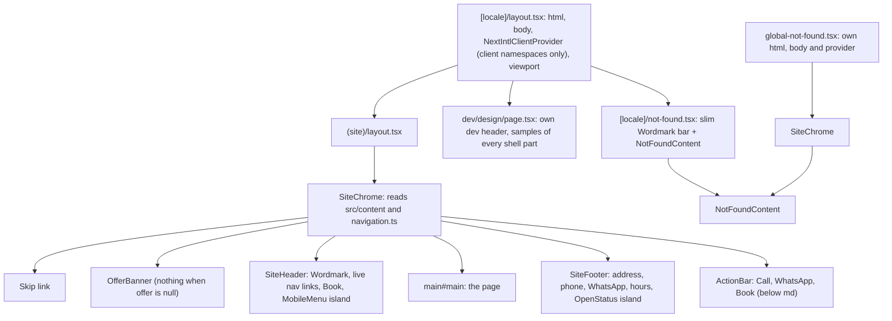
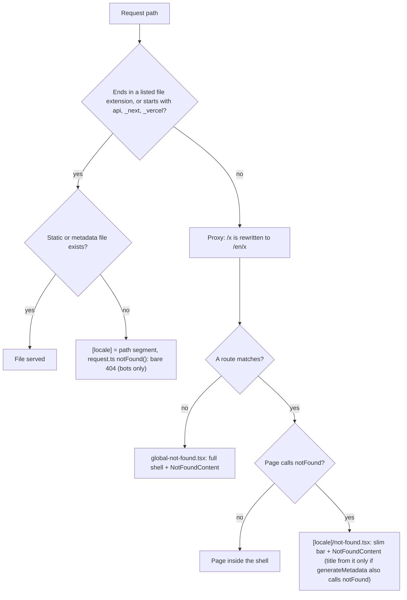
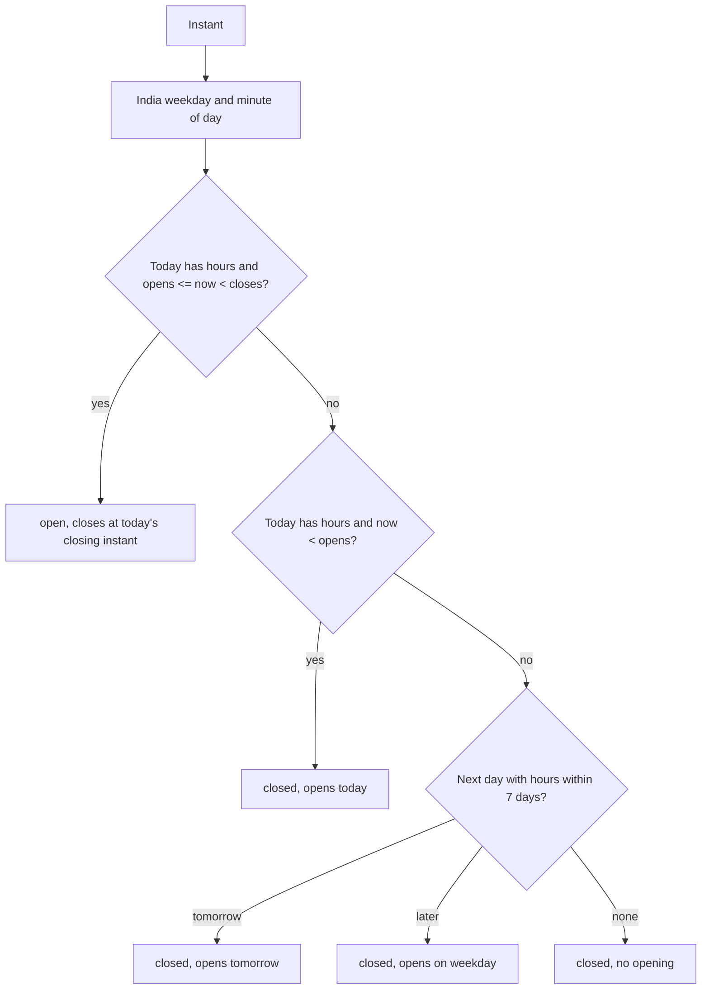

# Layout Shell - Plan

## Goal Capsule

- **Objective:** On every public page, a visitor on a phone or a desktop sees whose garage this is, whether it is open right now, its hours and address, and can call, WhatsApp or book in one tap. A wrong address shows a branded page that leads back. Pages load as fast as they do today, and no link leads to a missing page.
- **Means:** one shared, server-rendered shell (header, footer, phone action bar, offer banner) around a `(site)` route group, garage data from a typed `src/content/` module, the open status worked out in the browser, and branded 404s for both kinds of missing page (KTD1–KTD12).
- **Authority:** the owner's data and decisions (Key Decisions, R1–R3), then `document/website/features.md` "Design direction" and `design-system/go-mechanic/MASTER.md`, then the master plan's task 12 row (see origin) and the task 12 steps in `document/task/task.md`, then this plan. `CLAUDE.md` governs the workflow, languages, design-system and SEO rules. All four lessons in `document/solutions/` apply: read the bundled Next.js docs, test lint guards against real code shapes, only document output you ran, and watch the plan file rather than a `claude -p` child.
- **Execution profile:** the opening-hours logic is written test-first (U2). Components get `renderWithIntl` tests. Behaviour is proven on a production build (`npm run test:e2e`), under `next dev` for the 404's language fallback, and on `/dev/design` (`npm run test:design`).
- **Stop conditions:** stop and ask the owner when:
  - The shared header and footer can't render inside `global-not-found.tsx` with KTD7's locale fallback, under `next dev` or a production build (U7). Don't restructure the i18n setup without asking.
  - Keeping public pages prerendered would mean dropping a requirement.
  - A shadcn component needs more than class changes (for example a new Badge size).
  - A step would install something globally, run `npx playwright install`, approve an npm install script, or use paid 21st.dev generation.
  - The owner has not done the look check (U12). No push or pull request before that.
- **Who finishes:** the main session on branch `12_layout_shell`. Commit on that branch and stop. Pushing and the pull request happen only at `CLAUDE.md` Task workflow step 11, when the owner asks.

---

## Product Contract

### Summary

Build the frame every public page sits in: a frosted sticky header with the wordmark, navigation and a "Book a service" action; a phone menu; a footer with the garage's address, phone, WhatsApp and weekly hours; a Call / WhatsApp / Book bar fixed to the bottom of phones; a live "Open now / Closed" badge in India time; and an offer banner that stays empty until there is an offer. Both kinds of missing page get one branded 404. The browser receives only the translation messages it needs. The garage's real details live in one typed file that task 14 swaps for the database.

### Problem Frame

Today the site is a placeholder heading on a blank page. A visitor can't find the garage's phone number, address or hours, and an unknown URL shows a bare, unstyled 404. Dotted URLs such as `/index.html` and pages that call `notFound()` (like `/dev/design` in production) get Next.js's plain error page, which the SEO checks in tasks 10 and 11 flagged. Every page also ships all of `messages/en.json` to the browser (SEO check in task 10).

The pages the navigation will point to (services, prices, about, contact, booking) arrive in tasks 18, 19 and 23. The shell has to work before them without broken links, and light them up as they ship. Tasks 13 (home page) and 14 (database) build directly on it.

Two local facts shape the details. Most visitors are on Android phones over 4G, so the phone bar and fast static pages matter more than desktop polish. The garage runs on India time while servers and some visitors don't, so "open now" must be computed in `Asia/Kolkata`, not in whatever time zone the code runs in. The owner's own computer is set to IST, so tests must not quietly rely on it.

### Key Decisions

- **Use the owner's contact details exactly as given on 2026-10-26, including the PIN code 412101.** (session-settled: user-directed — the owner gave the PIN after this plan was first written; it was added to the plan before implementation. No email and no current offer were given.) Governs R1, R3.
- **Book stays the third action in the phone bar and the header's main action, even before `/book` exists.** The owner asked for a Call / WhatsApp / Book bar and a "Book a service" action. Until task 23 it opens WhatsApp with a booking message (Assumption A1). Governs R4, R7.

### Requirements

**Garage details**

- R1. The shell shows the owner's real details: phone "+91 97647 50567", dialled as `tel:+919764750567`; WhatsApp at `https://wa.me/919764750567` with a prefilled message from `messages/en.json`; address "Mukai Chowk, Kiwale, Pune, Maharashtra" with PIN code "412101", shown as "Mukai Chowk, Kiwale, Pune, Maharashtra 412101". No email is shown or invented.
- R2. Opening hours are 10:00 to 19:00 India time every day except Monday, when the garage is closed. Every public page shows them.
- R3. Garage details, hours and the current offer live in one typed module under `src/content/`. Translatable text (the address, an offer's text) is `LocalizedText`. The brand name stays only in `messages/en.json`.

**Header and navigation**

- R4. Every public page has a frosted sticky header (`frosted` class) with the Wordmark linking home, the main navigation and one main "Book a service" action. On phones a menu button opens a `Sheet` (`closeLabel` from `Common.close`) with the navigation, the open status, the hours and the call and WhatsApp actions.
- R5. No link in the shell leads to a page that doesn't exist. A navigation item appears once its page ships: services and prices in task 18, about and contact in task 19, booking in task 23.
- R6. Keyboard and screen-reader users can skip straight to the main content and reach every control in visual order. The focus outline is never hidden under the sticky header or the phone bar. A link that opens WhatsApp says so to screen readers.

**Phone action bar**

- R7. Below 768px only, a bar fixed to the bottom of the screen offers Call, WhatsApp and Book. Each target is at least 44px tall, the bar stays clear of the iPhone home indicator, it never covers the end of the page, and it doesn't move.

**Footer**

- R8. The footer shows the Wordmark, the address, phone and WhatsApp links, the weekly hours (marked as India time) and the open status, plus the navigation links once any page is live.

**Open now**

- R9. A badge says "Open now" (Badge `success`) or "Closed" in India time, whatever the visitor's or the server's time zone. When closed, the text next to it says when the garage next opens: "Opens today at 10:00 am", "Opens tomorrow at 10:00 am" or "Opens Tue at 10:00 am". It updates while the page stays open. The weekly hours stay readable without JavaScript.

**Offer banner**

- R10. The offer banner renders nothing when there is no current offer, which is the case today. With an offer it shows one line of text and an optional link.

**Missing pages**

- R11. Unknown URLs (including dotted ones such as `/index.html` and `/contact.php`) and pages that call `notFound()` (such as `/dev/design` in production) show a branded 404 with a heading, a short explanation and a link home. Each answers with status 404, `noindex` and one `<title>` that includes the brand.

**Speed and payload**

- R12. Public pages stay prerendered, and the shell causes no layout shift.
- R13. The browser receives only the message namespaces that client components use.

**Design catalogue and approval**

- R14. Every new site component has a sample on `/dev/design`, `npm run test:design` passes, and the owner reviews screenshots of the header, menu, footer and phone bar before the pull request.

### Success Criteria

- Tasks 13, 18, 19, 23 and 38 plug into the shell by flipping a navigation flag or giving it data, plus the notes this plan adds to their steps in `task.md`.
- Task 14 replaces the reads of `src/content/` with a cached database read that returns the same types, inside `SiteChrome` only.

### Scope Boundaries

- Not in this task: home page content (task 13), the services, prices, about, contact and booking pages (tasks 18, 19, 23), the database (task 14), real offers and their dates (task 38), the metadata title template, sitemap and structured data (task 42), holidays and closed days (tasks 22 and 28), login or account links in the header (tasks 15 and 25), and Hindi text.
- Considered and not built:
  - **Server-side open status** with `connection()` or `io()` in a `<Suspense>` hole: it would make every public page render part of its HTML per request (KTD1). Revisit if a status must be right even when a visitor's clock is wrong.
  - **An active-page marker (`aria-current`) on navigation links:** no link is live yet, so nothing could test it, and `usePathname` in a shared layout suspends on unprerendered dynamic routes under Cache Components (`use-pathname.md`, "Cache Components") and can mismatch after the proxy's rewrite. Task 18 adds it with the first live link (Deferred).
  - **An async garage reader now:** a constant import is enough until task 14, and changing one reader in `SiteChrome` then is cheap (KTD3).
  - **Hiding the phone bar while a form field has focus:** the shell has no forms. Tasks 15 and 23 decide it with their forms (Deferred).
  - **A holiday parameter on `openStatusAt`:** task 22 owns closed days and can add it; the call sites are few.
  - **A "Closing soon" state:** not asked for. Add it if the owner wants it.
  - **A directions or map link:** a link built from the address text would drop people at Mukai Chowk, not the garage. Waits for an exact map link from the owner (task 19).
  - **A copyright year in the footer:** reading today's date would break prerendering under Cache Components. Add a fixed year only if the owner wants one.
  - **Hiding the phone bar while scrolling:** extra motion for no gain. The bar stays put.
  - **The full header and footer inside `src/app/[locale]/not-found.tsx`:** Next.js sends a segment's `not-found` tree with every page under it, so it would add a second copy of the shell to every page (KTD4).

#### Deferred to Follow-Up Work

Each item becomes a step or note in `task.md` (U12):

- Backlog: Badge text is shadcn's stock 12px, below MASTER.md's 13px floor. Restyle Badge's text size in its own small task.
- Task 13: pinned and scroll-triggered sections on phones must end above the bar (`--action-bar-height` plus the safe area) and start below the header (`--header-height`).
- Task 14: read garage data with `'use cache'` and a `cacheTag`, and call `updateTag` on every save (tasks 28 and 40), so all prerendered pages refresh. Validate phone numbers at save time; the shell's formatters don't throw (KTD3).
- Task 15: a login or account entry in the header goes in a `<Suspense>` slot or a client island, never a cookie read in `SiteHeader`, or every page turns dynamic. Decide whether the phone bar hides while a field has focus.
- Task 18: add `aria-current` to live navigation links inside a `<Suspense>` with a plain-links fallback, with an e2e check for the attribute and no hydration errors. A page that can 404 (unknown service slug) calls `notFound()` from `generateMetadata` as well as the page body, before any `<Suspense>`, so the status is 404 and the title comes from `[locale]/not-found.tsx` (KTD11). Add `src/app/[locale]/(site)/not-found.tsx` if that 404 should keep the full shell. Add an e2e status check for an unknown slug.
- Task 23: decide the phone bar's behaviour on `/book`, where its Book duplicates the page and can cover the wizard's own buttons.
- Task 38: a prerendered banner can't check an offer's end date at render time. End it through cache expiry or a browser-side date check like the open status.
- Task 42: the 404 titles already include the brand, so the title template must not add it a second time. The PIN code (412101) is already in `src/content/garage.ts`.

### Open Questions

None block the work. Each has a default the plan uses (see Assumptions); ask the owner at the look check (U12).

- Desktop "Book a service" before `/book` exists: is WhatsApp in a new tab right (A1), and should desktop also show the phone number in the header?
- Phone bar before task 23: three items (Call, WhatsApp, Book, two of which open WhatsApp) or Call and WhatsApp only (A1)?
- Does the garage close on festival days (Diwali, Ganeshotsav)? Until task 28 the badge would say "Open now" then (A9).
- Should desktop show the open status in the header (A3)?
- Will a landline or emergency number come later, separate from the WhatsApp mobile (KTD3 keeps them separate fields)?

---

## Planning Contract

### Key Technical Decisions

- KTD1. **"Open now" runs in the browser.** A small client component reads the clock through `useSyncExternalStore`: the server snapshot is `null`, so the static HTML holds an empty, fixed-height slot on its own line, and hydration never mismatches. After hydration it shows the status from the pure `openStatusAt` (KTD2), re-checking at each minute boundary, when the tab becomes visible again (`visibilitychange`) and when a page comes back from the back/forward cache (`pageshow`). Why: the shell wraps every page, so a request-time hole (`connection()` + `<Suspense>`, as the master plan said, or `io()`, which the 16.4 docs now prefer) would make every public page partly rendered per request, costing a server call on every visit and breaking the prerender check on `/` in `e2e/i18n.spec.ts`. A server-rendered status would also go stale in a tab left open. A browser clock can be fixed in tests with Playwright's `page.clock`. Trade-off: a phone with the wrong time shows the wrong badge, while the weekly hours next to it stay right. This replaces the master plan's "Open now ... use `connection()`" rule; `io()` stays the tool for request-time values such as slots (task 22).
- KTD2. **Opening hours are plain data plus one pure module.** `src/domain/opening-hours.ts` defines the types (each weekday, Monday first, is either closed or a same-day `opens`/`closes` pair in 24-hour `HH:MM`) and the functions `isOpenAt`, `openStatusAt` and a grouping helper for display. It reads the India wall-clock time through `Intl` with `GARAGE_TIME_ZONE`, never a hard-coded +05:30 or the computer's local time. Opening is inclusive and closing exclusive (19:00:00 is closed). `openStatusAt` returns either "open, closes at <instant>" or "closed, opens at <instant> today, tomorrow or later", or "closed, no opening" when no day has hours. It searches up to seven days ahead. Overnight hours are rejected by validation. The content module and, later, the database (task 14) share these types.
- KTD3. **Garage data: one typed content module, derived formats, no throwing at render.** `src/content/garage.ts` stores `phone` (any Indian number, for `tel:` and display) and `whatsapp` (a mobile) as separate E.164 fields, both `+919764750567` today, so a later landline can't break WhatsApp. `src/lib/contact-links.ts` derives the display form ("+91 97647 50567"), the `tel:` link and the `wa.me` link with an encoded message. The formatters never throw: a number they can't group is shown as stored. A separate validator checks the numbers, used by `garage.test.ts` now and by admin saves later. The address is one `LocalizedText` holding the owner's exact string, plus `postalCode: "412101"` and the country code; the display appends the PIN code. Task 42 splits the street, area and city into structured parts for the JSON-LD, so no structure is guessed now. `src/content/offer.ts` exports the current offer (`null`): a `LocalizedText` and an optional internal link. Components never import these files; `SiteChrome` reads them and passes props (KTD5).
- KTD4. **A `(site)` route group carries the shell; the 404s share their content.** `src/app/[locale]/(site)/layout.tsx` wraps public pages in `SiteChrome`. The home page moves into `(site)`. `/dev/design` stays outside, so it keeps its own dev header, and `/admin`, `/account` and `/login` (tasks 15, 25, 26) can get their own frames later. One `NotFoundContent` component serves both 404s:
  - `src/app/global-not-found.tsx` (unknown URLs) renders it inside the full `SiteChrome`. It is its own document, so it adds nothing to other pages.
  - `src/app/[locale]/not-found.tsx` (pages that call `notFound()`) renders it under a slim bar with the Wordmark linking home. Next.js passes a segment's not-found element to its layout router on every render (`not-found` handling in `node_modules/next/dist/server/app-render/create-component-tree.js`), so the full shell here would ride along in every page's payload.
- KTD5. **The shell is server components fed by props; interactivity lives in two small client islands.** `SiteChrome` is the one place that reads `src/content/` and the navigation registry. `SiteHeader`, `SiteFooter`, `ActionBar`, `OfferBanner` and `NotFoundContent` are server components that take data as props, so `/dev/design` can render them with demo data and task 14 changes only the reader. The client islands are `MobileMenu` (the Sheet's open state; its labels and server-rendered content arrive as props and children) and `OpenStatus` (KTD1). A client island never imports `Wordmark` or another module that calls `useTranslations` with a server-only namespace; it receives them as children. Navigation links are plain `Link`s from `@/i18n/navigation`, rendered on the server (no `usePathname`; see Scope Boundaries).
- KTD6. **A navigation registry with a `live` flag, tied to real files by a test.** `src/components/site/navigation.ts` lists each item's message key, path and `live` flag (services `/services` and prices `/packages`: task 18; about `/about` and contact `/contact`: task 19; book `/book`: task 23). Only live items render. A unit test fails when an item's flag disagrees with whether a `page.tsx` for its path exists under `src/app/[locale]/`, in any route group, so a page task can't ship its page without lighting up its link, or light a link with no page. The Book action's target is `/book` when live, otherwise the WhatsApp booking link (A1). Labels come from a `Nav` namespace.
- KTD7. **`global-not-found.tsx` gets a locale without a URL segment.** It renders `<html>`, `<body>`, a `NextIntlClientProvider` with the client messages (KTD9) and `SiteChrome` + `NotFoundContent`. The provider is required, not optional: `Link` from `@/i18n/navigation` renders next-intl's client `BaseLink`, which reads the locale from that provider. The shared server components call `useTranslations` without a locale, which runs `src/i18n/request.ts`. Outside `[locale]` there is no `locale` root param: a production render returns nothing (`getRootParam` in `node_modules/next/dist/server/request/root-params.js` reads `rootParams[name]`), while `next dev` can return a rejected promise (its `assertRootParamInSamples` check). So `request.ts` wraps the root-param read in `try`/`catch` and falls back to `routing.defaultLocale` when it is missing or rejected. An unknown locale inside `[locale]` (such as `/foo.png` reaching `[locale]="foo.png"`) still answers 404. With the provider in place, `NotFoundContent` links home through `@/i18n/navigation`, and the `next/link` exception for `global-not-found.tsx` in `eslint.config.mjs` goes away.
  - *Implemented differently (2026-10-27): a probe showed `rootLocale()` resolves to `undefined` in the global 404 under `next dev` too, so the `?? defaultLocale` fallback does the work. `request.ts` catches only the `INSTANT_VALIDATION_ERROR` digest and rethrows every other error (ce-code-review), so misuse in a Server Action or Route Handler fails loudly. See `document/learning/12_layout_shell.md`.*
- KTD8. **The proxy skips known file extensions, not every dotted path.** The matcher in `src/proxy.ts` excludes `api`, `_next`, `_vercel` and paths ending in a listed file extension (images, icons, `txt`, `xml`, `webmanifest`, fonts, `js`, `css`, `map`, `pdf`), written inline because Next.js reads the matcher statically (`proxy.md`, "Matcher"). Then `/index.html`, `/contact.php` and `/foo.bar` (old-site links a garage replacing its website will get) reach the branded 404 instead of Next.js's bare page. Trade-off from task 10's review: a public file whose extension is missing from the list would be rewritten to `/en/...` and 404. `src/proxy.test.ts` closes that gap with `unstable_doesProxyMatch` (`next/experimental/testing/server`) over every file in `public/` and every metadata file in `src/app/`. CLAUDE.md's "page slugs never contain a dot" rule stays as the simple rule; only its reason changes.
- KTD9. **Only client namespaces reach the browser.** `NextIntlClientProvider` with no `messages` prop sends all messages (`messages === undefined ? await getMessages()` in `node_modules/next-intl/dist/esm/development/react-server/NextIntlClientProviderServer.js`). `src/i18n/client-messages.ts` holds the list of client namespaces (expected: `OpenStatus` only, since other labels arrive as props) and a helper that picks them. Both the root layout and `global-not-found.tsx` pass the result. A unit test scans every `"use client"` file under `src/`, and the `src/` modules each one imports, for `useTranslations("<namespace>")`. It fails when a namespace isn't in the list, or when a client file calls `useTranslations()` without a namespace.
- KTD10. **Phone bar, safe areas and stacking are tokens.** The root layout and `global-not-found.tsx` export `viewport` with `viewportFit: "cover"` (the `Viewport` type supports it), so `env(safe-area-inset-*)` works on iPhones. `src/app/globals.css` gains `--header-height`, `--action-bar-height`, a `--gutter` that never goes below the side safe areas, `scroll-padding-top` and (below 768px) `scroll-padding-bottom` on `html`, so focused elements and anchors land clear of both bars. Stacking, lowest first: header and bar (`z-40`), the skip link while focused (above the header), the Sheet and its overlay (`z-50`, set in `sheet.tsx`). The bar is `fixed` at the bottom, hidden from `md`, solid `bg-background` with `shadow-md` and a top border (MASTER.md "Elevation" names the action bar), with bottom padding `max(<space>, env(safe-area-inset-bottom))`. Below 768px a spacer of the bar's height follows the footer. It has no animation, so reduced motion needs no extra case. Its three links share the width equally. If "WhatsApp" doesn't fit next to an icon at 320px, the icon goes above the label (tab-bar style); `test:design` and e2e measure it.
- KTD11. **404 titles carry the brand, and pages 404 from `generateMetadata` too.** A `NotFound.metaTitle` message ("Page not found | {brand}") is filled with `Brand.name`, so a rename still touches only `Brand.name`. `global-not-found.tsx` sets it in `generateMetadata` with the explicit locale. `src/app/[locale]/not-found.tsx` sets it the same way, but with `globalNotFound` on, Next.js uses that metadata only when `notFound()` is thrown while metadata is resolved; a `notFound()` from the page body keeps the page's own metadata (`hasGlobalNotFound` in `node_modules/next/dist/server/app-render/app-render.js`). So `/dev/design` replaces its static `metadata` export with a `generateMetadata` that calls `devOnly()` first, and `src/lib/dev-only.test.ts` requires that for every dev page. Task 18 follows the same rule (Deferred).
- KTD12. **Three test levels plus the catalogue, with the time zone pinned.** Pure logic in Vitest (`node`), components with `renderWithIntl` (`jsdom`), and real behaviour in Playwright on a production build. Both test configs pin the time zone to UTC (`TZ` in `vitest.config.mts`, `timezoneId` in `playwright.config.ts`), since the owner's machine runs in IST and would hide local-time bugs; tests that need another zone set it themselves. Fixed states use `page.clock.setFixedTime`; the 19:00 boundary uses `page.clock.install`, `pauseAt` and `runFor`, so page-load time can't move the clock past the boundary. Layout shift is measured by a `PerformanceObserver` registered before navigation (`addInitScript`, `buffered: true`). `/dev/design` gets a "Layout shell" section, and a new dev spec saves screenshots of the real shell for the owner and checks the unknown-URL 404 under `next dev`.

### High-Level Technical Design

Where each piece renders:



How a request reaches a 404 after KTD8:



What `openStatusAt` returns (all times in Asia/Kolkata):



### Output Structure

New and moved files. The per-unit **Files** lists are authoritative.

```text
src/
  app/
    [locale]/
      (site)/
        layout.tsx            # SiteChrome around public pages
        page.tsx              # moved from [locale]/page.tsx
        page.test.tsx         # moved
      not-found.tsx           # slim bar + NotFoundContent
    global-not-found.tsx      # full shell + NotFoundContent
  components/site/
    site-chrome.tsx  site-header.tsx  mobile-menu.tsx
    site-footer.tsx  action-bar.tsx  offer-banner.tsx  open-status.tsx
    not-found-content.tsx  navigation.ts  (+ tests next to each)
  content/
    garage.ts  offer.ts  garage.test.ts
  domain/
    opening-hours.ts  opening-hours.test.ts
  i18n/
    client-messages.ts  client-messages.test.ts
  lib/
    contact-links.ts  contact-links.test.ts
  proxy.test.ts
e2e/
  layout-shell.spec.ts
  dev/shell-preview.spec.ts
```

### Assumptions

These are bets made without the owner's confirmation (scoping confirmation was off). Each is cheap to change; Open Questions lists the ones to ask.

- A1. Until `/book` exists (task 23), "Book a service" and the bar's Book open WhatsApp with a booking message ("Hi, I'd like to book a service for my vehicle."), separate from the general WhatsApp message. The label stays "Book a service" / "Book". Every `wa.me` link opens in a new tab (`rel="noopener noreferrer"`), shows a decorative chat icon, and carries screen-reader text "(opens WhatsApp)" from messages.
- A2. The phone menu always shows, even with no live pages: it holds the open status, hours, address, and the call and WhatsApp actions, and gains navigation as pages ship.
- A3. The open status shows in the footer's hours block and in the phone menu, not in the header, to keep the header calm. Tasks 13 and 19 reuse the component.
- A4. Open: `success` badge "Open now" plus "until 7:00 pm". Closed: `secondary` badge "Closed" plus the next opening. Not red: closed is a normal state, not a problem (MASTER.md "Badges").
- A5. The offer banner sits below the header, scrolls away with the page, and uses the grey tone.
- A6. The WhatsApp messages and the navigation labels (Services, Prices, About, Contact) are first drafts in `messages/en.json` for the owner to edit.
- A7. The footer lists hours grouped from Monday: "Monday: Closed" and "Tuesday to Sunday: 10:00 am to 7:00 pm", with weekday names from `Intl` (so Hindi gets them for free) and a caption "Times are India time (IST)" for visitors abroad.
- A8. A "Skip to main content" link comes first on every page (MASTER.md keyboard checklist).
- A9. Holidays are ignored until tasks 22 and 28, so the badge can say "Open now" on a holiday.
- A10. The task stays one task, as `task.md` defines it, although it is bigger than the 15-minute guideline. Its units are commit-sized so the review can go one unit at a time.

### Risks and Dependencies

| Risk | Mitigation |
| --- | --- |
| The root-param fallback in `request.ts` still fails inside `global-not-found.tsx` | U7 checks it first, under `next dev` and on a production build. If it fails, stop (Goal Capsule) |
| A future page calls `notFound()` only in its body and keeps its own title, or calls it after streaming starts and answers 200 | KTD11 and the task 18 note; `dev-only.test.ts` enforces the rule for dev pages |
| Playwright can't emulate iPhone safe-area insets | The owner checks the phone bar on a real iPhone during the look check (U12) |
| A client component starts using a namespace that isn't sent | The scan test in U9, plus the console-error checks in e2e, including with the phone menu open |
| A future public file type is missing from the proxy's extension list | The `public/` walk in `src/proxy.test.ts` (U8) |
| A visitor's device clock is wrong | Weekly hours always shown next to the badge |
| The task is large for one review | Commit per unit. `code-reviewer` can review unit by unit |

---

## Implementation Units

| U-ID | Title | Key files | Depends on |
| --- | --- | --- | --- |
| U1 | Garage data and contact links | `src/content/garage.ts`, `src/lib/contact-links.ts`, `src/i18n/format.ts` | none |
| U2 | Opening-hours logic | `src/domain/opening-hours.ts`, `vitest.config.mts` | none |
| U3 | Navigation registry, header and phone menu | `src/components/site/{navigation.ts,site-header.tsx,mobile-menu.tsx}` | U1 |
| U4 | Open status | `src/components/site/open-status.tsx` | U1, U2 |
| U5 | Footer, phone bar and offer banner | `src/components/site/{site-footer,action-bar,offer-banner}.tsx`, `src/content/offer.ts` | U1, U2, U3, U4 |
| U6 | Shell, route group and layout tokens | `src/components/site/site-chrome.tsx`, `src/app/[locale]/(site)/`, `src/app/globals.css` | U3, U5 |
| U7 | Branded 404s | `src/components/site/not-found-content.tsx`, `src/app/[locale]/not-found.tsx`, `src/app/global-not-found.tsx`, `src/i18n/request.ts`, `src/app/[locale]/dev/design/page.tsx` | U6, U9 |
| U8 | Proxy matcher for dotted URLs | `src/proxy.ts`, `src/proxy.test.ts` | U7 |
| U9 | Client messages only | `src/i18n/client-messages.ts`, `src/app/[locale]/layout.tsx` | U4 |
| U10 | `/dev/design` samples | `src/app/[locale]/dev/design/page.tsx`, `e2e/dev/` | U3–U7 |
| U11 | End-to-end tests on a production build | `e2e/layout-shell.spec.ts`, `e2e/i18n.spec.ts`, `playwright.config.ts` | U6–U9 |
| U12 | Docs and the owner's look check | `MASTER.md`, `CLAUDE.md`, master plan, `features.md`, `task.md` | U1–U11 |

### U1. Garage data and contact links

- **Goal:** the owner's details as typed data, and tested helpers that turn them into what the shell shows and links to.
- **Requirements:** R1, R2, R3.
- **Dependencies:** none (imports the hours type from U2; build U2's types first if working in parallel).
- **Files:**
  - Create `src/content/garage.ts`, `src/content/garage.test.ts`.
  - Create `src/lib/contact-links.ts`, `src/lib/contact-links.test.ts`.
  - Modify `src/i18n/format.ts`, `src/i18n/format.test.ts`.
  - Modify `messages/en.json` (`Contact` namespace: call and WhatsApp labels, the two WhatsApp messages and the "(opens WhatsApp)" text per A1).
- **Approach:**
  1. `garage.ts` holds `phone` and `whatsapp` (separate E.164 fields), the address as `LocalizedText` with `postalCode: "412101"` and the country code, and the weekly hours (Monday closed, Tuesday to Sunday 10:00–19:00), typed with `satisfies` against types from U2 and KTD3. No email field.
  2. `contact-links.ts`: display form, `tel:` href, `wa.me` href with an encoded message, and a validator for Indian numbers (KTD3).
  3. `format.ts`: a weekday-name formatter (long and short) and a wall-clock formatter ("10:00" to "10:00 am"), both `en-IN` and independent of the computer's time zone, next to `formatTime`.
- **Patterns to follow:** `src/i18n/format.ts` (pure, `Intl`) and `src/i18n/localized-text.ts`.
- **Test scenarios:**
  - `+919764750567` displays as "+91 97647 50567".
  - A number the formatter can't group (a landline, a foreign number) is displayed as stored, without throwing.
  - The `tel:` href is exactly `tel:+919764750567`.
  - The WhatsApp href starts with `https://wa.me/919764750567?text=`, and decoding the query gives back the message, including an apostrophe and a newline.
  - The validator accepts the garage's numbers, accepts a mobile only for `whatsapp`, and rejects `+1...`, a wrong length and a mobile starting with 5.
  - The garage's address in English is exactly "Mukai Chowk, Kiwale, Pune, Maharashtra"; `postalCode` is "412101"; the displayed address is "Mukai Chowk, Kiwale, Pune, Maharashtra 412101".
  - The garage's hours: Monday closed; every other day opens "10:00" and closes "19:00"; every open day passes U2's validation.
  - The weekday formatter gives "Monday" / "Tue" whatever `process.env.TZ` is.
  - The wall-clock formatter gives "10:00 am" for "10:00" and "7:00 pm" for "19:00".
  - The brand name appears in none of the new files (`brand-name.test.ts` already covers `src/`).
- **Verification:** `npm run check` passes with the new tests.

### U2. Opening-hours logic

- **Goal:** a pure, tested answer to "is the garage open at this instant, and if not, when does it open?"
- **Requirements:** R2, R9.
- **Dependencies:** none.
- **Files:** create `src/domain/opening-hours.ts`, `src/domain/opening-hours.test.ts`; modify `vitest.config.mts` (`TZ` pinned to UTC, KTD12).
- **Approach:** implements KTD2: types, `isOpenAt`, `openStatusAt`, a validator for hours, and a helper that groups consecutive days with the same hours for the footer (A7). Imports only `GARAGE_TIME_ZONE`; no Next.js, React or next-intl.
- **Execution note:** write the tests first; each scenario below names an instant in UTC and the India time it stands for.
- **Test scenarios** (dates are in 2026; 26 Oct is a Monday):
  - Monday 26 Oct at 00:00, 12:00 and 23:59 IST: closed; next opening Tuesday 10:00 IST, reported as "tomorrow".
  - Tuesday 27 Oct 09:59:59 IST (04:29:59Z): closed, opens "today" at 04:30:00Z.
  - Tuesday 27 Oct 10:00:00 IST (04:30:00Z): open, closes at 13:30:00Z.
  - Tuesday 18:59:59 IST: open. Tuesday 19:00:00 IST: closed, opens "tomorrow" (Wednesday 10:00).
  - Sunday 1 Nov 19:30 IST: closed, opens on Tuesday 3 Nov at 10:00 IST, reported as "later" with weekday Tuesday.
  - UTC and India days differ: 26 Oct 20:00Z is Monday in UTC but Tuesday 01:30 IST, so closed, opens "today". 1 Nov 13:29Z is Sunday 18:59 IST, so open.
  - The same instants give the same answers with `process.env.TZ` set to `Asia/Kolkata` and to `America/New_York` (restored after the test).
  - A week with no open day: never open, `openStatusAt` reports no next opening.
  - Validation rejects `closes` at or before `opens`, and times that aren't `HH:MM` within 00:00–23:59.
  - Grouping the garage's hours gives two groups: Monday closed, Tuesday–Sunday 10:00–19:00.
- **Verification:** all scenarios pass under `npm run test`.

### U3. Navigation registry, header and phone menu

- **Goal:** the frosted header and the phone menu, showing only links to pages that exist.
- **Requirements:** R4, R5, R6.
- **Dependencies:** U1.
- **Files:**
  - Create `src/components/site/navigation.ts`, `src/components/site/navigation.test.ts`.
  - Create `src/components/site/site-header.tsx`, `site-header.test.tsx`.
  - Create `src/components/site/mobile-menu.tsx`, `mobile-menu.test.tsx`.
  - Modify `messages/en.json` (`Nav` labels, `Header` labels: open-menu label, menu title, navigation landmark name, "Book a service").
- **Approach:**
  1. `navigation.ts` per KTD6, including the Book target rule (A1).
  2. `SiteHeader` (server, props: live items, Book href, garage data for the menu): `frosted sticky top-0` with a bottom border, height `--header-height` (U6), Wordmark (`type-lead`) in a link to `/`, a named `<nav>` of plain `Link`s from `md` (only when items exist), and one `default` "Book a service" button (`size="sm"`) from `md`. Below `md`, the `MobileMenu` button only. A comment marks where a login or account slot goes later (task 15 note).
  3. `MobileMenu` (client): `Sheet` with `closeLabel`, an icon button (`size="icon"`, `aria-label` from messages) as trigger, a `SheetTitle`, and server-rendered children: the live nav links wrapped in `SheetClose`, the `OpenStatus` island (U4), the hours, and call and WhatsApp buttons (A2).
- **Patterns to follow:** the Sheet sample in `src/app/[locale]/dev/design/page.tsx`; `Wordmark`'s comment style; the lint lesson `document/solutions/conventions/lint-guards-test-real-jsx-shapes.md` (every label through `t()`).
- **Test scenarios:**
  - `navigation.test.ts`: every item's `live` flag equals whether a `page.tsx` for its path exists under `src/app/[locale]/`, in any route group. Today every flag is false.
  - `navigation.test.ts`: the Book target is the WhatsApp booking link while `/book` isn't live, and `/book` once it is.
  - Header with no live items: the Wordmark link points to `/`, there is no navigation landmark, and "Book a service" links to the WhatsApp booking URL, opens in a new tab and includes the "(opens WhatsApp)" text.
  - Header with two demo items: both render as links, in order, with labels from messages.
  - `MobileMenu`: the trigger's accessible name comes from messages; clicking it opens a dialog titled from messages; the close button is named `Common.close`; Escape closes it and focus returns to the trigger.
  - Lint: the new files pass `npm run lint` with no text typed into JSX.
- **Verification:** component tests pass; the header renders in U10's sample.

### U4. Open status

- **Goal:** the live "Open now / Closed" badge, with no hydration mismatch and no layout shift.
- **Requirements:** R9, R12.
- **Dependencies:** U1, U2.
- **Files:**
  - Create `src/components/site/open-status.tsx`, `open-status.test.tsx`.
  - Modify `messages/en.json` (`OpenStatus`: "Open now", "Closed", "until {time}", "Opens today at {time}", "Opens tomorrow at {time}", "Opens {day} at {time}").
- **Approach:** per KTD1. Two parts in one file or two files, as the implementer prefers:
  1. A presentational view that takes a status (from U2) and renders the badge plus its text: `success` for open, `secondary` for closed (A4). Times through U1's formatters, passed to `t()` as strings (CLAUDE.md "Format first").
  2. The live client wrapper: a clock hook built on `useSyncExternalStore` (server snapshot `null`; the snapshot is the current minute number), subscribed to a timer at the next minute boundary, `visibilitychange` and `pageshow`. Before hydration it renders an empty slot on its own line, with the badge's fixed height and a `data-open-status="pending"` marker; after, `data-open-status="open"` or `"closed"`.
- **Test scenarios:**
  - View, open status: "Open now" in a `success` badge and "until 7:00 pm".
  - View, closed before opening: "Closed" in a `secondary` badge and "Opens today at 10:00 am".
  - View, closed Monday: "Opens tomorrow at 10:00 am". Closed Sunday night: "Opens Tue at 10:00 am".
  - View, no opening at all: "Closed" with no second line.
  - Live, with `vi.setSystemTime` at Tuesday 18:59:30 IST: shows "Open now"; after advancing fake timers past 19:00 IST it shows "Closed" and "Opens tomorrow at 10:00 am".
  - Live, server render (`renderToString`): the output has the pending slot and no status text, so it never depends on the clock.
  - Lint: the open/closed choice uses `t()` in both branches (the shape the lint lesson names).
- **Verification:** tests pass; U11 proves it in a real browser with a fixed clock.

### U5. Footer, phone bar and offer banner

- **Goal:** the bottom of every page and the phone actions.
- **Requirements:** R1, R2, R6, R7, R8, R10.
- **Dependencies:** U1, U2, U3, U4.
- **Files:**
  - Create `src/components/site/site-footer.tsx`, `site-footer.test.tsx`.
  - Create `src/components/site/action-bar.tsx`, `action-bar.test.tsx`.
  - Create `src/components/site/offer-banner.tsx`, `offer-banner.test.tsx`.
  - Create `src/content/offer.ts`.
  - Modify `messages/en.json` (`Footer` headings and landmark names, `Hours` phrases for day ranges, closed days and the India-time caption, `ActionBar` labels).
- **Approach:**
  1. `SiteFooter` (server): a grey `Section` (`width="wide"`) with the Wordmark (`type-callout`), the address through `localize`, phone and WhatsApp links, the grouped hours from U2 with weekday names from U1 and the India-time caption (A7), the `OpenStatus` island, and live navigation links when any exist. Text links get `min-h-11` on touch screens. No copyright year (Scope Boundaries).
  2. `ActionBar` (server): a `<nav>` named from messages, three equal links styled as buttons (Call `secondary`, WhatsApp `secondary`, Book `default`: one blue per group), icons from lucide marked decorative, WhatsApp links per A1, layout per KTD10.
  3. `OfferBanner` (server): returns `null` when the offer is `null`; otherwise one `type-callout` line through `localize`, with the link only when its target is a live page (KTD6).
- **Patterns to follow:** `Section` for the footer band; the touch-size rules in `src/components/ui/button.tsx`.
- **Test scenarios:**
  - Footer: the phone link's `href` is `tel:+919764750567` and its text "+91 97647 50567".
  - Footer: the WhatsApp link's `href` decodes to the general message from messages, and it opens in a new tab.
  - Footer: the address text equals the owner's string exactly.
  - Footer: the hours read "Monday: Closed" and "Tuesday to Sunday: 10:00 am to 7:00 pm" (wording from messages), followed by the India-time caption.
  - Footer: with no live items there is no links list; with demo items there is.
  - Action bar: Call, WhatsApp and Book links with accessible names from messages; Book points at the WhatsApp booking link while `/book` isn't live; exactly one link uses the `default` variant.
  - Offer banner with `null`: renders nothing (empty container).
  - Offer banner with a demo offer: its English text shows; with a Hindi text and locale `hi` the Hindi text shows; a link to a non-live page is not rendered.
- **Verification:** component tests pass; the footer and bar render in U10's samples.

### U6. Shell, route group and layout tokens

- **Goal:** every public page gets the shell, and nothing else does.
- **Requirements:** R4, R6, R7, R12.
- **Dependencies:** U3, U5.
- **Files:**
  - Create `src/components/site/site-chrome.tsx`, `site-chrome.test.tsx`.
  - Create `src/app/[locale]/(site)/layout.tsx`.
  - Move `src/app/[locale]/page.tsx` and `page.test.tsx` into `src/app/[locale]/(site)/`.
  - Modify `src/app/[locale]/layout.tsx` (`viewport` export).
  - Modify `src/app/globals.css` (KTD10 tokens).
  - Modify `messages/en.json` (`Common.skipToContent`).
- **Approach:**
  1. `SiteChrome` reads `src/content/garage.ts`, `src/content/offer.ts` and `navigation.ts`, and renders: skip link (A8), `OfferBanner`, `SiteHeader`, `<main id="main" tabIndex={-1}>`, `SiteFooter`, `ActionBar` and the phone-only spacer (KTD5, KTD10).
  2. The `(site)` layout renders `SiteChrome` around its children (KTD4). The home page drops its own `<main>`, since the shell provides it.
  3. `globals.css`: header and bar height tokens, safe-area-aware `--gutter`, `scroll-padding` on `html`, stacking per KTD10. No raw values outside `globals.css` (CLAUDE.md "Design system").
- **Test scenarios:**
  - `SiteChrome` renders, in order: the skip link (first focusable, pointing at `#main`), the header (banner landmark), one `main`, the footer (contentinfo landmark) and the action-bar navigation. Each `nav` has a distinct accessible name.
  - `SiteChrome` with the real content renders no offer banner.
  - The moved home page test still finds one level-1 heading and the tagline.
  - `dev-only.test.ts` and `brand-name.test.ts` still pass after the move.
- **Verification:** `npm run build` succeeds and `/` is still listed as prerendered (static) in the build output; `npm run check` passes.

### U7. Branded 404s

- **Goal:** one branded 404 for unknown URLs and for pages that call `notFound()`, with the brand in the title.
- **Requirements:** R11, R13.
- **Dependencies:** U6, U9.
- **Files:**
  - Create `src/components/site/not-found-content.tsx`, `not-found-content.test.tsx`.
  - Create `src/app/[locale]/not-found.tsx`.
  - Modify `src/app/global-not-found.tsx`, `src/i18n/request.ts`, `eslint.config.mjs` (drop the `global-not-found.tsx` exception, KTD7).
  - Modify `src/app/[locale]/dev/design/page.tsx` (`generateMetadata` calling `devOnly()` first, KTD11) and `src/lib/dev-only.test.ts`.
  - Create `src/i18n/request.test.ts`.
  - Modify `messages/en.json` (`NotFound.metaTitle`; contact-action labels if the 404 offers them).
- **Approach:**
  1. Do the `request.ts` fallback first (KTD7), render the shell inside `global-not-found.tsx`, and confirm that `/this-page-does-not-exist` shows the header and footer both under `npm run dev` and on a production build. Stop per the Goal Capsule if it can't work.
  2. `NotFoundContent` (server): a `Section` with the heading, explanation, a `default` "Go to the home page" button and `secondary` Call and WhatsApp buttons.
  3. `global-not-found.tsx`: own `<html>`/`<body>` with the font classes, `viewport` (if the build rejects a `viewport` export here, drop it: this page then keeps the default viewport, and the bar's bottom padding falls back to its minimum), the provider with client messages (U9), `SiteChrome` + `NotFoundContent`, title per KTD11.
  4. `[locale]/not-found.tsx`: slim bar (Wordmark link home) + `NotFoundContent`, title per KTD11 (KTD4).
  5. `/dev/design`: move its title and `robots` into a `generateMetadata` that calls `devOnly()` first (KTD11).
- **Patterns to follow:** today's `global-not-found.tsx` (explicit locale, font classes, CSS import); the dev-page scan in `src/lib/dev-only.test.ts`.
- **Test scenarios:**
  - `NotFoundContent`: one level-1 heading with `NotFound.title`, the description, and a home link to `/`.
  - `request.ts` (mocking `next/root-params`): an explicit locale is used as is; a missing root param gives the default locale; a rejected root-param promise gives the default locale; an unknown root param throws Next.js's not-found error.
  - `dev-only.test.ts`: every dev page calls `devOnly()` first in its component and, when it has metadata, in a `generateMetadata` (no static `metadata` export).
  - Integration (U10 under `next dev`, U11 on a production build): both 404s show the parts named in KTD4 and the brand in the title.
- **Verification:** U10's dev check and U11's 404 tests pass.

### U8. Proxy matcher for dotted URLs

- **Goal:** dotted page-like URLs reach the branded 404; real files are still served.
- **Requirements:** R11.
- **Dependencies:** U7.
- **Files:** modify `src/proxy.ts`; create `src/proxy.test.ts`; modify `e2e/i18n.spec.ts` (the dotted-path test).
- **Approach:** per KTD8, with the comment in `src/proxy.ts` explaining the list and pointing at the test.
- **Test scenarios:**
  - The proxy runs for `/`, `/services`, `/index.html`, `/contact.php`, `/foo.bar` and `/en/anything`.
  - The proxy skips `/icon.svg`, `/favicon.ico`, `/robots.txt`, `/sitemap.xml`, `/manifest.webmanifest`, `/apple-icon.png`, `/_next/static/chunk.js`, `/api/health`.
  - Every file under `public/` (none today; the walk must handle a missing folder) and every metadata file under `src/app/` is skipped.
  - e2e: `/index.html` answers 404 with the branded heading; `/icon.svg` still answers 200.
- **Verification:** unit test and the updated e2e test pass.

### U9. Client messages only

- **Goal:** the browser gets only the namespaces client components use.
- **Requirements:** R13.
- **Dependencies:** U4.
- **Files:**
  - Create `src/i18n/client-messages.ts`, `src/i18n/client-messages.test.ts`.
  - Modify `src/app/[locale]/layout.tsx` (U7 does the same in `global-not-found.tsx`).
- **Approach:** per KTD9. The root layout is already async, so it can await the messages and pick.
- **Test scenarios:**
  - Picking from the real messages returns exactly the listed namespaces.
  - Every `"use client"` file under `src/`, and every `src/` module it imports, that calls `useTranslations("X")` has `X` in the list. The scan finds `open-status.tsx`, so it isn't vacuous.
  - A `"use client"` file calling `useTranslations()` without a namespace fails the scan.
  - Both `src/app/[locale]/layout.tsx` and `src/app/global-not-found.tsx` pass a `messages` prop to `NextIntlClientProvider`.
  - e2e (U11): on `/`, the page's serialized data contains the `OpenStatus` namespace but not `Metadata` or `HomePage`.
- **Verification:** unit tests and the e2e check pass.

### U10. `/dev/design` samples

- **Goal:** every new site component is in the living catalogue, and the owner can judge it from screenshots.
- **Requirements:** R14.
- **Dependencies:** U3–U7.
- **Files:**
  - Modify `src/app/[locale]/dev/design/page.tsx` (a "Layout shell" section and its entry in the page's section list).
  - Modify `e2e/dev/design-preview.spec.ts`.
  - Create `e2e/dev/shell-preview.spec.ts`.
- **Approach:**
  1. Samples with demo props: the header with every navigation item (as they will look once live), the phone menu (its trigger opens the real Sheet), the footer, the action bar inside a phone-width frame rendered in place rather than fixed, `OpenStatus` views for open, opens today, opens tomorrow and opens Tue, the offer banner with a demo offer, and `NotFoundContent`.
  2. `design-preview.spec.ts`: add the menu sample to the "no console errors" walk; the 44px check at 375px now covers the new controls; the swatch count stays 81.
  3. `shell-preview.spec.ts` (against `next dev`): screenshots of `/` and of an unknown URL at 320, 375 and 1440px, plus the open phone menu at 375px, saved under `test-results/design/screenshots/`. Its unknown-URL visit is the dev-mode check for KTD7: header visible, no console errors.
- **Test scenarios:**
  - At 375px, every visible button and button link, including the new samples, is at least 44px tall.
  - At 320px, no action-bar label overflows its link and the page doesn't scroll sideways.
  - At 768px, the header sample with every navigation item doesn't overflow or wrap.
  - Opening and closing the sample phone menu logs no console errors.
  - Under `next dev`, `/this-page-does-not-exist` shows the header and footer with no console errors.
- **Verification:** `npm run test:design` passes and the screenshots exist.

### U11. End-to-end tests on a production build

- **Goal:** prove the shell's behaviour where users meet it.
- **Requirements:** R1, R5, R6, R7, R9, R11, R12, R13.
- **Dependencies:** U6–U9.
- **Files:** create `e2e/layout-shell.spec.ts`; modify `e2e/i18n.spec.ts`, `e2e/smoke.spec.ts` where the shell changes their assumptions, and `playwright.config.ts` (`timezoneId: "UTC"`, KTD12).
- **Approach:** expected text comes from `messages/en.json` and `src/content/garage.ts`, as the existing specs do. Clock and layout-shift techniques per KTD12.
- **Test scenarios:**
  - `/` shows the header (Wordmark link to `/`, Book action), the footer with `tel:+919764750567` and "+91 97647 50567", a WhatsApp link to `wa.me/919764750567` whose decoded text is the message from messages, the exact address, and the hours.
  - Every internal link on `/` and on the unknown-URL 404 answers 200 (no broken links).
  - Open status with `setFixedTime` at Tuesday 27 Oct 11:00 IST: "Open now". Monday 26 Oct 12:00 IST: "Closed" and "Opens tomorrow at 10:00 am". Sunday 1 Nov 19:30 IST: "Opens Tue at 10:00 am". Tuesday 09:59 IST: "Opens today at 10:00 am".
  - The same Tuesday 11:00 IST instant with `timezoneId` `America/Los_Angeles` and `Asia/Kolkata`: still "Open now".
  - Boundary: clock installed, page loaded, paused at Tuesday 18:59:30 IST: "Open now"; after running 60 seconds: "Closed".
  - Phone (375px, touch): the action bar is visible with Call, WhatsApp and Book, each at least 44px tall; after scrolling to the bottom, the footer's last line ends above the bar's top edge. Desktop (1440px): the bar is hidden.
  - Phone: the menu button opens the dialog; Escape closes it; focus returns to the button.
  - Keyboard: the first Tab focuses the skip link, and activating it moves focus to `main`.
  - Layout shift on `/` at 375px and 1440px, observed from before navigation until the open status has rendered: total below 0.01.
  - `/` is still prerendered (the existing test in `e2e/i18n.spec.ts` keeps passing unchanged).
  - `/this-page-does-not-exist`, `/index.html` and `/dev/design`: status 404, `noindex`, `lang="en"`, the `NotFound.title` heading, a home link to `/`, exactly one `<title>`, containing `Brand.name`. The unknown URL also shows the header and footer.
  - No console errors on `/`, on the unknown-URL 404 and while opening the phone menu.
  - Client messages, per U9.
- **Verification:** `npm run test:e2e` passes.

### U12. Docs and the owner's look check

- **Goal:** the repo's docs match the new shell, later tasks carry this plan's notes, and the owner has seen it.
- **Requirements:** R14.
- **Dependencies:** U1–U11.
- **Files:**
  - Modify `design-system/go-mechanic/MASTER.md` (new tokens, stacking order, the shell components, the action bar, the "client islands get labels as props" rule).
  - Modify `CLAUDE.md` (repo map: `src/content/`, `src/domain/`, the `(site)` group, `client-messages.ts`; the dotted-slug rule's new reason; the client-namespace rule; dev pages put metadata in a `generateMetadata` that calls `devOnly()`).
  - Modify `document/plans/2026-10-24-gomechanic-master-plan.md` (Cache Components rules: open now per KTD1; `io()` for request-time values).
  - Modify `document/website/features.md` only if the shell changes a feature's description.
  - Modify `document/task/task.md` (link this plan, add the Deferred items to tasks 13, 14, 15, 18, 23, 38, 42 and the Badge-size backlog line).
- **Approach:** the owner looks at the U10 screenshots and at the real phone bar on an iPhone (safe area, Risks), and answers the Open Questions. Record their verdict and any changes in the learning doc only after it happens (`document/solutions/conventions/run-commands-before-documenting-output.md`).
- **Test expectation:** none -- documentation and a human review.
- **Verification:** the owner's verdict is recorded; `code-reviewer` finds no stale rule.

---

## Verification Contract

| Gate | Command or step | Proves |
| --- | --- | --- |
| Lint, types, unit and component tests | `npm run check` | U1–U9 logic and components, lint guards, brand and dev-only guards |
| Production build | `npm run build` | Cache Components accepts the shell; `/` stays static |
| Browser tests on the production build | `npm run test:e2e` | U11 (port 3210, installed Chrome) |
| Design catalogue and dev-mode 404 | `npm run test:design` | U10 samples, touch sizes, screenshots, the 404 under `next dev` (port 3000, reuses a running dev server) |
| SEO | the `seo-reviewer` agent when the Stop hook asks | No broken links, one `h1`, titles; metadata gaps go on its "Waiting for task 42" line |
| Review | `ce-code-review`, then the `code-reviewer` agent | Bugs and repo rules |
| Owner | look check on the screenshots and a real iPhone | R14 |

---

## Definition of Done

- Every requirement R1–R14 is met and covered by a test or, for R14, by the owner's recorded verdict.
- `npm run check`, `npm run test:e2e` and `npm run test:design` pass.
- `/` is still prerendered, and no internal link in the shell answers 404.
- No text typed into JSX, no raw colours, sizes or spacing outside `globals.css` and `src/components/ui/`, and the brand only in `messages/en.json`.
- The docs and `task.md` notes in U12 are updated, and the learning doc and `task.md` follow `CLAUDE.md` steps 8–10.
- Code from abandoned attempts (for example a server-side open status tried and dropped) is removed, not left in the diff.

---

## Sources and Research

- `node_modules/next/dist/docs/01-app/03-api-reference/04-functions/connection.md` and `io.md`: `io()` (16.3+) is preferred over `connection()` for request-time values; both leave a request-time hole (KTD1).
- `node_modules/next/dist/docs/01-app/01-getting-started/08-caching.md`, "Random values and timestamps" and "Prerendering" (KTD1).
- `node_modules/next/dist/docs/01-app/02-guides/self-hosting.md`: dynamically rendered pages are sent with `no-store`.
- `node_modules/next/dist/docs/01-app/03-api-reference/04-functions/use-pathname.md`, "Cache Components" and "Avoid hydration mismatch with rewrites" (Scope Boundaries, task 18 note).
- `node_modules/next/dist/docs/01-app/03-api-reference/03-file-conventions/not-found.md`: `global-not-found.js` bypasses layouts and needs its own styles and fonts; 404s get `noindex` automatically; after streaming starts the status stays 200 (KTD4, task 18 note).
- `node_modules/next/dist/server/app-render/app-render.js` (`hasGlobalNotFound`) and `node_modules/next/dist/lib/metadata/metadata.js` (`getNotFoundMetadata`): which metadata a 404 gets (KTD11).
- `node_modules/next/dist/server/app-render/create-component-tree.js`: the not-found element is passed to the layout router on every render (KTD4).
- `node_modules/next/dist/docs/01-app/03-api-reference/04-functions/next-root-params.md` and `node_modules/next/dist/server/request/root-params.js` (KTD7).
- `node_modules/next-intl/dist/esm/development/navigation/shared/BaseLink.js`: the locale-aware `Link` needs `NextIntlClientProvider` (KTD7).
- `node_modules/next/dist/docs/01-app/03-api-reference/03-file-conventions/proxy.md`: matcher values must be constants; `unstable_doesProxyMatch` (KTD8).
- `node_modules/next/dist/lib/metadata/types/extra-types.d.ts`: `viewportFit` (KTD10).
- `node_modules/next-intl/dist/esm/development/react-server/NextIntlClientProviderServer.js` (KTD9).
- `document/solutions/conventions/lint-guards-test-real-jsx-shapes.md`: names this task's open badge and menu button as the shapes to put through `t()`.
- `document/solutions/conventions/nextjs-16-read-bundled-docs-image-priority.md`, `run-commands-before-documenting-output.md`, `document/solutions/workflow-issues/ce-plan-child-session-hangs-use-idle-watcher.md`.
