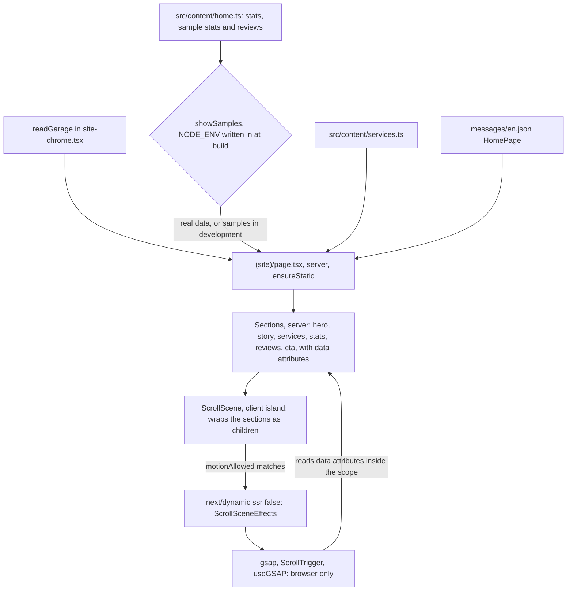
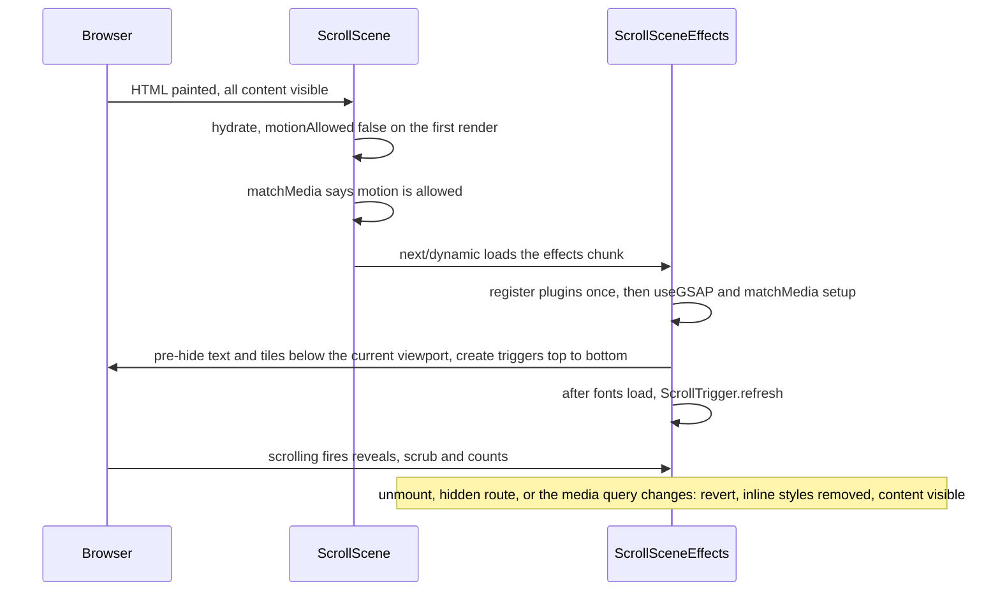

# Home Page - Plan

## Goal Capsule

- **Objective:** A car or two-wheeler owner near Kiwale opens the site on their phone. On the first screen they see what the garage does and where it is, and they can book or call with one tap. They scroll through a calm page that moves smoothly but never hides content and never shows made-up numbers or reviews on the live site.
- **Means:** server-rendered sections, plus one client island per page that loads GSAP lazily. The story section uses a sticky (pinned) visual. Placeholder stats and reviews exist only under `next dev` (KTD1–KTD13).
- **Authority:** the order is:
  1. The owner's decisions (Key Decisions below, 2026-10-27).
  2. `document/website/features.md` ("Design direction") and `design-system/go-mechanic/MASTER.md`.
  3. The master plan's task 13 row (see origin) and the task 13 steps in `document/task/task.md`.
  4. This plan.

  `CLAUDE.md` governs the workflow, languages, design-system, dev-page and SEO rules. These lessons in `document/solutions/` apply:
  - read the bundled Next.js docs (and use `loading="eager"`, never `priority`, for the hero photo);
  - test guards against the shapes real code uses;
  - only document output you actually ran;
  - watch the plan file, not a `claude -p` child.
- **Execution profile:**
  - U1's content gate and number formatting are written test-first.
  - Components get `renderWithIntl` tests.
  - Motion is proven in Playwright, on a production build (`npm run test:e2e`) and under `next dev` (`npm run test:design`), using KTD13's clock rules.
  - The first build runs early in U4, before the sections are built out (Risks).
- **Stop conditions:** stop and ask the owner when:
  - keeping `/` fully prerendered (`○ /en`) would mean dropping a requirement;
  - GSAP can't be kept out of server rendering (KTD2), or the story can't work without ScrollTrigger's `pin` (KTD4);
  - a step would show sample stats or sample reviews in a production build;
  - a shadcn component needs more than class changes;
  - a step would install something globally, run `npx playwright install`, approve an npm install script, or use paid 21st.dev generation;
  - the owner has not done the look check (U7). No push or pull request before it.
- **Who finishes:** the main session on branch `13_home_page`. Commit on that branch and stop. The push and the pull request happen only at `CLAUDE.md` Task workflow step 11, after the owner says so.

---

## Product Contract

### Summary

Replace the placeholder home page with the real one. It has a hero that names the service and the place, a "how it works" story whose vehicle visual stays in view and scales as you scroll, a bento grid of the eleven services, and a final call to action. Trust stats with counting numbers and a reviews preview are built now. Until the owner gives real numbers (stats) and task 37 ships real reviews, they render only under `npm run dev`, marked as samples. Motion comes from GSAP and ScrollTrigger, loaded only for visitors who allow motion. Without that motion, every word is still on the page.

### Problem Frame

Today `/` shows one heading and the line "Our new website is on its way". Visitors who search for car or bike service in Kiwale find nothing that tells them what the garage fixes, how a visit works, or why to trust it. The site shell from task 12 gives them the phone number, WhatsApp and hours, but the page itself is empty.

The owner asked for an Apple-like site with smooth scroll animation (features.md, "Design direction"). Most visitors use Android phones on 4G, so motion must not cost speed: the page must stay prebuilt, steady while it loads, and light on JavaScript. The owner also has no real photos, numbers or reviews yet. The master plan planned labelled placeholders on the live site. On 2026-10-27 the owner narrowed that: nothing made up may reach customers.

### Key Decisions

- **Trust stats are samples that show only under `next dev` until the owner gives real numbers.** (session-settled: user-directed — chosen over the master plan's labelled placeholder stats on the live site: made-up numbers must never reach customers.) Governs R6.
- **Sample reviews follow the same rule until task 37.** (session-settled: user-directed — chosen over the master plan's "sample reviews marked as samples" on the live site: same reason.) Governs R7.
- **No stock photos.** Neutral placeholder visuals, with slots for real photos later. (session-settled: user-directed — chosen over stock photos: they would pretend to be the garage.) Governs R8.
- **The services grid shows the usual eleven services with no prices and no links** (owner, 2026-10-27). Prices arrive in task 18, and the service pages don't exist yet. The names are the owner's (features.md item 4), so, unlike the master plan's "labelled placeholder", they carry no sample mark. The one-line summaries, and which vehicles each service covers, are drafts the owner confirms at the look check. Governs R4.
- **"Book" opens WhatsApp with the booking message until `/book` exists** (owner, 2026-10-27, task 12). Governs R3.
- **The `h1` says the service and the area.** People search for "car service Kiwale", not the brand (SEO check in task 12; task 13 step). Governs R1.

### Requirements

**The page**

- R1. The page has exactly one `h1`: "Car and bike service in Kiwale, Pune". The line under it names cars, two-wheelers and Mukai Chowk.
- R2. The sections come in this order, each with one idea and its own `h2`: hero, how it works, services, trust stats, reviews, final call to action. Neighbouring sections never share a tone, the grey footer included, with or without the two sample sections.
- R3. The hero and the final call to action each offer one blue "Book a service" (`bookTarget()`) and a secondary Call (`tel:`). From 768px, Call also shows the formatted number, because `tel:` does nothing on most desktops. No link leads to a page that isn't live.
- R4. The services grid lists the eleven services the owner named. Each has a one-line summary and says whether it's for cars, two-wheelers or both. No prices, no links.
- R5. The story explains, in three or four steps, how a visit works today. It promises nothing the garage or site doesn't offer yet: no pickup, online tracking, online estimates, online payment, warranty or parts claims.

**Placeholder content**

- R6. Trust stats (years in business, vehicles serviced, Google rating, warranty) render only under `next dev`, each marked "Sample". A production build has no stats section, and its HTML, page data and JavaScript files contain none of the sample values or labels. Once real numbers are set, they show in every build, without the mark. Years in business is a number the owner gives, never worked out from today's date.
- R7. Sample reviews render only under `next dev`, each marked as a sample and credited to no real-looking person. A production build has no reviews section and none of their text.
- R8. Visuals are neutral line illustrations of a car and a two-wheeler, not photos. Each visual slot can take a real photo later, with alt text from messages. The hero photo loads eagerly.

**Motion**

- R9. When the device allows motion:
  - content below the fold fades and rises in;
  - service tiles reveal in a stagger;
  - on large screens (KTD4), the story's vehicle stays in view and scales while the steps scroll past;
  - numbers count up.

  Only transform and opacity animate, with timings from `@/lib/motion`.
- R10. All content is in the server HTML. It is visible without JavaScript, before JavaScript runs, and with reduced motion, when nothing moves. Content waiting to animate stays readable by screen readers and findable with find-in-page. Links and buttons are never hidden, so a keyboard user never focuses something invisible.
- R11. Phones (below 768px) get simpler motion: no sticky story, no scroll-linked scaling, and shorter reveals. Reveal triggers account for the sticky header and the phone bar.
- R12. A counting number has its final value in the HTML. Screen readers hear only that final value, and nothing is announced while it counts. Counting never moves the text around it. With reduced motion, the final value just shows.

**Speed and quality**

- R13. `/` stays fully prerendered (`○ /en`). CLS stays below 0.01 while the page loads and while it is scrolled from top to bottom, on a 375px phone and a 1440px desktop. The page never scrolls sideways.
- R14. GSAP downloads only on pages that use the scroll scene, after the page has loaded, and never for visitors with reduced motion. Other pages' JavaScript does not grow.
- R15. All UI text is in `messages/en.json`, and content text is `LocalizedText`. The browser still gets only the `OpenStatus` messages.
- R16. New shared components have samples on `/dev/design`. Before the pull request, the owner approves the look and the draft copy from screenshots of both what `next dev` shows and what production ships.

### Success Criteria

- On a 375px phone, the `h1`, the line under it and both buttons are visible on first load, above the phone bar.
- The owner approves the look and the copy from screenshots at 375, 768, 1024 and 1440px, with motion and with reduced motion, under `next dev` and in production. The copy covers the story steps, the service summaries, and the hero and call-to-action lines.

### Scope Boundaries

- The home page only. No new pages, no database, no prices, no real reviews or rating, no photos.
- Page metadata stays as task 12 left it, except that the description no longer says "on its way" (Assumption A9). Title, canonical URL, social image and JSON-LD are task 42.
- Considered and not built:
  - **ScrollTrigger `pin`:** see KTD4.
  - **SplitText or letter-by-letter headings:** splitting breaks joined Devanagari letters once Hindi ships, and adds DOM. Revisit only if the owner asks for letter animation in English only.
  - **ScrollSmoother or any smooth-scroll library:** it takes over native scrolling, which fights the sticky header, the phone bar and scroll padding.
  - **A guard against animations replaying when a visitor comes back to the page:** replaying is harmless (KTD2).
  - **`overflow-x: clip` on the story band:** not needed, because the visual never scales above its natural size (KTD4). Revisit if a later design scales anything up.
  - **A bundle-size budget test:** the `window.gsapVersions` check in U6 proves GSAP stays off pages and visitors that shouldn't get it. Revisit when a second page uses the scroll scene.
  - **An "All services" link gated by `isLivePage`, built now:** task 18 adds it with the page.

#### Deferred to Follow-Up Work

- **Owner:** real trust numbers go into `src/content/home.ts` (`trustStats`). Real photos go into `src/assets/`, passed to the visual slots, with alt text added to messages.
- **Task 17:** if the owner names the brands served, consider a brands row on the home page.
- **Task 18:**
  - the services grid reads the database;
  - each tile links to its `/services/[slug]` page;
  - the hero gets "See prices" and the grid an "All services" link, once those pages are live;
  - add an e2e test that navigates from home to a service and back: no console errors, nothing left hidden.
- **Task 37:**
  - the reviews preview reads real reviews, and the sample reviews are deleted;
  - decide the rating stat's one source: the owner's Google rating or the site's own average (Open Questions).
- **Task 42:** the home page's title and description name Kiwale, Pune; AutoRepair JSON-LD; a social image.

### Open Questions

None of these blocks the work. Each has a default, and the owner answers them at the U7 look check.

- **Production has no trust section until real numbers arrive. Should a short row of facts that are true by construction stand in?** Examples: "Cars and two-wheelers", "Open 6 days, 10 am to 7 pm", "Pay at the garage", read from `garage.ts`. Default: no row, because the owner asked only for the stats rule. Show the production screenshots so the gap is visible.
- **Which services cover two-wheelers?** AC and insurance claim help are the unclear ones. Default: cars only for AC; both for everything else. The owner corrects it.
- **Is "Google rating" a number the owner copies in, or task 37's average of site reviews?** Two ratings that disagree would confuse visitors. Default: dev sample only now; task 37 picks one source.

---

## Planning Contract

### Key Technical Decisions

- KTD1. **Server sections and one client island per page.**
  - The page and its sections are Server Components. A section component never imports GSAP.
  - `ScrollScene`, a small `"use client"` island, wraps all the sections. Server Components passed to a client component as `children` stay on the server (`node_modules/next/dist/docs/01-app/01-getting-started/05-server-and-client-components.md`).
  - Page-only sections live in `src/app/[locale]/(site)/_components/`. Reusable pieces go in `src/components/site/`: tasks 18, 19 and 37 will reuse the tiles, cards and illustrations.
  - `page.tsx` reads the garage through `readGarage()` (as both 404 pages do), builds `bookTarget()`, reads the home content and passes everything down as props.
- KTD2. **GSAP loads lazily, on the client only, and only for visitors who allow motion.**
  - `ScrollScene` is a client component, so it may use `next/dynamic` with `ssr: false`; Server Components may not (`node_modules/next/dist/docs/01-app/02-guides/lazy-loading.md`).
  - It watches `motionAllowed` with `useSyncExternalStore`. On the server, and when `matchMedia` doesn't exist, the answer is false.
  - Only while that is true does it render `ScrollSceneEffects`, so the chunk isn't even requested otherwise. If the setting switches to "allow" mid-visit, the effects mount then.
  - The effects component renders nothing and gets no children, because `ssr: false` leaves its output out of the HTML.
  - Why lazy: GSAP calls `Date.now()` when it is imported (`node_modules/gsap/gsap-core.js:1269-1272`, `node_modules/gsap/ScrollTrigger.js:49`), and `Date.now()` during a prerender stops the page being built ahead of time. Lazy loading also keeps about 117 KB of minified GSAP and ScrollTrigger off the first load, and off reduced-motion visitors entirely.
  - The effects module registers `useGSAP` and ScrollTrigger once, at its top level.
  - It runs `useGSAP` with `ScrollScene`'s ref as the scope, and puts everything inside `gsap.matchMedia()` with three conditions: `motionAllowed`, `motionReduced` and the story query (KTD4).
  - It calls `ScrollTrigger.refresh()` once after `document.fonts.ready`.
  - ScrollTrigger is the only plugin used (see Scope Boundaries for the others).
  - Leaving the page: `useGSAP` reverts everything on unmount. With Cache Components, a page you navigate away from is hidden, not removed, and its effects are cleaned up when it is hidden and run again when it shows (`node_modules/next/dist/docs/01-app/03-api-reference/05-config/01-next-config-js/cacheComponents.md`, `node_modules/next/dist/docs/01-app/02-guides/preserving-ui-state.md`). So nothing keeps running on a hidden page, and reveals simply set themselves up again when the visitor comes back.
- KTD3. **Animations are chosen by data attributes.**
  - Server markup marks elements with data attributes. The names live in one plain module that both the sections and the effects import.
  - The effects look the elements up inside the scope only.
  - This keeps animation code out of the sections, and lets a later page reuse `ScrollScene` without new client code.
- KTD4. **The pinned story uses CSS `position: sticky` plus a scroll-linked scale, not ScrollTrigger's `pin`.**
  - The story becomes two columns at one query: `(min-width: 64rem) and (min-height: 40rem)`. Tablets, short laptop windows and landscape phones keep the stack. The string is exported from `@/lib/motion` as the story query, and mirrored by a Tailwind custom variant in `globals.css`; `motion.test.ts` keeps the two equal.
  - In the two-column layout, the visual column is `sticky` at `top-(--header-height)`, at most `--stage-height` tall (KTD12), and the steps scroll past beside it.
  - A scrubbed tween scales only the visual's inner wrapper, from a little smaller up to its natural size, never above it. So it never overflows sideways.
  - The layout is the same with and without JavaScript. There's no pin-spacer, so nothing shifts when GSAP starts, and no DOM that React owns gets moved. Reduced motion keeps the sticky layout with no scaling.
  - Each step has a numbered marker whose rail fills (a transform) as the step passes. Step text is never dimmed, so it always meets contrast.
- KTD5. **The reveal rules.**
  - Reveal targets are headings, text, tiles and visuals. A target never contains a link or a button: keyboard focus could land on it while it is invisible, and the scroll padding may stop the browser short of the trigger.
  - When the effects start, only targets entirely below the viewport, measured at the current scroll position, are pre-hidden (opacity 0 and a small `y`). Everything on or above the screen, the hero included, never animates on load (`node_modules/next/dist/docs/01-app/02-guides/preventing-flash-before-hydration.md`). That also covers a page whose scroll position was restored.
  - Targets animate in with `ScrollTrigger.batch` and `once: true`, using `opacity`, never `autoAlpha`, `visibility` or `display`. So hidden text stays in the accessibility tree and in find-in-page. Inline styles are cleared when the reveal ends.
  - Jumping past a target still fires `onEnter`, because ScrollTrigger's `limitCallbacks` is off by default (`node_modules/gsap/ScrollTrigger.js:1768-1778`).
  - On phones, `start` is a function that measures the phone bar in pixels, so a reveal begins once the target clears the bar.
  - A `@media print` rule forces reveal targets visible.
  - Distances and stagger come from a new GSAP-only `distance` entry in `@/lib/motion`.
- KTD6. **Counting numbers.**
  - The server renders the final value with a new `formatNumber` in `src/i18n/format.ts` (en-IN grouping, so 123456 is "1,23,456").
  - Two copies of the value share one grid cell:
    - the animated copy is `aria-hidden`;
    - the final copy sits at opacity 0. It is what screen readers read, and it fixes the width, so counting never moves its neighbours.
  - There is no `aria-live`.
  - The effects tween a plain number from 0 to the final value, writing it with the same formatter on each update. The count runs once, on entering view, and only when motion is allowed.
  - Text around the number ("+", "/5", "months") comes from messages. Only the digits change.
  - The rating counts with one decimal. Warranty is shown, not counted.
- KTD7. **Samples are gated at build time.**
  - `src/content/home.ts` holds `trustStats`, which is real or `null` (today `null`), plus separate `sampleTrustStats` and `sampleReviews`. Selectors return the real data, else the samples when `showSamples()` is true, else `null`.
  - `showSamples()` lives in its own `src/lib/samples.ts`: `NODE_ENV === "development"`. It is never tied to `devOnly()`, whose comment invites showing dev pages on staging; staging must never show samples.
  - The build writes `NODE_ENV` into the code (`node_modules/next/dist/build/define-env.js`), so reading it keeps the page static, and a production prerender never renders a sample.
  - Sample values and texts live only in that server module, imported only by Server Components. Only labels ("Sample", headings) go in messages. Sample text never names the brand (`brand-name.test.ts`).
  - A section whose data is `null` renders nothing. Each sample item renders `data-sample` and a visible "Sample" badge.
- KTD8. **The services are typed content.**
  - `src/content/services.ts` lists the eleven services in display order. Each has an id, a `LocalizedText` name and summary, and the vehicle kinds it covers. That mirrors task 18's services table, so task 18 only swaps the reader.
  - The tile component maps service ids to icons (lucide: `wrench`, `snowflake`, `spray-can`, `battery-charging`, `circle-dot`, `disc-3`, `cog`, `engine`, `zap`, `sparkles`, `shield-check`).
  - The bento grid has twelve cells: periodic service is a double-width tile from 768px, and the other ten are single. Rows fill evenly at 4, 3 and 2 columns.
  - Tiles aren't links, so they get no hover lift or arrow.
- KTD9. **Visual slots.**
  - `VehicleIllustration` is an inline SVG Server Component: a car and a two-wheeler in line art, `currentColor`, `aria-hidden`, with no network request.
  - `VisualSlot` sits in a fixed aspect-ratio box. With a photo (a static import, which gives width, height and a blur placeholder automatically) it renders `next/image` with `fill` and `sizes`. Without one, it renders the illustration.
  - The hero's slot passes `loading="eager"` and `fetchPriority="high"`, per `document/solutions/conventions/nextjs-16-read-bundled-docs-image-priority.md`.
  - Today every slot gets `null`.
- KTD10. **The home page sets `ensureStatic = 'navigation'`.** `next dev` and `next build` then fail if the page, or a layout above it, stops being fully static (`node_modules/next/dist/docs/01-app/03-api-reference/03-file-conventions/02-route-segment-config/ensureStatic.md`). It's the cheapest guard for R13. Task 15's login slot was already planned as a client island, so this guard doesn't change it.
- KTD11. **One server-only `HomePage` namespace.**
  - It has nested groups: hero, story, services, stats, reviews, cta and sample. `HomePage.title` stays the `h1` key, so the existing smoke tests keep reading it.
  - `ScrollScene` gets no text, so `clientNamespaces` stays `["OpenStatus"]`.
  - `Metadata.description` gets new copy.
- KTD12. **A `--stage-height` token in `globals.css`.**
  - It is the visible screen below the header, `100svh` minus `--header-height`. Below 768px it also subtracts `--action-bar-height`, as `MASTER.md` promised for task 13.
  - The sticky story visual and the large-screen hero's minimum height use it.
  - `svh` doesn't change when a phone's address bar hides. ScrollTrigger already ignores those resizes on touch screens (`node_modules/gsap/ScrollTrigger.js:2038`).
- KTD13. **How each part is tested, and the test clock.**
  - Pure functions get unit tests.
  - Components get `renderWithIntl` tests. jsdom has no `matchMedia`, so the effects never load in unit tests.
  - Motion is tested in Playwright.
  - **The clock:** `page.clock.setFixedTime` freezes `Date.now`, and GSAP times its tweens with `Date.now`, so under a fixed clock no reveal ever finishes. The existing `openAt` (`e2e/layout-shell.spec.ts`) and `open` (`e2e/dev/shell-preview.spec.ts`) helpers fix the clock, for the open status.
    - Screenshots and content checks on `/` run with `reducedMotion: "reduce"`: GSAP never loads, and the page is at rest.
    - Motion checks never fix the clock.
    - Visibility checks read the computed `opacity`, because Playwright's `toBeVisible()` counts opacity 0 as visible.
  - "Was GSAP downloaded?" is answered by `window.gsapVersions`, which GSAP sets when it starts (`node_modules/gsap/gsap-core.js:1329`).
  - The guard that only the effects module imports GSAP is a Vitest scan of `src/`, like `client-messages.test.ts`, not an ESLint rule. A second `no-restricted-imports` block would replace the existing one's options, not add to them (`document/solutions/conventions/lint-guards-test-real-jsx-shapes.md`, point 5).

### High-Level Technical Design

How data and code reach the page:



What each visitor gets. "Large" means the story query: `(min-width: 64rem) and (min-height: 40rem)`.

| Visitor | GSAP downloaded | Below-fold reveals | Tile stagger | Sticky story and scale | Count-up | Hero |
| --- | --- | --- | --- | --- | --- | --- |
| JavaScript off | No | No, all visible | No | Sticky on large screens, no scale | Final value | Static |
| Reduced motion | No | No, all visible | No | Sticky on large screens, no scale | Final value | Static |
| Motion, below 768px | Yes, after load | Short distance | No | No, stacked | Yes | Static |
| Motion, 768px up but not large | Yes, after load | Yes | Yes | No, stacked | Yes | Static |
| Motion, large | Yes, after load | Yes | Yes | Yes, scrubbed scale | Yes | Static |

The effects' lifecycle:



### Output Structure

```text
src/
  content/home.ts, services.ts                (+ tests)
  lib/samples.ts                              (showSamples, + test)
  lib/motion.ts                               (+ distance, story query)
  i18n/format.ts                              (+ formatNumber)
  components/site/
    scroll-scene.tsx                          ("use client" island)
    scroll-scene-effects.tsx                  ("use client", lazy, the only GSAP importer)
    scroll-scene-attributes.ts                (data-attribute names)
    vehicle-illustration.tsx, visual-slot.tsx
    service-tile.tsx, stat-tile.tsx, review-card.tsx, sample-badge.tsx
  app/[locale]/(site)/
    page.tsx                                  (rewritten)
    _components/home-hero.tsx, home-story.tsx, home-services.tsx,
                home-stats.tsx, home-reviews.tsx, home-cta.tsx
e2e/home.spec.ts
e2e/dev/home-preview.spec.ts
```

### Assumptions

These are the planner's own calls. Scoping confirmation was skipped, so the owner hasn't confirmed them. Each is cheap to change at the U7 look check.

- A1. The tones are: hero white, story dark, services grey, stats white, reviews grey, call to action white, then the grey footer. In production, without the two sample sections, that's white, dark, grey, white, grey.
- A2. The story has four steps, describing today's real flow:
  1. Book on WhatsApp or call.
  2. Bring your vehicle to Mukai Chowk.
  3. We check it and tell you the price before any work starts.
  4. Collect it and pay at the garage.

  The step copy and the service summaries are drafts for the owner.
- A3. The hero's second action is Call. "See prices" waits for task 18.
- A4. The final call to action shows no hours or open status, because the footer right below it does.
- A5. The `h1` uses "bike", the word people search for. The lead line says "two-wheeler".
- A6. Sample reviews are credited "Sample customer" plus a vehicle type, never a person's name.
- A7. Real photos will be static imports from `src/assets/`. Each photo's alt text joins messages with the photo, not before.
- A8. Years in business and the warranty are numbers the owner will give. The samples use round, obviously invented values.
- A9. The `Metadata.description` copy is refreshed in this task. Everything else about metadata waits for task 42.
- A10. There is no internal link from the home page to another page today, so leaving and coming back is tested in task 18.
- A11. Reveals move up to about 24px on large screens and 12px on phones, and counts last about twice `duration.reveal`. Final values go in `@/lib/motion`.

### Risks and Dependencies

| Risk | Mitigation |
| --- | --- |
| `next/dynamic` with `ssr: false`, or `ensureStatic`, behaves differently in a build than the docs suggest. The docs don't say whether `generateStaticParams` in the `[locale]` layout is enough for the page. | Build early in U4, before the sections are fleshed out. If the bailout fails validation, swap `next/dynamic` for a plain `import()` in an effect, with a cancelled flag. If `ensureStatic` needs page-level params, add `generateStaticParams` to the page. Drop `ensureStatic` only as a last resort, and keep the `x-nextjs-prerender` e2e check either way. |
| A fixed test clock freezes GSAP, so screenshots show blank sections while tests stay green. | KTD13's clock rules, plus U5's change to the existing home screenshots. |
| Scroll restoration after a hidden page comes back can pre-hide something already on screen, so it flashes once. | Mostly prevented, because pre-hiding is measured at the current scroll position (KTD5). Any leftover is cosmetic, and the content ends visible. |
| An ancestor with `overflow: hidden` would quietly break `sticky`. None exists today (`globals.css`, `Section`, `main`). | The e2e check in U6 confirms the visual stays in view mid-story at 1440px. |
| Scrubbing can stutter on slow Android phones. | There's no scrubbing below the story query. |
| Draft copy can make claims about the garage. | R5, plus owner approval at U7. |
| The SEO Stop hook fires during building. | Expected. Run `seo-reviewer` in the foreground when it asks (`CLAUDE.md`, "SEO review"). |

### System-Wide Impact

- `src/content/` gains a second reader: the home page reads `home.ts` and `services.ts`. The garage is still read only through `readGarage()`, now called by the home page too. The "only `site-chrome.tsx` reads them" wording in `CLAUDE.md` and `MASTER.md` changes.
- New repo rules for `CLAUDE.md`:
  - sample content shows only through `showSamples()`;
  - only `scroll-scene-effects.tsx` and dev pages import GSAP;
  - `ensureStatic` on the home page means any request-time read added to the `(site)` layout fails the build;
  - Playwright tests of animated pages never fix the clock while motion is on (KTD13).

---

## Implementation Units

### U1. Home content, the sample gate and number formatting

- **Goal:** typed content for stats, reviews and services, with samples that can't reach a production build.
- **Requirements:** R4, R6, R7, R12, R15.
- **Dependencies:** none.
- **Files:**
  - create `src/content/home.ts`, `src/content/home.test.ts`, `src/content/services.ts`, `src/content/services.test.ts`, `src/lib/samples.ts`, `src/lib/samples.test.ts`;
  - modify `src/i18n/format.ts`, `src/i18n/format.test.ts`.
- **Approach:**
  1. `home.ts` follows KTD7. The stat ids are `years`, `vehicles`, `rating` and `warranty`, each with a value, its decimals and whether it counts (KTD6). A sample review has a vehicle type, a rating from 1 to 5 and `LocalizedText`.
  2. Include one distinctive canary phrase in a sample review, so U6 can search for it.
  3. `services.ts` follows KTD8, with the owner's eleven services in the order the owner listed them.
  4. Add `formatNumber(value, locale, decimals)` to `format.ts` (KTD6) and `showSamples()` to `samples.ts` (KTD7).
- **Execution note:** write the selector and `showSamples()` tests first.
- **Patterns to follow:** `src/content/offer.ts` (real-or-nothing), `src/content/garage.ts` (`satisfies`), `src/lib/dev-only.test.ts` (`vi.stubEnv`).
- **Test scenarios:**
  - `showSamples()` is false with `NODE_ENV` "production", false with "test", and true with "development".
  - With `trustStats` null, the stats selector returns the samples in development and `null` in production. The same holds for the reviews selector.
  - Given real stats (passed in), the selector returns them in production and in development.
  - Every sample stat and sample review has a value the UI can show: rating 1 to 5, and English text that isn't empty.
  - `services.ts` has eleven unique ids, and each service has an English name, an English summary and at least one vehicle kind.
  - `formatNumber(5000, "en", 0)` is "5,000". `formatNumber(4.8, "en", 1)` is "4.8". 123456 is "1,23,456". A non-finite input throws `RangeError`, like `formatRupees`.
- **Verification:** `npm run check` passes, and the selectors can't return samples outside development.

### U2. Shared building blocks

- **Goal:** the Server Components the home sections are made of, reusable by tasks 18, 19 and 37.
- **Requirements:** R4, R6, R7, R8, R12, R15.
- **Dependencies:** U1.
- **Files:**
  - create in `src/components/site/`: `vehicle-illustration.tsx`, `visual-slot.tsx`, `service-tile.tsx`, `stat-tile.tsx`, `review-card.tsx`, `sample-badge.tsx`, plus `vehicle-illustration.test.tsx`, `visual-slot.test.tsx`, `service-tile.test.tsx`, `stat-tile.test.tsx`, `review-card.test.tsx`;
  - modify `messages/en.json` (the `HomePage.sample`, `HomePage.services.vehicles` and `HomePage.reviews.rating` keys these use).
- **Approach:**
  - `VehicleIllustration` and `VisualSlot` follow KTD9.
  - `ServiceTile`: a flat `Card`-style tile with an icon, `type-title` name, `type-callout` summary and the vehicle kinds. It is not a link.
  - `StatTile`: the label in `dt` and the value in `dd`, built as KTD6 describes (two copies in one grid cell), with the count attributes from KTD3 only when the stat counts.
  - `ReviewCard`: stars as `aria-hidden` icons plus "Rated 5 out of 5" for screen readers, the review text in a `blockquote`, and the credit.
  - `SampleBadge`: the existing `Badge` with the "Sample" text from messages.
  - `StatTile` and `ReviewCard` add `data-sample` and the badge when given `sample`.
  - Tokens only, `type-*` sizes only, `tabular-nums` on numbers.
- **Patterns to follow:** `src/components/site/not-found-content.tsx` (props in, `titleAs`), `src/components/site/opening-hours-list.tsx`, `src/components/ui/card.tsx`.
- **Test scenarios:**
  - `VisualSlot` with no photo renders the illustration with `aria-hidden` and no `img`. Given a photo, it renders an `img` with the alt text passed in (if `next/image` doesn't render in jsdom, move this check to U6 and note it).
  - `ServiceTile` shows the localized name and summary, and "Cars and two-wheelers" for both kinds. It renders no link.
  - `StatTile` for 5000 vehicles shows "5,000+". The animated copy is `aria-hidden`. The final copy reads "5,000+" and isn't `aria-hidden`. There's no `aria-live` anywhere in the tile.
  - A warranty `StatTile` has no count attribute. The rating tile counts with one decimal.
  - `StatTile` and `ReviewCard` with `sample` show the "Sample" badge and `data-sample`. Without `sample`, neither appears.
  - `ReviewCard` with a rating of 4 has screen-reader text "Rated 4 out of 5", and its five star icons are `aria-hidden`.
- **Verification:** `npm run check` passes, including the stock-text-size and no-literal lint rules on the new files.

### U3. The scroll scene island and its lazy effects

- **Goal:** one reusable island that brings scroll motion to server markup, as KTD2 to KTD6 describe.
- **Requirements:** R9, R10, R11, R12, R13, R14.
- **Dependencies:** none (U2's count attributes use its attribute module).
- **Files:**
  - create `src/components/site/scroll-scene.tsx`, `src/components/site/scroll-scene-effects.tsx`, `src/components/site/scroll-scene-attributes.ts`, `src/components/site/scroll-scene.test.tsx`, `src/lib/gsap-imports.test.ts`;
  - modify `src/lib/motion.ts` (`distance`, the story query), `src/lib/motion.test.ts`, `src/app/globals.css` (`--stage-height` from KTD12, the story variant from KTD4, the print rule from KTD5).
- **Approach:**
  1. `scroll-scene-attributes.ts` exports the attribute names: reveal, reveal group, count, story, story visual, story step.
  2. `ScrollScene` renders a `div` scope around `children` and lazily mounts the effects (KTD2).
  3. The effects build, in page order: reveals (KTD5), the tile stagger, the story's scrubbed scale and step rails (story query only, KTD4), and counts (KTD6). Each uses function-based `start`/`end` that measure the header and phone bar in pixels.
  4. `gsap-imports.test.ts` fails when any file under `src/` other than `scroll-scene-effects.tsx` and `src/app/*/dev/**` imports `gsap`, `gsap/*` or `@gsap/react`.
- **Patterns to follow:** `src/app/[locale]/dev/design/_components/motion-demo.tsx` (`useGSAP` scope, `matchMedia` with `motionAllowed`/`motionReduced`); `src/components/site/open-status.tsx` (`useSyncExternalStore` with a server snapshot); `src/i18n/client-messages.test.ts` (scanning code).
- **Test scenarios:**
  - `ScrollScene` renders its children inside one wrapper, and the text is present.
  - With no `window.matchMedia` (jsdom), the effects module is never imported. Mock it and assert it's never rendered.
  - With `matchMedia` stubbed to reduced motion, the effects module is never imported.
  - With `matchMedia` stubbed to motion allowed, the effects component mounts once, with the scope element.
  - `gsap-imports.test.ts` finds today's allowed importers. It fails for a made-up file that imports `gsap` in `src/components/site/`, and passes for the same import in a dev page path.
  - `motion.test.ts`: the new `distance` values are positive numbers, the story query in `motion.ts` equals the one in `globals.css`, and the existing CSS/GSAP equality checks still pass.
- **Verification:** `npm run check` passes. Motion behaviour is proven in U5 and U6, since jsdom can't run it.

### U4. Home sections and the page

- **Goal:** the real home page, in the order and tones of R2, prerendered.
- **Requirements:** R1, R2, R3, R4, R5, R6, R7, R8, R9, R10, R11, R13, R15.
- **Dependencies:** U1, U2, U3.
- **Files:**
  - create `src/app/[locale]/(site)/_components/home-hero.tsx`, `home-story.tsx`, `home-services.tsx`, `home-stats.tsx`, `home-reviews.tsx`, `home-cta.tsx`;
  - modify `src/app/[locale]/(site)/page.tsx`, `src/app/[locale]/(site)/page.test.tsx`, `messages/en.json` (the `HomePage` groups and `Metadata.description`; remove `HomePage.tagline`), `src/components/site/site-chrome.test.tsx` (only if it relies on the old copy).
- **Approach:**
  1. Write `page.tsx` first with `ensureStatic` (KTD10) and a bare hero inside `ScrollScene`. Run a production build: the output must list `○ /en` (Risks).
  2. Each section is a `Section` with `aria-labelledby` set to its `h2` id. `wide` width for the grids, `content` width for the story text.
  3. **Hero:** the `h1` (R1), the lead, Book (blue) and Call (secondary, showing the number from 768px), and a `VisualSlot` with `null`. On large screens, its minimum height is `--stage-height`.
  4. **Story:** KTD4 markup on the dark tone, with the steps from A2 in an ordered list.
  5. **Services:** the bento grid from U1's list (KTD8).
  6. **Stats and reviews:** render nothing when their selector returns `null` (KTD7).
  7. **Call to action:** a `h2`, one line, Book and Call.
  8. Book and Call reuse the `Button asChild` + `WhatsAppLink` / `tel:` patterns, and sit outside every reveal target (KTD5).
- **Execution note:** build before the sections are fleshed out (step 1), so a prerender or `ensureStatic` problem shows up while the page is small.
- **Patterns to follow:** `src/components/site/not-found-content.tsx` (buttons), `src/components/site/site-header.tsx` (`bookTarget` with `WhatsAppLink`), `src/components/site/site-footer.tsx` (`formatPhoneNumber`), `src/app/[locale]/dev/design/page.tsx` (dark showcase band).
- **Test scenarios:**
  - The page has exactly one `h1`, with the text of `HomePage.title`, which contains "Kiwale, Pune".
  - The section headings appear in the R2 order. With `NODE_ENV` "test", there are no stats or reviews headings and no `[data-sample]` elements.
  - With `NODE_ENV` stubbed to "development", the stats and reviews sections render, and every stat and review carries `data-sample` and the badge.
  - The hero and the call to action each have exactly one Book link. While `/book` isn't live, it opens WhatsApp with `Contact.bookingMessage`, in a new tab. Each also has a Call link to `tel:+919764750567`, whose text includes "+91 97647 50567".
  - All eleven service names render, and no link inside the services section exists.
  - No `a` or `button` sits inside a reveal target.
  - No `a[href]` on the page points to a page whose `live` flag is false.
  - `HomePage` no longer contains the "on its way" copy, and neither does `Metadata.description`.
- **Verification:** `npm run check` passes. `npm run build` lists `○ /en` and passes `ensureStatic` validation. Under `npm run dev`, the page shows the labelled samples.

### U5. `/dev/design` samples and the dev look-check spec

- **Goal:** the living catalogue covers the new shared pieces, and the owner gets screenshots of the home page as `next dev` shows it.
- **Requirements:** R6, R7, R9, R12, R16.
- **Dependencies:** U2, U3, U4.
- **Files:**
  - modify `src/app/[locale]/dev/design/page.tsx`: a "Page blocks" section with illustrations on white, grey and dark; a visual slot; one wide and one normal service tile; a stat tile; a review card; the sample badge; a small `ScrollScene` demo; and the `distance` row in Motion;
  - modify `e2e/dev/design-preview.spec.ts`, and `e2e/dev/shell-preview.spec.ts`, whose home screenshots switch to `reducedMotion: "reduce"` (KTD13);
  - create `e2e/dev/home-preview.spec.ts`.
- **Approach:** follow `e2e/dev/shell-preview.spec.ts`: Inter forced, the dev badge hidden, screen-only screenshots saved to `test-results/design/screenshots/home-*.png` at 375, 768, 1024 and 1440px.
  - Take one set with reduced motion and the fixed clock, scrolled section by section, so the screenshots are repeatable.
  - Take one set with motion allowed and no fixed clock, mid-story at 1440px, after the scrub settles.
- **Patterns to follow:** `e2e/dev/shell-preview.spec.ts`, `e2e/dev/design-preview.spec.ts` (motion demo with `reducedMotion`, no fixed clock), `e2e/dev/warm-up.ts` (`/` is already warmed).
- **Test scenarios:**
  - Under `next dev`, the stats and reviews sections are visible, and every sample stat and review shows the "Sample" badge.
  - With motion allowed, a stat scrolled into view ends showing exactly its final text. Its final copy (the one screen readers read) holds that text throughout.
  - With reduced motion, `window.gsapVersions` is undefined after the network goes idle, and every stat shows its final value without scrolling.
  - With motion allowed at 1440 by 900, scrolled to the middle of the story, the story visual's box stays below the header and inside the viewport. Its computed scale is above the start value and at most 1. The page doesn't scroll sideways.
  - `/dev/design`: the new samples render, no console errors appear, and no page scrolls sideways at 375px.
- **Verification:** `npm run test:design` passes, and the screenshots exist for U7.

### U6. End-to-end tests on a production build

- **Goal:** prove R6, R7, R10, R13 and R14 where they matter: the built site. Also give the owner screenshots of what ships.
- **Requirements:** R1, R2, R3, R6, R7, R10, R11, R13, R14, R16.
- **Dependencies:** U4.
- **Files:** create `e2e/home.spec.ts`. Modify `e2e/smoke.spec.ts` and `e2e/i18n.spec.ts` only if the new `h1` copy needs it (both already read `messages.HomePage.title`).
- **Approach:**
  - Reuse `watchErrors`, the CLS observer and `rscPayload` from `e2e/layout-shell.spec.ts` (copy them, or extract them into an `e2e/helpers.ts`).
  - Content checks use reduced motion and may fix the clock. Motion checks don't fix the clock (KTD13).
  - Run at 375px touch and 1440px.
  - Save production screenshots at 375 and 1440px (reduced motion, section by section) to `test-results/home/` for U7.
- **Test scenarios:**
  - `/` answers 200 with one `h1` equal to `HomePage.title`. The story, services and call-to-action headings are visible.
  - There are no `[data-sample]` elements and no stats or reviews heading. Neither the HTML nor the RSC payload contains the sample canary or the `HomePage.stats` labels.
  - None of the JavaScript files the page loads (each `script[src]`, fetched) contains the canary.
  - The hero's Book link opens WhatsApp with the booking message (`target="_blank"`). Call dials `tel:+919764750567`. At 375px, both buttons sit above the phone bar on first load.
  - With JavaScript disabled, every section heading and all eleven service names have computed opacity 1.
  - With reduced motion, after load and after scrolling to the bottom, every reveal target has opacity 1 and no transform. `window.gsapVersions` is undefined.
  - With motion allowed (no fixed clock):
    - after load, `window.gsapVersions` is defined;
    - after jumping straight to the bottom, every reveal target reaches opacity 1 within a few seconds;
    - pressing Tab until the final call to action's Book link is focused, the link and its section heading have opacity 1.
  - With motion allowed, scrolling from top to bottom in steps keeps CLS below 0.01 at 375px and at 1440px, and the page never scrolls sideways. So does load (same observer as `layout-shell.spec.ts`).
  - No console or page errors on load or after a full scroll, at both sizes.
  - On `/this-page-does-not-exist`, `window.gsapVersions` is undefined: other pages don't load GSAP.
  - The home page is still prerendered. The existing `i18n.spec.ts` header check stays green.
- **Verification:** `npm run test:e2e` passes in full, and the production screenshots exist for U7.

### U7. Docs and the owner's look check

- **Goal:** the repo's rules and trackers describe the new patterns, and the owner approves the page before the pull request.
- **Requirements:** R16, and the documentation for every KTD that adds a rule.
- **Dependencies:** U5, U6.
- **Files:** modify `design-system/go-mechanic/MASTER.md`, `CLAUDE.md`, `document/website/features.md`, `document/task/task.md`.
- **Approach:**
  - **`MASTER.md`:** a "Page blocks and scroll motion" section covering:
    - the `ScrollScene` attributes and when to use each;
    - the reveal rules (KTD5);
    - the sticky story pattern and its query (KTD4);
    - accessible counting (KTD6);
    - visual slots;
    - the "Sample" badge;
    - the `--stage-height` row under "Site shell tokens";
    - the `distance` row under "Motion".
  - **`CLAUDE.md`:**
    - repo map rows for `src/content/home.ts` and `services.ts` and their reader, `src/lib/samples.ts`, `(site)/_components/`, and the new `site/` pieces;
    - the System-Wide Impact rules as convention bullets.
  - **`features.md`:** the Home item says the stats and reviews appear once they are real.
  - **`task.md`:**
    - task 13: link this plan, refresh its steps, and record the owner's decisions of 2026-10-27;
    - add the follow-ups from "Deferred to Follow-Up Work" to tasks 17, 18, 37 and 42, and to the backlog (real numbers, photos).
  - **Look check:**
    - show the owner both screenshot sets: dev (U5) and production (U6), with motion and with reduced motion;
    - show the draft copy (A2, the service summaries) and ask the Open Questions;
    - apply the changes they ask for, re-run the affected specs, and record their verdict in `task.md`.
- **Test expectation:** none. Documentation, plus the owner's review.
- **Verification:** the owner has approved the look and the copy, in their own words, before any push. The docs don't contradict the code (`globals.css` and `motion.ts` win).

---

## Verification Contract

| Gate | Command or check | When |
| --- | --- | --- |
| Lint, types, unit tests | `npm run check` | After every unit; before every commit called done |
| Prerender and the static guard | `npm run build`: the output lists `○ /en`, and `ensureStatic` passes | U4 step 1, then again after U4 |
| Production behaviour and screenshots | `npm run test:e2e` | U6, and before the pull request |
| Dev catalogue and screenshots | `npm run test:design` (screenshots in `test-results/design/screenshots/`) | U5, and after look-check changes |
| SEO | `seo-reviewer` in the foreground when the Stop hook asks | During U2 to U4 |
| Review | `ce-code-review`, then the `code-reviewer` agent | Before the learning doc's review section (`CLAUDE.md` step 9) |
| Owner | Look check from both screenshot sets (U7) | Before the push and the pull request |

---

## Definition of Done

- U1 to U7 are each done by their own Verification line.
- Under `npm run dev`, the page shows labelled samples. A production build shows none: U6 passes, including the JavaScript scan.
- `/` is `○ /en`. CLS stays below 0.01 on load and during a full scroll, with no sideways scroll. GSAP never loads under reduced motion or on other pages.
- The owner approved the look and the copy (U7).
- `CLAUDE.md`'s Definition of Done holds:
  - learning doc `document/learning/13_home_page.md`;
  - reviews, with every "must fix" fixed;
  - the compound question asked;
  - `task.md` ticked, except "Merge".
- Cleanup: no abandoned experiments, debug markers (`markers: true`), stray `console` calls or unused messages are left in the diff.

---

## Sources and Research

- **Next.js 16.4.3 bundled docs:**
  - `node_modules/next/dist/docs/01-app/03-api-reference/03-file-conventions/02-route-segment-config/ensureStatic.md` (KTD10);
  - `01-app/02-guides/lazy-loading.md` (`ssr: false` only in client components; it leaves its output out of the HTML);
  - `01-app/02-guides/preserving-ui-state.md` and `01-app/03-api-reference/05-config/01-next-config-js/cacheComponents.md` (hidden routes, effects cleaned up);
  - `01-app/02-guides/environment-variables.md` and `node_modules/next/dist/build/define-env.js` (`NODE_ENV` written in at build time);
  - `01-app/02-guides/preventing-flash-before-hydration.md` (don't hide what's on screen);
  - `01-app/03-api-reference/02-components/image.md` (`loading="eager"`, `fetchPriority`, static imports, `fill` + `sizes`);
  - `01-app/02-guides/building.md` (the `○` legend).
- **GSAP 3.15.0 source:**
  - `node_modules/gsap/gsap-core.js:1269-1272` (`Date.now()` on import, and the ticker's clock) and `:1329` (`gsapVersions`);
  - `node_modules/gsap/ScrollTrigger.js:1768-1778` (a jump past still fires `onEnter`) and `:2038` (mobile resize ignored on touch).
- **GSAP skills (read-only):** `.claude/skills/gsap-react` (`useGSAP`, scope, cleanup), `gsap-scrolltrigger` (create triggers top to bottom, `batch`, `refresh` after fonts), `gsap-core` (`matchMedia`, `immediateRender`), `gsap-performance` (transforms, scrub cost), `gsap-plugins` (every plugin is free; ScrollTrigger is the only one needed).
- **Repo:**
  - `src/components/site/site-chrome.tsx` (`readGarage`), `navigation.ts` (`bookTarget`, `live`), `open-status.tsx`, `src/content/offer.ts`;
  - `src/lib/dev-only.ts` (and why `showSamples()` stays separate), `src/lib/motion.ts`, `src/app/[locale]/dev/design/_components/motion-demo.tsx`;
  - `e2e/layout-shell.spec.ts` (CLS observer, `rscPayload`, `watchErrors`, `openAt` with a fixed clock), `e2e/dev/shell-preview.spec.ts` (`open` with a fixed clock, home screenshots), `e2e/i18n.spec.ts` (prerender header);
  - `document/plans/2026-10-26-1937-feat-layout-shell-plan.md` (KTD1: open status in the browser).
- **Lessons:** all files in `document/solutions/conventions/` and `document/solutions/workflow-issues/`.
