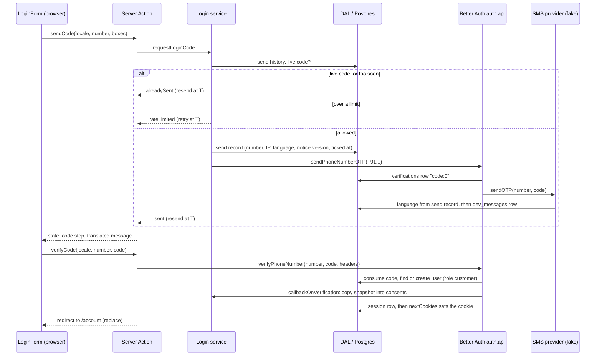
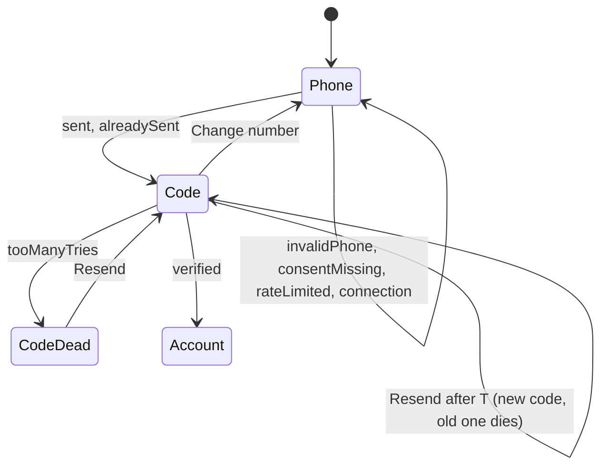
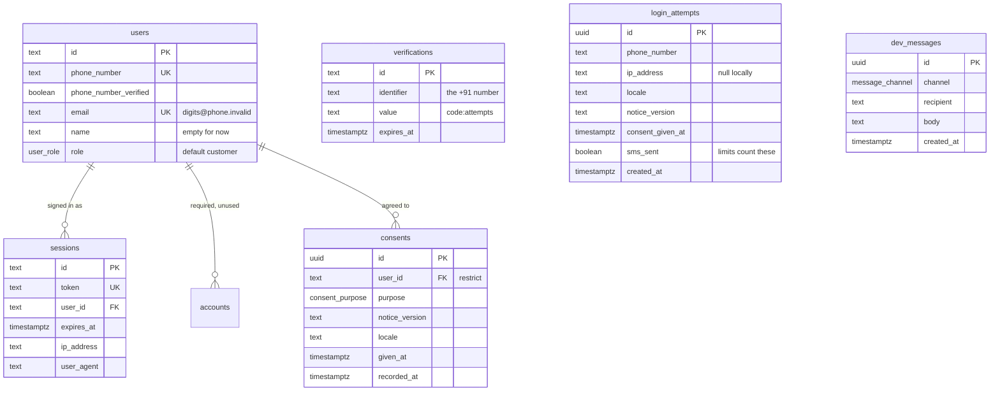

# Mobile OTP Login - Plan

## Goal Capsule

- **Objective:** A customer with an Indian mobile number can log in to the garage's site with a 6-digit SMS code (no password), see which number they are signed in with, and log out. Their 18+ declaration and consent are on record with the notice version they saw. Every public page stays prebuilt, and nobody can trigger a code SMS without passing the login form's checks.
- **Means:** Better Auth's phone-number plugin over our Drizzle database, called only from Server Actions (KTD2, KTD3). SMS goes through a provider interface whose only provider for now is a fake that writes to `dev_messages` (KTD5).
- **Authority:**
  1. The master plan (see origin): Architecture (Auth, SMS providers, `env.ts` refusing fakes in production), Data model, Cache Components rules, Risks ("OTP abuse and SMS bills", "spike Better Auth in 15 and pin versions").
  2. The task 15 steps in `document/task/task.md`, as reworded by U11.
  3. `CLAUDE.md`: workflow, Database, Languages, Design system, site shell, Secrets and dev-only rules.
  4. This plan.

  These lessons in `document/solutions/` apply:
  - `conventions/nextjs-16-catch-only-expected-request-api-errors.md` names task 15: `unstable_rethrow` first, then catch only the expected Better Auth error, and pass the locale into every action;
  - `conventions/nextjs-16-dev-server-is-not-one-process-use-cache-probe.md`: auth and the fake provider reach the database only through `getDatabase()`;
  - `conventions/nextjs-16-read-bundled-docs-image-priority.md`: check every Next.js API used here in `node_modules/next/dist/docs/`;
  - `conventions/lint-guards-test-real-jsx-shapes.md`: prove each new guard (the 404 check, the env refusals, the notice-version pin) by watching it fail;
  - `conventions/run-commands-before-documenting-output.md`: the learning doc shows only real output.
- **Execution profile:**
  - U1 is a spike. It proves Better Auth's phone OTP works on our in-memory PGlite before anything else is built on it.
  - U2, U3 and U5 are written test-first. Database tests run on in-memory PGlite in Vitest's node project.
  - Pages (U7–U9) follow the existing component-test and `/dev/design` patterns.
  - Full `npm run check`, `npm run test:e2e` and `npm run test:design` runs come at the end (U10). When the SEO Stop hook asks, run `seo-reviewer` in the foreground.
- **Stop conditions:** stop and ask the owner when:
  - installing `better-auth@1.7.14` needs an install-script approval, fails with ERESOLVE, or leaves two copies of `drizzle-orm`;
  - Better Auth's schema check rejects the hand-written tables in a way only its `fields`/`modelName` renames would fix;
  - `nextCookies()` cannot set or clear the session cookie from a Server Action in Next.js 16.4.3;
  - `/` stops building as `○ /en`, or the browser messages on `/` change;
  - a step would expose Better Auth over HTTP (a Route Handler or a browser client), contradicting R11;
  - a step needs a global install, a cloud account, real SMS, or `npx playwright install`.
- **Who finishes:** the main session on branch `15_auth_otp_login`. Commit there and stop. The push and the pull request happen only at `CLAUDE.md` Task workflow step 11, after the owner says so.

## Review changes (2026-10-28, main session)

ce-plan's document review was cut off: its run hung after the plan was written (the known hang, `document/solutions/workflow-issues/ce-plan-child-session-hangs-use-idle-watcher.md`) while two of its six reviewers (feasibility, adversarial) hadn't reported and its findings weren't folded in. The main session applied the findings the run had printed (C1, C2), and a separate feasibility, security and adversarial review (a subagent that read Better Auth 1.7.14's published files and the bundled Next.js 16.4.3 docs and source) supplied the rest. **Where this section and the text below disagree, this section wins.** The main contradictions below were also fixed in place.

- **C1. Resend sends a new code.** `decideSend` takes an intent: `start` (the phone step) or `resend` (the code step's button).
  - `start`: a usable live code gives `alreadySent`, with no SMS.
  - `resend`: once 30 s have passed since the last send, a new code goes out even while the old one is live. Better Auth's verify reads the newest row and deletes every row for the number, so the old code dies.
  - Both intents give the new outcome `tooSoon` (retry at T) inside 30 s of the last send when there is no usable code. Example: a send, then 4 quick wrong tries. The form stays where it is and shows the countdown.
- **C2. Nothing logs a number, a code or a token (R13).** Drizzle's query errors and Better Auth's `logger.error("INTERNAL_SERVER_ERROR", error)` (`getSession`, `signOut`) carry bound parameters: phone numbers, codes, session tokens.
  - Better Auth gets a `logger` whose `log` writes only the level and the message, never the extra arguments.
  - The login service, the session read and the actions call `unstable_rethrow` first, then turn any unexpected error into a new `Error` with a fixed message naming the step, the error's `name` and its Postgres `code` (SQLSTATE) only. It has no `cause`, as `postgresClient` does (task 14).
  - A test checks that `util.inspect` of such an error holds no number, code or token.
- **C3. Consent travels with a login attempt, and fails closed (R12, KTD8).** Every phone-step submit that passes the number and box checks writes one `login_attempts` row: the renamed send record. It holds a random `id`, the number, the IP, the language, the notice version, the moment the boxes were ticked, and `sms_sent` (true only when an SMS went out). This happens even when the answer is `alreadySent` or `tooSoon`.
  - The form keeps the attempt id in a hidden field.
  - Resend posts it, and its new row copies the consent fields from that attempt (same number, or refused).
  - Verify posts it too. The callback copies exactly that attempt's snapshot into `consents`, after checking the attempt's number. A missing or mismatched attempt throws, so no session is created.
  - The limits (R10) count only rows with `sms_sent`.
- **C4. Limits can't be beaten by a burst.** Deciding and writing the attempt happen in one transaction that first takes `pg_advisory_xact_lock` on the number, and on the IP when there is one. The SMS is sent after the commit, outside the transaction: a query made while the transaction holds PGlite's only connection would wait forever. Test: 10 parallel requests for one number produce exactly 5 SMS.
- **C5. A "usable live code" means unexpired and with tries left.**
  - Better Auth stores `code:attempts` and re-creates the row as `code:3` after the third wrong try. It deletes the row only on the fourth call, which answers `TOO_MANY_ATTEMPTS`.
  - The DAL's `readLiveCode(number)` parses that value and returns `{ expiresAt, triesLeft }` or null. U1's spike pins the format with a test.
  - After a wrong code, verify re-reads the row: no tries left gives `tooManyTries` at once (R4).
- **C6. A failed SMS doesn't block the number.** Better Auth stores the code before it calls `sendOTP`. If the send throws, `requestLoginCode` deletes that number's `verifications` rows through the DAL, marks the attempt `sms_sent = false`, and rethrows (C2). Test: a failing provider, then a retry sends.
- **C7. The form's wrapper doesn't swallow the login.** A successful verify redirects, and the browser receives that as a rejected action call. The `LoginForm` wrapper calls `unstable_rethrow(error)` from `next/navigation` first, and only then maps a rejection to `connection`. A unit test covers both.
- **C8. Log out works without JavaScript.** The log-out `<form>` sits in the static part of `/account`, outside `<Suspense>`: streamed content needs JavaScript to appear. Only the number is read inside Suspense.
- **C9. Smaller changes.**
  - Sessions: the global `session.disableSessionRefresh: true` (30 days, never extended).
  - The client IP: `x-vercel-forwarded-for` first, then the first `x-forwarded-for` value. IPv6 addresses are limited per /64.
  - `dev_messages` rows are purged after 48 hours too.
  - e2e specs read only outbox lines sent after the test started, since the file outlives runs.
  - The schema check compares the Drizzle schema object (missing tables or columns, required columns Better Auth never writes), not the database: U1's run on migrated PGlite guards the migration.
  - `signOut` clears the cookie even if deleting the session row fails; the learning doc says so.
- **C10. Accepted, with the reason written down.**
  - **Production can't build or start until task 44.** `serverEnv()` refuses the fake SMS provider when `APP_ENV=production`, and every page reads `serverEnv()` through `readGarage()`. That's the master plan's intent: production launches in task 46, after the real providers.
  - **A victim's number can be locked out for up to a day.** Someone sends codes to it and burns its tries. Until task 44 (Turnstile, a per-IP cap on verify calls, tuned limits) the garage can't reset the limit. The "call the garage" line is for booking by phone, not for unlocking.

Owner answers (2026-10-28), all the defaults: no header entry until task 21; the consent wording in Open Question 2 as drafted; logins last 30 days; both boxes at every login.

---

## Product Contract

### Summary

Customers log in at `/login` with their mobile number and a 6-digit code sent by SMS. Before a code is sent they confirm they are 18 or older and agree to a short privacy notice; both are recorded against their account. A minimal `/account` page shows the signed-in number and a log-out button. Until real SMS arrives (task 44), codes go to a fake sender that stores them in the database, and a development page, `/dev/outbox`, shows them. Sending and checking codes is limited per number and per connection, and only the login form can do either.

### Problem Frame

The master plan's customer features (bookings in 23, tracking in 25, estimates later) need to know who the customer is. Features list item 11 sets the rules: mobile number plus OTP, +91 only, no passwords, 18+ and consent checkboxes. The DPDP Act also means the garage must be able to show what each person agreed to and when (feature 33; withdrawal comes in task 43).

Three constraints shape it. First, OTP SMS costs money and attracts abuse (SMS pumping, bombing a victim's phone), so limits and a single guarded entry point have to exist from the start, even while the sender is fake. Second, public pages are prebuilt: the home page sets `ensureStatic = "navigation"`, which rejects any server-side cookie or header read anywhere in its route, layouts included. Third, the owner is learning and tests often on a phone under `npm run dev`, so the fake SMS must be easy to read and the setup easy to explain.

### Requirements

**Logging in**

- R1. `/login` sits outside the site shell, is `noindex`, and has a prerendered shell. It asks for a 10-digit Indian mobile number after a fixed "+91". It accepts what people type (spaces, dashes, a leading 0, 91 or +91, Devanagari digits) and rejects anything that is not an Indian mobile (+91, starting 6–9) with a field error.
- R2. The phone step shows two required checkboxes to every visitor at every login: "I am 18 or older" and agreement to the privacy notice summarised on the page. If either is unticked, the visitor gets a field error and no SMS is sent.
- R3. A code is 6 digits, works for 5 minutes and allows 3 wrong tries. If the number already has a code sent less than 5 minutes ago that is still usable (unexpired, tries left), the phone step moves to the code step without sending another SMS. "Send a new code" becomes available 30 seconds after the last send and then sends a new code, which kills the old one; the server decides that moment (C1).
- R4. The code step names the number the code went to, accepts a pasted code with spaces, and supports SMS autofill. A wrong, expired or already-used code gets one message that says to check the latest SMS or ask for a new code. Too many tries says to ask for a new code. "Change number" returns to the phone step.
- R5. A correct code signs the visitor in. A new number gets an account with role `customer` on its first correct code. The session cookie is set and the browser replaces the login page with `/account`.
- R6. A signed-in visitor who opens `/login` is sent to `/account`.
- R7. Every word people read, including errors and the SMS text, comes from `messages/en.json` in the request's language. The brand name is never typed into code.

**Account**

- R8. `/account` sits inside the site shell and is `noindex`. It shows the signed-in number as "+91 98765 43210" and a "Log out" button that works without JavaScript (its form sits outside `<Suspense>`, C8). A signed-out visitor is sent to `/login`.
- R9. Log out ends this session (its database row and its cookie) and lands on the home page.

**Abuse limits and privacy**

- R10. Code sends are limited to 5 per number per hour and 10 per number per day. Staging and production also allow at most 30 per client IP per hour. Limits and messages are the same for numbers with and without an account, and no message reveals whether a number has an account.
- R11. Only the login form's Server Actions can send or check a code. No Better Auth HTTP endpoint or browser client exists, and a POST to Better Auth's paths answers 404.
- R12. Before a session is created, every signed-in user holds a consent record for each of the two purposes at the current notice version. Each record holds the user, the purpose, the notice version, the language, and the moment the box was ticked. If the record can't be written, no session is created.
- R13. No code, no full phone number and no session token is ever written to a log (C2). Login attempts (number, IP) and `dev_messages` rows are deleted after 48 hours.

**Fake SMS and the outbox**

- R14. SMS goes through a provider interface in `src/server/providers/sms/`. Its only provider is a fake that stores each message in `dev_messages`. Production (`APP_ENV=production`) refuses to start with the fake; staging and local allow it.
- R15. `/dev/outbox` lists stored messages newest first, fresh on every load, readable on a 375 px phone. It exists only under `npm run dev`: anywhere else it is a 404 with `noindex`.

**Settings**

- R16. `BETTER_AUTH_SECRET` is read through `serverEnv()`. Staging and production require it. Locally a fixed placeholder is used. It must be at least 32 characters, its value is never printed, it is listed in `.env.example`, and it never carries `NEXT_PUBLIC_`.

**Continuity**

- R17. `/` still builds as `○ /en`, its browser messages are still only `OpenStatus`, and the existing unit, e2e and design suites pass with their current expectations. No auth, database or provider code reaches the browser's files.
- R18. The docs explain the login for a junior engineer: `CLAUDE.md` (repo map, conventions, settings), `readme.md`, `task.md` follow-ups and the learning doc.

### Key Decisions

- **Consent boxes for everyone, at every login.** Showing them only to new numbers would reveal which numbers have accounts. Governs R2, R10, R12.
- **The notice is summarised on `/login` and versioned until task 19's privacy page exists.** Linking a page that 404s is worse than a short inline notice; the version records which text each person saw. Governs R2, R12.
- **The phone step reuses a live code.** A reload, a second tab or Android discarding the tab while the visitor reads the SMS would otherwise kill the code they are holding. Governs R3.
- **`/account` lives inside the site shell.** It is a customer page, not a tool like `/dev/design`; later account pages (tasks 21, 25) keep the header, footer and phone bar. Governs R8.
- **Log out lands on the home page.** `/login` has no shell, so landing there strands the visitor with only a Wordmark link. Governs R9.

### Success Criteria

- Under `npm run dev`, the owner logs in from a phone: `/login`, the code read on `/dev/outbox`, `/account`, then log out, in under a minute.
- The production e2e suite signs a fresh number in end to end and logs it out, and `npm run build` still lists `○ /en`.

### Scope Boundaries

- Login, logout, a minimal `/account`, the fake SMS sender with `/dev/outbox`, consent records and send limits. Nothing else in the account area.
- No role checks, `requireUser`/`requireRole`, proxy redirects or owner bootstrap (task 16). No profile or vehicles (21). No privacy or terms pages (19). No real SMS, Turnstile or tuned limits (44). No consent withdrawal, data export or deletion (43).
- No header "Log in"/"Account" entry in this task (Open Question 1). The phone bar's behaviour while a field has focus doesn't arise yet: `/login` has no shell and `/account` has no fields (task 23).
- Considered and not built:
  - **Better Auth's Route Handler, browser client and built-in rate limiter.** The limiter and its origin check run only inside its HTTP router and key on IP plus path. The handler would let anyone call send-OTP past the consent check and our limits (KTD2). Revisit only if a feature needs Better Auth over HTTP.
  - **A separate limiter on wrong codes.** Guesses are already bounded by 3 tries per code times the send limits in R10: at most 30 a day per number. Revisit in task 44 if real-SMS traffic shows guessing.
  - **A site-wide daily SMS cap.** It only matters once SMS costs money (task 44).
  - **shadcn's Checkbox and InputOTP.** The Radix checkbox can't be ticked before JavaScript loads and is 16 px. Six separate code boxes break paste, autofill and screen readers.
  - **`'use cache: private'` for the session read.** Under `next dev` it serves a stale result while refreshing, and a minimal `/account` gains nothing from it.
  - **A real 307 from `/account` to `/login`.** Inside `<Suspense>` the redirect happens on the client with status 200. Task 16's proxy check gives the real redirect.
  - **Revoking a different user's session when a new number verifies.** `/login` already sends signed-in visitors away (R6). Revisit in task 23, where inline OTP on a shared phone makes it likely.
  - **Hashing codes or numbers in Better Auth's `verifications` table.** The plugin stores the code in plain text for 5 minutes by design, and its identifier hashing would only hash the number and make debugging harder.
  - **A login that works with JavaScript turned off.** The form is a client island. Slow JavaScript is covered (submits queue until hydration), and a `<noscript>` line offers the garage's phone number.
  - **A test-only HTTP endpoint or a fixed test code for e2e.** Either would be a backdoor if it were ever switched on in a deployment (KTD10 instead).
  - **`BETTER_AUTH_URL`.** Nothing reads it without a Route Handler or client, and the secure-cookie choice is set explicitly (KTD3). Task 20 or 42 adds a site URL when one is needed.
  - **IP address or user agent in consent records.** Data minimisation: the IP lives only in the 48-hour send record.

#### Deferred to Follow-Up Work

- **Task 16:** `requireUser`/`requireRole` built on `getCurrentUser()`; proxy redirects (`/account` signed out to `/login` with a real 307, signed-in `/login` to `/account`); a way to make the owner's number `owner` (everyone signs up as `customer`); `saveGarage` checks the role.
- **Task 19:** the privacy and terms pages. Link the notice on `/login` to `/privacy` and bump the notice version in the same commit.
- **Task 20:** set `BETTER_AUTH_SECRET` on Vercel; confirm which header carries the client IP there; decide how staging testers read fake codes (today `/dev/outbox` is a 404 on any production build) without exposing codes publicly.
- **Task 21:** the header "Log in"/"Account" entry once `/account` has content, as a static link or a browser island (never a server read: `ensureStatic`), with `prefetch={false}`; name on the profile; recycled numbers (carriers reassign unused numbers, so a new SIM owner inherits the account).
- **Task 23:** `/book`'s inline OTP reuses the login service, the consent snapshot and the e2e outbox file; decide the phone bar while a field has focus; revoke the old session when a different number verifies.
- **Task 35:** reuse `dev_messages` and the provider pattern for WhatsApp and email; `notify()` respects the consent purposes.
- **Task 42:** the WebOTP line (`@domain #code`) in the SMS once the domain is known.
- **Task 43:** consent withdrawal and history; what deleting a user does to its consent records (U1 makes that delete fail until 43 decides); mention session IP and user agent in the notice.
- **Task 44:** the MSG91 provider (`SMS_PROVIDER=msg91`) and its DLT template, Turnstile on the phone step, tuned limits, a daily SMS cap, closing the small race where two simultaneous sends both pass the limit check, a provider-failure message, and sending through Better Auth's background-task hook.

### Open Questions

**Answered by the owner on 2026-10-28: the defaults below for 1, 2, 4 and 6.** 3 and 5 keep their defaults.

1. **Header entry now or later?** Default: later, task 21 (Scope Boundaries). An account page that shows only a number gives visitors little reason to sign up and share data.
2. **Consent wording and what it covers.** Default draft, in `messages/en.json`:
   - "I am 18 or older."
   - "I agree that {brand} can use my mobile number to log me in and to contact me by SMS, WhatsApp or phone about my bookings."
   - Notice summary: "We keep your mobile number and when you agreed. We use it only to log you in and to tell you about your bookings. To stop this or delete your data, call the garage." Reminders and offers get their own opt-in later (tasks 35, 43).
3. **Code rules.** Default: R3 and R10 as written, all in one rules object for task 44 to tune.
4. **How long a login lasts.** Default: 30 days, not extended by visits (KTD3). Better Auth's own default is 7 days.
5. **Where log out lands.** Default: the home page (Key Decisions).
6. **Returning customers tick both boxes again at every login.** Default: yes (Key Decisions). A pre-ticked box would not count as consent.

---

## Planning Contract

### Key Technical Decisions

- KTD1. **Pin `better-auth@1.7.14`, and nothing else.** `npm view` confirms its peers accept next 16.4.3, react 19.3.0, drizzle-orm 0.45.4 and vitest 5, all optional. It brings zod 4 (the repo already has 4.6.7 transitively) and kysely. No install scripts were found in its tree, and telemetry is off by default (set `telemetry: { enabled: false }` anyway).
  - Imports: the adapter from `better-auth/adapters/drizzle` (a re-export of `@better-auth/drizzle-adapter`), `phoneNumber` from `better-auth/plugins`, `nextCookies` from `better-auth/next-js`.
  - No CLI. `@better-auth/cli` is deprecated, and the `auth` CLI loads the config outside Next.js, where `server-only` and the async `getDatabase()` break it. The tables are hand-written (KTD4).
  - After installing, re-read in `node_modules`: the phone plugin's `routes.mjs` (the `code:attempts` value, the verify order, `createUser`); the rate limiter in `api/index.mjs`, called only from the router; the adapter's lookup by property key; the `nextCookies` after-hook in `integrations/next-js.mjs`; `npm ls drizzle-orm` showing one copy.
- KTD2. **Server Actions are the only way in (R11).** No Route Handler, no `toNextJsHandler`, no browser client. Direct `auth.api.*` calls skip Better Auth's rate limiter and origin check: both run only in its HTTP router. So a handler would be an unguarded send-OTP endpoint. Next.js's own Origin-against-Host check protects the actions (`node_modules/next/dist/docs/01-app/02-guides/server-actions.md`, "Security"). Set `rateLimit: { enabled: false }` with a comment saying our limiter (KTD7) is the one that counts.
- KTD3. **One lazily created auth instance per process.** `betterAuth()` is synchronous and does no database work at creation, but it needs the database handle, and `getDatabase()` is async.
  - `createAuth(dependencies)` builds the instance from the database, the settings and the SMS provider; tests call it directly. `getAuth()` memoises it on `globalThis` next to the database, forgets a rejected attempt, and is typed with `ReturnType<typeof createAuth>`. A change to the auth config needs a dev-server restart (documented).
  - Phone plugin: the R3 numbers (`otpLength`, `expiresIn`, `allowedAttempts`); `phoneNumberValidator` set to `isIndianMobileNumber`; `signUpOnVerification` with a placeholder email `<digits>@phone.invalid` (the `.invalid` domain is reserved and never delivers) and an empty name; `callbackOnVerification` for consents (KTD8); `sendOTP` hands the code to the SMS provider and is awaited, so a provider failure fails the send.
  - `user.additionalFields.role`: `input: false`, default `customer`. Anything a caller sends for `role` is ignored on create and refused on update.
  - Sessions: `expiresIn` 30 days (Open Question 4). Server Components read the session with `disableRefresh`, because they can't write cookies: a refresh there would move the database expiry but not the cookie's.
  - Cookies: `advanced.useSecureCookies` is true on staging and production and false locally. Left unset, a production build on `http://localhost:3210` would get a `__Secure-` cookie. Otherwise Better Auth's defaults: `httpOnly`, `SameSite=Lax`, signed value, no cookie cache (every read checks the database).
  - Plugins in order: `phoneNumber`, then `nextCookies` last.
- KTD4. **Hand-written tables in `src/server/db/schema.ts`, one migration (`auth_login`).**
  - The adapter finds a table by its key in the `schema` object and a column by its Drizzle property key. So the property keys are Better Auth's field names (`emailVerified`, `expiresAt`) and the SQL names are snake_case (`email_verified`), as the repo already does. Pass `schema: { user: users, session: sessions, account: accounts, verification: verifications }`. The SQL tables are `users`, `sessions`, `accounts` and `verifications`, which avoids Postgres's reserved word `user`.
  - Don't use Better Auth's `fields` or `modelName` renames. Its runtime schema check, on in every environment, compares property keys and throws on any drift. The first `auth.api` call in U1's test is the guard.
  - Times are `timestamp with time zone`. `updatedAt` gets `defaultNow()` plus an on-update `new Date()`. Ids on Better Auth's tables are `text`; Better Auth generates them. Our own tables use `uuid` with a random default (`gen_random_uuid()` exists in PGlite's Postgres 17).
  - `role` is a `user_role` pgEnum, mirrored from `ROLES` in `src/domain/roles.ts` with a test, as `weekday` is today. `accounts` is required by Better Auth even though phone login never writes to it.
  - Our tables (the diagram below has the columns):
    - `consents`: unique on (user, purpose, notice version). Its foreign key to `users` is `restrict`, so deleting a user can't silently erase proof of consent; task 43 decides what deletion does.
    - `login_attempts`: the send record, indexed by number and time, and by IP and time.
    - `dev_messages`: a `message_channel` enum (`sms`, `whatsapp`, `email`), so task 35 can reuse it.
- KTD5. **The SMS provider pattern.**
  - `src/server/providers/sms/` holds the `SmsProvider` interface (`send({ to, text })`), the fake, and `smsProvider()`, which picks one from `serverEnv().smsProvider`.
  - The fake stores the message through the DAL (`saveDevMessage` in `src/server/dal/dev-messages.ts`). Queries stay in `src/server/dal/` (`CLAUDE.md`). When `E2E_OUTBOX_FILE` is set, the fake also appends one JSON line per message to that file (KTD10).
  - The SMS text comes from `Sms.loginCode` in `messages/en.json`, with the brand read from `Brand.name`, in the language stored on the send record (KTD7). Better Auth hands `sendOTP` only the number and the code, so the send record is where the language travels.
- KTD6. **New settings in `serverEnv()`** (`src/server/env.ts`), each with problem codes rather than sentences:
  - `BETTER_AUTH_SECRET` (R16): required on staging and production, at least 32 characters. Locally a fixed, clearly fake placeholder of at least 32 characters is used, different from Better Auth's built-in default. That default throws whenever `NODE_ENV=production`, which includes `next build`, `npm start` and `test:e2e`.
  - `SMS_PROVIDER`: today only `fake`, which is also the default. Production refuses `fake`, so production can't start until task 44. That is the master plan's intent; staging allows it.
  - `E2E_OUTBOX_FILE`: optional. It is refused unless `APP_ENV` is `local` and `VERCEL` is unset.
  - The `explanations` map is keyed by problem code alone, and today's `unknown` text names `APP_ENV`'s values. So new codes get their own names, or the map moves to per-variable text: the implementer's choice.
- KTD7. **A login service with a pure rules core.**
  - `src/domain/login.ts` holds the rules object (R3, R10 numbers) and `decideSend(history, now)`. It answers "send", "already sent (resend at T)" or "limited (retry at T)" from counts and timestamps, and tests use `fixedClock`.
  - `src/server/auth/login.ts` runs `requestLoginCode` and `verifyLoginCode`:
    - **requestLoginCode:** parse the number, check the boxes, load the history and whether a live code exists, decide, write the send record, then call `auth.api.sendPhoneNumberOTP`.
    - **verifyLoginCode:** call `auth.api.verifyPhoneNumber` with the request headers, and map Better Auth's `APIError` by `body.code` (a string, not `instanceof`).
  - A "usable live code" is an unexpired row in `verifications` for that number with tries left. Better Auth keeps the row after the third wrong try (as `code:3`), so `readLiveCode` parses its value (C5).
  - The client IP is the first `x-forwarded-for` value on staging and production. Locally there is no trustworthy IP, so the IP limit is skipped and parallel e2e tests don't share one "IP".
  - Every successful send record insert first deletes records older than 48 hours (R13).
  - Problem codes (the contract between the service, the actions and the form):

    | Problem | When | What the form does |
    | --- | --- | --- |
    | `invalidPhone` | the number doesn't parse as an Indian mobile | stays on the phone step, field error |
    | `consentMissing` | a box is unticked | stays, error under the boxes |
    | `rateLimited` (retry at T) | an R10 limit is hit | stays, says when to try again and offers the garage's number |
    | `alreadySent` (resend at T) | phone step: a usable live code exists | shows the code step, no error, countdown to T |
    | `tooSoon` (retry at T) | under 30 s since the last send, with no usable code, or Resend before T (C1) | stays on its step, countdown to T |
    | `invalidCode` | the code isn't 6 digits after cleanup | stays on the code step |
    | `wrongCode` | Better Auth's `INVALID_OTP`, `OTP_NOT_FOUND` or `OTP_EXPIRED` | clears and refocuses the field (R4) |
    | `tooManyTries` | Better Auth's `TOO_MANY_ATTEMPTS` | turns Resend on at once (R4) |
    | `connection` | the browser's action call rejects: no network, or an unexpected server error | keeps the step and what was typed |

  - Any other error is not caught. The lesson says catch only what you expect: the server logs it without the code or the number, and the form shows `connection`.
- KTD8. **Consent: snapshot at send, record before the session.** (Changed by C3: the snapshot is the login attempt the form posts back, not the number's latest record, and a missing one fails closed.) The send record carries the notice version, the language and the moment the boxes were submitted. Better Auth's `callbackOnVerification` runs after the code checks out and before it creates the session. There, a DAL call copies the snapshot into `consents`, one row per purpose, and does nothing on conflict. If the write throws, verify throws, no session exists, and the next login writes the missing rows (R12).
  - The purposes (`age_18_plus`, `account_and_booking_contact`) and `LOGIN_NOTICE_VERSION` live in `src/domain/consent.ts`. A test pins the English notice and checkbox text for the current version, so changing the words without bumping the version fails.
- KTD9. **Pages keep a prerendered shell; session reads sit in `<Suspense>`.**
  - `/login` (`src/app/[locale]/login/page.tsx`, outside `(site)`) has the static shell: a slim Wordmark bar like `src/app/[locale]/not-found.tsx`, the heading, the notice and the `LoginForm` island. A small server component inside `<Suspense fallback={null}>` reads the session and redirects a signed-in visitor (R6).
  - `/account` (`src/app/[locale]/(site)/account/page.tsx`) has a static heading and a `<Suspense>` child that reads the session and redirects to `/login` when there is none. The brief asked for this shape. The trade-off: once streaming starts, the redirect is client-side with status 200 (`node_modules/next/dist/docs/01-app/02-guides/streaming.md`, "Status codes"), and task 16's proxy adds a real 307.
  - Metadata for both is static (`robots: { index: false, follow: false }`, titles from messages) and reads no session.
  - `getCurrentUser()` (`src/server/auth/session.ts`) wraps the session read in React `cache()` and returns only `{ id, phoneNumber, role }`.
  - Nothing is added to the `(site)` layout, `SiteChrome` or the root layout. `ensureStatic = "navigation"` on `/` would fail the build.
- KTD10. **Browser tests read codes from a file only a local fake can write.** `test:e2e` runs `next start` with in-memory PGlite, where `/dev/outbox` is a 404, so Playwright needs another way to read the code.
  - `playwright.config.ts` sets `E2E_OUTBOX_FILE` for its web server, and specs read their own number's newest line. Each test uses its own random number, starting `60000`, so parallel tests and reruns never collide.
  - Two guards keep this out of deployments: `serverEnv()` refuses the variable outside local, and production refuses the fake provider altogether.
  - The dev suite (`e2e/dev/`) also checks the human path: a code sent from `/login` shows first on `/dev/outbox`.
- KTD11. **Action files and the form island.**
  - Actions live in `src/server/actions/login.ts`: `"use server"` first, then `import "server-only"`. The repo's "every `src/server/` file starts with `server-only`" rule gets that wording.
  - Each action takes the locale as a bound first argument and checks it with next-intl's `hasLocale`; an unknown locale throws. Actions read messages with `getTranslations({ locale, namespace: "Login" })` and redirect with `redirect({ href, locale }, RedirectType.replace)` from `@/i18n/navigation`, outside any `try`.
  - The `LoginForm` client island gets its fixed labels as props from the server page (the `MobileMenu` pattern). The actions return translated messages. The countdown uses one raw message template with a `{time}` placeholder that the browser fills in. So no `Login` namespace joins `clientNamespaces`, and the home page's browser messages stay `{ OpenStatus }` (`e2e/layout-shell.spec.ts`).
  - Checkboxes are native `<input type="checkbox">` in a new `CheckboxField` (`src/components/site/`), styled with tokens, with the whole label row as a 44 px target. A native box can be ticked before JavaScript loads.

### High-Level Technical Design

Sending and checking a code (R3, R5, R10–R12, KTD2, KTD7, KTD8):

The form's states (R3, R4, KTD7):

New tables (KTD4):

Every table also has `created_at` and, where Better Auth needs it, `updated_at`. `accounts` carries Better Auth's provider columns.

### Assumptions

These are bets the plan makes without the owner's confirmation (scoping confirmation was off):

- The owner accepts that production can't start until task 44, because production refuses the fake SMS provider (R14, KTD6).
- The fixed local secret is safe because `APP_ENV=local` is refused on Vercel (task 14), and Vercel is the only deployment target.
- An attacker can use up a victim's per-number limit by asking for codes, or burn tries, locking the number out for up to a day. Until task 44 nobody can reset it (C10).
- Bursts can't beat the limits: decide and write happen under an advisory lock (C4).
- Better Auth stores the session's IP address and user agent. That's acceptable personal data for security, and task 43's notice mentions it.
- Customers' phones receive 6-digit codes and fill them in with iOS's one-time-code autofill. Android WebOTP waits for the domain (task 42).

### Deferred to Implementation

- Whether Vitest needs `better-auth` in `server.deps.inline` (as `next-intl` is), and whether `next build` needs it in `serverExternalPackages`. Default: neither, until a failure shows it.
- Whether Better Auth's schema check accepts `phone_number` as NOT NULL. Default: NOT NULL, since every account is a phone account; fall back to nullable if the check refuses it.
- How to handle Better Auth's "Base URL is not set" warning if it shows on every start. Pass a fixed local value, or accept one line per process.
- The client wrapper calls `unstable_rethrow` first (C7); the e2e login test proves the redirect still works.
- Where `E2E_OUTBOX_FILE` points. It must be outside `test-results/`, which a filtered Playwright run empties.
- Which strings `e2e/server-boundary.spec.ts` uses as markers for the new code. Pick ones its positive control finds in `.next/server`.
- Exact names of helpers, message keys and test files.

### Risks

| Risk | Mitigation |
| --- | --- |
| A Better Auth upgrade changes how codes are stored or checked; the live-code read and the error mapping depend on it | Exact pin; U1 and U5 integration tests exercise send, verify, expiry and tries against the real plugin |
| Cookie writes fail silently outside Server Actions (`nextCookies` swallows them) | Session reads in Server Components use `disableRefresh` (KTD3); e2e checks the cookie after verify and its absence after log out |
| Someone later reads the session in the shell and breaks the home page build | KTD9 note in `CLAUDE.md`; the existing `/` prerender check in `e2e/i18n.spec.ts` |
| The local placeholder secret ends up on a real deployment | `APP_ENV=local` is refused on Vercel; `serverEnv()` requires a real secret on staging and production (R16) |
| Codes sit in plain text in `verifications` (5 minutes) and in `dev_messages` | Better Auth's design; `dev_messages` is written only by the fake, which production refuses (R14) |
| The dev suite writes test users and messages into the owner's `.pglite/` | Numbers starting `60000` make them easy to spot; `npm run db:reset` clears them |

### Sources and Research

- Better Auth 1.7.14 published source (via unpkg): `dist/plugins/phone-number/{index,routes,schema,error-codes}.mjs`, `dist/api/{index,dispatch}.mjs`, `dist/integrations/next-js.mjs`, `dist/api/routes/session.mjs`, `dist/context/create-context.mjs`; `@better-auth/drizzle-adapter@1.7.14/dist/index.mjs`; `@better-auth/core@1.7.14/dist/db/{get-tables,schema-check}.mjs`. Docs: better-auth.com `plugins/phone-number`, `adapters/drizzle`, `integrations/next`, `concepts/rate-limit` ("Server-side requests made using `auth.api` aren't affected by rate limiting").
- Next.js 16.4.3 bundled docs: `01-app/02-guides/authentication.md` and `authentication-with-cache-components.md` (DAL, Suspense), `02-guides/server-actions.md` and `data-security.md` (Origin check, `server-only` in action files), `03-api-reference/03-file-conventions/02-route-segment-config/ensureStatic.md` (covers layouts, rejects cookies and headers even in Suspense), `02-guides/streaming.md` (status codes), `03-api-reference/04-functions/{redirect,cookies,connection,io}.md`.
- Repo patterns: `src/server/env.ts` (problem codes), `src/server/db/index.ts` (`getDatabase`, `globalThis` memo, helper-process guard), `src/server/dal/garage.ts` and its test (DAL shape, PGlite test setup), `src/lib/dev-only.ts` and `dev-only.test.ts`, `src/components/site/mobile-menu.tsx` (labels as props), `src/app/[locale]/not-found.tsx` (slim Wordmark bar), `src/app/[locale]/dev/design/page.tsx` (dev page, phone field sample), `e2e/server-boundary.spec.ts`, `e2e/layout-shell.spec.ts` (browser messages on `/`), `e2e/dev/design-preview.spec.ts` (44 px rule).

---

## Implementation Units

Phases: foundation (U1–U3), server (U4–U6), pages (U7–U9), proof and docs (U10–U11).

| U-ID | Title | Key files | Depends on |
| --- | --- | --- | --- |
| U1 | Spike: Better Auth phone OTP on our database | `package.json`, `src/server/db/schema.ts`, `src/server/db/migrations/`, `src/server/auth/auth.ts` | – |
| U2 | Settings: secret, SMS provider, e2e outbox file | `src/server/env.ts`, `.env.example` | – |
| U3 | Login rules: number and code parsing, limits, consent version | `src/lib/contact-links.ts`, `src/domain/login.ts`, `src/domain/consent.ts` | U1 |
| U4 | Fake SMS provider and outbox storage | `src/server/providers/sms/`, `src/server/dal/dev-messages.ts` | U1, U2 |
| U5 | Auth instance and login service | `src/server/auth/`, `src/server/dal/login-codes.ts`, `src/server/dal/consents.ts` | U1–U4 |
| U6 | Server Actions | `src/server/actions/login.ts` | U5 |
| U7 | `/login` page, form and checkbox field | `src/app/[locale]/login/`, `src/components/account/login-form.tsx`, `src/components/site/checkbox-field.tsx` | U6 |
| U8 | `/account` page and log out | `src/app/[locale]/(site)/account/`, `src/components/account/` | U6 |
| U9 | `/dev/outbox` | `src/app/[locale]/dev/outbox/page.tsx` | U4 |
| U10 | Browser tests and boundary guards | `e2e/`, `playwright.config.ts` | U7–U9 |
| U11 | Docs and tracker | `CLAUDE.md`, `readme.md`, `document/task/task.md` | U1–U10 |

### U1. Spike: Better Auth phone OTP on our database

**Goal:** Prove that Better Auth's phone-number plugin sends and verifies a code against our in-memory PGlite, with hand-written snake_case tables, before anything else is built.

**Requirements:** R5, R12 (tables), R17

**Dependencies:** none

**Files:**
- `package.json`, `package-lock.json`
- `src/domain/roles.ts` (`ROLES`), `src/domain/consent.ts` (purposes only; U3 adds the rest)
- `src/server/db/schema.ts`
- `src/server/db/migrations/0001_auth_login.sql`, `src/server/db/migrations/meta/`
- `src/server/db/database.test.ts` (enum mirror tests)
- `src/server/auth/auth.ts` (a first `createAuth` with an injected `sendOTP`)
- `src/server/auth/auth.test.ts`

**Approach:**
1. Install `better-auth@1.7.14` exactly. Do the KTD1 re-reads and record what they show for the learning doc.
2. Add the tables and enums from KTD4 to `schema.ts`, keeping its rules (`import type` only, no `server-only`). Generate the migration with `npm run db:generate -- --name=auth_login`.
3. Write the first `createAuth`: Drizzle adapter (`provider: "pg"`, the schema object from KTD4), the phone plugin with R3's numbers and `signUpOnVerification`, the role field, and a `sendOTP` passed in as a dependency.
4. Run the spike test. If the schema check or the adapter refuses the tables, apply the stop conditions.

**Patterns to follow:** `src/server/db/schema.ts` (`weekday` enum and its mirror test); `src/server/dal/garage.test.ts` (memory PGlite in `beforeAll`, `vi.setConfig` timeouts with the reason in a comment).

**Test scenarios:**
- A first send for "+919876543210" calls the injected `sendOTP` once with that number and a 6-digit code, and leaves one `verifications` row for the number.
- Verifying that code creates one user with role `customer`, `phone_number_verified` true, email `919876543210@phone.invalid` and an empty name, plus one session row. It returns a session token.
- A second send and verify for the same number signs in the same user: still one user row, two session rows.
- The first `auth.api` call doesn't throw Better Auth's schema mismatch error (it checks the Drizzle schema object, C9), and the flow works on migrated PGlite, which proves the migration matches.
- `readLiveCode` parses the stored `code:attempts` value: after 3 wrong tries it reports no tries left (C5).
- `user_role` and `consent_purpose` enum values equal `ROLES` and the consent purposes.
- The existing "migrates only once" test still passes with the new migration in the journal.

**Verification:** The spike test passes on in-memory PGlite, and `npm ls drizzle-orm` shows one copy.

### U2. Settings: secret, SMS provider, e2e outbox file

**Goal:** `serverEnv()` returns the auth secret, the SMS provider choice and the optional e2e outbox file, and refuses unsafe combinations.

**Requirements:** R14, R16

**Dependencies:** none

**Files:** `src/server/env.ts`, `src/server/env.test.ts`, `.env.example`

**Approach:** Follow KTD6. Extend `ServerEnv` and `ServerEnvProblem`. Update the existing `toEqual` expectations in `env.test.ts` for the larger shape.

**Execution note:** Test-first; watch each refusal test fail before writing the rule.

**Patterns to follow:** `parseServerEnv` and its `errorFor` test helper; the "error text names a variable, never its value" assertions.

**Test scenarios:**
- Local with nothing set returns the placeholder secret (at least 32 characters, not Better Auth's default), `smsProvider: "fake"` and no outbox file.
- Staging without `BETTER_AUTH_SECRET` reports the secret as missing; production too.
- A 20-character secret is refused as too short, and the error text doesn't contain it.
- Production with the default or explicit `fake` provider is refused. Staging with `fake` passes.
- An unknown `SMS_PROVIDER` value is refused with its own problem code.
- `E2E_OUTBOX_FILE` passes locally. It is refused on staging, on production, and on local with `VERCEL=1` (which also reports `APP_ENV`).
- Several problems at once are all listed in one error.

**Verification:** `env.test.ts` passes, and `.env.example` lists the three variables, commented, with fake values.

### U3. Login rules: number and code parsing, limits, consent version

**Goal:** The pure rules every later unit uses: turn typed input into a number or code, decide whether a send may happen, and name the consent version.

**Requirements:** R1, R3, R4 (code cleanup), R10, R12

**Dependencies:** U1 (purposes in `src/domain/consent.ts`)

**Files:**
- `src/lib/contact-links.ts`, `src/lib/contact-links.test.ts` (`parseIndianMobile`)
- `src/domain/login.ts`, `src/domain/login.test.ts` (rules object, `parseLoginCode`, `decideSend`, problem code types)
- `src/domain/consent.ts`, `src/domain/consent.test.ts` (`LOGIN_NOTICE_VERSION`, the notice-text pin)

**Approach:**
1. `parseIndianMobile` maps Devanagari digits to ASCII and strips spaces, dashes, dots and brackets. It accepts 10 digits, 0 plus 10, 91 plus 10, or +91 plus 10, and returns E.164 only if `isIndianMobileNumber` agrees. Extend the file's header comment, which says checks run "when a number is saved".
2. `decideSend(history, now)` takes the last send time, counts per hour and per day for the number, the per-hour count for the IP (or none), and whether a live code exists. It returns KTD7's outcomes.
3. The notice pin test reads `messages/en.json` and compares the `Login.notice` and checkbox texts with a copy kept for `LOGIN_NOTICE_VERSION`.

**Execution note:** Test-first.

**Test scenarios:**
- `parseIndianMobile`: "98765 43210", "098765-43210", "919876543210", "+91 98765 43210" and "९८७६५४३२१०" all give "+919876543210".
- `parseIndianMobile`: "5876543210" (starts with 5), 9 digits, 11 digits, "+1 2025550123", letters and an empty string give no number.
- `parseLoginCode`: "123 456", "123-456" and "१२३४५६" give "123456". "12345", "1234567" and "12a456" give no code.
- `decideSend`: no history means send.
- `decideSend`: a live code means already sent, with resend at the last send plus 30 s. Ten seconds after a send means already sent; thirty-one seconds after (no live code) means send.
- `decideSend`: a 6th send within an hour is limited, with retry at the oldest counted send plus one hour. An 11th within a day is limited by the daily rule. The 31st send from one IP in an hour is limited.
- `decideSend`: no IP (local) never triggers the IP rule.
- `decideSend`: every outcome is identical whether or not the number has an account (the function has no such input).
- Consent pin: the stored copy matches `messages/en.json`, and editing one word in a copy of the messages (in the test) makes the comparison fail with a "bump `LOGIN_NOTICE_VERSION`" message.

**Verification:** The three test files pass, and no function reads the system clock.

### U4. Fake SMS provider and outbox storage

**Goal:** A provider interface with a fake that stores each SMS in `dev_messages` (and in the e2e file when set), and a DAL to save and list messages.

**Requirements:** R7 (SMS text), R13, R14, R15 (data)

**Dependencies:** U1, U2

**Files:**
- `src/server/providers/sms/types.ts`, `src/server/providers/sms/fake.ts`, `src/server/providers/sms/index.ts`, `src/server/providers/sms/fake.test.ts`
- `src/server/dal/dev-messages.ts`, `src/server/dal/dev-messages.test.ts`
- `src/server/auth/login-code-text.ts` (composes the SMS text from messages for a locale), with a test
- `messages/en.json` (`Sms` namespace), `src/i18n/messages.test.ts` (namespace list)

**Approach:** Follow KTD5. Every file starts with `import "server-only"`. The file append uses Node's `fs/promises` and writes one JSON object per line (`to`, `text`, `sentAt`). The provider never logs the text.

**Patterns to follow:** `src/server/dal/garage.ts` (DAL shape, uncached reads); `src/server/db/index.ts` (`globalThis` memo, if the provider needs one).

**Test scenarios:**
- Sending through the fake stores one `dev_messages` row (channel `sms`, recipient, body) with the given text.
- With an outbox file configured, the same send appends one parseable JSON line holding the recipient and text. Without one, no file is created.
- `listDevMessages` returns rows newest first and honours its limit.
- `smsProvider()` returns the fake for `smsProvider: "fake"`.
- The login-code text for `en` contains the code, the brand from `Brand.name` and the 5-minute validity, and has no unfilled placeholder.
- A database failure while storing passes the error through unchanged.

**Verification:** Tests pass on in-memory PGlite, and `brand-name.test.ts` still passes.

### U5. Auth instance and login service

**Goal:** The production `createAuth`/`getAuth`, the login service from KTD7 with limits and consent recording, and `getCurrentUser()`.

**Requirements:** R3, R4, R5, R10, R12, R13

**Dependencies:** U1–U4

**Files:**
- `src/server/auth/auth.ts` (the full config from KTD3, `getAuth`), `src/server/auth/auth.test.ts` (extend U1's)
- `src/server/auth/login.ts`, `src/server/auth/login.test.ts`
- `src/server/auth/session.ts` (`getCurrentUser`), `src/server/auth/session.test.ts`
- `src/server/dal/login-codes.ts`, `src/server/dal/login-codes.test.ts` (history, live code, write and purge send records)
- `src/server/dal/consents.ts`, `src/server/dal/consents.test.ts`

**Approach:**
1. `createAuth` wires `sendOTP` to `smsProvider()` and the login-code text, reading the language from the latest send record for the number (KTD5). `callbackOnVerification` calls the consents DAL (KTD8).
2. `requestLoginCode` and `verifyLoginCode` take the auth instance, the request headers and a `Clock`, so tests control everything. The action passes `getAuth()` and `systemClock`.
3. Better Auth reads time through `Date`, so expiry tests fake only `Date` (`vi.useFakeTimers({ toFake: ["Date"] })` with `vi.setSystemTime`), never timers: PGlite's I/O needs real timers.

**Execution note:** Start with a failing integration test for the whole send, outbox, verify and session path, then add the edge cases.

**Patterns to follow:** `src/server/dal/garage.test.ts` (memory PGlite, `vi.mock("@/server/db")` with `getDatabase` resolving the test database); `checkGarage`-style problem codes.

**Test scenarios:**
- Happy path: request a code for a new number with both boxes ticked. One send record and one `dev_messages` row whose text holds the code. Verifying that code gives one user, two consent rows at `LOGIN_NOTICE_VERSION` with `given_at` equal to the send time, and one session.
- A returning user who logs in again at the same notice version adds no consent rows. At a newer version (version stubbed in the test), two rows are added.
- Requesting again from the phone step while the code is usable returns `alreadySent` with resend at send plus 30 s, and no second SMS. Resend after 30 s sends a new code (C1); Resend before 30 s gives `tooSoon`.
- Ten parallel requests for one number send exactly 5 SMS (C4). A failing provider leaves no `verifications` row, and a retry sends (C6).
- Verify with a missing attempt id, or one for another number, creates no session (C3). No error thrown by the service contains the number, the code or a token (C2).
- `wrongCode` for a wrong code. After 3 wrong tries the 4th call gives `tooManyTries`, and the right code then also fails.
- An expired code (system time moved 5 minutes 1 second on) gives `wrongCode`, and a new request then sends a new code.
- Resend after 30 s sends a new code. The old code now gives `wrongCode`, the new one signs in.
- Limits: the 6th request for one number within an hour gives `rateLimited` with the right retry time. With an IP passed, the 31st request from that IP gives `rateLimited`. Without an IP no IP limit applies.
- An unknown and a known number get identical results for every step before the correct code (same problem codes, same timing rules).
- Unticked boxes give `consentMissing` and send nothing. A bad number gives `invalidPhone` and sends nothing.
- When the consent insert throws (DAL mocked to fail), verify throws, no session row exists, and the user row remains. The next successful login writes the consents.
- A send record older than 48 hours is deleted when a new one is written.
- `getCurrentUser()` with the session cookie from a verify returns `{ id, phoneNumber, role: "customer" }`, without a cookie returns null, and never changes the session's `expires_at` (refresh disabled).
- `getAuth()` returns the same instance on repeated calls, and a rejected creation is not remembered.

**Verification:** The service tests pass on in-memory PGlite, and a log scan in the tests (spy on `console`) shows no code and no full number.

### U6. Server Actions

**Goal:** Thin actions that turn form data into service calls, problem codes into translated messages, and success into redirects.

**Requirements:** R5, R7, R9, R11

**Dependencies:** U5

**Files:** `src/server/actions/login.ts`, `src/server/actions/login.test.ts`

**Approach:**
1. Actions: `sendLoginCode`, `resendLoginCode` (the same service call, from the code step), `verifyLoginCode` and `logOut`. Each takes the locale as a bound first argument (KTD11).
2. `logOut` calls `auth.api.signOut` with the request headers, then redirects to `/`.
3. In any `catch`, call `unstable_rethrow` first, handle only the expected Better Auth error, and rethrow everything else (lesson).

**Patterns to follow:** `src/app/[locale]/(site)/page.test.tsx` (mocking `next-intl/server`, extended to the object form `getTranslations({ locale, namespace })`); `src/i18n/request.test.ts` (asserting a thrown Next.js error by its `digest`).

**Test scenarios:**
- `sendLoginCode` with a valid number and both boxes returns the code step, the formatted number and a resend time, with messages in the requested locale.
- `sendLoginCode` maps `invalidPhone`, `consentMissing` and `rateLimited` to their `Login.errors` messages. The `rateLimited` message names the minutes left.
- `verifyLoginCode` success throws a redirect whose digest names `replace` and `/account`.
- `verifyLoginCode` maps `wrongCode` and `tooManyTries` to their messages and keeps the number in the state.
- An unknown bound locale throws before any service call.
- `logOut` calls sign-out with the request headers and redirects to `/`.
- An unexpected service error is rethrown, not turned into a message.

**Verification:** Action tests pass, and `npm run build` succeeds with Better Auth bundled into a server route. This is the first build that includes it: apply the stop conditions if it fails.

### U7. `/login` page, form and checkbox field

**Goal:** The login page from R1–R6 with a native-checkbox field component, its `/dev/design` sample and the `Login` messages.

**Requirements:** R1–R7, R17

**Dependencies:** U6

**Files:**
- `src/app/[locale]/login/page.tsx`, `src/app/[locale]/login/page.test.tsx`
- `src/app/[locale]/login/redirect-if-signed-in.tsx` (the Suspense child from KTD9)
- `src/components/account/login-form.tsx`, `src/components/account/login-form.test.tsx`
- `src/components/site/checkbox-field.tsx`, `src/components/site/checkbox-field.test.tsx`
- `src/app/[locale]/dev/design/page.tsx` (a "Checkbox field" sample: unticked, ticked, with an error)
- `e2e/dev/design-preview.spec.ts` (the 44 px rule measures a checkbox's label row instead of the box)
- `messages/en.json` (`Login`), `src/i18n/messages.test.ts`
- `design-system/go-mechanic/MASTER.md` (the checkbox field)

**Approach:**
1. The server page reads its text with `getTranslations` and the garage (cached `readGarage()`) for the "Trouble logging in? Call us" line and the `<noscript>` line. It passes labels and the locale-bound actions to `LoginForm`.
2. `LoginForm` (`"use client"`, no `useTranslations`) holds the step. Each step's form has its own `useActionState`, with a wrapper that turns a rejected call into `connection` (KTD7).
3. Code step: focus moves to the code field, and a polite live region says where the code went. The countdown is not a live region; it announces once when Resend becomes available. "Change number" keeps the number and the ticked boxes.
4. Phone field: `type="tel"`, `inputMode="numeric"`, `autoComplete="tel-national"`, with the visible "+91" outside the input. Code field: `type="text"`, `inputMode="numeric"`, `autoComplete="one-time-code"`, no `maxLength` (a pasted "123 456" must survive). Errors use `aria-invalid`, `aria-describedby` and `FieldError`.
5. `CheckboxField` renders a native checkbox and its label as one row at least 44 px tall, using only token classes (`accent-primary`, `type-*`), with an optional error.

**Patterns to follow:** `src/components/site/mobile-menu.tsx` (labels as props), `src/app/[locale]/not-found.tsx` (slim bar), the phone field sample in `/dev/design` (`page.tsx`, around the "Enter all 10 digits" error), `src/components/site/open-status.test.tsx` (`renderWithIntl`).

**Test scenarios:**
- The page renders the heading, the notice text, both checkboxes, the "+91" prefix and the call line. Its metadata has `robots` noindex and the title "Log in | {brand}".
- `LoginForm`: after a `sent` state, the code step shows the formatted number, focuses the code field, and shows Resend counting down to the given time. With a fake timer at that time, Resend becomes usable.
- `LoginForm`: an `invalidPhone` state shows the error tied to the phone field (`aria-invalid`, `aria-describedby`).
- `LoginForm`: when the wrapped action rejects, the `connection` message appears and the typed number is still there.
- `LoginForm`: "Change number" returns to the phone step with the number and ticks kept.
- `CheckboxField` renders a real `input[type=checkbox]` that is ticked by clicking its label, shows its error with `aria-describedby`, and its row has the 44 px class.
- The design sample renders, and `npm run test:design` passes with the updated 44 px rule.

**Verification:** Component and page tests pass, `/dev/design` shows the checkbox field, and lint finds no typed text.

### U8. `/account` page and log out

**Goal:** The minimal account page inside the shell, with the session read in Suspense and a log-out form.

**Requirements:** R8, R9, R17

**Dependencies:** U6

**Files:**
- `src/app/[locale]/(site)/account/page.tsx`, `src/app/[locale]/(site)/account/page.test.tsx`
- `src/components/account/account-details.tsx` (async server component: reads `getCurrentUser()`, redirects or renders)
- `messages/en.json` (`Account`), `src/i18n/messages.test.ts`

**Approach:**
1. Static heading, then `<Suspense>` with a fallback the same height as the details (no layout shift), then `AccountDetails` (KTD9).
2. Log out is a server-rendered `<form action={logOut bound to the locale}>` with a submit `Button`, placed in the static part of the page, outside `<Suspense>`, so it works without JavaScript (C8).
3. Nothing in `navigation.ts` changes: `/account` is not a nav page.

**Patterns to follow:** `src/app/[locale]/(site)/page.test.tsx` (render `await` the async component with the DAL mocked).

**Test scenarios:**
- Signed in as "+919876543210": shows "+91 98765 43210" and a "Log out" submit button inside a form.
- Signed out: `AccountDetails` throws a redirect whose digest names `/login`.
- The page metadata has noindex and the title from messages, and reads no session.

**Verification:** Tests pass, and `npm run build` doesn't list `/account` as fully dynamic (`ƒ`). Record what it does list in the learning doc.

### U9. `/dev/outbox`

**Goal:** A dev-only page that lists the fake messages newest first, readable on a phone.

**Requirements:** R15

**Dependencies:** U4

**Files:** `src/app/[locale]/dev/outbox/page.tsx`, `src/app/[locale]/dev/outbox/page.test.tsx`

**Approach:**
1. `generateMetadata` and the page each call `devOnly()` first, with noindex (`dev-only.test.ts` checks both).
2. A `<Suspense>` child calls `await connection()` before reading `listDevMessages`, so each load reads fresh rows, then renders one card per message: channel, the number via `formatPhoneNumber`, the time via `formatDate` and `formatTime` in India time, and the text.
3. An empty state says how to send a code. A plain "Refresh" link reloads the page. Demo text may be typed here (dev pages), but never the brand name.

**Patterns to follow:** `src/app/[locale]/dev/design/page.tsx` (dev page shape, metadata).

**Test scenarios:**
- With two mocked messages, the list renders the newer one first, with its formatted number, India-time timestamp and text.
- With none, the empty state renders.
- `dev-only.test.ts` passes, finding `devOnly()` first in both the page and `generateMetadata`.

**Verification:** Under `npm run dev`, a code sent from `/login` appears at the top of `/dev/outbox` on a 375 px viewport. A production build answers 404.

### U10. Browser tests and boundary guards

**Goal:** Prove the whole login in a production build, the human outbox path under `next dev`, and that nothing leaked or regressed.

**Requirements:** R1–R6, R8, R9, R11, R15, R17

**Dependencies:** U7–U9

**Files:**
- `playwright.config.ts` (`E2E_OUTBOX_FILE` for the web server)
- `e2e/login.spec.ts`, `e2e/helpers.ts` (read a number's newest code from the outbox file; make a unique number)
- `e2e/server-boundary.spec.ts` (markers)
- `e2e/dev/outbox-preview.spec.ts`, `e2e/dev/warm-up.ts` (add `/login`, `/dev/outbox`)

**Approach:** Specs that read codes run at 375 px with `reducedMotion: "reduce"`, and every spec uses its own number (KTD10).

**Test scenarios:**
- Full flow (production):
  1. `/login` has a noindex meta tag and no console errors.
  2. Type "98765 43210"-style input for a fresh number, tick both boxes, send.
  3. The code step names the number. The code from the outbox file, typed with a space, lands on `/account` showing the number.
  4. The session cookie is `HttpOnly`, `SameSite=Lax`, not `Secure` locally.
  5. A reload stays signed in. Opening `/login` returns to `/account`.
  6. Log out lands on `/` with no session cookie. `/account` then ends at `/login`.
- Errors (production): sending without ticking shows the consent error and writes nothing to the outbox file. A wrong code shows the wrong-code message. Sending twice for one number leaves one line in the outbox file and shows the code step both times.
- R11: a POST to `/api/auth/phone-number/send-otp` answers 404.
- Regressions: the existing `/` prerender check (`e2e/i18n.spec.ts`) and browser-messages check (`e2e/layout-shell.spec.ts`) pass unchanged.
- The boundary scan finds no new server marker in `.next/static/` and finds each marker in `.next/server/`.
- Dev suite: a code sent from `/login` is the first message on `/dev/outbox`. At 375 px the page doesn't scroll sideways. A screenshot is saved with the other design screenshots.

**Verification:** `npm run test:e2e` and `npm run test:design` pass. The tests read codes only through the outbox file or `/dev/outbox`.

### U11. Docs and tracker

**Goal:** A junior engineer can find, run and explain the login, and later tasks carry their follow-ups.

**Requirements:** R18

**Dependencies:** U1–U10

**Files:** `CLAUDE.md`, `readme.md`, `document/task/task.md`, `document/learning/15_auth_otp_login.md` (written at workflow step 8)

**Approach:**
1. `CLAUDE.md`:
   - Stack line: Better Auth 1.7.14 installed.
   - Repo map: `src/server/auth/`, `src/server/actions/`, `src/server/providers/sms/`, the new DAL files, `/login`, `/account`, `/dev/outbox`, `src/components/account/`, `CheckboxField`.
   - Conventions: an "Auth and login" block covering KTD2, KTD3, KTD9 and KTD11 in rule form: actions only, `getCurrentUser()` inside Suspense, never in the shell, `disableRefresh`, the locale bound into actions, the `server-only` wording for action files.
   - Providers and fakes: KTD5, plus production refusing fakes.
   - Settings: the three new variables. Testing: KTD10.
2. `readme.md`: how to log in locally (open `/login`, read the code on `/dev/outbox`), the new settings in the `.env.example` row, and the new e2e spec.
3. `task.md`:
   - Reword task 15's header and phone-bar step: no header entry now; the server can't read the session in the shell because of `ensureStatic`. Keep the `/dev/outbox` and tables steps, and tick them when done.
   - Add the follow-ups from "Deferred to Follow-Up Work" to tasks 16, 19, 20, 21, 23, 35, 42, 43 and 44.
4. The learning doc should cover:
   - what an OTP is, and why Server Actions rather than Better Auth's HTTP endpoint (KTD2);
   - why the limits are ours, and how a resend resets Better Auth's tries;
   - the session cookie's flags;
   - DPDP consent and the notice version;
   - why the auth instance is created lazily;
   - why `/account` redirects with status 200 inside Suspense;
   - how e2e reads codes safely (KTD10);
   - real output from the KTD1 re-reads and `npm run build`;
   - the owner's answers to the Open Questions.

**Test expectation:** none: documentation only.

**Verification:** `code-reviewer` finds the repo map, conventions and tracker consistent with the code.

---

## Verification Contract

| Gate | Command or check | Proves |
| --- | --- | --- |
| Unit, component and integration tests | `npm run check` (lint, `next typegen` + `tsc`, Vitest) | U1–U9 scenarios, env refusals, notice pin, lint text guards, `dev-only.test.ts`, `client-messages.test.ts`, `brand-name.test.ts`, `messages.test.ts` |
| Production browser tests | `npm run test:e2e` | U10 full login flow, errors, the 404 for Better Auth's paths, `/` still prerendered with `{ OpenStatus }` only, no server markers in `.next/static/` |
| Dev pages | `npm run test:design` (after `test:e2e`, per `CLAUDE.md`) | the checkbox sample, the 44 px rule, `/dev/outbox` on a phone |
| Build output | `npm run build` | `○ /en` kept; `/login` and `/account` not fully dynamic |
| Hand check | `npm run dev` on a phone on the same network (add the computer's IP to `allowedDevOrigins` if Next.js blocks it) | the Success Criteria flow |
| SEO | `seo-reviewer` in the foreground when the Stop hook asks | `/login`, `/account` and `/dev/outbox` verdicts, with "Waiting for task 42" items listed once |
| Reviews | `ce-code-review`, then the `code-reviewer` agent | every "must fix" fixed before the pull request |

---

## Definition of Done

- Every U1–U11 verification above holds, and every gate in the Verification Contract passes.
- `better-auth` is pinned to `1.7.14` exactly, with no install-script approvals and one copy of `drizzle-orm`.
- The migration's `.sql` and `meta/` are committed with the schema change. An existing `.pglite/` picks it up on the next `npm run dev`, with no reset needed.
- No Better Auth Route Handler or browser client exists, and nothing in the shell or root layout reads the session.
- No secret, code or full phone number appears in any committed file or log line. The local secret placeholder is documented as refused on staging and production.
- The learning doc answers Why, What and How with real command output, and records the owner's answers to the Open Questions (or the defaults used).
- `task.md` has task 15's steps reworded and ticked (except Merge) and the follow-ups added to later tasks.
- Abandoned spike code (U1's injected test `sendOTP` wiring, any experiments with Better Auth options) is removed or folded into the final `createAuth`; nothing unused is left in the diff.
