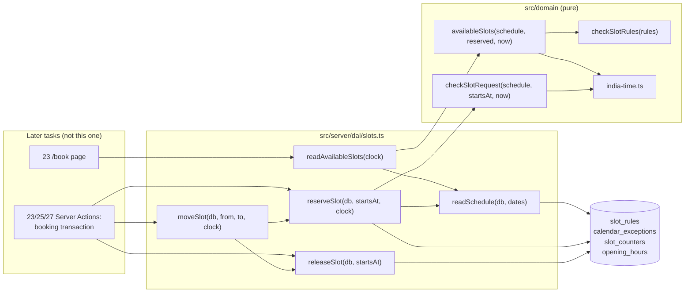
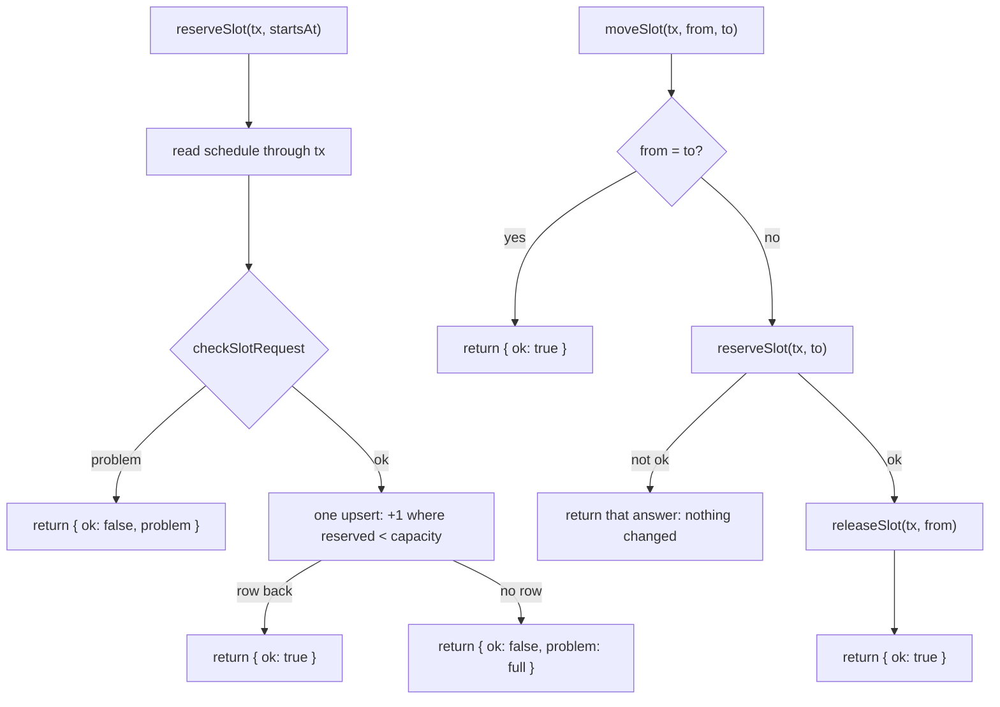
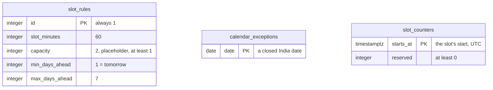

# Slot Engine - Plan

## Goal Capsule

- **Objective:** When booking opens (task 23), a customer is only ever offered, and only ever gets, a time when the garage is open and has room: 1-hour slots from tomorrow up to 7 days ahead, never on a closed day, and never more vehicles in a slot than it can take, even when two people take the last place at the same moment.
- **Means:** Slot rules, closed dates and per-slot counters in the database; a pure India-time slot calculator in `src/domain/`; reserve, release and move as single conditional statements run inside the caller's booking transaction (KTD1, KTD2, KTD3).
- **Authority:**
  1. The owner's decisions of 2026-10-28 (Key Decisions below).
  2. The master plan (see origin): data rules ("slot capacity is taken with one atomic conditional `UPDATE`"), data model (`slot_rules`, `calendar_exceptions`, `slot_counters`), Cache Components rules, risks ("Double booking: atomic slot update, tested in parallel on staging").
  3. The task 22 steps in `document/task/task.md`.
  4. `CLAUDE.md`: Database, Code conventions, Languages, Clock, tests next to code.
- **Execution profile:** one task branch (`22_slot_engine`), small commits, no UI and no page. Built while two other sessions work in parallel on their own branches (tasks 16 and 17), so migrations follow the regenerate rule in Risks.
- **Stop conditions:** stop and ask the owner if evidence shows a Key Decision can't work; stop if `db:generate` would number the migration over one already on `origin/main`; stop if a test needs a real Postgres to pass.
- **Who finishes:** Session 3 builds, reviews and commits on `22_slot_engine`, then asks the owner before pushing and opening the pull request. The owner merges.

---

## Product Contract

### Summary

Add the slot engine that task 23's booking wizard sits on: three tables (slot rules, closed dates, slot counters), a pure function that lists the bookable days and slots for the next week, and reserve, release and move functions that can never put more vehicles in a slot than its capacity. No screens: tasks 23, 25, 26, 27 and 28 build on this contract.

### Problem Frame

The garage takes a limited number of vehicles per hour. Today the site has no notion of time slots, so the booking wizard (task 23) has nothing to offer and nothing to stop two customers from taking the last place. The owner closes on some festival days (Diwali, Ganeshotsav) and doesn't take same-day bookings, and those rules must hold for every customer, at any hour of the night, whatever time zone the server runs in. Every later booking task (cancel, reschedule, staff bookings, schedule editing) changes slot capacity, so the contract set here is expensive to change once they build on it.

### Requirements

**Schedule**

- R1. Slots are 1 hour long. Each starts on a whole multiple of the slot length after India midnight (for 1 hour: on the hour), no earlier than the day's opening time, and ends no later than its closing time; a slot that would run past closing isn't offered.
- R2. Customers can book India calendar dates from tomorrow up to 7 days ahead, both included, and never a slot that has already started.
- R3. A closed weekday (Monday today) and a date in the closed-dates list give no slots.
- R4. A slot takes at most `capacity` vehicles, cars and two-wheelers together. Capacity is 2 for now, a placeholder until the owner gives the real number.
- R5. The slot length, capacity and booking window live in the database as one row, so task 28 can edit them; every new local database gets the owner's values, with capacity marked as a placeholder.

**Availability**

- R6. `availableSlots()` lists every date in the booking window: closed (and why: weekday or closed date), or its slots with the places left (0 when full, never negative).
- R7. Availability is read live at request time, never from a cache, so a taken place never shows as free.

**Reservation**

- R8. `reserveSlot` takes one place only in a slot a customer may book now (R1 to R3), and only while a place is left (R4). Two reservations at the same moment can never both take the last place. "Full" and "not bookable" come back as answers, not errors.
- R9. `releaseSlot` gives one place back. It never goes below zero, and it fails loudly when the slot has no place to give back.
- R10. `moveSlot` moves a booking's place from one slot to another: if the new slot can't be taken, nothing changes; moving to the same slot changes nothing and succeeds.
- R11. Reserve, release and move always run through a database handle the caller passes in (its booking transaction), so a booking and its place are saved or rolled back together.

**Correctness**

- R12. Dates and times are worked out on India's calendar (`Asia/Kolkata`), whatever the server's time zone; "now" comes from a `Clock`.
- R13. Unit tests cover the calculator; integration tests on in-memory PGlite cover the tables, the seed and reserve/release/move, including parallel reservations. The docs say plainly that PGlite runs one query, or one whole transaction, at a time, so the true race is proven on Postgres in task 20.

### Key Decisions

- **1-hour slots.** (session-settled: user-directed — chosen over 2-hour and 30-minute slots: the owner's choice on 2026-10-28.) Governs R1.
- **Book from tomorrow up to 7 days ahead, never same-day.** (session-settled: user-directed — chosen over 14 days ahead with 2 hours' notice, and over 30 days: the owner doesn't take same-day bookings.) Governs R2.
- **Capacity is a placeholder of 2 vehicles per slot, shared by cars and two-wheelers.** (session-settled: user-approved — chosen over separate car and two-wheeler capacities and over a fixed real number: the owner hasn't decided the real number yet.) Governs R4, R5.

### Success Criteria

- Task 23 can build `/book` and its confirm step from `readAvailableSlots` and `reserveSlot` alone, with no change to this task's tables.
- Breaking the atomic reserve on purpose (a read, then a separate write) makes the parallel-reservation test fail; breaking the India-date logic makes the late-evening tests fail.

### Scope Boundaries

Not built (considered; each line says what would change the call):

- **A staff booking policy** (phone bookings for today, or beyond 7 days). `reserveSlot` enforces the customer window only. Adding an option for staff in task 26 is a small change with no data impact.
- **`reservationsOffSchedule()`** (which future reservations a new holiday, hours or rule change would strand). It's a pure function over data this task stores, so task 28 adds it next to the editor that needs it.
- **Holiday names and special hours** (open 10:00 to 14:00 on a festival). The owner closes all day; both fit later as nullable columns.
- **Per-vehicle-type capacity.** It would change the counter's key. Only if the owner asks.
- **Holding a slot while the customer logs in.** A place is taken when the booking is created (task 23). Holds need an expiry, which a counter can't carry.
- **Deadlock avoidance in `moveSlot`.** Two opposite moves at the same moment (A to B and B to A) can make Postgres abort one with `40P01`. That's rare for one garage, and the customer can try again.
- **Caching the schedule.** Live reads are a few small queries. Task 28's open-status badge needs a cached copy of the closed dates and adds it there.

#### Deferred to Follow-Up Work

Recorded at the end of the backlog in `document/task/task.md` by U6, each marked "(task 22)":

- Task 20: seed the `slot_rules` row on Supabase, and run N parallel reservations against Postgres to prove the race (the master plan's "tested in parallel on staging").
- Task 23: reserve the slot first, then create the booking, in one transaction, returning a non-ok answer before writing anything (KTD7); confirm with the owner that a pending booking holds a place from creation (assumed here); a test that counters equal active bookings; read slots inside `<Suspense>` (with `io()` if the clock is read before the first uncached query).
- Task 24: a pickup booking's slot is the time the vehicle reaches the garage.
- Tasks 25 and 27: cancel by updating the booking only while it's active (`... returning`), and release only when a row comes back; reschedule through `moveSlot`.
- Task 26: a staff policy for `reserveSlot` and `moveSlot` (today, beyond 7 days, walk-ins).
- Task 28: edit slot rules (`checkSlotRules`) and closed dates; before saving rules, hours or a closed date, list the future reservations it would strand (lock the `slot_rules` row in each save, and have `reserveSlot` read it `for share`, so the list includes reservations still being made); a cached closed-dates read so the open badge says "Closed" on them.
- Task 43: deleting a customer's data releases their future bookings' places.

---

## Planning Contract

### Key Technical Decisions

- KTD1. **Three tables.** `slot_rules` is one row (id 1, CHECK, like `garage_settings`) with slot length, capacity, and the window's first and last day offsets; CHECKs keep each value in a sane range and capacity at least 1. `calendar_exceptions` is one row per closed India date (a `date` primary key, string mode). `slot_counters` is one row per slot that has ever been reserved (`starts_at` primary key, `reserved` with a CHECK of at least 0). A counter row appears on the first reservation, so there's no row per future slot to create or clean up.
- KTD2. **One statement per change, no locks.** Reserve is an insert of `(starts_at, 1)` that, on a conflict, adds 1 only where `reserved < capacity`, and returns the row; no row back means full. Capacity is a parameter from the schedule read in the same transaction; its CHECK of at least 1 makes the insert path safe. Release subtracts 1 only where `reserved > 0`. Postgres runs each statement atomically on the row (a second writer waits, then re-checks the condition), so no advisory lock is needed. Drizzle 0.45.4's `onConflictDoUpdate({ target, set, setWhere })` renders this (checked with `toSQL()` during research).
- KTD3. **The database handle is a required argument** for `reserveSlot`, `releaseSlot` and `moveSlot`, and their schedule read goes through the same handle. The caller passes its booking transaction. Never `getDatabase()` or the cached `readGarage()` inside: PGlite has one connection, and such a query waits forever while the transaction holds it. The type follows `readLiveCode(phoneNumber, db)` in `src/server/dal/login-codes.ts`.
- KTD4. **The grid is anchored at India midnight, not at opening time.** Slot starts are whole multiples of the slot length after midnight (R1), so moving Tuesday's opening from 10:00 to 10:30 removes one slot instead of shifting every slot's key and stranding its counter. For today's on-the-hour hours both give the same slots.
- KTD5. **The calculator is pure and lives in `src/domain/slots.ts`.** It takes `now: Date`, the way `openStatusAt` and `decideSend` do; the DAL reads the clock. The private India-time helpers in `src/domain/opening-hours.ts` move to a new `src/domain/india-time.ts` and are exported, and `opening-hours.ts` imports them, so there's one copy. India dates are `"YYYY-MM-DD"` strings, the form Postgres `date` columns return.
- KTD6. **Slot reads are live and uncached** (R7). `readSchedule` reads opening hours, rules and closed dates in one uncached pass, through the lenient `weeklyHours` mapping exported from `src/server/dal/garage.ts`, so a bad hours row means "closed" for both the open badge and the slots.
- KTD7. **Answers vs errors.** "Full" and the schedule problems are returned values (`{ ok: false, problem }`), never thrown, so callers need no `catch` (the `unstable_rethrow` lesson). Releasing a slot with nothing to release throws: it means the counters and bookings disagree, and failing rolls back the caller's transaction. Database errors aren't caught. Because answers are returned, the order matters: a caller reserves (or moves) before its transaction's other writes and returns a non-ok answer at once, and writes the booking row, or changes its slot, only after an ok. Otherwise returning "full" would commit a booking with no place.
- KTD8. **`moveSlot` reserves the new slot first, then releases the old one.** A full new slot then returns `full` before anything has changed, so even a caller that returns that answer from its transaction commits nothing wrong. Moving to the same slot is a no-op that succeeds, also on a full slot.
- KTD9. **A separate seed for the rules.** `seedSlotRules` checks the owner's values with `checkSlotRules`, then inserts the row only if it's missing (`onConflictDoNothing`). `createDatabase` calls it after `seedGarage`, so existing tests that delete and re-seed the garage keep working, and a dev database made before this task gets the row on its next start. A missing row makes the slot reads throw a clear error, as `readGarage` does.
- KTD10. **A slot is identified by its start instant** (`timestamptz`, UTC). Times are compared with `getTime()`, and the reserved counts are passed to the calculator keyed by epoch milliseconds, never by `Date` objects. An `Invalid Date` or an instant with stray seconds is "not a slot".

### High-Level Technical Design

Where each piece lives and who calls it:

What one reservation does, and how a move orders its two steps:

The three tables (directional; exact columns and CHECK bounds are settled in U3):

### Assumptions

Bets made without the owner's confirmation (scoping confirmation was skipped):

- "Up to 7 days ahead" means today + 1 through today + 7, both included. On a Wednesday that's Thursday to next Wednesday: 6 open days and 54 slots with today's hours.
- A slot is the time one vehicle arrives (dropped off or picked up); how long the work takes isn't modelled.
- A partial last slot is dropped: with closing at 18:30 the last 1-hour slot starts at 17:00.
- Closed dates are closed all day.
- `reserveSlot` applies the customer window; staff bookings get their own rule in task 26.
- Every booking that should occupy a place reserves one when it's created, pending or confirmed (task 23 confirms).

### Deferred to Implementation

- The exact names and shapes of the result types and the handle type (`Pick<Database, ...>` vs Drizzle's transaction type).
- Whether `readSchedule` takes the window's first and last dates or one date (reserve needs one).
- The exact CHECK bounds (for example slot length 15 to 480 minutes, capacity 1 to 50, window up to 60 days), mirrored in `checkSlotRules`.
- The migration's file name: `npm run db:generate -- --name=slot_engine` picks the number.

### Risks

| Risk | Mitigation |
| --- | --- |
| PGlite runs one query, or one whole transaction, at a time, so the parallel test can't reproduce a real row race | KTD2 is atomic by construction; the test still catches a read-then-write split because its calls get the bare database (U4 mutation check); task 20 runs the real race on Postgres |
| Counters drift from bookings (a reserve without a booking, a release twice) | KTD3 and KTD7, the contract comment in `slots.ts`, CLAUDE.md, and task 23's counters-equal-bookings test |
| Another session's migration reaches `origin/main` first and takes the same number | `git fetch origin && git merge origin/main` right before `db:generate`; if theirs lands before this PR merges, merge again, delete only this task's migration files and journal entry, and generate again |
| A dev database made before this task has no rules row | KTD9: the migration adds the tables and `seedSlotRules` fills the row on the next start; no `db:reset` needed |
| "Tomorrow" worked out in UTC would offer same-day slots from 00:00 to 05:30 India time | KTD5; tests at 18:29Z and 18:31Z and across month and year ends |

### Sources and Research

- `src/server/dal/garage.ts` (cached read, save with check + transaction), `src/server/dal/login-codes.ts` (transaction handle passed in, advisory locks), `src/server/db/seed.ts` and `seed-data.ts` (idempotent seed, owner values), `src/server/dal/garage.test.ts` (PGlite test setup with `getDatabase` mocked), `src/server/auth/login.test.ts` (parallel test and its PGlite caveat), `src/server/db/database.test.ts` (enum parity, `violation()`, migration count).
- `node_modules/drizzle-orm/pg-core/query-builders/insert.d.ts` (`onConflictDoUpdate` with `setWhere`; `where` is deprecated); `node_modules/@electric-sql/pglite` (`_runExclusiveQuery`, `_runExclusiveTransaction`).
- `node_modules/next/dist/docs/01-app/03-api-reference/04-functions/io.md` (for task 23: `io()` inside `<Suspense>`).
- `document/solutions/conventions/nextjs-16-catch-only-expected-request-api-errors.md` (names task 22: return "full", don't catch broadly); `nextjs-16-dev-server-is-not-one-process-use-cache-probe.md` (why slot reads stay uncached); `run-commands-before-documenting-output.md`.

---

## Implementation Units

### U1. India-time helpers in their own module

- **Goal:** One exported set of India calendar helpers that both the open badge and the slot calculator use.
- **Requirements:** R12.
- **Dependencies:** none.
- **Files:** create `src/domain/india-time.ts`, `src/domain/india-time.test.ts`; modify `src/domain/opening-hours.ts`.
- **Approach:**
  1. Move `indiaClock`, `indiaWallClockAt`, `indiaOffsetAt`, `indiaInstant` and the weekday index out of `opening-hours.ts`, keeping their comments.
  2. Add date-string helpers on top: the India date of an instant (`"YYYY-MM-DD"`), a date plus N days, a date's weekday index (Monday 0), and the instant India's clock shows a given minute of a date.
  3. `opening-hours.ts` imports them. To avoid an import cycle, `india-time.ts` returns a weekday index, not a `Weekday` (that list stays in `opening-hours.ts`).
- **Execution note:** run `opening-hours.test.ts` before and after the move; it must pass unchanged.
- **Patterns to follow:** `src/domain/opening-hours.ts` (Intl, never `getHours()` or a typed `+05:30`); its test style (UTC instants with the India time in a comment).
- **Test scenarios:**
  - The India date of `2026-10-28T18:29:00Z` is `2026-10-28`; of `2026-10-28T18:30:00Z` it's `2026-10-29`.
  - `2026-10-31` plus 1 day is `2026-11-01`; `2026-12-31` plus 1 is `2027-01-01`; `2028-02-28` plus 1 is `2028-02-29`.
  - The weekday index of `2026-10-26` (a Monday) is 0, of `2026-11-01` (a Sunday) 6.
  - Minute 600 of `2026-10-29` is `2026-10-29T04:30:00.000Z`.
  - The suite's first test confirms `process.env.TZ` is `UTC`, as `opening-hours.test.ts` does.
- **Verification:** both test files pass; `opening-hours.ts` has no India-time helper of its own left.

### U2. Slot calculator, request check and rule check

- **Goal:** Pure functions that say which slots exist, which a customer may book now, and whether a set of rules is valid.
- **Requirements:** R1, R2, R3, R4, R6, R12; Key Decisions; KTD4, KTD5, KTD10.
- **Dependencies:** U1.
- **Files:** create `src/domain/slots.ts`, `src/domain/slots.test.ts`.
- **Approach:**
  1. Types: the rules (slot minutes, capacity, min and max days ahead), a schedule (weekly hours, rules, closed dates as a set of date strings), a day in the result (date, closed reason or its slots), a slot (start, end, places left), and problem codes.
  2. `checkSlotRules` returns problem codes (empty when fine), in the style of `checkDayHours`.
  3. `availableSlots(schedule, reservedByStart, now)` walks the window's dates (R2). Each date is closed by weekday, closed by date, or open: open days list their grid slots (R1, KTD4), drop slots that have started, and give each slot `max(0, capacity - reserved)` places. Invalid rules give an empty list; a day whose hours fail `checkDayHours` counts as closed.
  4. `checkSlotRequest(schedule, startsAt, now)` returns the first problem (not a slot, closed date, outside the window) or null. It derives the answer from the same grid code as `availableSlots`, so the two can't disagree.
  5. A header comment states the contract later tasks rely on (KTD3, KTD7, KTD8 summarised and cited).
- **Execution note:** write the late-evening and month-end tests first.
- **Patterns to follow:** `src/domain/opening-hours.ts` and `src/domain/login.ts` (problem codes, results as unions, `now` passed in).
- **Test scenarios** (now = Wednesday 28 Oct 2026, 17:54 India time, unless said otherwise; owner hours; owner rules):
  - The window is 29 Oct to 4 Nov: 7 days; 2 Nov (Monday) closed by weekday; the other 6 have 9 slots each, 10:00 to 18:00 starts, 54 in all, each with 2 places.
  - The first slot starts at `2026-10-29T04:30:00.000Z` and ends an hour later; the last on 4 Nov starts at 18:00 India time.
  - At 23:59 India time (`18:29Z`) on 28 Oct, the window still starts on 29 Oct; at 00:01 on 29 Oct (`18:31Z`) it starts on 30 Oct and ends on 5 Nov.
  - A window crossing 31 Dec into January, and one crossing 28 Feb, lists the right dates and weekdays.
  - A closed date inside the window shows as closed by date and has no slots.
  - One place taken in a slot leaves 1; two leave 0 and the slot is still listed; three (after a capacity cut) still leave 0.
  - A reserved count for a slot outside the window is ignored.
  - Hours 10:00 to 18:30: the last slot starts at 17:00. Hours 10:30 to 19:00: the first starts at 11:00 (KTD4). Hours 10:00 to 10:30 give no slots.
  - With `minDaysAhead` 0 and now 12:20 India time, today's slots start at 13:00.
  - Invalid rules (slot length 0, capacity 0, min after max, not whole numbers) give no days; each gives its own code from `checkSlotRules`.
  - `checkSlotRequest`: a listed slot is fine; 10:30, a stray second, an `Invalid Date`, a Monday and 19:00 are "not a slot"; a closed date is "closed date"; a slot today, one on day 8 and one in the past are "outside the window".
  - A full slot passes `checkSlotRequest` (capacity is the database's job, KTD2).
- **Verification:** the suite passes; breaking the India-date step (using the UTC date) makes the 18:31Z test fail.

### U3. Tables, migration and seed

- **Goal:** The three tables exist in every database, and every new local database has the owner's slot rules.
- **Requirements:** R4, R5; KTD1, KTD9.
- **Dependencies:** U2 (the rules type and `checkSlotRules`).
- **Files:** modify `src/server/db/schema.ts`, `src/server/db/seed.ts`, `src/server/db/seed-data.ts`, `src/server/db/index.ts`, `src/server/db/database.test.ts`, `src/server/db/seed-data.test.ts`; create `src/server/db/migrations/0002_<name>.sql` and its `meta/` snapshot and journal entry (generated).
- **Approach:**
  1. Add the three tables to `schema.ts` with snake_case names written on each column, named CHECKs (spelled out for NULLs where a column is nullable) and `import type` only.
  2. Add `ownerSlotRules` to `seed-data.ts` with a comment that capacity is a placeholder, dated, and the owner's other values with their date.
  3. Add `seedSlotRules` to `seed.ts`; call it after `seedGarage` in `createDatabase`.
  4. Right before generating: `git fetch origin && git merge origin/main`, then `npm install`, then `db:generate`. Commit the SQL and `meta/` with the schema change.
- **Patterns to follow:** `garage_settings` (single row), `opening_hours` (CHECK comments), `seedGarage` (check, then `onConflictDoNothing`).
- **Test scenarios:**
  - A fresh in-memory database has one `slot_rules` row equal to `ownerSlotRules`, and empty closed dates and counters.
  - Running `seedSlotRules` twice leaves one row; a changed row survives a second seed.
  - Invalid seed rules throw before anything is written, naming the problem.
  - Each CHECK refuses its bad value, by name (`violation()`): a second rules row, slot length 0, capacity 0, min after max, `reserved` below 0.
  - A duplicate closed date and a duplicate counter start are refused by their primary keys.
  - `ownerSlotRules` passes `checkSlotRules` and equals 60 minutes, capacity 2, days 1 to 7 (`seed-data.test.ts`, with the "check with the owner" note).
  - The existing migration-count test covers the new migration without changes.
- **Verification:** `npm run check` passes; `npm run dev -- --port 3002`, started once before the migration exists (so `.pglite/` has the old schema) and again after it, applies the migration and seeds the rules row without a reset.

### U4. Data access: schedule, availability, reserve, release, move

- **Goal:** The functions task 23 onward call, safe inside a booking transaction.
- **Requirements:** R6, R7, R8, R9, R10, R11, R13; KTD2, KTD3, KTD6, KTD7, KTD8.
- **Dependencies:** U2, U3.
- **Files:** create `src/server/dal/slots.ts`, `src/server/dal/slots.test.ts`; modify `src/server/dal/garage.ts` (export `weeklyHours`).
- **Approach:**
  1. `readSchedule(db, dates)` reads hours, rules and the closed dates in range through the handle; throws a clear error when the rules row is missing (KTD9).
  2. `readAvailableSlots(clock = systemClock)` reads the clock, the schedule and the counters in the window through `getDatabase()`, then calls `availableSlots`. Not cached; a comment says it must run at request time inside `<Suspense>` (task 23).
  3. `reserveSlot(db, startsAt, clock = systemClock)`: schedule through `db`, `checkSlotRequest`, then the one upsert (KTD2).
  4. `releaseSlot(db, startsAt)`: the conditional decrement; throws when no row comes back (KTD7). The error names the slot time only.
  5. `moveSlot(db, from, to, clock = systemClock)` (KTD8).
  6. The file header states the contract: call only from booking code inside the transaction that writes the booking; reserve before the booking is written (KTD7); release with the slot read from the stored booking row.
- **Execution note:** after the parallel test passes, swap the upsert for a read-then-write once and confirm that test fails; record the result in the learning doc, then restore it.
- **Patterns to follow:** `src/server/dal/garage.test.ts` setup (one PGlite per file, `getDatabase` mocked, rows reset in `beforeEach`, 60 s limits with the reason); `src/server/auth/login.test.ts` parallel test and its comment.
- **Test scenarios** (`fixedClock` at Wednesday 28 Oct 2026, 17:54 India time):
  - `readAvailableSlots` on the seed gives the 54 slots with 2 places each; after one reservation that slot shows 1.
  - A closed date inserted for 31 Oct makes that day closed by date in `readAvailableSlots`, and makes `reserveSlot` for its 10:00 slot return "closed date" without writing a counter.
  - `reserveSlot` twice on Thursday 10:00 succeeds and leaves `reserved` 2; a third returns "full" and leaves it 2; Thursday 11:00 is untouched.
  - Five reservations of one slot started together (`Promise.all`), each `reserveSlot(db, ...)` on the bare test database with no `db.transaction` around it, give exactly 2 successes and 3 "full", and `reserved` 2. The comment says PGlite runs one query, or one whole transaction, at a time: bare calls interleave query by query, which catches a read-then-write split, while a transaction per call would run them one after another and hide it. The real row race is task 20's.
  - "Not a slot" (10:30) and "outside the window" (today, day 8) write nothing.
  - Lowering capacity to 1 in the rules row with 2 reserved makes a reservation return "full" and `readAvailableSlots` show 0, not a negative number.
  - A reservation inside `db.transaction` that then throws leaves no counter row: the place rolls back with the booking.
  - `releaseSlot` after two reservations leaves 1; releasing a slot with no row, or with 0, throws and changes nothing.
  - `moveSlot` from Thursday 10:00 to 11:00 leaves 0 and 1; into a full slot returns "full" and changes neither counter; from a slot to itself on a full slot succeeds and changes nothing.
  - Missing rules row: `readAvailableSlots` throws the clear error.
  - Database errors pass through: a closed database makes `reserveSlot` reject with the driver's error (the `garage.test.ts` trick).
- **Verification:** the suite passes, and the mutation check above has been run and recorded.

### U5. Repo rules for slots

- **Goal:** Future sessions find the slot contract without reading the code.
- **Requirements:** R11, R13.
- **Dependencies:** U4.
- **Files:** modify `CLAUDE.md`.
- **Approach:** add the new files to the repo map rows for `src/domain/` and `src/server/dal/`, and a short "Slots (task 22)" convention block: the required handle and same-transaction rule, reserve before the booking is written and reserve-then-release for moves, answers vs errors, live reads, the grid anchor, the placeholder capacity, and that PGlite runs one query or one whole transaction at a time, so it can't prove the race.
- **Test expectation:** none -- documentation only.
- **Verification:** each rule in the block points to a file that exists.

### U6. Tracker

- **Goal:** The task's steps and the follow-up notes for later tasks are in `document/task/task.md`.
- **Requirements:** Scope Boundaries (Deferred to Follow-Up Work).
- **Dependencies:** none (can land first, with the plan link).
- **Files:** modify `document/task/task.md` (task 22's step list, and new lines at the end of the backlog).
- **Approach:** link this plan from task 22's "Plan with `ce-plan`" step; add one backlog line per later task (20, 23, 24, 25 and 27, 26, 28, 43), each starting "For task NN" and ending "(task 22)". Three sessions work in parallel, and each may edit only its own task's row and steps, so the notes can't go into the later tasks' step lists.
- **Test expectation:** none -- tracker only.
- **Verification:** every item in "Deferred to Follow-Up Work" has a matching backlog line.

---

## Verification Contract

| Check | When | Proves |
| --- | --- | --- |
| `npm run check` | after each unit, and before every commit called done | lint, `next typegen` + `tsc`, all Vitest suites (domain and PGlite) |
| Mutation checks (U2 India date, U4 read-then-write) | once, during U2 and U4 | the guarding tests can fail; results go in the learning doc |
| `npm run dev -- --port 3002`, once before U3's migration and once after | U3 | the migration and `seedSlotRules` apply to an existing dev database without a reset |
| `npm run test:e2e` | before the pull request (port 3210; if taken, another session is testing: wait) | nothing else broke; no page changed |
| Not run: `npm run test:design` | – | no design change, and port 3000 belongs to Session 1 |

---

## Definition of Done

- U1 to U6 are done and their tests pass; `npm run check` and `npm run test:e2e` pass.
- The migration was generated right after merging the latest `origin/main`, and its number doesn't clash with one on `origin/main`.
- The mutation checks were run and their results recorded.
- No experimental code is left (the read-then-write variant is gone).
- The learning doc `document/learning/22_slot_engine.md` exists, says the task was built while other sessions worked in parallel, and describes any merge conflict.
- `ce-code-review` and `code-reviewer` ran and every "must fix" is fixed; the compound question was answered.
- Every task 22 step in `task.md` is ticked except "Merge".
