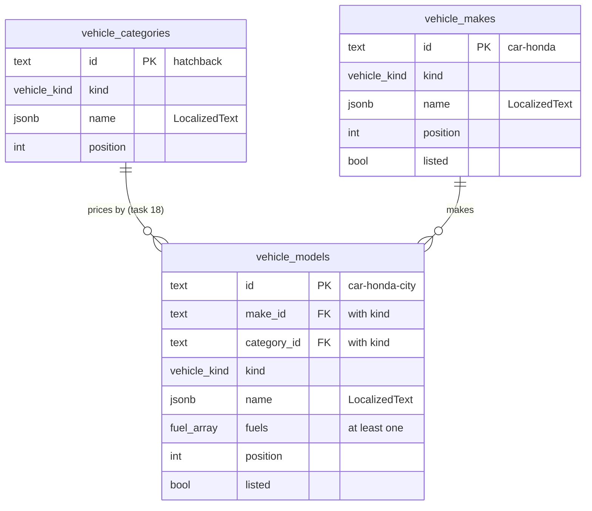
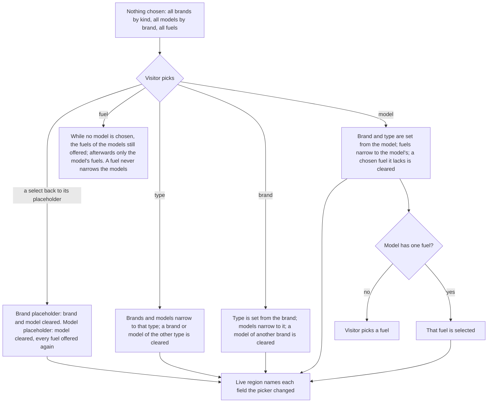

# Vehicle Catalogue - Plan

## Goal Capsule

- **Objective:** The site knows which vehicles the garage works on: the owner's 12 car brands and 10 two-wheeler brands, each with a draft list of models and the fuels they run on. Visitors see the brands on the home page. Tasks 18, 21 and 23 get one shared picker (type, then brand, model and fuel) whose answer means the same vehicle on every server.
- **Means:** three catalogue tables with a seed and a cached read (KTD2–KTD7), and a client-island picker built on native form controls (KTD8, KTD9).
- **Authority:**
  1. The master plan (see origin): task 17's row (categories, makes and models plus seed, vehicle picker; owner decision "brands served"), feature A2 (type → brand → model → fuel), the data model's table names and the Cache Components rules.
  2. The task 17 steps in `document/task/task.md`.
  3. `CLAUDE.md`: Database, Languages, Design system, site shell, lint guards, test rules.
  4. The owner's rules for this parallel session (2026-10-28):
     - work only in the `go-mechanic-s2` folder, with the dev server on port 3001;
     - never run `npm run test:design` (port 3000 is Session 1's);
     - merge `origin/main` right before `npm run db:generate`, and generate again if another session's migration reaches `main` first;
     - in `task.md`, edit only task 17's row and steps, and add new backlog lines at the end of the backlog;
     - pin new packages exactly and commit them on their own.
  5. This plan.

  These lessons in `document/solutions/` apply:
  - `conventions/nextjs-16-dev-server-is-not-one-process-use-cache-probe.md`: the seed runs inside `createDatabase` on the one connection. It uses one insert per table so a cold start stays fast. Nothing throws inside the cached read.
  - `conventions/lint-guards-test-real-jsx-shapes.md`: every picker label comes from messages, conditions included. Brand and model names are data.
  - `conventions/nextjs-16-test-lazy-islands-with-app-router-dynamic.md`: the picker loads normally, not through `next/dynamic`. Prove each picker test by breaking the behaviour it guards and watching it fail.
  - `conventions/nextjs-16-read-bundled-docs-image-priority.md`: check `'use cache'`, `cacheTag` and `cacheLife` in `node_modules/next/dist/docs/` before use.
  - `conventions/run-commands-before-documenting-output.md`: the learning doc shows only output that was really run.
- **Execution profile:**
  - U1 and U3 are written test-first: they are pure rules and data checks.
  - Database tests run on in-memory PGlite in Vitest's node project.
  - Components follow the existing jsdom component-test and `/dev/design` patterns.
  - Full `npm run check` and `npm run test:e2e` runs come at the end (U8). The `/dev/design` checks run against port 3001 (Verification Contract).
  - When the SEO Stop hook asks, run `seo-reviewer` in the foreground.
- **Stop conditions:** stop and ask the owner when:
  - `npx shadcn add native-select` would add a package or overwrite an edited `ui/` file;
  - `/` stops building as `○ /en`, or the home page's browser messages change;
  - a step needs a change in code another task owns (tasks 16, 22 and the others in progress);
  - the draft catalogue makes a cold `npm run dev` start noticeably slower (over about 2 seconds more than on `main`);
  - a step needs a global install, a cloud account or `npx playwright install`.
- **Who finishes:** Session 2's main session on branch `17_vehicle_catalogue`. Commit there and stop. The push and the pull request wait until the owner says yes (`CLAUDE.md` Task workflow step 11).

---

## Product Contract

### Summary

Add the vehicle catalogue to the database: vehicle kinds, price groups, the owner's brands, and a draft list of models with their fuels, seeded into every local and build database. Add a reusable vehicle picker, shown for now only on `/dev/design`. Add a quiet text row of the brands served to the home page.

### Problem Frame

Prices (task 18), saved customer vehicles (task 21) and bookings (task 23) all start from "which vehicle is it?". Today the site only knows the words "car" and "two-wheeler" (`src/content/services.ts`). Each of those tasks needs the same list of brands, models and fuels, the same way to pick one, and an answer that still points to the same vehicle when a form posts to another server process. The owner also wants visitors to see straight away which brands the garage works on.

### Requirements

**Catalogue**

- R1. The catalogue holds the two vehicle kinds, price groups for each kind, the owner's brands under their kind, and each brand's models with the fuels each model runs on.
- R2. Every new local database and every build starts with the draft catalogue. A restart never changes or removes a row that is already there.
- R3. A chosen vehicle is identified the same way in every server process, after every restart, and in every build.
- R4. Pages that show the catalogue stay prerendered (`○ /en` for the home page).

**Picker**

- R5. A visitor picks a vehicle as type, then brand, then model, then fuel. Each choice narrows the lists after it. Every control is at least 44px tall and usable with a keyboard and a screen reader.
- R6. The picker works inside a plain HTML form through named native fields. Without JavaScript the fields still work, with full lists.
- R7. Every label comes from `messages/en.json`, and brand and model names are stored per language, so Hindi needs no rework.

**Home page**

- R8. The home page lists the brands served, cars and two-wheelers separately, as text names. No logos, no links.

**Hand-over**

- R9. Tasks 18, 20, 21, 23 and 39 find what they need from this task: the owner's check of the draft models, the staging seed, the picker inside forms, the "not listed" question, and hiding instead of deleting. The notes go in the task tracker's backlog, each line naming its task, and the two gates (the owner's check before task 18 shows any model, the staging seed before task 20's first build) also go in CLAUDE.md, which every session reads.

### Key Decisions

- **Car brands served: Maruti Suzuki, Hyundai, Tata, Mahindra, Kia, Toyota, Honda, MG, Renault, Skoda, Volkswagen, Nissan.** (session-settled: user-directed — chosen over the same list plus BMW, Mercedes-Benz, Audi, Jeep and Volvo, and over a placeholder list: these cover most cars the garage sees.) Governs R1, R8.
- **Two-wheeler brands served: Hero, Honda, TVS, Bajaj, Royal Enfield, Yamaha, Suzuki, KTM, Ather, Ola Electric.** (session-settled: user-directed — chosen over the same list without the electric brands, and over a placeholder list: the garage works on electric two-wheelers too.) Governs R1, R8.
- **Claude writes the models as a draft for the owner to check later.** (session-settled: user-directed — chosen over waiting for the owner's own list: the build isn't blocked, and task 39 lets the owner correct it without code.) Governs R1, R2.
- **A brands row on the home page, names only.** (session-settled: user-directed — chosen over leaving the home page as it is: logos are other companies' trademarks, so text only.) Governs R8.

### Scope Boundaries

- No prices: task 18 adds them, keyed on this task's price groups and fuels.
- No public page shows the picker or any model name yet; `/dev/design` shows the picker. Task 18 puts it on its prices page after the owner has checked the draft models.
- No saving of a customer's vehicle (task 21), no booking (task 23), and no admin editing or any save function in `src/server/dal/` (task 39, after task 16's role checks).
- No logos and no brand pages.
- Considered and not built:
  - A `hybrid` fuel. Strong hybrids (Hyryder, Innova Hycross, City e:HEV) count as petrol. Adding an enum value later is a one-line migration; build it if task 18's price list prices hybrids differently.
  - Rules that tie fuels to a kind (no diesel two-wheelers). `checkCatalogue` checks the draft only; a rule here would also block odd but real vehicles. Revisit in task 39 if the owner's edits need it.
  - Throwing on an empty catalogue, as `readGarage()` does. The home row is optional, so an empty catalogue hides it. Task 20's staging seed is the real fix (R9).

#### Deferred to Follow-Up Work

- "My model isn't listed" for older models of the brands served (a Maruti 800, a Santro): an owner question for tasks 21 and 23 (Open Questions).
- The picker inside task 21's and task 23's forms, built against a real form:
  - React 19 resets a form after its action, so the picker must return to its default on the form's `reset` event;
  - a choice made in the native fields before the page hydrates must not be lost;
  - editing a saved vehicle whose model was later hidden;
  - validating a posted choice on the server with `resolveVehicle`.

### Open Questions

Deferred, not blocking:

- **Owner, before task 18 shows models publicly:** check the draft models, their fuels and their price groups (U3 records them in `src/server/db/vehicle-seed-data.ts`).
- **Owner, before tasks 21 and 23:** should customers be able to say "my model isn't listed" (a typed name, priced at the garage after inspection)? It decides whether task 21's saved vehicles may have no model. The brands served are settled (Key Decisions), so the home row presents them as the garage's brands. Whether the garage also takes other brands (Ford, Chevrolet) is a separate owner question; a yes would add a line under the home row.

---

## Planning Contract

### Key Technical Decisions

- KTD1. **Kinds and fuels are fixed lists in `src/domain/vehicles.ts`, mirrored by database enums.** `VEHICLE_KINDS` (`car`, `two-wheeler`) moves there from `src/content/services.ts`, and the four files that import it switch to it. `FUELS` is `petrol`, `diesel`, `cng`, `electric`. Code branches on both, so they follow the weekday and role pattern: a domain list, a `pgEnum` pinned with `satisfies`, and a `database.test.ts` check that the lists match. A strong hybrid is `petrol`. An electric version sold under the same name is a fuel of that model (Nexon: petrol, diesel, CNG, electric). An electric-only name is its own model (BE 6, Windsor EV, Rizta). Only factory fuels count, not aftermarket CNG kits.
- KTD2. **`vehicle_categories` are price groups within a kind.** The six draft groups are, for cars, hatchback, sedan, and SUV (one group for SUVs and MUVs such as the Ertiga and Innova); for two-wheelers, scooter, motorcycle, and premium motorcycle (Royal Enfield, KTM, 250 cc and above). Task 18 prices by group and fuel instead of by each of about 140 models, which keeps the owner's price list short. Customers never see a group's name in the picker.
- KTD3. **A brand belongs to one kind.** Honda for cars and Honda for two-wheelers are two rows, as Suzuki and Maruti Suzuki already are. Each list keeps the owner's own order (Honda is seventh among cars, second among two-wheelers). The two Hondas are separate companies in India anyway.
- KTD4. **Ids are text built from names, and never change.** A price group is `hatchback`, a brand `car-honda` (kind, then brand), a model `car-honda-city` (brand id, then model). They use lowercase letters, digits and single hyphens only, never a dot ("Nexon.ev" would become `nexon-ev`, but by KTD1 it isn't its own model). The reason: every build worker and every `next start` opens its own in-memory PGlite and seeds it, so random ids would differ between the process that renders a page and the one that receives its form (R3). A name can change later; an id never does. `checkCatalogue` enforces the format and the prefixes.
- KTD5. **The database enforces the catalogue's shape.**
  - Each model row carries its kind. Two composite foreign keys, (make, kind) and (category, kind), make a car model under a two-wheeler brand or group impossible. That needs a unique (id, kind) on brands and groups. These are the repo's first composite keys, so their comment explains them.
  - Fuels are a `fuel` enum array with a CHECK for at least one value. Drizzle 0.45.4 parses the array text that PGlite and postgres.js return (`node_modules/drizzle-orm/pg-core/columns/common.js`, `PgArray.mapFromDriverValue`), and a test proves the round trip.
  - Names are `LocalizedText` in jsonb. An integer `position` orders each list, and a CHECK keeps the English name non-blank.
  - `listed` (boolean, default true) on brands and models hides a row without deleting it, so task 21's saved vehicles can keep pointing at a model the owner retires. Price groups have no `listed`: visitors never see them, and a hidden group with visible models would mean nothing. Foreign keys refuse deletes (`restrict`).
- KTD6. **The seed is a plain data file, added row by row and never updated.**
  - `src/server/db/vehicle-seed-data.ts` holds the draft nested by kind and brand, with no `server-only` import, so the e2e specs can import it, as they import `ownerGarage`. It becomes the third exception in CLAUDE.md's server-only rule.
  - `seedVehicleCatalogue(db)` in `src/server/db/seed.ts` runs right after `seedGarage(db)` in `createDatabase`. It is a separate call, because `seedGarage` returns early on every existing database.
  - It checks the draft with `checkCatalogue` and throws on any problem, then inserts groups, brands and models in one transaction, one multi-row insert per table, with `onConflictDoNothing` on the id.
  - Result: a new database gets everything. An existing database gets only rows it lacks, and rows already there, including the owner's later edits and hidden rows, stay as they are. A renamed draft model reaches an existing local database only after `npm run db:reset`.
  - Positions come from the order in the file.
- KTD7. **One cached read: `readVehicleCatalogue()` in `src/server/dal/vehicles.ts`.** It uses `'use cache'`, `cacheTag("vehicle-catalogue")` and `cacheLife("max")`, copied from `readGarage()`. It returns listed rows only, in position order: the price groups, and the brands with their models nested inside. Names stay `LocalizedText`; components localise them. An empty catalogue returns empty lists instead of throwing. No save function: task 39 adds saves with `updateTag` after task 16.
- KTD8. **The picker is a client island on native controls.**
  - `VehiclePicker` (`src/components/site/vehicle-picker.tsx`, `"use client"`) gets the catalogue and a `labels` object as props from a server parent. It reads no messages, so `client-messages.ts` doesn't change.
  - Type and fuel are native radios drawn as 44px pills, through a new `ChoiceGroup` (`src/components/site/choice-group.tsx`: fieldset, legend, one native radio inside each label).
  - Brand and model are native selects from shadcn's `native-select` (added through the CLI, then restyled: `h-11`, `type-body`, full width; a `restyle.test.tsx` case guards it).
  - Native controls work before JavaScript loads and post with the form, as MASTER.md "Components" says for `CheckboxField`. A Radix select would do neither.
  - Field names come from a `name` prefix prop (`vehicle` gives `vehicleKind`, `vehicleMake`, `vehicleModel`, `vehicleFuel`). Element ids use `useId`.
- KTD9. **Every list is complete until an earlier choice narrows it.** A pure function in `src/domain/vehicles.ts` computes the options and the next selection, so the rules are unit-tested without a browser. The full rules are in the HTD diagram; the main ones:
  - With no type chosen, the brand list shows all brands in two option groups (Cars, Two-wheelers). The model list shows every model, grouped by brand; while both kinds are listed, each group's name includes its kind ("Honda (car)").
  - Choosing a model fills in its brand and type. Changing the type or brand clears later choices that no longer fit. A model with exactly one fuel selects it.
  - Setting the brand select back to "Choose a brand" clears the brand and the model and keeps the type and fuel. Setting the model select back to "Choose a model" clears only the model, and every fuel is offered again.
  - Only matching options are rendered: iOS Safari ignores hidden `<option>`s.
  - The server render and the first client render always show the full lists, with any default selected, so there's no hydration mismatch and a visitor without JavaScript can still switch to any brand or model (R6). Narrowing starts once the picker has hydrated.
  - One polite live region says what the picker changed by itself ("Brand set to Honda", "Model cleared").
  - `resolveVehicle(catalogue, modelId, fuel)` turns a posted pair into a vehicle or a problem code. The picker uses it to know when the choice is complete; tasks 21 and 23 reuse it on the server.
- KTD10. **The brands row sits inside the home page's services section.** It goes under the grid in `HomeServices`, on the grey band: two short lists labelled "Cars" and "Two-wheelers", with no `h2` and no links. A section of its own would break about six fixed section counts (`page.test.tsx` headings and tones, `homeTones` and its test, `e2e/home.spec.ts`, `e2e/dev/home-preview.spec.ts`, MASTER.md). Separators come from CSS, since a typed `·` fails lint. The block carries `sceneMark("reveal")`. A kind with no brands is left out, and the block disappears when both are empty.

### High-Level Technical Design

The catalogue tables:

How a picker choice changes the others (KTD9):

Data flow: `createDatabase` seeds, `readVehicleCatalogue()` (cached) reads, the server page passes the catalogue and labels as props, and `VehiclePicker` filters in the browser once it has hydrated. No request reaches the server while a visitor picks.

### Assumptions

These are planning bets, not checked with the owner (the scope check was skipped at the owner's request):

- The price groups are the six in KTD2. The owner reviews them with the price list in task 18.
- The draft lists about 5–10 models a brand (fewer where a brand sells fewer, such as Renault, Nissan and Ather). It covers current models and a few recently discontinued ones still common on Pune roads (Polo, Vento, Jazz, WR-V, Micra, Sunny, older Duster). Fuels include those a model was sold with in roughly the last ten years (a 2018 Swift diesel still comes in for service).
- Brands keep the owner's order. Models follow rough popularity. The owner can reorder in task 39.
- Fuel and electric-version rules are as in KTD1.
- The picker needs JavaScript only for narrowing (KTD9).

### Deferred to Implementation

- Exact names of the narrowing function, the draft and catalogue types, and the label keys.
- How the picker knows it has hydrated before it narrows (KTD9), without a visible jump in the fuel pills.
- Whether the read needs an index for its `position` ordering (about 140 models: likely not).
- The exact draft model list, within the Assumptions' rules.

### Risks

| Risk | Mitigation |
| --- | --- |
| Session 3's task 22 also generates a `0002_*` migration from the same snapshot | Merge `origin/main` right before `npm run db:generate`. If another migration reaches `main` before this pull request merges, merge again, delete only this task's migration files and journal entry, generate again, and run `npm run db:reset` |
| A bigger seed slows a cold start towards the 10-second use-cache probe | One multi-row insert per table inside one transaction; compare a cold `npm run dev` start against `main` (stop condition) |
| Draft models, fuels or groups are wrong | Labelled as a draft in the data file's header and the learning doc; no public page shows models until the owner checks them (Open Questions) |
| `npm run test:design` can't run in this folder | Run the `e2e/dev` specs with a scratch Playwright config pointed at port 3001 (Verification Contract); the pull request says `/dev/design` changed so it is re-run after the merge |
| Other sessions edit `CLAUDE.md`, `task.md`, `messages/en.json` and `/dev/design` too | Add only this task's lines and keys, in its own places; resolve conflicts by keeping both sides, and record them in the learning doc |

### Sources and Research

- `src/server/dal/garage.ts`, `src/server/dal/garage.test.ts`: the cached-read and PGlite test pattern.
- `src/server/db/seed.ts`, `src/server/db/seed-data.ts`, `src/server/db/index.ts` (`createDatabase`): where the seed goes and why it can't hang off `seedGarage`.
- `src/server/db/database.test.ts`: enum checks and the `violation()` helper for constraint tests.
- `src/components/account/login-form.tsx` with `src/app/[locale]/login/page.tsx`: labels as props, a client island with no message reads.
- `src/components/site/checkbox-field.tsx` and MASTER.md "Components": why native controls.
- `e2e/dev/design-preview.spec.ts`: the 44px check measures only `button, a[data-slot="button"], input` and special-cases checkboxes.
- `npx shadcn view native-select`: shadcn's Radix-nova `native-select` exists (`NativeSelect`, `NativeSelectOption`, `NativeSelectOptGroup`), with a lucide chevron (`lucide-react` is installed; `components.json` sets lucide).

---

## Implementation Units

### U1. Vehicle rules in the domain

- **Goal:** the pure rules every other unit uses: kinds, fuels, ids, the catalogue's shape and checks, the picker's narrowing, and resolving a posted choice.
- **Requirements:** R1, R3, R5, R6 (KTD1, KTD4, KTD9).
- **Dependencies:** none.
- **Files:**
  - create `src/domain/vehicles.ts`, `src/domain/vehicles.test.ts`;
  - modify `src/content/services.ts`, `src/content/services.test.ts`, `src/content/home.ts`, `src/content/home.test.ts`, `src/components/site/service-tile.tsx` (import `VEHICLE_KINDS` and `VehicleKind` from the domain).
- **Approach:**
  1. Move `VEHICLE_KINDS` and `VehicleKind`; add `FUELS` and `Fuel`.
  2. Types: the draft's nested shape (kind → brands → models, with group ids and fuels) and the catalogue the read returns (groups, brands with models).
  3. `checkCatalogue(draft)` returns problem codes and never throws. It checks:
     - the id format and prefixes (KTD4);
     - ids unique per table;
     - a model's group has the brand's kind;
     - at least one fuel, with no repeats;
     - every brand has a model;
     - English names are not blank.
  4. The narrowing function: from the catalogue, the current selection and one change, it returns the next selection, the options for each field, and which fields the picker changed by itself (KTD9).
  5. `resolveVehicle` returns the brand, model and fuel, or `unknown-model` or `fuel-not-offered`.
- **Execution note:** write the tests first; the narrowing rules are the riskiest logic in the task.
- **Patterns to follow:** `src/domain/garage.ts` (`checkGarage` returning problem codes), `src/domain/opening-hours.ts` (const lists plus types).
- **Test scenarios:**
  - `checkCatalogue` accepts a small valid draft (two kinds, a brand each, a model each).
  - It reports each of these, by code: a duplicate brand id, `car-honda` filed under two-wheelers, a model id that doesn't start with its brand id, an id with a dot or a capital letter, a model with no fuels, a repeated fuel, a car model in a two-wheeler group, a brand with no models, a blank English name.
  - Narrowing from nothing chosen: every brand is offered (both kinds), every model, every fuel.
  - Choosing `car` leaves only car brands and car models; a chosen two-wheeler model is cleared and reported as changed.
  - Choosing brand `two-wheeler-honda` sets the kind to `two-wheeler` and offers only Honda two-wheeler models.
  - Choosing model `car-honda-city` with nothing else chosen sets brand `car-honda` and kind `car`; both are reported as changed.
  - A model with one fuel selects it; a model with three offers exactly those three and selects none.
  - Changing the model from a petrol-and-diesel one to an electric-only one replaces the chosen diesel with electric (one fuel) and reports the fuel as changed.
  - Changing the brand clears a model of the old brand but keeps the kind.
  - Setting the brand back to its placeholder clears the brand and the model, keeps the kind and the fuel, and reports the model as changed.
  - Setting the model back to its placeholder clears only the model and offers every fuel again.
  - `resolveVehicle` returns the vehicle for a valid pair, `unknown-model` for an id not in the catalogue, and `fuel-not-offered` for an electric-only model posted with petrol.
  - The services and home content tests still pass with the moved import.
- **Verification:** the domain tests pass, and nothing imports `VEHICLE_KINDS` from `src/content/services.ts` any more.

### U2. Catalogue tables and migration

- **Goal:** the three tables and two enums, with the database enforcing KTD5.
- **Requirements:** R1, R3 (KTD1, KTD2, KTD4, KTD5).
- **Dependencies:** U1.
- **Files:**
  - modify `src/server/db/schema.ts` (a `// --- Vehicle catalogue (task 17) ---` block), `src/server/db/database.test.ts`, `e2e/server-boundary.spec.ts` (add `vehicle_models` to `MARKERS`);
  - create `src/server/db/migrations/0002_vehicle_catalogue.sql` plus `meta/0002_snapshot.json` and the `meta/_journal.json` entry (generated, never hand-edited).
- **Approach:**
  - `vehicle_kind` and `fuel` enums pinned with `satisfies` to the domain lists.
  - Tables as in the HTD diagram. Every column names its snake_case name. Text ids. Composite unique (id, kind) on brands and groups, and composite foreign keys from models, with `restrict`. A CHECK for a non-empty fuels array, and a CHECK for a non-blank English name. Indexes for the read's ordering only if the query plan needs them (deferred).
  - Generate with `npm run db:generate -- --name=vehicle_catalogue` right after `git fetch origin && git merge origin/main` (Authority 4).
- **Patterns to follow:** `opening_hours` (spelled-out CHECK and its NULL comment), `consents` (named `unique(...)`), the `weekday` and `userRole` enums.
- **Test scenarios:**
  - The `vehicle_kind` and `fuel` enum values equal `VEHICLE_KINDS` and `FUELS`, in order.
  - Inserting a model whose kind differs from its brand's is refused by the composite foreign key (constraint name checked through `violation()`).
  - Inserting a model whose group has the other kind is refused.
  - A model with an empty fuels array is refused by its CHECK.
  - Fuels `{petrol,cng}` written and read back come out as the array `["petrol", "cng"]`.
  - Deleting a brand that still has models is refused.
  - The applied migrations match the journal (the existing test passes with the new entry).
- **Verification:** `database.test.ts` passes on a fresh in-memory database, and the generated SQL shows the composite foreign keys and both CHECKs.

### U3. Draft catalogue and its seed

- **Goal:** every new database starts with the owner's brands and the draft models (R2), checked before anything is written.
- **Requirements:** R1, R2, R3 (KTD2, KTD4, KTD6); Key Decisions on brands and on the draft.
- **Dependencies:** U1, U2.
- **Files:**
  - create `src/server/db/vehicle-seed-data.ts`, `src/server/db/vehicle-seed-data.test.ts`;
  - modify `src/server/db/seed.ts`, `src/server/db/index.ts` (call `seedVehicleCatalogue` after `seedGarage`), `src/server/db/database.test.ts` or a new `seed.test.ts` (seed behaviour).
- **Approach:**
  1. The data file's header says the brands are the owner's (2026-10-28), and that the models, fuels and groups are a Claude draft for the owner to check before task 18 shows them.
  2. Brands in the owner's order. About 5–10 models each, by the Assumptions.
  3. Plain data only, with `import type` app imports, so Playwright can import it.
  4. `seedVehicleCatalogue(db, draft = draftCatalogue)` throws on any `checkCatalogue` problem, as `seedGarage` does, then inserts in one transaction with `onConflictDoNothing` per table (KTD6).
- **Execution note:** write the data-file test first (every brand present, `checkCatalogue` passes), then fill in the data.
- **Patterns to follow:** `src/server/db/seed-data.ts` and `seed-data.test.ts` (the owner's exact values plus "passes every check"), `seedGarage`.
- **Test scenarios:**
  - The draft's car brands are exactly the owner's 12, in the owner's order; the two-wheeler brands are the owner's 10, in order.
  - `checkCatalogue(draftCatalogue)` returns no problems.
  - Every brand has at least one model; every price group in KTD2 is used by at least one model.
  - A new database holds every draft group, brand and model after `createDatabase`.
  - Two separate in-memory databases give identical ids for every row (R3).
  - Seeding twice adds nothing and changes nothing.
  - On a database where one model's name was edited and another model is hidden (`listed = false`), seeding again keeps the edit and the hidden flag.
  - A draft row missing from an existing database (deleted for the test) is added back on the next seed.
  - A draft with a problem (a model with no fuels) makes `seedVehicleCatalogue` throw before writing anything.
- **Verification:** the seed tests pass; `npm run dev -- --port 3001` starts on the existing `.pglite/` and the catalogue tables are filled (checked through the read in U4 on `/dev/design`).

### U4. The cached catalogue read

- **Goal:** pages get the listed catalogue in order from one cached read (R4).
- **Requirements:** R1, R4 (KTD7).
- **Dependencies:** U3.
- **Files:** create `src/server/dal/vehicles.ts`, `src/server/dal/vehicles.test.ts`.
- **Approach:** copy `readGarage()`'s shape. Use the Drizzle query builder (three selects, filtered on `listed`, ordered by `position`), then group models under brands in TypeScript. Export `VEHICLE_CATALOGUE_TAG`. The file header repeats the folder's three rules and says that saves come in task 39.
- **Patterns to follow:** `src/server/dal/garage.ts` and its test (PGlite in `beforeAll`, `next/cache` and `getDatabase` mocked, rows reset in `beforeEach`).
- **Test scenarios:**
  - Returns the groups, and brands with their models, in position order; Honda appears once under cars and once under two-wheelers.
  - Leaves out a hidden brand (with its models) and a hidden model.
  - Calls `cacheTag("vehicle-catalogue")` and `cacheLife("max")`.
  - Returns empty lists when the catalogue tables are empty, without throwing.
  - A model's fuels come back as an array of fuel values.
- **Verification:** the DAL test passes; no file outside `src/server/dal/` queries the new tables.

### U5. Native select and choice pills

- **Goal:** the two form controls the picker needs, at 44px, on the design system, and shown on `/dev/design`.
- **Requirements:** R5, R6 (KTD8).
- **Dependencies:** none (can run alongside U2–U4).
- **Files:**
  - create `src/components/ui/native-select.tsx` (through `npx shadcn add native-select`), `src/components/site/choice-group.tsx`, `src/components/site/choice-group.test.tsx`;
  - modify `src/components/ui/restyle.test.tsx`, `src/app/[locale]/dev/design/page.tsx` (samples in "Components"), `e2e/dev/design-preview.spec.ts` (measure `select`, and measure a radio's label row as it already does for checkboxes), `design-system/go-mechanic/MASTER.md` (the two controls under "Components").
- **Approach:**
  1. Add native-select through the CLI. Read the new file for typed English, then restyle it to `Input`'s look: `h-11`, `type-body`, `rounded-lg`, full width, the token focus ring. Mark it with the "Our changes to shadcn's ..." header.
  2. `ChoiceGroup`: a fieldset with a legend, then one label per option holding a native radio. It looks like a pill row, the checked pill in the primary colour through `has-[:checked]`, with a visible focus ring through `has-[:focus-visible]`. The radio stays a real, focusable input, and every pill is at least 44px tall. Props: legend, name, options (value plus label), value or default value, onChange, and the native extras.
- **Patterns to follow:** `src/components/site/checkbox-field.tsx` (native input in its label, 44px row, `accent-primary`); the existing `restyle.test.tsx` cases; the "Checkbox field" sample on `/dev/design`.
- **Test scenarios:**
  - `ChoiceGroup` renders a group named by its legend, with one radio per option, each named by its label.
  - Clicking a pill's text checks its radio and calls `onChange` with the value.
  - Arrow keys move between radios (native radio-group behaviour, checked through the radios' `name`).
  - With `defaultValue`, that radio starts checked; the radios post under `name` in a form's `FormData`.
  - The restyle test finds `h-11` and `type-body` on `NativeSelect` and no stock `text-*` size.
  - Design preview (port 3001 run): the select and every choice pill are at least 44px tall.
- **Verification:** the component and restyle tests pass, and both samples render on `/dev/design` under `npm run dev -- --port 3001`.

### U6. The vehicle picker

- **Goal:** one picker that tasks 18, 21 and 23 drop in (R5–R7).
- **Requirements:** R5, R6, R7 (KTD8, KTD9).
- **Dependencies:** U1, U4, U5.
- **Files:**
  - create `src/components/site/vehicle-picker.tsx`, `src/components/site/vehicle-picker.test.tsx`;
  - modify `messages/en.json` (a new `Vehicles` namespace: kind names, fuel names, the picker's legends, "Choose a brand" and "Choose a model" options, the option-group names, the live-region templates), `src/app/[locale]/dev/design/page.tsx` (a picker sample fed by `readVehicleCatalogue()` and labels from `getTranslations`), `e2e/dev/design-preview.spec.ts` (the picker sample is present).
- **Approach:**
  1. State is the selection. Every change goes through U1's narrowing function. Once hydrated, the picker renders only the options it returns; before that, the full lists with the defaults selected (KTD9).
  2. Selects carry the `name`-prefixed field names. The model select's option groups are named "Honda (car)"-style from a label template whenever both kinds are listed.
  3. A visually hidden `role="status"` region speaks the changes U1 reports.
  4. `onChange` is optional and receives the selection.
  5. Names are localised with `localize(name, locale)`, the locale from `useLocale()`.
- **Patterns to follow:** `src/components/account/login-form.tsx` (a `labels` prop type, no message reads), `src/components/site/mobile-menu.tsx`.
- **Test scenarios:**
  - With nothing chosen, the brand select shows two option groups (Cars, Two-wheelers) and the model select a group per brand, with both Hondas told apart by kind.
  - Choosing "Car" leaves only car brands in the brand select, and the live region stays quiet (the visitor made that change).
  - Choosing model "City" with nothing else chosen sets the brand to Honda (car) and the type to Car, and the live region names both.
  - Choosing a one-fuel model checks that fuel pill and announces it.
  - Changing the brand clears the model and announces "Model cleared".
  - Inside a `<form>`, `FormData` holds `vehicleKind`, `vehicleMake`, `vehicleModel` and `vehicleFuel` with the chosen ids.
  - `defaultValue` with a model fills every field on first render.
  - The server HTML of a picker with a default model still lists every brand and every model, with the default selected (rendered with `renderToString`).
  - `onChange` receives each new selection.
  - Every visible text comes from the `labels` prop (rendered with test labels that differ from `en.json`).
  - Break-it check: removing the narrowing call makes the "only car brands" test fail.
- **Verification:** the picker tests pass, and on `/dev/design` (port 3001) the picker narrows, fills in and announces as described with JavaScript on, and shows full working lists with JavaScript off.

### U7. Brands row on the home page

- **Goal:** visitors see the brands the garage works on (R8), on a page that stays prerendered (R4).
- **Requirements:** R4, R7, R8 (KTD10); Key Decision on the brands row.
- **Dependencies:** U4.
- **Files:**
  - modify `src/app/[locale]/(site)/page.tsx` (await `readVehicleCatalogue()`, pass the brand names by kind), `src/app/[locale]/(site)/_components/home-services.tsx`, `src/app/[locale]/(site)/page.test.tsx` (mock `@/server/dal/vehicles`), `messages/en.json` (`HomePage.services.brands`: a short intro, "Cars", "Two-wheelers"), `e2e/home.spec.ts`.
- **Approach:**
  1. The page passes only what the row needs: brand names by kind, still `LocalizedText`.
  2. `HomeServices` renders the block under the grid: a short line naming these as the brands the garage works on, then a labelled list per kind, items separated by CSS.
  3. No heading level 2, no link, no button. Leave a kind out when it has no brands.
- **Patterns to follow:** how `page.tsx` passes `services` and garage data to sync sections; `ServiceTile`'s `useLocale()` and `localize()`.
- **Test scenarios:**
  - The services section lists the 12 car brands and the 10 two-wheeler brands, in order, under their labels.
  - The services section still has no link or button.
  - The heading list and the section tones are unchanged.
  - With no two-wheeler brands, only the car list shows; with none at all, the block is absent.
  - e2e: the home page shows every brand from `vehicle-seed-data.ts`, in order; the no-JavaScript test still finds every reveal target at full opacity; `/` still builds as `○ /en`.
- **Verification:** `page.test.tsx` and `e2e/home.spec.ts` pass, and the build's route list shows `○ /en`.

### U8. Docs, tracker and full checks

- **Goal:** the repo's docs describe the catalogue, later tasks find their follow-ups (R9), and every gate passes.
- **Requirements:** R9.
- **Dependencies:** U1–U7.
- **Files:**
  - modify `CLAUDE.md` (repo map lines for `src/domain/vehicles.ts`, `src/server/dal/vehicles.ts`, `vehicle-seed-data.ts`, the picker and `ChoiceGroup`, the native select; the server-only exception list; a short "Vehicle catalogue" note on ids that never change, hiding instead of deleting, how the seed adds rows, and the two gates of R9);
  - modify `document/website/features.md` (item 2 names the brands served, and the home row), `design-system/go-mechanic/MASTER.md` if U5 didn't cover it, `src/server/db/seed-data.ts` header (the exception list), `readme.md` only if its task list or commands mention this area;
  - modify `document/task/task.md`: task 17's steps ticked, and new lines at the end of the backlog, each starting with its target task, for task 18 (the owner checks the draft before models go public; prices by group and fuel), task 20 (seed the catalogue on staging; ids never change), tasks 21 and 23 (the picker in a form, the "not listed" question, form reset, validating with `resolveVehicle`), task 39 (hide instead of delete; ids never change; saves call `updateTag("vehicle-catalogue")`).
- **Approach:** add lines in this task's own places and leave other sessions' sections alone. The learning doc, the reviews and the compound step follow the CLAUDE.md task workflow after this unit.
- **Test expectation:** none (documentation). The full gate runs here: see the Verification Contract.
- **Verification:** every Verification Contract row passes, and the docs name real file paths.

---

## Verification Contract

| Gate | Command or check | Proves |
| --- | --- | --- |
| Lint, types, unit and component tests | `npm run check` | U1–U7 tests, lint text guards, typed messages |
| Production build and browser tests | `npm run test:e2e` (port 3210; if the port is busy, another session is testing: wait and retry) | home brands row, no-JS reveals, server boundary with `vehicle_models` |
| Home page stays prerendered | the build's route list in the `test:e2e` or `npm run build` output shows `○ /en` | R4 |
| `/dev/design` checks | the `e2e/dev` specs run with a scratch Playwright config kept outside the repo, in the session scratchpad: a plain exported object with no `@playwright/test` import (it would not resolve there), absolute paths into the worktree for `testDir`, `globalSetup` and `outputDir` (Playwright resolves them from the config's folder), `baseURL` and `webServer.url` on port 3001, `webServer.command` `npm run dev -- --port 3001` with `webServer.cwd` at the worktree root. Never `npm run test:design` | 44px controls, the picker and select samples |
| Look and feel | open `/` and `/dev/design` on port 3001, with JavaScript on and off and at phone width | R5, R6, R8 |
| Cold start | time a cold `npm run dev -- --port 3001` on the existing `.pglite/` against the same on `main` | the seed stays inside the stop condition |
| Migration chain | `git fetch origin && git merge origin/main` right before `npm run db:generate`, and again before the pull request | no clash with another session's migration |

---

## Definition of Done

- U1–U8 are done on branch `17_vehicle_catalogue` in small commits (code, tests, docs and tracker apart), each body two to four plain sentences.
- Every Verification Contract row passed, and the learning doc shows the real output.
- `ce-code-review` and the `code-reviewer` agent ran, every "must fix" is fixed, and the learning doc records both verdicts and the fixes.
- The learning doc `document/learning/17_vehicle_catalogue.md` exists. It says this task was built while two other sessions worked in parallel, and describes any merge conflict and how it was resolved.
- The compound question was asked: a lesson is in `document/solutions/`, or the learning doc says why none was needed.
- No dead code from abandoned attempts, no secrets, no generated folders, no `.env.local`, and no file another task owns changed.
- The pull request (opened only after the owner says yes) says `/dev/design` changed, so `npm run test:design` is run after the merge.
