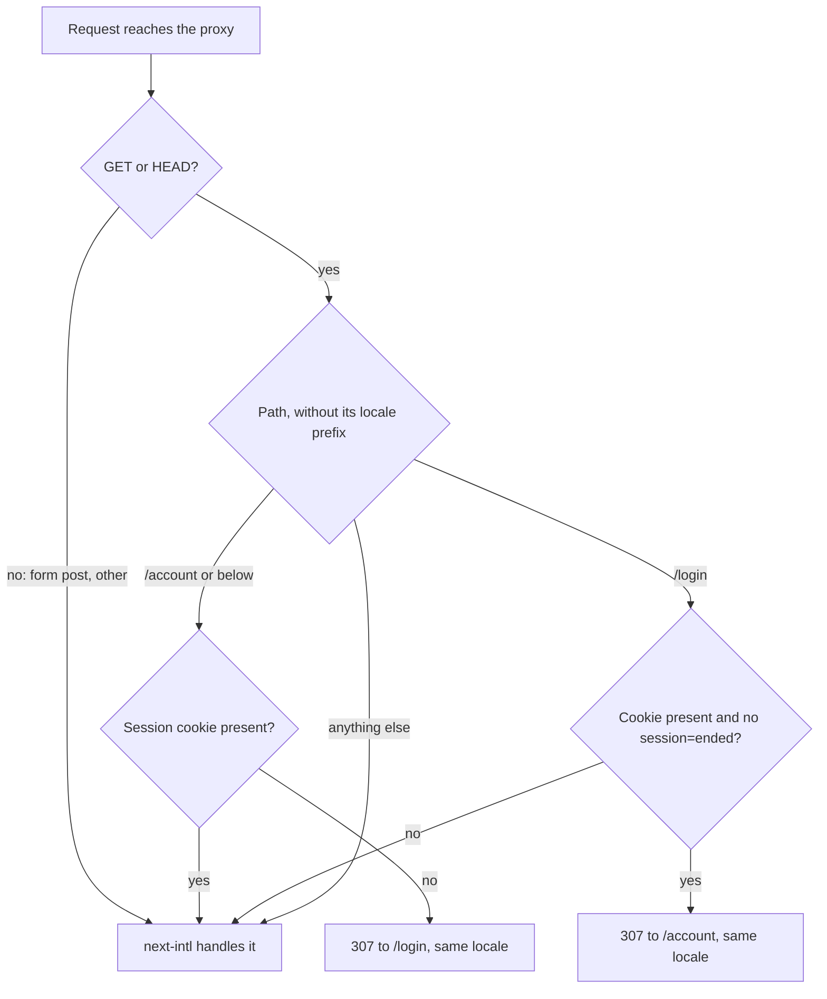
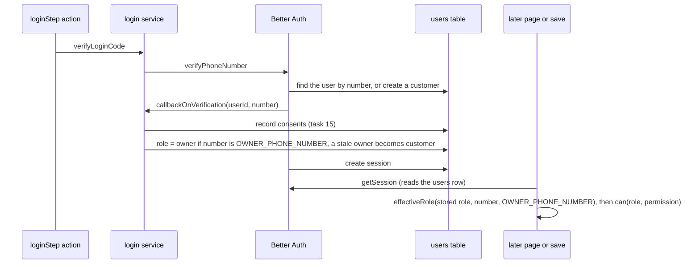

# Roles and Access - Plan

## Goal Capsule

- **Objective:** Only the right people can reach the garage's staff data and saves. Whoever logs in with the owner's number is the owner, and everyone else is a customer until the owner says otherwise. A save of the garage's details refuses anyone but the owner or a manager. A logged-out visitor who opens their account, or a logged-in one who opens the login page, lands on the right page straight away. The tasks that add staff pages and saves (20–41) follow the same written rules.
- **Means:** one pure permission table (KTD1), checks that read the session inside the data-access layer before any database work (KTD6, KTD7), the owner's number as a server setting (KTD2, KTD3), and a cookie-only shortcut in the proxy (KTD4, KTD5).
- **Authority:**
  1. The master plan (see origin): roles (customer, mechanic, manager, owner; mechanics can't see customers' phone numbers), "a data-access layer `dal/` where every query checks ownership or role", the risk "users reaching others' data by changing IDs", and the verification line naming the `can()` matrix tests.
  2. The task 16 steps in `document/task/task.md`, with their notes from tasks 14 and 15.
  3. `CLAUDE.md`: workflow, Database, Login and sessions, site shell (`ensureStatic`), Languages, Server Actions.
  4. This plan.

  These lessons in `document/solutions/` apply:
  - `conventions/better-auth-phone-login-only-from-server-actions.md`: points 1 (no Route Handler; PGlite's one connection), 4 (`callbackOnVerification` runs before the session and nothing is rolled back), 5 (no personal data in logs) and 6 (state on `globalThis`; a change to `auth.ts` needs a dev-server restart);
  - `conventions/nextjs-16-catch-only-expected-request-api-errors.md`: `unstable_rethrow` first in any `catch` near `redirect()` or `notFound()`;
  - `conventions/playwright-networkidle-hangs-after-second-page-load.md`: `expectNoErrors` only on a test's first page load; `freshNumber()` per test;
  - `conventions/nextjs-16-dev-server-is-not-one-process-use-cache-probe.md`: database access only through `getDatabase()`;
  - `conventions/nextjs-16-read-bundled-docs-image-priority.md`: check each Next.js API in `node_modules/next/dist/docs/`;
  - `conventions/lint-guards-test-real-jsx-shapes.md`: prove each new guard by watching its test fail first;
  - `conventions/run-commands-before-documenting-output.md`: the learning doc shows only real output.
- **Execution profile:**
  - Units run in order. U1 and U4 are written test-first: they are pure logic.
  - Database tests run on in-memory PGlite in Vitest's node project, as in `src/server/dal/garage.test.ts`.
  - No schema change and no migration (KTD8).
  - Aim for a diff a reviewer can read in one sitting: no admin pages, no team UI, no new UI on `/account`.
  - `npm run check` after each unit; `npm run test:e2e` at U7. When the SEO Stop hook asks, run `seo-reviewer` in the foreground.
- **Stop conditions:** stop and ask the owner when:
  - a schema change or migration looks necessary;
  - `/` stops building as `○ /en`, or `/login` and `/account` lose their prerendered shells;
  - `better-auth/cookies` can't be imported into `src/proxy.ts`, or its cookie names differ from `__Secure-better-auth.session_token` and `better-auth.session_token`;
  - Better Auth no longer calls `callbackOnVerification` for an existing user;
  - a step would add a Better Auth Route Handler or browser client, a global install, or `npx playwright install`.
- **Who finishes:** `ce-work` builds and commits on `16_roles_access`, then stops. The main session runs `ce-code-review`, `code-reviewer`, the learning doc and the compound step. It asks the owner before pushing and opening the pull request (`CLAUDE.md`, task workflow step 11).

---

## Product Contract

### Summary

Add a permission table that says what each role may do, and checks that use it in pages, Server Actions and the data-access layer. The owner is whoever logs in with the number in a new `OWNER_PHONE_NUMBER` setting, which is the garage's own number. `saveGarage` refuses everyone but the owner and managers. The proxy sends a logged-out `/account` to `/login`, and a logged-in `/login` to `/account`, with real 307s. `CLAUDE.md` gets the rules the later tasks follow.

### Problem Frame

Task 15 gave the site a login, and every user it creates is a `customer`. Nothing yet decides what a role may do, so the staff tasks (26–41) have no checks to build on. Without a shared rule, each would invent its own role comparisons, and one forgotten check would let a customer reach staff data or saves. The master plan names that risk: users reaching others' data by changing IDs. `saveGarage` exists and changes what every visitor sees, but nothing guards it, so its file forbids anyone from calling it until this task.

There is no owner yet either. The owner has to log in like everyone else, by phone code, and then hold the owner role. No form or request from a browser may ever choose a role.

Two rough edges are left over from task 15. The session is read inside `<Suspense>` so the pages stay prebuilt, which means a logged-out `/account` redirects in the browser with status 200 (`node_modules/next/dist/docs/01-app/02-guides/streaming.md`, "Status codes"). A logged-in `/login` does the same. Task 15's docs promised task 16 would add real redirects.

### Requirements

**Permissions**

- R1. One pure table decides what each role may do. `can(role, permission)` answers it over a short list of named permissions that later tasks use. Customers have none of them; the owner has all.
- R2. Mechanics never get the permission to see customers' phone numbers. Managing the team and roles is the owner's alone.

**The owner**

- R3. Whoever logs in with the owner's number is the owner. Everyone else starts as a customer, and no browser request can choose or change a role.
- R4. Changing the owner's number is a settings change with no code change. From the next request on, the new number is the owner and the old number is a customer. *(Corrected after `ce-code-review`, 2026-10-29: `serverEnv()` reads settings once per process, so the change needs a redeploy or restart first; from then on it applies even to open logins.)*

**Protected pages and saves**

- R5. A logged-out visitor who opens `/account`, or any page under it, gets a 307 to `/login` before any page renders. A logged-in visitor who opens `/login` gets a 307 to `/account`.
- R6. The proxy's redirects are shortcuts only. Every page and every save still checks the session itself, and a leftover cookie whose session is gone never causes a redirect loop.
- R7. Form submissions (Server Action POSTs) pass the proxy without a redirect. The proxy's language handling and its skip list keep working.
- R8. A save of the garage's details is refused, before anything is read or written, unless the signed-in user may edit the garage (owner or manager).
- R9. A page that needs a permission shows the 404 page to a signed-in user without it, and sends a signed-out visitor to `/login`.

**Conventions**

- R10. `CLAUDE.md` and `document/task/task.md` say how later tasks add checks: which helper to call, where, and what to test.
- R11. Public pages stay prebuilt (`○ /en`), and nothing logs a phone number, code or session token.

### Key Decisions

- **The owner's number is the garage's own number, +91 97647 50567.** (session-settled: user-directed — chosen over a separate personal mobile for the owner: the owner answered "The garage number" on 2026-10-28.) Governs R3, R4.

### Success Criteria

- A reviewer can see in one pass where every role decision lives (one table) and where every check runs (pages, actions, data-access layer).
- The task stays small: no admin pages (task 26) and no team management UI (task 29).

### Scope Boundaries

- No `/admin` pages, navigation by role, or staff UI (task 26).
- No way to assign mechanic or manager roles, and no audit log (task 29). Until then, roles other than owner can only be set in the database by hand.
- No customer data checks beyond `/account` itself: vehicles (21), bookings (23, 25) and jobs (31) bring their own, following R10's rules.
- No "return to the page you wanted" after login. Only `/account` is protected today, and it is also where login lands.

Considered and not built:

- **Showing the role on `/account`.** It would make the owner role visible, but it changes the page's one-line layout and nobody asked for it. The owner role is proven by PGlite tests with the real Better Auth. Task 26's role-based navigation is the first place a role shows.
- **A browser test that a customer is refused a staff page.** There is no staff page yet, and a page built only for the test would prove what the unit tests already prove. Task 26 adds it with `/admin`.
- **Clearing a leftover session cookie.** A page render can't write cookies, and clearing it in the proxy on a GET would let any website log a visitor out with a link. The `?session=ended` marker (KTD5) avoids the loop without it. Revisit if leftover cookies cause visible trouble.

#### Deferred to Follow-Up Work

The follow-ups that U8 writes into `document/task/task.md`:

- Task 20: set `OWNER_PHONE_NUMBER` on Vercel staging (required there).
- Task 21: vehicle and profile data read the user from the session and filter by it in the query; a test that customer A can't read or change customer B's vehicle by its id.
- Task 23: a booking takes its customer from the session after the inline code, never from a form field.
- Task 25: another customer's booking id gives a 404, not a 403.
- Task 26: add `/admin` to the proxy's protected paths; every `/admin` page calls `requirePermission(locale, "admin.open")` itself, not only its layout; browser tests that a customer gets a 404 and a logged-out visitor a 307; revisit `forbidden()`.
- Task 29: assigning roles needs `team.manage`; nobody can be given `owner` (it comes from the setting); the team list shows the effective role.
- Task 31: a mechanic's job queries filter by the assigned mechanic in the query, and never select a customer's phone number.

### Open Questions

None block the work. Each has a default the plan uses.

- **What can a manager do?** Default: everything except managing the team and roles, including prices, estimates and reports (`document/website/features.md`, "Owner / manager"). One row of the table changes if the owner wants reports or prices kept to themselves.
- **What does staff see on a page they can't use?** Default: the site's 404 page (KTD7). A "You don't have access" page needs a Next.js feature that is still experimental. Revisit in task 26.
- **When the owner's number changes, what is the old number?** Default: a customer. The old SIM may have been lost or passed on, so it shouldn't keep staff access.
- **Is the garage's number the owner under `npm run dev` too?** Default: yes, so the owner can log in as owner locally through `/dev/outbox`. A developer can set another number in `.env.local`.

---

## Planning Contract

### Key Technical Decisions

- KTD1. **Permissions, not role lists.** `src/domain/permissions.ts` holds one table from each permission to the roles that have it, and `can(role, permission)`. Pages, actions and the data-access layer ask about a permission. No other code compares roles (`role === "owner"`). One table is one thing to review and to pin in a test, which is what the master plan's "`can()` matrix tests" asks for. Data a customer owns (their vehicles, their bookings) is not a permission: the rule there is "signed in, and the row is yours" (KTD6).

- KTD2. **The owner's number is a server setting, `OWNER_PHONE_NUMBER`.** `serverEnv()` reads it. It must be an Indian mobile in E.164 form. It is required on staging and production, and locally defaults to the garage's seeded number. This puts the Key Decision into practice (R3, R4). Alternatives rejected:
  - Owner = `garage_settings.phone`: managers may edit the garage's details (`garage.edit`), so a manager could make their own number the owner.
  - A seeded owner user row: the seed runs only on a fresh local PGlite, not on the owner's existing `.pglite/` or task 20's Postgres, and a number change would need SQL.
  - A constant in code: every number change would need a pull request.
  - Better Auth `databaseHooks` (`user.create.before` plus `user.update.before`). They would work: hook data is merged after the `input: false` filter (`node_modules/better-auth/dist/plugins/phone-number/routes.mjs:364-374`, `dist/db/with-hooks.mjs:18-22`). But they put role logic in Better Auth's settings, where a change needs a restart, and they don't cut off an old owner's session that is still live.

- KTD3. **The owner role is worked out on every session read and written to the users row at each login.**
  - `effectiveRole(storedRole, phoneNumber, ownerPhoneNumber)` in `src/domain/roles.ts`: the owner's number gives `owner`, a stored `owner` on any other number gives `customer`, and otherwise the stored role stands. `getCurrentUser()` returns it, so a settings change applies on the next request, even to a 30-day session already open (R4).
  - The login service's verified-login step writes the same rule into `users.role`, so the table matches for the team list and reports (tasks 29, 41). Better Auth runs that step (`callbackOnVerification`) after every correct code, for new and existing users, before it creates the session (`routes.mjs:357-395`). The endpoint isn't wrapped in a transaction, so our own write there can't wait on the single PGlite connection.
  - `getSession` reads the users row fresh each time (`dist/db/internal-adapter.mjs:355-368`), and the session cookie cache is off by default (`dist/api/routes/session.mjs:39`), so a stored role is never stale.
  - `getCurrentUser()` reads `serverEnv()` before its `withoutDetails` wrapper, so a settings error keeps its own message instead of becoming a `LoginServiceError`.

- KTD4. **The proxy checks only whether a session cookie is present, only on GET and HEAD, only for listed paths.**
  - `getSessionCookie` from `better-auth/cookies` accepts both `__Secure-better-auth.session_token` and `better-auth.session_token`. It checks no signature and reads no database (`node_modules/better-auth/dist/cookies/index.mjs:263-272`), which is what the Next.js auth guide asks of a proxy (`node_modules/next/dist/docs/01-app/02-guides/authentication.md`, the optimistic-checks section).
  - Server Action POSTs reach the proxy at the page's own path (`.../01-app/03-api-reference/03-file-conventions/proxy.md`). The login form posts to `/login` and Log out posts to `/account`, so any method other than GET and HEAD is never redirected (R7).
  - The decision is a pure function in `src/lib/access-routes.ts`: protected path prefixes (`/account` today), the login path, and locale prefixes. `src/proxy.ts` calls it before next-intl's handler and otherwise returns next-intl's response unchanged. The matcher doesn't change. `NextResponse.redirect` defaults to 307 (`node_modules/next/dist/server/web/spec-extension/response.js`).

- KTD5. **Redirects to `/login` from the real checks carry `?session=ended`, and the proxy never sends such a request on to `/account`.** This breaks the loop a leftover cookie would cause (R6). A cookie whose session row is gone (after `npm run db:reset`, a deleted session, a changed secret) still passes the proxy, but the page finds no session:

  | Step | Request | Cookie | What answers |
  | --- | --- | --- | --- |
  | 1 | GET `/login` | leftover | proxy: 307 to `/account` |
  | 2 | GET `/account` | leftover | proxy lets it through; the page's check finds no session and redirects in the browser |
  | 3 | GET `/login?session=ended` | leftover | proxy lets it through (marker); the login form shows |
  | 4 | POST `/login` (log in) | replaced | proxy lets it through (POST); the new cookie overwrites the old one |

  Rejected: skipping the browser's internal page-data requests in the proxy. Next.js hides their headers from the proxy (`proxy.md`), and a redirect from a streamed page is a meta tag, which loads the next page as a normal document (`.../04-functions/redirect.md`).

- KTD6. **The data-access layer checks the session itself, first, before it touches the database.**
  - `authorize(permission)` in `src/server/auth/access.ts` reads `getCurrentUser()`. It returns the user, or throws `AccessDeniedError`, which holds a reason (`signedOut` or `notAllowed`) and the permission, and nothing else. Every exported write in `src/server/dal/` calls it on its first line, before it checks its input, calls `getDatabase()` or opens a transaction (R8).
  - Functions over a user's own data take the user from the session, never a user id from their caller, and filter by it in the query's `WHERE`.
  - Why the data-access layer reads the session itself: it is the Next.js guide's data-access-layer pattern (`authentication.md`; `.../02-guides/data-security.md`), no caller can hand it a made-up user, and the check always comes before the transaction. A session read is a database query, and PGlite has one connection: a query made while a transaction holds it waits forever.
  - Cached reads (`'use cache'`) can't read request data, so they stay for public data and never call `authorize`.

- KTD7. **Pages and Server Actions use `requireUser(locale)` and `requirePermission(locale, permission)`** from `src/server/auth/access.ts`.
  - Signed out: a redirect to `/login?session=ended` (next-intl's `redirect`, which works in Server Components and in Server Actions).
  - Signed in without the permission: `notFound()` (R9). `forbidden()` still needs `experimental.authInterrupts` in Next.js 16.4.3 (`node_modules/next/dist/server/config-shared.d.ts`) and has no global fallback page. Inside `<Suspense>`, where every session read sits, it answers 200 with noindex anyway (`.../04-functions/forbidden.md`). `notFound()` is stable and shows the branded 404.
  - There is no `requireStaff` or `requireRole`. A staff check is `requirePermission(locale, "admin.open")` (KTD1).
  - A Server Action calls `requireUser(locale)` first, so an ended session sends the person to login instead of an error. The data-access layer's `authorize` is the real check. An action never reads a role or a user id from its form data. React's `cache()` does nothing inside Server Actions (`authentication.md`), so an action reads the session twice; that is accepted.

- KTD8. **No schema change.** `users.role` and the `user_role` enum exist since task 15. If implementation finds a migration is needed, stop (Goal Capsule). If the owner approves one, run `git fetch origin && git merge origin/main` right before `npm run db:generate`, because the parallel sessions (tasks 17 and 22) add migrations.

### High-Level Technical Design

The permission table (KTD1). Rows are what U1's test pins; "first used by" names the task that first calls the permission.

| Permission | Customer | Mechanic | Manager | Owner | First used by |
| --- | --- | --- | --- | --- | --- |
| `admin.open` | – | yes | yes | yes | 26 |
| `bookings.manage` | – | – | yes | yes | 26, 27 |
| `jobs.update` | – | yes (assigned jobs: the query checks) | yes | yes | 31 |
| `customers.contact` | – | – | yes | yes | 26, 29, 31 |
| `estimates.manage` | – | – | yes | yes | 33 |
| `garage.edit` | – | – | yes | yes | 16 (`saveGarage`), 28, 40 |
| `content.edit` | – | – | yes | yes | 37, 38, 39, 40 |
| `team.manage` | – | – | – | yes | 29 |
| `reports.view` | – | – | yes | yes | 41 |

The proxy's decision (KTD4, KTD5):

The owner role at login and on every read (KTD3):

### Assumptions

Agent bets made without the owner's confirmation (scoping confirmation was off for this run):

- The permission list and who holds each one, for tasks 26–41. Each later task may rename or split a permission; it changes the table and the pinned test together.
- No browser test of a staff-only refusal in this task (Scope Boundaries). Unit and PGlite tests cover `requirePermission`, `authorize` and `saveGarage`.
- `/account` shows no role.
- The marker is the query `session=ended`.
- No `next` (return-to) parameter on `/login`. Adding one later needs a check that it is a local path.
- A target size of about 2,000 changed lines including tests and docs, against task 15's ~6,300.

### Deferred to Implementation

- Exact names: `authorize`, `AccessDeniedError`, the verified-login step and the users-table function, and how `access-routes.ts` names its exports.
- How `src/proxy.test.ts` builds requests: `NextRequest` objects, plus the helpers in `next/experimental/testing/server` if they cover redirects and rewrites.
- How tests assert a redirect or 404 from the helpers. Follow `src/components/account/account-details.test.tsx` and `src/app/[locale]/login/redirect-if-signed-in.test.ts`.
- Whether `e2e/login.spec.ts` and the new spec share a `logIn` helper in `e2e/helpers.ts`.

### Risks

| Risk | Mitigation |
| --- | --- |
| Owner access rests on one SIM: whoever holds the garage SIM (or swaps it) holds the owner role. | Accepted for version 1. R4 makes cutting off a lost SIM one settings change. A second factor for staff is a backlog candidate for the launch tasks (44). |
| Prefetches pass through the proxy too, so a prefetched link to `/account` gets the 307, and the docs don't cover a prefetch that redirects. | Nothing links to `/account` today. Task 21's header link already uses `prefetch={false}`. |
| A Better Auth upgrade renames the session cookie, and the proxy stops redirecting. | The page checks still protect everything. U4's request-level test pins both cookie names. |
| Sessions 2 and 3 edit `CLAUDE.md` and `task.md` at the same time. | U8's docs go in their own commits, after merging `origin/main`. |
| `forbidden()` goes stable in a later Next.js. | Revisit KTD7 in task 26. |

### System-Wide Impact

- **The auth boundary for every later task:** tasks 20–41 build on `can()`, `authorize` and the `require*` helpers. A wrong default here spreads, which is why the table is pinned in a test and `CLAUDE.md` gets the rules (R10).
- **Every page request:** the proxy adds a cookie read and a path check, no I/O.
- **Every login:** one extra `UPDATE users` in the verified-login step. If it fails, the login fails with no session, like a failed consent record.
- **`saveGarage`:** callers (tasks 28, 40) now get `AccessDeniedError` for the wrong user. Its signature stays the same.

### Sources and Research

- Next.js 16.4.3 bundled docs: `01-app/02-guides/authentication.md` (optimistic checks in the proxy, data-access layer, checks in Server Actions, no auth checks in layouts alone); `01-app/02-guides/data-security.md`; `01-app/03-api-reference/03-file-conventions/proxy.md` (Node runtime by default, static matcher, Server Actions reach the proxy); `01-app/03-api-reference/04-functions/redirect.md`, `forbidden.md`, `unauthorized.md`; `01-app/02-guides/streaming.md` ("Status codes").
- Better Auth 1.7.14 source: `dist/cookies/index.mjs` (`getSessionCookie`), `dist/plugins/phone-number/routes.mjs` (verify path and `callbackOnVerification`), `dist/db/internal-adapter.mjs` (session read joins the users row), `dist/api/routes/session.mjs` and `dist/integrations/next-js.mjs` (no cookie cache; `nextCookies()` drops writes it can't make).
- Repo: `src/server/auth/session.ts`, `src/server/auth/login.ts`, `src/server/auth/instance.ts`, `src/server/dal/garage.ts`, `src/proxy.ts` and `src/proxy.test.ts`, `src/server/env.ts`, `src/server/db/schema.ts` (`users.role`), `e2e/login.spec.ts`.
- The task 15 plan, `document/plans/2026-10-28-1155-feat-otp-login-plan.md` ("Deferred to Follow-Up Work": task 16).

---

## Implementation Units

### U1. Permission table and owner rule

**Goal:** the pure rules: what each role may do, and which role a user really has.

**Requirements:** R1, R2, R3, R4; KTD1, KTD3.

**Dependencies:** none.

**Files:**
- Create `src/domain/permissions.ts`, `src/domain/permissions.test.ts`
- Modify `src/domain/roles.ts` (add `effectiveRole`; update the header comment); create `src/domain/roles.test.ts`

**Approach:**
- The table as a typed constant, `Permission` as its keys, and `can(role, permission)`. No imports beyond `roles.ts`.
- Each permission carries a short comment naming the task that uses it, as in the High-Level Technical Design table.
- `effectiveRole` follows KTD3.

**Execution note:** write the tests first.

**Patterns to follow:** `src/domain/consent.ts` and `consent.test.ts` (a pinned copy in the test that fails until both change together); `src/domain/login.ts` (pure rules with plain-English comments).

**Test scenarios:**
- The test writes out the full expected table (every role against every permission) and compares it with `can()`. Changing one cell in `permissions.ts` fails it.
- The owner can do every permission, and a customer none.
- A mechanic has `admin.open` and `jobs.update`, but not `customers.contact`.
- Only the owner has `team.manage`.
- An unknown permission name is a type error (`@ts-expect-error`).
- `effectiveRole`: the owner's number with a stored `customer` gives `owner`.
- `effectiveRole`: a stored `owner` on another number gives `customer`.
- `effectiveRole`: a stored `manager` on another number stays `manager`; the owner's number with a stored `mechanic` gives `owner`.

**Verification:** `npm run check` passes, and the table test fails when one cell is changed by hand.

### U2. The `OWNER_PHONE_NUMBER` setting

**Goal:** the owner's number comes from a checked server setting.

**Requirements:** R3, R4; KTD2.

**Dependencies:** none.

**Files:**
- Modify `src/server/env.ts`, `src/server/env.test.ts`, `.env.example`

**Approach:**
- Add `ownerPhoneNumber` to `ServerEnv`. Add problems for `OWNER_PHONE_NUMBER`: `missing` on staging and production (it reuses the existing explanation), and a new `not-mobile` explained in words, never with the value.
- Check it with `isIndianMobileNumber` (`src/lib/contact-links.ts`).
- The local default is a named constant equal to the garage's seeded number.
- Document it in the header comment block. In `.env.example`, use a fake number (`+919876543210`), commented out like the others.

**Patterns to follow:** `BETTER_AUTH_SECRET` in `parseServerEnv`: required when deployed, with a local default.

**Test scenarios:**
- Unset locally: the default equals `ownerGarage.phone` from `src/server/db/seed-data.ts`.
- Set to a valid mobile: that number.
- `APP_ENV=staging` or `production` without it: a `ServerEnvError` listing `OWNER_PHONE_NUMBER` `missing`, alongside the other problems.
- `"+91 97647 50567"` (spaces), `"9764750567"` (no +91) and a landline `"+912012345678"` each give `not-mobile`.
- The error message never contains the value that was set.

**Verification:** `npm run check` passes.

### U3. The owner role at login and in the session

**Goal:** the owner's number gets the owner role in the users table at each login, and in every session read at once.

**Requirements:** R3, R4, R11; KTD3.

**Dependencies:** U1, U2.

**Files:**
- Create `src/server/dal/users.ts`, `src/server/dal/users.test.ts`
- Modify `src/server/auth/login.ts`, `src/server/auth/instance.ts`, `src/server/auth/session.ts`
- Tests: `src/server/auth/login.test.ts`, `src/server/auth/session.test.ts`

**Approach:**
1. `users.ts`: one function that brings a user's stored role in line with the owner rule. The owner's number sets `owner`. Any other number sets `customer` only where the stored role is `owner`. One `UPDATE` either way, with no read first. It is the first function in this folder called by the login service rather than by a page, so its comment says it needs no `authorize` (it only applies the setting).
2. `login.ts`: the verified-login step records consents first, then syncs the role, with the owner's number from `serverEnv()`. A refused login changes no role. `instance.ts` wires that step as `onVerified`. The auth instance is kept on `globalThis`, so a dev-server restart is needed (Better Auth lesson, point 6).
3. `session.ts`: read `serverEnv()` before `withoutDetails`, then return `effectiveRole(...)` as `role`.

**Patterns to follow:** `recordLoginConsents` in `src/server/dal/consents.ts`; the PGlite setup in `src/server/dal/garage.test.ts` and `src/server/auth/login.test.ts`. Mock `@/server/env` where a test needs another owner number: `serverEnv()` remembers its first answer.

**Test scenarios:**
- `users.test`: a customer row on the owner's number becomes `owner`.
- `users.test`: a stored `owner` on another number becomes `customer`; a `manager` on another number is unchanged.
- `users.test`: an unknown user id changes nothing and doesn't throw.
- `login.test` (real Better Auth on PGlite): a first login with the owner's number leaves the users row as `owner`. Covers R3.
- `login.test`: an existing customer on the owner's number becomes `owner` on its next login.
- `login.test`: a login refused for a missing consent leaves the stored role unchanged.
- `session.test`: a stored `customer` on the owner's number reads as `owner` with no new login. Covers R4.
- `session.test`: a stored `owner` on another number reads as `customer`.
- `session.test`: the result still holds only `id`, `phoneNumber` and `role`.
- `session.test`: a bad setting surfaces as `ServerEnvError`, not `LoginServiceError`.
- `auth.test.ts` stays unchanged and green, including "a role sent with the code is ignored".

**Verification:** `npm run check` passes; under `npm run dev`, logging in with the garage's number through `/dev/outbox` leaves that user's row as `owner`.

### U4. Proxy redirects

**Goal:** real 307s for a logged-out `/account` and a logged-in `/login`, from a cookie check only.

**Requirements:** R5, R6, R7; KTD4, KTD5.

**Dependencies:** none (it shares no code with U1–U3).

**Files:**
- Create `src/lib/access-routes.ts`, `src/lib/access-routes.test.ts`
- Modify `src/proxy.ts`, `src/proxy.test.ts`

**Approach:**
- `access-routes.ts` has no Next.js imports. It exports the protected prefixes (`/account`), the login and account paths, the `session=ended` marker, and the decision function. The function takes the method, path, query, whether a cookie is present, and the locales and default locale. It returns a target path or nothing.
- The locale prefix is stripped before matching and put back on the target. The default locale gets no prefix (`localePrefix: "as-needed"` in `src/i18n/routing.ts`), so `/en/account` goes straight to `/login`.
- A protected prefix matches the path itself or a path under it (`/account/vehicles`), never `/accounting`.
- `proxy.ts`: a default-export function that asks `getSessionCookie(request)` and the decision function. It returns `NextResponse.redirect(new URL(target, request.url))`, or else next-intl's handler (`createMiddleware(routing)`) with the request unchanged.
- Keep `config` and its comment as they are. Add a comment explaining the auth step and pointing to the marker (KTD5).

**Execution note:** write `access-routes.test.ts` first.

**Patterns to follow:** the current `src/proxy.ts` comments; `src/proxy.test.ts`'s use of `next/experimental/testing/server`.

**Test scenarios:**
- `access-routes.test` (pure, with locales `["en", "hi"]` so the Hindi prefix is covered now):
  - GET `/account`, `/account/vehicles` and `/en/account`, signed out: `/login`.
  - GET `/hi/account`, signed out: `/hi/login`.
  - GET `/account`, signed in: nothing.
  - GET `/login`, signed in: `/account`; GET `/hi/login`, signed in: `/hi/account`.
  - GET `/login?session=ended`, signed in: nothing. GET `/login`, signed out: nothing.
  - POST `/login` signed in, and POST `/account` signed out: nothing. HEAD `/account` signed out: `/login`.
  - `/accounting`, `/account-help`, `/services` and `/`: nothing.
- `proxy.test` (request level):
  - GET `/account` with no cookie: 307, Location `/login`.
  - GET `/account` with `better-auth.session_token`: no redirect to `/login` (next-intl's rewrite to `/en/account`).
  - GET `/login` with `__Secure-better-auth.session_token`: 307 to `/account`. Together with the case above, this pins both cookie names.
  - GET `/login` with an empty cookie value: no redirect.
  - GET `/login?session=ended` with a cookie: no redirect.
  - POST `/login` with a cookie and a `next-action` header: not a 307.
  - GET `/en/services`: next-intl's redirect to `/services` still happens.
  - The existing matcher tests stay unchanged and green.

**Verification:** `npm run check` passes; `npm run build` still lists `/` as `○ /en`.

### U5. Access helpers for pages, actions and the data-access layer

**Goal:** the three helpers later tasks call, and `/account` using one of them.

**Requirements:** R6, R9; KTD5, KTD6, KTD7.

**Dependencies:** U1, U3, U4 (the marker and login path).

**Files:**
- Create `src/server/auth/access.ts`, `src/server/auth/access.test.ts`
- Modify `src/components/account/account-details.tsx`, `src/components/account/account-details.test.tsx`
- Modify the comment in `src/app/[locale]/login/redirect-if-signed-in.tsx` (the proxy now sends logged-in visitors on with a 307; this check remains for leftover cookies and in-app navigation)

**Approach:**
- `requireUser(locale)` and `requirePermission(locale, permission)` follow KTD7. Use the `return redirect({ href, locale })` idiom, with the marker as a query (`href` with a `pathname` and a `query`).
- `authorize(permission)` and `AccessDeniedError` follow KTD6. The error's message names the reason and the permission, never a number or an id.
- `AccountDetails` calls `requireUser(locale)` instead of its own check. Update its comment: the proxy now answers a missing cookie with a 307, and this check catches a leftover cookie.

**Patterns to follow:** `src/server/auth/errors.ts` (an error that names a step and a kind, nothing personal); the `"server-only"` first line in `src/server/`.

**Test scenarios:**
- `requireUser`: a signed-in user comes back as is.
- `requireUser`: signed out, it redirects to `/login?session=ended`.
- `requirePermission`: an owner with `garage.edit` comes back.
- `requirePermission`: a customer with `admin.open` gets `notFound()`; signed out gets the redirect, not the 404.
- `authorize`: an owner or a manager with `garage.edit` comes back.
- `authorize`: a mechanic gets `AccessDeniedError` (`notAllowed`); signed out gets `AccessDeniedError` (`signedOut`).
- `authorize`: the error's message contains the permission and no phone number.
- `AccountDetails`: signed out, it redirects to `/login?session=ended`; signed in, it still shows "Logged in as …".

**Verification:** `npm run check` passes.

### U6. `saveGarage` checks `garage.edit` first

**Goal:** nobody but the owner or a manager can save the garage's details, and the check comes before any database work.

**Requirements:** R8; KTD6.

**Dependencies:** U5.

**Files:**
- Modify `src/server/dal/garage.ts`, `src/server/dal/garage.test.ts`

**Approach:**
- Make `await authorize("garage.edit")` the first line of `saveGarage`, before `checkGarage`, `getDatabase()` and the transaction.
- Rewrite rule 3 in the file's header comment as the convention: every write calls `authorize` first, and `readGarage` stays public and cached. Tasks 28 and 40 can now call it from a Server Action.
- The signature doesn't change.

**Patterns to follow:** the existing `garage.test.ts` setup. Mock `@/server/auth/session`'s `getCurrentUser`, set to an owner in `beforeEach`, so the existing tests keep their meaning.

**Test scenarios:**
- An owner and a manager each save (the existing happy path, run as each).
- A customer and a mechanic each get `AccessDeniedError`: the rows are unchanged, `updateTag` isn't called and `getDatabase` is never called. That proves the check runs before the database.
- Signed out: `AccessDeniedError` (`signedOut`), and nothing written.
- A customer who sends invalid details gets `AccessDeniedError`, not problem codes: the check runs before validation.
- `readGarage` still reads without calling `getCurrentUser`.

**Verification:** `npm run check` passes.

### U7. Browser tests

**Goal:** prove the real 307s, the leftover-cookie path, and that form posts still work, on the production build.

**Requirements:** R5, R6, R7, R11.

**Dependencies:** U4, U5.

**Files:**
- Create `e2e/access.spec.ts`
- Modify `e2e/helpers.ts` only if a shared `logIn` helper is extracted from `e2e/login.spec.ts`

**Approach:** each test uses its own `freshNumber()`. Read redirect statuses with Playwright's request API and `maxRedirects: 0` (the page's own `request` shares its cookies). Call `expectNoErrors` only on a test's first page load. After a revisit, check `expect(errors).toEqual([])` (networkidle lesson).

**Test scenarios:**
- Logged out: GET `/account` answers 307 with Location `/login`.
- Logged in through the form: GET `/login` answers 307 with Location `/account`, and GET `/account` answers 200.
- Leftover cookie: with a made-up `better-auth.session_token` cookie, opening `/account` ends on `/login?session=ended` with the login heading. Opening `/login` ends there too. No loop: the final URL settles and the heading shows.
- On that page, with the leftover cookie still set, logging in with a code reaches `/account`. A form post that carries a cookie isn't redirected.
- `e2e/login.spec.ts` passes unchanged, including its log-out POST to `/account`.
- No console errors in any test.

**Verification:** `npm run test:e2e` passes.

### U8. Docs and tracker

**Goal:** later tasks find the rules, and the tracker holds the follow-ups.

**Requirements:** R10.

**Dependencies:** U1–U7.

**Files:**
- Modify `CLAUDE.md`:
  - a new "Roles and access" section under Code conventions, covering KTD1, KTD3 and KTD5–KTD7 in rule form;
  - repo map rows for `src/domain/permissions.ts`, `src/server/auth/access.ts`, `src/server/dal/users.ts` and `src/lib/access-routes.ts`;
  - `OWNER_PHONE_NUMBER` in the settings lists;
  - in "Login and sessions", replace "task 16 adds a real 307 in the proxy" with what the proxy now does.
- Modify `document/task/task.md`: tick task 16's steps as they're really done, link this plan, and add the follow-ups from Scope Boundaries ("Deferred to Follow-Up Work"). Reword tasks 28 and 40's "after task 16's role check" steps to "`saveGarage` checks `garage.edit` itself; the action calls `requireUser(locale)` first".
- Modify `readme.md` only if it lists server settings.
- `document/learning/16_roles_access.md` comes later, from the `learning-doc-writer` agent, after the code is committed (task workflow step 8).

**Approach:** merge `origin/main` before the docs commit, because the parallel sessions edit the same files. Notes for the learning doc:
- authentication (who you are) against authorization (what you may do);
- an optimistic check against the real one;
- why a real 307 needs the proxy (a streamed page has already sent 200);
- reaching other people's data by changing an id, and why a function never takes a user id from its caller;
- why the owner is a setting and not the garage's phone;
- the leftover-cookie loop and its marker;
- why the check runs before the transaction.

**Test expectation:** none: docs only.

**Verification:** `code-reviewer` finds the rules, the repo map and the tracker consistent with the code.

---

## Verification Contract

| Gate | Command or check | Proves |
| --- | --- | --- |
| Unit and integration tests, lint, types | `npm run check` | U1–U6: the table, the setting, the owner role, the helpers, the `saveGarage` refusal, the proxy decision |
| Browser tests on a production build | `npm run test:e2e` | U7: the two 307s, no loop with a leftover cookie, form posts unaffected, task 15's login spec unchanged |
| Pages stay prebuilt | `npm run build` route list | `/` is `○ /en`; `/login` and `/account` keep their prebuilt shells (R11) |
| Design catalogue | not needed | No token, `type-*`, `ui/` or `site/` change |
| SEO | `seo-reviewer` in the foreground when the Stop hook asks | `AccountDetails` and the login page comment changed |
| Repo rules | `ce-code-review`, then the `code-reviewer` agent | Task workflow step 9 |

---

## Definition of Done

- Every unit's Verification holds, and `npm run check` and `npm run test:e2e` pass on the final commit.
- No code compares roles outside `src/domain/permissions.ts` and `src/domain/roles.ts`. Every write in `src/server/dal/` calls `authorize` before `getDatabase()`.
- No migration was added. `.env.example` lists `OWNER_PHONE_NUMBER` with a fake value, and no real secret is committed.
- `CLAUDE.md` and `document/task/task.md` are updated (U8). The learning doc exists and links from `task.md`.
- `code-reviewer` reports "Ready to merge", or every "must fix" is fixed. The compound question is answered.
- No dead code from abandoned attempts is left in the diff.
- The branch is pushed and its pull request opened only after the owner says yes.
