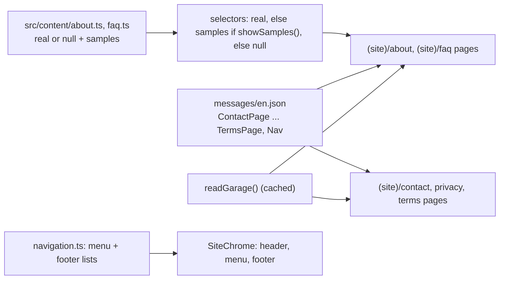

# Info Pages - Plan

## Goal Capsule

- **Objective:** A visitor can find how to reach the garage, what it is, answers to common questions, and how their data is handled, on fast prebuilt pages that state only facts the owner has confirmed or the garage's stored details hold (address, phone, hours). Made-up text never reaches staging or production.
- **Means:** Five server-rendered pages under `src/app/[locale]/(site)/` built from the existing design system and shell pieces, with unknown facts held as dev-only samples in typed content files (KTD1, KTD2). The menu and footer link to them (KTD5), and the login notice links to `/privacy` (KTD6).
- **Authority:**
  1. The owner's facts of 2026-10-29 (Key Decisions below).
  2. The master plan (see origin): row 19, Cache Components rules, and the DPDP line in "Privacy".
  3. The task 19 steps in `document/task/task.md`.
  4. `CLAUDE.md`: Languages, Design system, Keep public pages prerendered, samples rules, Login and sessions (consent wording).
- **Execution profile:** one branch (`19_info_pages`), small commits. Three Claude sessions build tasks in parallel, each in its own git worktree: Session 1 in `go-mechanic` (tasks 15, 16, 21, 23 ...), Session 2 in `go-mechanic-s2` (tasks 17, 18 ...), and this one, Session 3, in `go-mechanic-s3`. Sessions 1 and 2 touch `messages/en.json`, `CLAUDE.md` and `task.md`, so this task adds new namespaces and blocks rather than editing theirs.
- **Stop conditions:** stop and ask if a page can't stay prerendered, or if the privacy draft would have to claim processing the code doesn't do.
- **Who finishes:** Session 3 builds and reviews, then asks the owner before pushing and opening the pull request.

---

## Product Contract

### Summary

Add `/contact`, `/about`, `/faq`, `/privacy` and `/terms`. Contact and about go into the menu; FAQ, privacy and terms go into the footer. The login notice links to the privacy page, and its consent version is bumped. Unknown facts show as labelled samples under `npm run dev` only.

### Problem Frame

The site has a home page and a login, and nothing that answers "where are you, when are you open, how do I pay, what do you do with my number?". The menu has About and Contact, hidden because their pages don't exist. The login asks for consent with a two-line notice and nowhere to read more. India's DPDP Act needs a fuller, standalone notice before its duties apply (about May 2027), and task 43 finalises it with a lawyer. Many facts the about page and FAQ would usually state (the garage's story, team, warranty, parts, job times) aren't known yet. Inventing them would mislead customers of a real business.

### Requirements

**Pages**

- R1. `/contact` shows the address, the opening hours with the live open/closed badge, Call and WhatsApp, and a breakdown line using the garage phone that makes no towing, roadside or round-the-clock promise. It has no map and no directions link until the owner sends the exact map link.
- R2. `/about` shows only confirmed facts in every build: one garage in Kiwale, Pune, for cars and two-wheelers, its hours, and how to book today (WhatsApp or call). Story, team, certifications, workshop photos, genuine parts and warranty appear as labelled samples under `npm run dev` only.
- R3. `/faq` answers, as confirmed facts, how to pay (cash or UPI at the garage; no online payment), how to book today, and when the garage is open. Warranty, job durations, genuine parts, pickup and drop, and the online booking window are dev-only samples.
- R4. `/privacy` is a standalone draft notice in plain language. It itemises exactly what the site stores today and why, who processes it, how long it's really kept, and how to withdraw consent, use the DPDP rights (verified against the mobile number the person logs in with) and complain to the Data Protection Board of India (named, with no portal link until one is verified). The contact is the garage's phone and WhatsApp.
- R5. `/terms` is a draft covering only decided facts: a booking is a request for an arrival time; payment is at the garage, cash or UPI; work beyond what was agreed needs the customer's approval first; contact for problems. Undecided terms (cancellation, warranty, liability) are listed for task 43, not invented.
- R6. The privacy and terms pages say they are drafts, and are kept out of search results (`noindex`) until task 43.

**Navigation and login**

- R7. About and Contact show in the header, phone menu and footer. FAQ, Privacy and Terms show in the footer only. No link points at a page that doesn't exist.
- R8. The login's short notice links to `/privacy`, opening in a new tab so a half-done login isn't lost, and says what the login keeps (the number, when you agreed, and the network address used for security). The notice version changes, and any later change to the `/privacy` wording also needs a new version, so a consent record always names the wording the person was shown.

**Quality**

- R9. Every page stays prerendered and has its own title and description from `messages/en.json`; all page text lives in messages or typed content files, never typed into JSX.
- R10. No sample text, sample heading or `data-sample` mark reaches a production build of any page; tests prove it, as they do for the home page.
- R11. When samples are hidden, a section with nothing real in it disappears whole (heading included), and the last section is never grey (it would merge with the footer).
- R12. A test fails when a new database table is added without its personal data being considered for `/privacy`.

### Key Decisions

- **No directions link and no map yet.** (session-settled: user-directed — chosen over pasting a link now: the owner hasn't got the exact Google Maps link; one built from the address lands at Mukai Chowk.) Governs R1.
- **The breakdown number is the garage phone.** (session-settled: user-directed — chosen over no emergency line or a different number.) Governs R1.
- **Payment at the garage is cash or UPI.** (session-settled: user-directed — chosen over cards and "not sure yet".) Governs R3, R5.
- **Unknown facts are dev-only labelled samples.** (session-settled: user-approved — chosen over leaving the sections out entirely or sending the facts now: the pages can be built and reviewed with realistic content without any of it reaching customers.) Governs R2, R3, R10, R11.

### Scope Boundaries

Not built (considered; what would change the call):

- **A map embed:** it would point at the wrong place (as the directions link would), load Google scripts and cookies before any consent, and slow the page. Revisit with the owner's exact map link.
- **An FAQ accordion:** a closed Radix accordion leaves answers out of the prebuilt HTML. Plain headings and paragraphs keep every answer visible without JavaScript. Revisit if the FAQ grows past about 15 questions.
- **Scroll motion on these pages:** reading pages don't need it, and leaving it out keeps GSAP off them. Revisit if the owner wants the about page to feel like the home page.
- **Marathi and Hindi versions of the privacy notice:** the Act asks for the option of an Eighth Schedule language by the time its duties apply. The `[locale]` routes are ready; the translation belongs to the Hindi task and task 43.
- **A named grievance officer and a DPO:** a non-significant fiduciary needs a named contact person, not a DPO. Naming that person is task 43's owner decision; the draft uses the garage's phone and WhatsApp.

#### Deferred to Follow-Up Work

- Task 42: titles 50–60 characters, canonical URLs, sitemap, Open Graph, and `FAQPage` JSON-LD for `/faq`.
- Task 43: finalise privacy and terms with a lawyer; name the grievance contact; settle the one-year log retention rule (DPDP Rule 8(3)) against the deletion of login-attempt rows and real deletion; delete login-attempt rows on a schedule (today they go only at the next login after 48 hours); delete expired sessions on a schedule, or stop storing their IP and browser details (Better Auth's `disableIpTracking`); whether the 18+ checkbox is enough; a verified Data Protection Board link; remove `noindex` and the draft line; self-serve withdrawal, deletion and export.
- Task 40: FAQ and about content move to the database for the owner to edit.
- Any task that adds personal data (21 vehicles, 23 bookings, 30 photos, 37 reviews, 35 messages): update `/privacy` in the same task (R12's test reminds it).
- When the owner sends the exact map link: add it to the garage's details (a seed change) and a Directions button to `/contact`.

---

## Planning Contract

### Key Technical Decisions

- KTD1. **Pages follow the home page's shape.** Each is an async Server Component in `src/app/[locale]/(site)/<slug>/page.tsx` with `ensureStatic = "navigation"`, `readGarage()` for contact details and `getTranslations()` for text. Each has a `generateMetadata` with a title (`{brand}` in it) and its own description. Text lives in new namespaces: `ContactPage`, `AboutPage`, `FaqPage`, `PrivacyPage`, `TermsPage`. The shared `Contact` namespace stays as it is.
- KTD2. **Unknown facts copy `src/content/home.ts`.** New `src/content/about.ts` and `src/content/faq.ts` hold the real data (`null` or empty today), the samples as `LocalizedText`, a canary phrase each, and selectors that return real data, else samples under `showSamples()`, else `null`. Sample headings and bodies live in these files, not in messages, so they can't ship to the browser by accident. The files are server-only by convention, like `home.ts`, with no `import "server-only"` line: the e2e spec imports their canaries, and Playwright has no alias for that package. Samples render with `data-sample` and the existing `SampleBadge`.
- KTD3. **The FAQ is headings and paragraphs.** Each question is an `h3` with its answer below, grouped under `h2`s. Confirmed answers are message keys (`FaqPage.items.<key>`; messages can't hold arrays). Sample answers come from `faq.ts`. A group with no confirmed answers in production disappears.
- KTD4. **Contact reuses shell pieces, not new shared components.** `OpeningHoursList`, `OpenStatus`, `WhatsAppLink`, `Button`, `telHref` and `formatAddress` are used as they are. The page's action group is one blue Call button and a secondary WhatsApp button that opens a plain chat (`Contact.whatsappMessage`, not the booking message). There's no Book button here, so a visitor with a question isn't steered into booking, and the phone bar already has Book. The breakdown line is a sentence with an inline `tel:` link that points to the hours beside it. No new `src/components/site/` component is added, but the footer changes (KTD5), so `/dev/design`'s Footer sample is updated.
- KTD5. **Links go through `navigation.ts`.** `about` and `contact` flip to `live: true`, each in its page's commit. A new footer-only list (FAQ, Privacy, Terms) joins `sitePages`, so `navigation.test.ts` checks each against its `page.tsx`. It stays out of `liveNavItems()`, so the header and action bar don't pick it up. `SiteChrome` passes the live footer-only items to `SiteFooter` as a separate prop. Their labels are new keys in `Nav`, and the footer's Pages list renders them after the menu items.
- KTD6. **The login notice gets a rich-text link.**
  1. `Login.notice` gains a `<privacy>` tag and is reworded from KTD7's list, so it no longer says only the number and the consent time are kept: it also names the network address kept for security. `LoginFormLabels.notice` becomes a `ReactNode`.
  2. The login page passes `t.rich("notice", { privacy: … })`, as it already does for `help`. The link opens in a new tab with a translated "(opens in a new tab)".
  3. `LOGIN_NOTICE_VERSION` moves to `"2026-10-29"`. `consent.test.ts` pins, under that version, the three login strings and every `PrivacyPage` message, so a later change to the full notice also fails until the version moves. All in one commit.
  4. Tests that match the notice text switch to the tag-free text.
  An attempt recorded on the old version stays on it, which is accurate: the person saw that wording.
- KTD7. **The privacy draft states only what the code does,** including how long each thing is really kept. Research found:
  - **Sessions** store the full IP address and browser details (Better Auth fills `ip_address` and `user_agent` from the request). A session row stays until logout, or until its expired cookie comes back; nothing deletes old ones.
  - **Login attempts** (number, IP where known, consent snapshot) are deleted only when someone next asks for a code, once they're over 48 hours old (`decideAndRecordAttempt`, `LOGIN_RULES.keepRecordsHours`). There's no scheduled job.
  - **Login codes** last 5 minutes. **Consent records and users** stay until task 43 adds deletion.
  Confirm each with the code, or a row read in a test, before writing, and word retention exactly that way.
- KTD8. **A pinned table list guards `/privacy` (R12).** `src/app/[locale]/(site)/privacy/coverage.test.ts` lists every table in `schema.ts` and whether it holds personal data. A new table fails the test until someone adds it to the list, and to the notice; the failure names each unlisted table and says what to do. A CLAUDE.md rule alone would only ask people to remember.
- KTD9. **Legal pages carry a fixed "last updated" date.** For `/privacy` it is `LOGIN_NOTICE_VERSION`, shown with `formatDate`, so the date and the consent version can't drift apart. For `/terms` it is a date in messages. Both have `robots: { index: false }` and a one-line draft note until task 43. The date is never read from the clock.

### High-Level Technical Design

What each page shows in production versus `npm run dev` (directional; exact sections are settled while building):

| Page | Production (confirmed facts) | `npm run dev` adds (samples) |
| --- | --- | --- |
| `/contact` | Address, hours + badge, Call (blue), WhatsApp chat, breakdown line | — |
| `/about` | Who we are (Kiwale, Pune; cars and two-wheelers), hours, how to book, contact call to action | Story, team, certifications, workshop photos (`VisualSlot` stand-ins), genuine parts, warranty |
| `/faq` | Paying (cash or UPI, no online payment), booking today, opening hours | Warranty, job durations, genuine parts, pickup and drop, the online booking window |
| `/privacy` | The full draft notice | — |
| `/terms` | Decided terms only | — |

### Assumptions

Made without the owner's confirmation (scoping confirmation was off):

- Pickup and drop is described only as a dev sample until task 24 builds it. The site makes no pickup claim today.
- The privacy and terms drafts are reviewed by the owner and a lawyer in task 43 before launch. Staging may show them with the draft line.
- The FAQ's real answers are the ones the owner confirmed plus facts the code already holds (hours, booking by WhatsApp or call).

### Risks

| Risk | Mitigation |
| --- | --- |
| Sample text leaks into production | KTD2's server-only files, a canary per page, and the e2e scan of HTML, RSC payload and scripts (copied from `e2e/home.spec.ts`) |
| `/privacy` goes stale as later tasks add data | KTD8's pinned table list, plus a CLAUDE.md rule |
| Merge conflicts with Sessions 1 and 2 in `messages/en.json`, `CLAUDE.md`, `task.md` | New namespaces and blocks only; merge `origin/main` before the pull request |
| The new nav links change shell tests (`site-chrome.test.tsx` landmark count) and the e2e crawler visits five new pages | Update those tests in the page commits; run the full e2e before the pull request |
| Task 17 adds tables in parallel; whichever of 17 and 19 merges second sees `coverage.test.ts` fail | The failure names the tables; that branch adds them to the list (vehicle catalogue tables hold no personal data). Mention it in the PR |
| The footer changes, but `npm run test:design` can't run in this setup: Session 1 owns port 3000, and the config would reuse Session 1's server and pass falsely | Update the `/dev/design` Footer sample; the PR asks for `npm run test:design` after the merge |
| The SEO hook watches the other session's folder (this chat started in `go-mechanic`) | Run `seo-reviewer` by hand on the five pages in this folder |

### Sources and Research

- `src/app/[locale]/(site)/page.tsx` and `page.test.tsx` (page shape, tests); `src/content/home.ts` and `home.test.ts`, `e2e/home.spec.ts` (samples and their guards); `src/app/[locale]/(site)/account/page.tsx` (simple page, `metaTitle`); `src/components/account/login-form.tsx`, `src/app/[locale]/login/page.tsx`, `src/domain/consent.ts`, `consent.test.ts` (the notice).
- DPDP: the Act (2023) and the DPDP Rules, 2025 (G.S.R. 846(E), 13 Nov 2025). Rule 3 (notice contents), Rule 9 (contact person), Rule 14 (rights and a grievance reply within 90 days), Rule 8(3) (one-year log retention, for task 43), s.5(3) (language option). Most duties apply from about May 2027.
- `document/solutions/conventions/playwright-networkidle-hangs-after-second-page-load.md` (call `expectNoErrors` on a page's first load only); `lint-guards-test-real-jsx-shapes.md`; `nextjs-16-read-bundled-docs-image-priority.md`.

---

## Implementation Units

### U1. Sample content for about and FAQ

- **Goal:** The unknown facts exist as dev-only samples behind selectors.
- **Requirements:** R2, R3, R10; KTD2.
- **Dependencies:** none.
- **Files:** create `src/content/about.ts`, `src/content/about.test.ts`, `src/content/faq.ts`, `src/content/faq.test.ts`; modify `src/content/home.test.ts` (extend the "samples only through the selectors" scan).
- **Approach:** mirror `home.ts`: real values `null` (or empty), samples typed as `LocalizedText`, one canary phrase per file, selectors taking the real data as a default parameter.
- **Test scenarios:**
  - Under `NODE_ENV` development each selector gives the samples flagged `sample: true`; under production and test it gives `null`; real data wins in every environment; an empty list counts as none.
  - No source file outside `src/content/` names the sample exports (the scan).
  - No canary phrase appears in `messages/en.json`.
- **Verification:** the suites pass.

### U2. `/contact` and the first live menu link

- **Goal:** The contact page exists and is in the menu.
- **Requirements:** R1, R7, R9, R11; KTD1, KTD4, KTD5.
- **Dependencies:** none.
- **Files:** create `src/app/[locale]/(site)/contact/page.tsx`, `page.test.tsx`; modify `src/components/site/navigation.ts` (contact live), `src/components/site/site-chrome.test.tsx`, `messages/en.json` (`ContactPage`).
- **Approach:** one `h1`; the action group (KTD4: blue Call, secondary plain-chat WhatsApp); the address and hours with `OpeningHoursList` and `OpenStatus`; the breakdown sentence with an inline `tel:` link. Copy says to call the garage and see its hours, and never promises towing, roadside help or 24-hour answers. Section tones alternate, and the last one isn't grey.
- **Test scenarios:**
  - One `h1`; the address, hours and both links render from the mocked garage, so a different phone in the mock shows that phone.
  - Exactly one blue button; no Book link; the WhatsApp link carries the plain chat text, not the booking message.
  - No `maps.google` or `google.com/maps` link anywhere; the breakdown text contains no "24", "tow" or "roadside".
  - `ensureStatic` is `"navigation"`; `generateMetadata` gives the title with the brand and the page's own description.
  - Neighbouring sections never share a tone, the footer included.
- **Verification:** `npm run check` passes, including `navigation.test.ts` with contact live.

### U3. `/about`

- **Goal:** The about page with confirmed facts, and samples in dev.
- **Requirements:** R2, R7, R9, R10, R11; KTD1, KTD2, KTD5.
- **Dependencies:** U1, U2.
- **Files:** create `src/app/[locale]/(site)/about/page.tsx`, `page.test.tsx`, `about-tones.ts` and its test; modify `navigation.ts` (about live), `messages/en.json` (`AboutPage`).
- **Approach:**
  1. Production composition: a short intro saying what the garage is (Kiwale, Pune; cars and two-wheelers), then hours, then how to book with the call to action. One-sentence facts share a section rather than each getting its own band.
  2. In dev, sample sections slot in between: each only when its selector returns data, with `data-sample` and `SampleBadge`. Workshop photos use `VisualSlot` with `photo={null}` (no stock photos).
  3. Tones come from the sections actually rendered, in a small helper beside the page like `home-tones.ts`: neighbours never match, and the last one is never grey.
- **Test scenarios:**
  - Production render: only the confirmed sections, no `[data-sample]`, no sample heading, and no two neighbouring sections share a tone (footer included). The same check passes for the dev set.
  - Development render: every sample section shows with its badge.
  - Booking text links to WhatsApp or Call, never to `/book` while it isn't live.
- **Verification:** the suite passes in both environments.

### U4. `/faq` and the footer's extra links

- **Goal:** The FAQ page, and the footer list that links it.
- **Requirements:** R3, R7, R9, R10, R11; KTD3, KTD5.
- **Dependencies:** U1.
- **Files:** create `src/app/[locale]/(site)/faq/page.tsx`, `page.test.tsx` (tones from the rendered groups, as in U3); modify `navigation.ts` (footer list with `faq`), `navigation.test.ts` if needed, `src/components/site/site-chrome.tsx` and `site-footer.tsx` and their tests, `src/app/[locale]/dev/design/page.tsx` (the Footer sample passes the footer-only list), `messages/en.json` (`FaqPage`, `Nav.faq`).
- **Test scenarios:**
  - Production: the paying, booking-today and hours answers show; "cash" and "UPI" appear and no card or online payment is offered.
  - Development: the sample questions show with badges; a group with only samples is absent in production.
  - The footer shows FAQ after the menu items; the header and action bar don't.
- **Verification:** suites pass; the footer test covers the new link.

### U5. `/privacy` and `/terms`

- **Goal:** The two drafts and their footer links.
- **Requirements:** R4, R5, R6, R7, R9, R12; KTD7, KTD8, KTD9.
- **Dependencies:** U4.
- **Files:** create `src/app/[locale]/(site)/privacy/page.tsx`, `page.test.tsx`, `coverage.test.ts`, `src/app/[locale]/(site)/terms/page.tsx`, `page.test.tsx`; modify `navigation.ts`, `messages/en.json` (`PrivacyPage`, `TermsPage`, `Nav.privacy`, `Nav.terms`).
- **Approach:**
  1. Confirm KTD7's list of what each table stores and for how long, then write the notice from it: data, purpose, processors (hosting, the SMS provider), retention as it really is, rights (verified against the login number), withdrawal, complaint (the Data Protection Board of India, no link), contact, draft line, last updated.
  2. Layout for reading on a phone: the narrow prose width (`max-w-2xl`), a short list of anchor links at the top, and each kind of data as a heading with a short stacked list (what, why, who, how long), never a table.
  3. Terms cover R5's decided points only.
- **Test scenarios:**
  - Each page has one `h1`, the draft line and the fixed last-updated date; `generateMetadata` sets `robots.index` false.
  - The privacy page names the garage phone from the mocked garage, and its login-attempt wording uses `LOGIN_RULES.keepRecordsHours` and says the deletion happens at the next login, not on a timer.
  - The last-updated date on `/privacy` is `LOGIN_NOTICE_VERSION` formatted.
  - `coverage.test.ts` lists exactly the tables in `schema.ts`; adding a fake table name to the schema list makes it fail.
- **Verification:** suites pass; `seo-reviewer` sees `noindex` as intended.

### U6. The login notice links to `/privacy`

- **Goal:** Consent wording points to the full notice, with a new version.
- **Requirements:** R8; KTD6.
- **Dependencies:** U5.
- **Files:** modify `messages/en.json` (`Login.notice`, a new-tab label), `src/components/account/login-form.tsx`, `src/app/[locale]/login/page.tsx`, `src/domain/consent.ts`, `src/domain/consent.test.ts`, `src/components/account/login-form.test.tsx`, `src/app/[locale]/login/page.test.tsx`.
- **Test scenarios:**
  - The notice renders a link to `/privacy` that opens in a new tab and says so to screen readers; its text names the network address kept for security.
  - `consent.test.ts` pins the three login strings and every `PrivacyPage` message under `"2026-10-29"`, and fails when any of them changes.
  - The phone step's `aria-describedby` still points at the notice.
- **Verification:** `npm run check` passes, and all of this lands in one commit.

### U7. Browser tests

- **Goal:** The production build proves the pages.
- **Requirements:** R6, R7, R9, R10.
- **Dependencies:** U2 to U6.
- **Files:** create `e2e/info-pages.spec.ts`; modify `e2e/i18n.spec.ts` (prerender check for the new URLs) and `e2e/login.spec.ts` if the notice link needs a check.
- **Test scenarios:**
  - Each page answers 200, has one `h1`, and has no console errors on its first load.
  - Each page is prerendered (`x-nextjs-prerender`).
  - No `[data-sample]` and no canary or sample-only text in HTML, RSC payload or scripts.
  - `/privacy` and `/terms` carry `noindex`.
  - The login notice's link opens `/privacy`.
- **Verification:** `npm run test:e2e` passes.

### U8. Docs and tracker

- **Goal:** Future sessions know the new pages and the privacy rule.
- **Requirements:** R12.
- **Dependencies:** U5.
- **Files:** modify `CLAUDE.md` (repo map rows for the pages and content files; a rule that a task adding personal data updates `/privacy` and the coverage list), `document/task/task.md` (task 19 steps; backlog notes for tasks 40, 42, 43 at the end of the backlog).
- **Test expectation:** none -- documentation.
- **Verification:** each rule names a file that exists.

---

## Verification Contract

| Check | When | Proves |
| --- | --- | --- |
| `npm run check` | each unit | lint (no JSX text, no stock sizes), types, all Vitest suites |
| `npm run test:e2e` | before the pull request (port 3210; wait if another session holds it) | prerendering, links, no sample leaks, `noindex` on drafts |
| `npm run dev -- --port 3002` and a look at each page at 375 px and desktop | after U5 | samples show with badges; layout reads well |
| `npm run build`, then `npm start -- --port 3002`, and a look at `/about` and `/faq` at 375 px and desktop | after U5 | the production pages, with no samples, still read well |
| `seo-reviewer` on the five pages | after U7 | headings, NAP, links; missing metadata items are "Waiting for task 42" |
| Not run here: `npm run test:design` | after the merge (stated in the PR) | the footer and its `/dev/design` sample changed; it can't run in this setup (Session 1 owns port 3000, and the config would reuse its server) |

---

## Definition of Done

- U1 to U8 done; `npm run check` and `npm run test:e2e` pass.
- No sample text in any production build; the about and FAQ pages read sensibly without samples.
- The login notice change, version bump and pinned wording landed in one commit.
- Learning doc written (including the parallel-session work and any merge conflicts); `ce-code-review` and `code-reviewer` run with fixes; the compound question answered.
- Every task 19 step ticked except "Merge".
