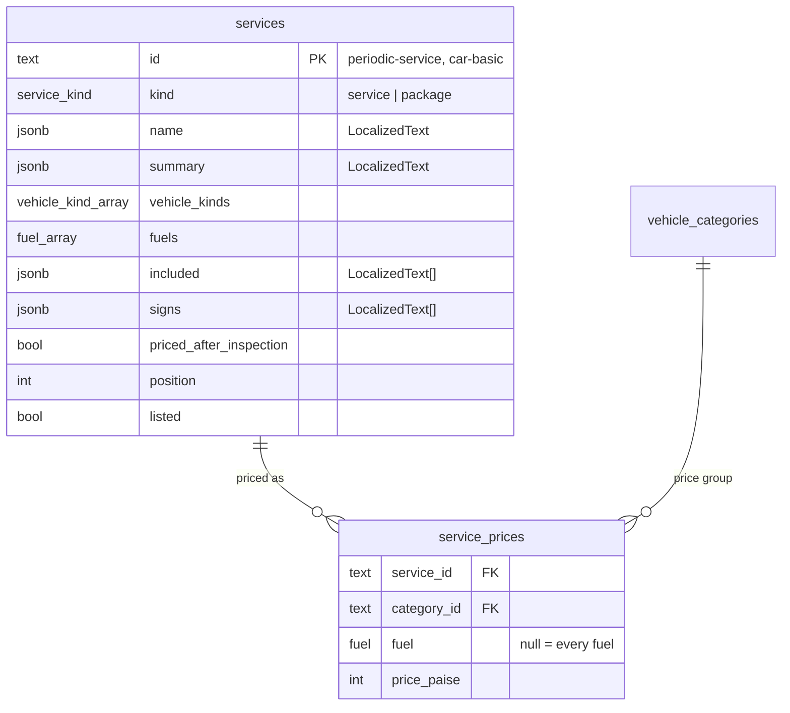
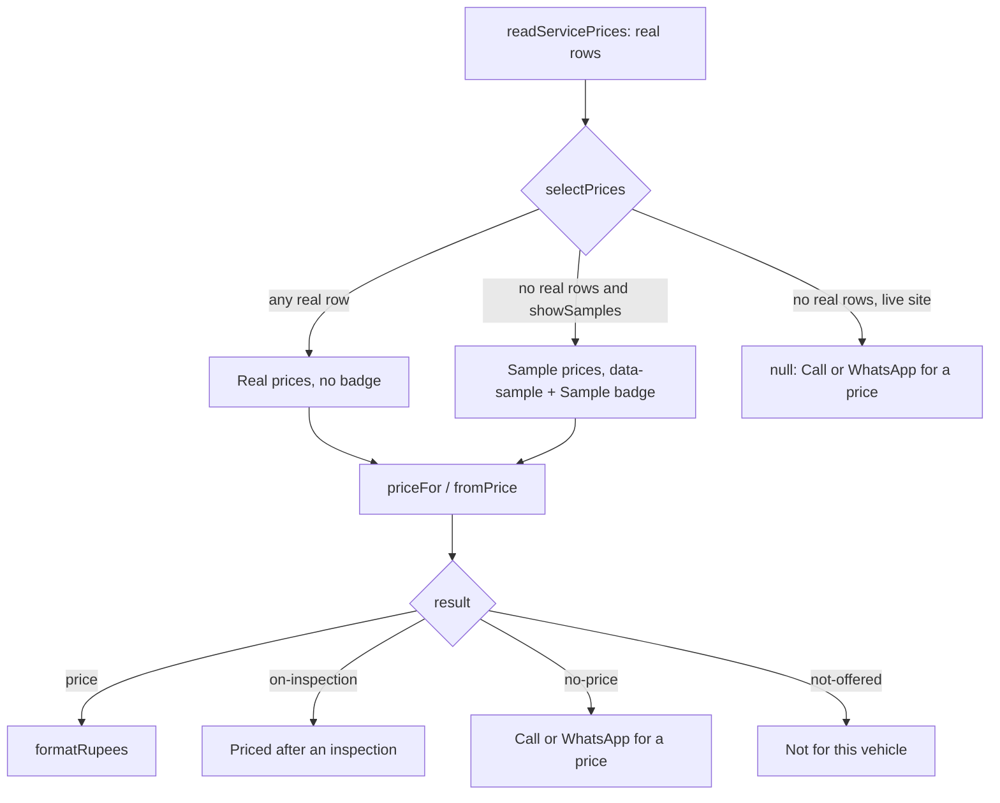

# Services, Packages and Prices - Plan

## Goal Capsule

- **Objective:** Visitors can read what each of the garage's 11 services covers, compare the Basic, Standard and Comprehensive packages for cars and for two-wheelers, and reach every service from the home page and the menu. The site never shows a price the owner hasn't given. Under `npm run dev` the owner can already try the whole price experience, with clearly marked sample prices and a vehicle picker that shows the prices for one exact vehicle.
- **Means:** services and packages in the database with a cached read, a pure `priceFor()`, three prerendered pages, and sample prices kept in code behind `showSamples()` (KTD1–KTD9).
- **Authority:**
  1. The master plan (see origin): row 18, feature items 2–4, the data model names, the Cache Components rules.
  2. The task 18 steps and the task 18 backlog lines in `document/task/task.md`.
  3. `CLAUDE.md`: Database, Roles and access, Vehicle catalogue, Languages, Design system, the site shell, lint guards, tests.
  4. The owner's parallel-session rules (2026-10-28): work only in `go-mechanic-s2` with the dev server on port 3001; never `npm run test:design`; merge `origin/main` right before `npm run db:generate`; edit only task 18's row and steps in `task.md`, new backlog lines at the end; pin new packages; stage files by name.
  5. This plan.

  Lessons that apply (`document/solutions/`):
  - `workflow-issues/parallel-branches-same-migration-number-regenerate-not-rename.md`: task 21 (Session 1) also adds a table, so both may generate `0004`.
  - `conventions/nextjs-16-dev-server-is-not-one-process-use-cache-probe.md`: one insert per table in the seed; nothing throws inside a cached read.
  - `conventions/nextjs-16-test-lazy-islands-with-app-router-dynamic.md`: the lazy phone-menu panel (U10).
  - `conventions/playwright-networkidle-hangs-after-second-page-load.md`: the home → service → back test (U8).
  - `conventions/lint-guards-test-real-jsx-shapes.md`, `conventions/nextjs-16-read-bundled-docs-image-priority.md`, `conventions/run-commands-before-documenting-output.md`.
  - `workflow-issues/full-check-times-out-under-parallel-session-load.md`: tell a load timeout from a real failure.
- **Execution profile:** U1 and U4 are test-first (pure rules, sample gating). Database tests use in-memory PGlite. Pages follow the home page's test patterns. U10 measures before it changes anything. Full runs come at the end (U12).
- **Stop conditions:** stop and ask the owner when:
  - a public page would show a price, a model name or a "time taken";
  - `/` stops building as `○ /en`, or a new public page isn't prerendered;
  - a step needs code another task owns (19's navigation and samples changes, 21's tables), beyond merging `main`;
  - a new package is needed, or `npx shadcn add` would overwrite an edited `ui/` file.
- **Who finishes:** Session 2's main session on branch `18_services_pricing`. Commit and stop; push and the pull request only after the owner says yes.

---

## Product Contract

### Summary

Move the 11 services into the database with drafted details (what's included, signs you need it), add Basic, Standard and Comprehensive packages for cars and for two-wheelers, and add `/services`, `/services/[slug]` and `/packages`. Prices exist only as samples under `npm run dev`, where `/packages` also gets a price finder built on the task 17 vehicle picker. The home page's service tiles link to their pages, and the menu gets Services and Packages.

### Problem Frame

The home page lists the services, but nothing tells a visitor what a service includes, how packages differ, or what their vehicle will cost. The owner hasn't given real prices yet, and the vehicle models from task 17 are an unchecked draft, so neither may reach the live site. The owner still needs to see and judge the full price experience before giving numbers. Task 23 (booking) and task 34 (estimates) will need one trusted way to work out a price, and task 39 will let the owner edit all of this.

### Requirements

**Services and packages**

- R1. Every service has a page with its name, summary, what's included and the signs you need it; an unknown service address answers 404.
- R2. `/services` lists every service, and the home page's service tiles link to their pages.
- R3. `/packages` shows Basic, Standard and Comprehensive side by side with their checklists, for cars and for two-wheelers.
- R4. The menu shows Services and Packages (labelled "Packages" until real prices exist), and marks the current page for screen readers.

**Prices**

- R5. One function works out a vehicle's price for a service from the price group and fuel: a price, "priced after inspection", "no price yet", or "not offered for this vehicle"; plus a "from" price for a list.
- R6. The live site never shows a price until the owner gives real ones: it says to call or WhatsApp for a price. Under `npm run dev`, sample prices show everywhere a price would, each marked Sample.
- R7. Under `npm run dev`, `/packages` has a price finder: pick type, brand, model and fuel, and see that vehicle's package prices. It never appears on the live site.

**Built in**

- R8. Every new public page stays prerendered, keeps its text in `messages/en.json`, and stores service text per language.
- R9. Later tasks find what they need: notes in the backlog for tasks 20, 23, 34, 39 and 42.

### Key Decisions

- **Prices are samples, shown only under `npm run dev`.** (session-settled: user-directed — chosen over waiting for the owner's real prices and over samples on the live site: the build isn't blocked and no customer sees a made-up price.) Governs R6.
- **The vehicle picker on /packages is dev-only until the owner checks the draft models.** (session-settled: user-directed — chosen over using the draft models publicly now and over waiting for corrections.) Governs R7.
- **Claude drafts the package checklists and service details, shown publicly now.** (session-settled: user-directed — chosen over the owner writing them, and over keeping drafts dev-only: they describe the work and promise nothing.) Governs R1, R3.
- **No "time taken" anywhere for now.** (session-settled: user-directed — chosen over dev-only draft times: a turnaround is a promise the owner gives.) Governs R1.
- **The menu item says "Packages" until real prices exist.** (session-settled: user-directed — chosen over keeping "Prices" and over hiding the item.) Governs R4.
- **One task.** (session-settled: user-directed — chosen over splitting prices into a separate task.) Governs scope.

### Scope Boundaries

- No real prices, no saves (task 39 edits services, packages and prices with `authorize("content.edit")`).
- No booking (task 23) and no estimates (task 34).
- No metadata beyond a title, description and `noindex` decisions per page: canonical, Open Graph, `Service` JSON-LD and the sitemap are task 42.
- Considered and not built:
  - A separate `package_items` table. A checklist is an ordered list of texts the owner edits as a whole, so a jsonb list on the row is enough; build the table if task 23 needs to price packages from their services.
  - A `(site)/not-found.tsx` with the full shell. Every `(site)` page would then carry the 404 content; an unknown slug gets the same slim 404 as other pages under `[locale]`.
  - The `scroll-scene-effects.tsx` try/catch rework (task 13 follow-up): its step applies "if the scroll effects change", and this task doesn't change them.

#### Deferred to Follow-Up Work

- A "models approved" switch, separate from `showSamples()`: once real prices exist, the price finder must still stay off the live site until the owner has checked the models (task 39 backlog line).
- Real prices, and a "time taken" per service, from the owner (task 39).

### Open Questions

Deferred, not blocking:

- Owner: check the drafted service details and package checklists in `src/server/db/service-seed-data.ts`, and the sample price levels (they only guide the price experience).
- Owner: the real price list, by service, price group and fuel, and whether the six draft price groups fit it (task 17 left the groups for this review).
- Owner: what periodic service and the packages include for electric vehicles. Until then they leave out electric (Assumptions).

---

## Planning Contract

### Key Technical Decisions

- KTD1. **One `services` table for services and packages.** A `service_kind` enum (`service`, `package`) tells them apart, so task 23's booking items point at one table. Columns:
  - `id` (text, made from the name: `periodic-service`, `car-basic`), `kind`, `name` and `summary` (`LocalizedText`);
  - `vehicle_kinds` (`vehicle_kind[]`, at least one) and `fuels` (`fuel[]`, at least one: the fuels it applies to; Engine leaves out electric);
  - `included` and `signs` (`LocalizedText[]` in jsonb: the checklist and "signs you need it"; packages have no signs);
  - `priced_after_inspection` (boolean): denting and painting, engine, electricals, clutch and suspension, insurance claim help;
  - `position`, `listed`, timestamps, as in the catalogue tables.
  Packages are per kind: `car-basic`, `car-standard`, `car-comprehensive`, `two-wheeler-basic`, and so on.
- KTD2. **`service_prices` holds real prices only, and starts empty.** Columns: `service_id`, `category_id` (a `vehicle_categories` price group), `fuel` (null means every fuel), `price_paise` (integer, above 0). One row per (service, group, fuel), with `NULLS NOT DISTINCT` so two "every fuel" rows can't exist. Foreign keys refuse deletes. Prices are integer paise, shown with `formatRupees`.
- KTD3. **`priceFor()` and `fromPrice()` in `src/domain/services.ts`, pure.**
  - `priceFor(service, prices, vehicle)`, where the vehicle is a kind, a price group and a fuel (not a model id, so a vehicle whose model is hidden later still gets a price). It returns one of: `not-offered` (the kind or the fuel isn't covered), `on-inspection`, `no-price`, or `price` with paise. A row for the exact fuel wins over the "every fuel" row.
  - `fromPrice(service, prices, kind?)`: the lowest price over the groups and fuels it covers, or null.
  - `checkServices()` returns problem codes: id format, duplicate ids, empty kinds or fuels, an empty checklist (`included`), blank English, a price for an unknown service or group, a group whose kind the service doesn't cover, a fuel the service doesn't cover, a duplicate (service, group, fuel), a non-integer or non-positive price.
- KTD4. **Sample prices live in code, never in the database.** `src/content/sample-prices.ts` holds them, read only through `selectPrices(real)`. The rule matches the home page's: any real price turns every sample off, and no real prices plus `showSamples()` gives the samples, marked `sample: true`. Otherwise it gives null.
  - Only server pages import the file. A sample price is rendered with `data-sample` and a server-rendered `SampleBadge`.
  - The canary: `messages/en.json` has no `₹`, so the production HTML, page data and scripts of `/services`, a service page and `/packages` must contain no `₹`. Prices are integers until `formatRupees` runs, so the same scan also looks for sample-only text, as `e2e/home.spec.ts` does: the price finder's own labels and the draft model names that appear in no message or service text, across the HTML, the page data, the RSC flight response and every loaded script.
  - A source scan like `home.test.ts`'s keeps every other file from importing the samples, and fails if any `"use client"` file imports `@/content/sample-prices`.
  - The helper: reuse `realOrSamples` from `src/lib/samples.ts` if task 19 has moved it there by then, else from `src/content/home.ts`, exported.
- KTD5. **The seed: a plain data file, rows added only when missing.** `src/server/db/service-seed-data.ts` (no `server-only`, so Playwright can import it; added to CLAUDE.md's exception list) holds the 11 services (names and summaries from `src/content/services.ts`, details drafted) and the 6 packages. `seedServices` runs after `seedVehicleCatalogue`, checks first and throws, and uses one transaction with one insert per table and `onConflictDoNothing`. It writes no prices. `src/content/services.ts` is deleted, and the `Service` type moves to the domain.
- KTD6. **Cached reads.** `readServices()` (tag `services`) returns the listed services and packages in order. `readServicePrices()` (tag `service-prices`) returns the real price rows, an empty list today. Both use `cacheLife("max")` and throw nothing on empty tables. No saves: task 39 adds them with `updateTag`.
- KTD7. **Three prerendered pages under `(site)`, each with `ensureStatic = "navigation"`.**
  - `/services`: every service as a tile with "From ₹…" (sample, dev only) or nothing.
  - `/services/[slug]`: summary, what's included, the signs, and the price block. Under dev, the price block is a table by price group from the samples, one table per vehicle kind; on the live site it says "Call or WhatsApp us for a price" (or "Priced after an inspection"). The price block and the package cards hold text only, never buttons. The page ends with one action group: Book as the only blue button, Call and WhatsApp as secondary.
    - `generateStaticParams` returns every service's slug (never empty: the seed has 11).
    - Both `generateMetadata` and the page call `notFound()` for an unknown slug, before any `<Suspense>`.
    - Packages have no pages of their own.
  - `/packages`: two sections, "For cars" and "For two-wheelers", each with three package cards side by side (one column on phones), and one action group after both sections.
- KTD8. **The price finder is a dev-only client island.** `PriceFinder` wraps `VehiclePicker` (its `onChange`) and shows each package's price for the chosen vehicle, through `priceFor`.
  - The page renders it whenever `showSamples()` is true, and passes it whatever `selectPrices()` returns (samples today, real rows once they exist), so it stays on under `npm run dev` and off the live site. The "models approved" switch stays a follow-up.
  - It gets the catalogue, the prices, the packages of the chosen kind and its labels as props.
  - Its states: until a model and a fuel are both chosen, each card shows "Choose your vehicle to see its price". Then each of the three cards for the chosen type shows its price (with the Sample badge when the prices are samples), "Call or WhatsApp us for a price" for `no-price`, or "Not for this vehicle" for `not-offered`. The prices appear in place on the cards, and one polite live region announces the update. Every one of these strings comes through the labels prop.
  - Each model's price group comes from the catalogue (`categoryId`).
  - It reads no messages, so `client-messages.ts` doesn't change.
- KTD9. **The home page and the menu.**
  - Service tiles become links (a stretched link on the h3, 44px, with a hover state). Their grid loses `revealGroup`, because a link inside a reveal target is banned; the heading block still reveals.
  - The hero gets a "See packages" text link, outside `HomeActions` (which the call to action shares). Its e2e count of links above the phone bar changes.
  - An "All services" link goes under the grid.
  - The nav items `services` and `prices` (labelled "Packages") go live in the commit that adds the pages.
  - `aria-current`: a small client `NavLinks` island (`usePathname` from `@/i18n/navigation`, labels as props, prefix match so `/services/brakes` marks Services), inside `<Suspense>` with plain links as the fallback, in the header and the phone menu.
  - The home page's "every link exists" test learns service paths (`servicePath(id)`).
- KTD10. **The phone menu loads its panel only on the first tap, if that saves bytes.** Today `MobileMenuContent` wraps each link in `SheetClose` from `ui/sheet` on the server, so the sheet's client code loads on every page anyway.
  - The change moves the closing inside the client panel (the links come in as data) and loads the panel with `next/dynamic`, starting on pointer-down or focus of the trigger. The trigger stays a Radix `SheetTrigger` in the always-loaded code, so `aria-expanded` and focus return don't change. While the panel loads, or if it fails, the sheet shows its title and the live page links as plain links; only the hours, the address and the Call and WhatsApp block load lazily.
  - `nav-links.tsx` (U9) must not import `@/components/ui/sheet`, or the measurement can't show a saving.
  - Measure the first-load script bytes on `/` before and after. If they don't drop, record the numbers and revert.

### High-Level Technical Design

Where a price comes from, on every page:

### Assumptions

Planning bets not checked with the owner (the scope check was skipped at the owner's request):

- Packages are three levels of periodic service, separately for cars and two-wheelers: 6 rows.
- The five services "priced after an inspection" are denting and painting, engine, electricals, clutch and suspension, and insurance claim help.
- Engine work, periodic service and the six packages don't apply to electric vehicles for now: their checklists and the approved periodic-service summary describe oil and filters. Every other service applies to every fuel its kinds use. The dev price finder then answers "not for this vehicle" for an electric vehicle's package (Open Questions).
- The sample prices are plausible Pune garage levels by price group, with periodic service differing by fuel; they only demonstrate the layout.
- The menu marks the current page in the header and the phone menu; the footer's page list stays plain.

### Deferred to Implementation

- Exact component names and message keys.
- How the stretched link on a tile meets the 44px rule.
- Whether the lazy menu saves enough to keep (U10 measures).
- Whether task 19 has moved `realOrSamples` by the time U4 runs.

### Risks

| Risk | Mitigation |
| --- | --- |
| Task 21 (Session 1) also generates migration `0004` | Merge `origin/main` right before `npm run db:generate`; if theirs lands first, delete this task's migration files and journal entry, take `main`'s, generate again, then `npm run db:reset` (the lesson) |
| Task 19 (Session 3) changes `navigation.ts`, `samples.ts`, the footer and `messages/en.json` | Merge `main` before U4 and U6; keep both sides; reuse its `realOrSamples` |
| A sample price leaks into the live site | Code-only samples behind `selectPrices`; the source scan; the `₹` canary over HTML, page data and scripts of all three routes in `test:e2e` |
| An unknown slug answers 200 | `notFound()` in `generateMetadata` and the page, before any Suspense; a request-level status check and `curl` |
| Linking the tiles changes the home page's motion | The heading still reveals; MASTER.md and `/dev/design` updated; the no-JS and reduced-motion tests stay |
| Full checks time out under the other sessions' load | Follow the load lesson; `--workers=2` for `test:e2e` |

---

## Implementation Units

| U | Title | Main files | Depends on |
| --- | --- | --- | --- |
| U1 | Service and price rules | `src/domain/services.ts` | – |
| U2 | Tables and migration | `src/server/db/schema.ts`, `migrations/0004_*` | U1 |
| U3 | Seed data, and `services.ts` removed | `src/server/db/service-seed-data.ts`, `seed.ts` | U1, U2 |
| U4 | Sample prices and their selector | `src/content/sample-prices.ts` | U1, U3 |
| U5 | Cached reads | `src/server/dal/services.ts` | U3 |
| U6 | `/services` and `/services/[slug]` | `src/app/[locale]/(site)/services/` | U4, U5 |
| U7 | `/packages` and the price finder | `src/app/[locale]/(site)/packages/`, `price-finder.tsx` | U4, U5 |
| U8 | Home page links | `home-services.tsx`, `home-hero.tsx`, `service-tile.tsx` | U5, U6, U7 |
| U9 | `aria-current` in the menu | `nav-links.tsx`, `site-header.tsx` | U6, U7 |
| U10 | Lazy phone-menu panel (measured) | `mobile-menu.tsx`, `site-header.tsx` | U9 |
| U11 | Browser tests and `/dev/design` | `e2e/*.spec.ts`, `dev/design/page.tsx` | U6–U10 |
| U12 | Docs, tracker, full checks | `CLAUDE.md`, `task.md`, `features.md`, `MASTER.md` | all |

### U1. Service and price rules

- **Goal:** the pure rules every other unit uses (R5).
- **Requirements:** R1, R3, R5 (KTD1, KTD3).
- **Dependencies:** none.
- **Files:** create `src/domain/services.ts`, `src/domain/services.test.ts`.
- **Approach:** types `Service`, `ServicePrice`, `PricedVehicle` (kind, categoryId, fuel), `PriceResult`; `checkServices(services, prices, catalogue)`; `priceFor`; `fromPrice`; `servicePath(id)`.
- **Execution note:** test-first.
- **Patterns to follow:** `src/domain/vehicles.ts` (`checkCatalogue`, problem codes).
- **Test scenarios:**
  - A valid set has no problems; each problem code fires for its case (bad id, duplicate id, empty kinds or fuels, blank English, unknown service or group in a price, group of another kind, fuel not covered, duplicate (service, group, fuel), price 0 or 12.5).
  - `priceFor`: an exact-fuel row wins over the every-fuel row; only an every-fuel row → that price; a kind the service doesn't cover → `not-offered`; an uncovered fuel (Engine, electric) → `not-offered`; `priced_after_inspection` → `on-inspection` even with rows; no row → `no-price`.
  - `fromPrice`: the lowest over groups and fuels, limited to a kind when given; null with no rows or for an inspection-priced service.
  - `servicePath("brakes")` is `/services/brakes`.
- **Verification:** the domain tests pass.

### U2. Tables and migration

- **Goal:** `services` and `service_prices`, with the database enforcing KTD1 and KTD2.
- **Requirements:** R1, R5 (KTD1, KTD2).
- **Dependencies:** U1.
- **Files:** modify `src/server/db/schema.ts`; create the generated `0004_*.sql` plus `meta/`; create `src/server/db/services-tables.test.ts`; add `service_prices` to `MARKERS` in `e2e/server-boundary.spec.ts`.
- **Approach:** `service_kind` enum pinned to the domain list; the CHECKs (non-empty kinds and fuels, English name, price above 0); unique (service, group, fuel) `NULLS NOT DISTINCT`; foreign keys with `restrict`. Generate right after `git fetch origin && git merge origin/main`.
- **Patterns to follow:** the vehicle catalogue tables and their test file.
- **Test scenarios:**
  - The enum equals the domain list.
  - Refused: empty `vehicle_kinds`, empty `fuels`, a blank English name, a price of 0, a second every-fuel row for the same service and group, a price for an unknown group, deleting a service that has prices.
  - Lists come back as arrays and `LocalizedText` lists as objects.
- **Verification:** the table tests pass; the journal's times only go up.

### U3. Seed data, and `services.ts` removed

- **Goal:** every new database starts with the 11 services and 6 packages (R1, R3).
- **Requirements:** R1, R2, R3 (KTD5).
- **Dependencies:** U1, U2.
- **Files:**
  - create `src/server/db/service-seed-data.ts` and its test;
  - modify `seed.ts`, `index.ts` (call `seedServices` last);
- **Approach:** names and summaries copied as they are (owner-checked in task 13); details and packages drafted, with the header saying so; no prices.
- **Test scenarios:**
  - The 11 names in the owner's order, unique ids, `checkServices` clean.
  - 6 packages, 3 per kind, each with a non-empty checklist.
  - A new database holds them; seeding again changes nothing; edits survive; a folder database that already has the garage gets them on reopen.
- **Verification:** the seed tests pass.

### U4. Sample prices and their selector

- **Goal:** sample prices that only `npm run dev` ever shows (R6).
- **Requirements:** R6 (KTD4).
- **Dependencies:** U1, U3.
- **Files:** create `src/content/sample-prices.ts` and its test.
- **Approach:** sample rows for every list-priced service and package, by group, with fuel rows where they differ; `selectPrices(real)`.
- **Execution note:** test-first.
- **Test scenarios:**
  - Real rows → real, `sample: false`, under any `NODE_ENV`.
  - No real rows + `development` → samples, `sample: true`; + `production`, `test` or `staging` → null.
  - The samples pass `checkServices` against the seed services and the draft catalogue.
  - No file under `src/` but `sample-prices.ts` (and its test) mentions `samplePrices`.
  - `messages/en.json` contains no `₹`.
- **Verification:** the tests pass.

### U5. Cached reads

- **Goal:** pages get the services and the real prices from cached reads (R8).
- **Requirements:** R1–R3, R8 (KTD6).
- **Dependencies:** U3.
- **Files:**
  - create `src/server/dal/services.ts` and its test;
  - delete `src/content/services.ts` and `services.test.ts` (their checks move to the seed test);
  - switch the importers: `(site)/page.tsx` and `dev/design/page.tsx` call `readServices()`; `page.test.tsx` mocks it; `home-services.tsx` and `service-tile.tsx` (+ test: a `Partial` icon map with the wrench fallback) take the domain `Service` type; `e2e/home.spec.ts` reads the seed data.
- **Test scenarios:** the read equals the seed (services and packages in order); a hidden row is left out; empty prices give an empty list; the tags and `cacheLife("max")` are set; every seeded service has its own icon.
- **Verification:** the DAL tests pass; nothing imports `src/content/services.ts`.

### U6. `/services` and `/services/[slug]`

- **Goal:** the two service pages (R1, R2, R6).
- **Requirements:** R1, R2, R4, R6, R8 (KTD7).
- **Dependencies:** U4, U5.
- **Files:**
  - create `src/app/[locale]/(site)/services/page.tsx` and `services/[slug]/page.tsx`, with tests;
  - create a server `ServicePrices` block (`src/components/site/service-prices.tsx`) and its test;
  - modify `messages/en.json` (a `Services` namespace), and `navigation.ts` plus its test (`services` live, in the same commit as the pages).
- **Approach:** `generateMetadata` titles name the service and Kiwale, Pune; `notFound()` first. Book and Call come from the existing actions. The prices come from `selectPrices` and `priceFor`. The periodic service page links to `/packages`.
- **Test scenarios:**
  - `/services` lists 11 services in order, each linking to its page; under dev each shows a "From ₹…" with a Sample badge; outside dev, no `₹` and no `[data-sample]`.
  - A service page shows its summary, included list and signs; an inspection-priced service says so; outside dev the price block offers Call or WhatsApp; under dev it shows a table by price group with badges.
  - An unknown slug calls `notFound()` from both `generateMetadata` and the page.
  - `generateStaticParams` returns 11 slugs and no package.
- **Verification:** the tests pass and `next build` lists both routes as prerendered.

### U7. `/packages` and the price finder

- **Goal:** the packages page, and the dev-only price finder (R3, R7).
- **Requirements:** R3, R4, R6, R7, R8 (KTD7, KTD8).
- **Dependencies:** U4, U5.
- **Files:**
  - create `src/app/[locale]/(site)/packages/page.tsx` and its test;
  - create `src/components/site/package-card.tsx` and `price-finder.tsx` (`"use client"`), with tests;
  - modify `messages/en.json` (a `Packages` namespace; `Nav.prices` says "Packages") and `navigation.ts` (`prices` live).
- **Test scenarios:**
  - Two sections, three cards each, in order, with their checklists.
  - Outside dev: no price finder, no `₹`; each card offers Call or WhatsApp.
  - Under dev: the finder shows; before a model and fuel are chosen each card asks for the vehicle; picking a model and fuel shows each package's price for that vehicle's group, announced once; an electric vehicle gets "Not for this vehicle".
  - Under dev with a real price row (stubbed), the finder still shows, with that real price and no Sample badge.
  - The finder shows only words from its labels prop.
- **Verification:** the tests pass; the route is prerendered.

### U8. Home page links

- **Goal:** the home page leads into the new pages (R2).
- **Requirements:** R2, R8 (KTD9).
- **Dependencies:** U5, U6, U7.
- **Files:** modify `home-services.tsx` (links; no `revealGroup`; "All services"), `home-hero.tsx` ("See packages"), `service-tile.tsx` (a link variant), their tests, `e2e/home.spec.ts`, and `MASTER.md` (ServiceTile).
- **Test scenarios:**
  - Each tile links to its service page; every link on the page exists.
  - No link sits inside or around a reveal target.
  - The hero's h1, its two buttons and "See packages" sit above the phone bar at 375px.
  - e2e: home → a service page → back, with no console errors, and every reveal target at full opacity after scrolling.
- **Verification:** the home tests pass; `/` is still `○ /en`.

### U9. `aria-current` in the menu

- **Goal:** screen readers hear which page is current (R4).
- **Requirements:** R4 (KTD9).
- **Dependencies:** U6, U7.
- **Files:** create `src/components/site/nav-links.tsx` (`"use client"`) and its test; modify `site-header.tsx` (header and phone menu).
- **Approach:** the current link also looks current (an `aria-[current=page]:` token style), so sighted visitors see what screen readers hear.
- **Test scenarios:**
  - On `/services/brakes`, Services carries `aria-current="page"`; on `/packages`, Packages does.
  - The fallback renders the same links, without `aria-current`.
  - e2e: the attribute is set on `/services` and there are no hydration errors.
- **Verification:** the tests pass.

### U10. Lazy phone-menu panel (measured)

- **Goal:** the phone menu's code loads on the first tap instead of on every page, if that is a real saving.
- **Requirements:** R8 (KTD10).
- **Dependencies:** U9.
- **Files:** modify `src/components/site/mobile-menu.tsx`, `site-header.tsx`, `nav-links.tsx` and their tests.
- **Execution note:** measure first: the first-load script bytes of `/` in a production build, before and after. If they don't drop, revert and record the numbers in the learning doc.
- **Test scenarios:**
  - The panel's module isn't loaded before the first tap (the App Router `next/dynamic` mock, per the lesson).
  - A failed load still leaves the pages reachable.
  - The menu opens, lists the live pages and closes on a link tap.
- **Verification:** the numbers are recorded, and either the saving is kept with tests or the change is reverted.

### U11. Browser tests and `/dev/design`

- **Goal:** the production build proves the pages and the no-samples rule; `/dev/design` shows the new components.
- **Requirements:** R1–R8.
- **Dependencies:** U6–U10.
- **Files:**
  - modify `e2e/home.spec.ts`, `e2e/i18n.spec.ts` (prerender headers for the new routes), `e2e/layout-shell.spec.ts` (links answer 200), and `e2e/server-boundary.spec.ts`;
  - create `e2e/services.spec.ts` (`/services`, a service page, `/packages`, the `₹` canary over HTML, page data and scripts, the unknown-slug 404 by request);
  - modify `src/app/[locale]/dev/design/page.tsx` (link tile, package card, price block, price finder), `e2e/dev/warm-up.ts` and the dev specs.
- **Test scenarios:**
  - Each route answers 200, prerendered.
  - No `₹`, no `[data-sample]`, no price-finder label and no draft model name in the live build's HTML, page data, flight response or scripts of the three routes.
  - `/services/not-a-service` answers 404 with `noindex`.
  - Under `npm run dev`, the samples show, marked, and the price finder works.
- **Verification:** `test:e2e` and the dev specs (port 3001) pass.

### U12. Docs, tracker, full checks

- **Goal:** the docs describe the services and prices, later tasks find their notes (R9), every gate passes.
- **Requirements:** R9.
- **Dependencies:** all.
- **Files:** `CLAUDE.md` (the repo map, the server-only exceptions, a short "Services and prices" note), `features.md`, `MASTER.md`, `readme.md` if needed, `task.md` (steps; backlog lines for tasks 20, 23, 34, 39 and 42).
- **Approach:** the backlog lines:
  - task 20: seed services before the first build, because `generateStaticParams` can't be empty;
  - tasks 23 and 34: price with `priceFor` and real prices only, never the samples;
  - task 39: real prices, times, and the "models approved" switch; when the first real price is saved, rename `Nav.prices` back to "Prices" and the hero's "See packages" to "See prices"; and decide whether visitors may see the price groups' names in the service pages' price tables (task 17 kept them hidden);
  - task 42: `Service` JSON-LD only with real prices.
- **Test expectation:** none (documentation); the full checks run here.
- **Verification:** the Verification Contract rows pass.

---

## Verification Contract

| Gate | Command or check | Proves |
| --- | --- | --- |
| Lint, types, unit and component tests | `npm run check` | U1–U10 |
| Production build and browser tests | `npm run test:e2e` (`-- --workers=2` under load; port 3210) | pages, the `₹` canary, the 404, home links |
| Prerendering | the build's route list: `○ /en`, and the new routes prerendered | R8 |
| The unknown-slug 404 without JavaScript | `curl -s -o /dev/null -w "%{http_code}"` on `/services/not-a-service` against the production build | R1 |
| `/dev/design` and dev pages | the `e2e/dev` specs with the scratch config on port 3001; never `npm run test:design` | samples, price finder, components |
| Look and feel | `/`, `/services`, a service page and `/packages` in Chrome on port 3001, phone and desktop | R1–R7 |
| Migration chain | merge `origin/main` right before `npm run db:generate` and before the pull request | no clash |

---

## Definition of Done

- U1–U12 on branch `18_services_pricing` in small commits (code, tests, docs and tracker apart), each with a 2–4 sentence body.
- Every Verification Contract row passed, with its real output in the learning doc.
- `ce-code-review` and `code-reviewer` ran, every must-fix fixed, both verdicts in the learning doc.
- The learning doc says the task was built alongside other sessions, and describes any merge conflict and its resolution.
- The compound question asked and answered.
- No sample price, model name or time taken on the live site; no dead code; no file another task owns changed beyond merges.
- The pull request (only after the owner says yes) says `/dev/design` changed.
