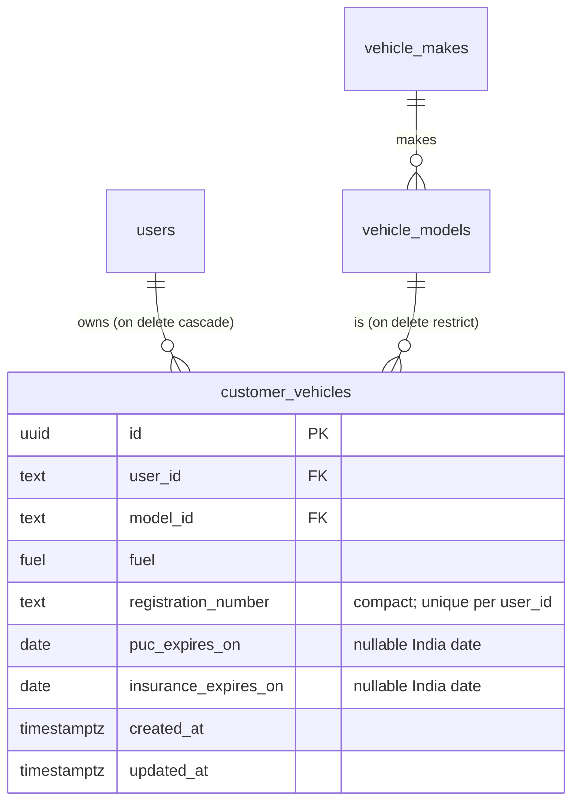
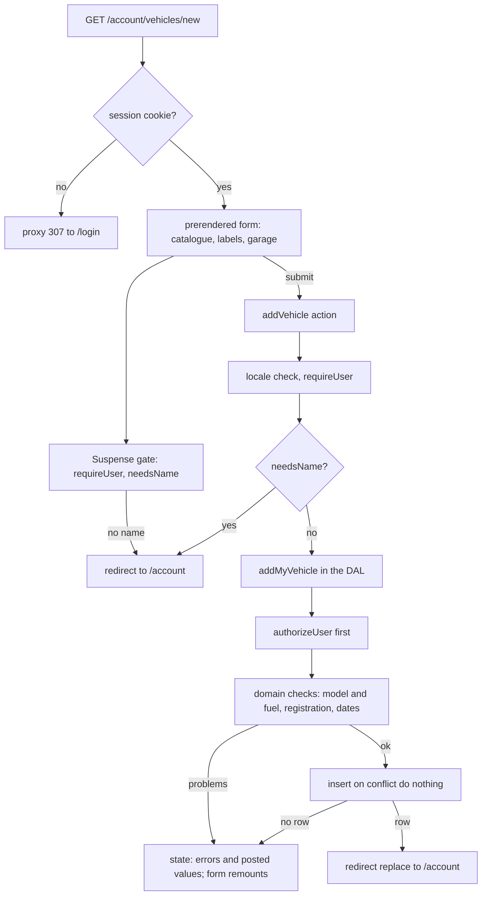
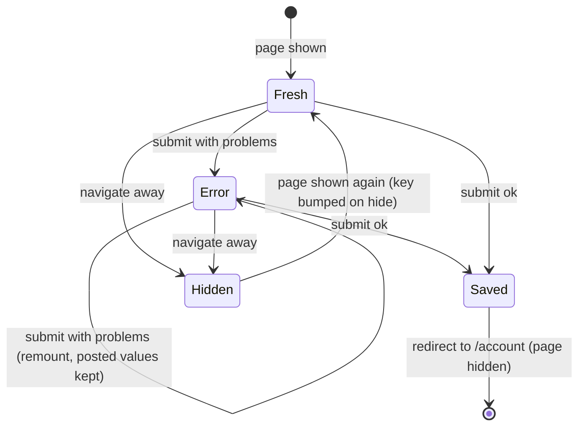

# Customer Vehicles and Profile - Plan

## Goal Capsule

- **Objective:** A logged-in customer has a profile with their name and a list of their own vehicles, each with a checked registration number and optional PUC and insurance expiry dates. The booking and reminder tasks can rely on that data. No customer can see or change another customer's vehicles.
- **Means:** pure input rules in `src/domain` (KTD3, KTD14), one new table (KTD4), data-access functions that take the user only from the session (KTD7), a name step and an add-vehicle form under `/account` built on the task 17 picker (KTD2, KTD9, KTD10), and one static header link (R13).
- **Authority:**
  1. The owner's decisions of 2026-10-29 (Key Decisions below).
  2. The master plan (see origin): task 21 "Registration validator + tests, vehicles, profile"; the risk "users reaching others' data by changing IDs"; the verification line "customer A can't read customer B".
  3. `document/website/features.md` feature 12, and the task 21 steps and backlog notes in `document/task/task.md` (from tasks 15, 16 and 17).
  4. `CLAUDE.md`: Database, Login and sessions, Roles and access, Vehicle catalogue, Languages, Design system and site shell.
  5. This plan.

  These lessons in `document/solutions/` apply:
  - `workflow-issues/parallel-branches-same-migration-number-regenerate-not-rename.md`: merge `origin/main` right before `db:generate`, and if another migration lands first, regenerate rather than rename;
  - `conventions/pglite-parallel-tests-bare-database-not-transaction-per-call.md`: tests of parallel saves call the bare database;
  - `conventions/better-auth-phone-login-only-from-server-actions.md`: Server Action shape, `unstable_rethrow` first in the client wrapper, the name saved through our own data-access code (not Better Auth's API);
  - `conventions/nextjs-16-catch-only-expected-request-api-errors.md`: catch only the expected error, by its code;
  - `conventions/playwright-networkidle-hangs-after-second-page-load.md`: `expectNoErrors` only on a test's first page load;
  - `workflow-issues/full-check-times-out-under-parallel-session-load.md`: timeouts under load are not failures to "fix" by raising limits;
  - `conventions/run-commands-before-documenting-output.md`: the learning doc shows only real output.
- **Execution profile:**
  - Units run in order. U1 is written test-first (pure rules). In U3, write the ownership tests first and mutation-check them (remove `authorizeUser()`, drop `user_id` from a `WHERE`, move the check below the input check): each mutation must fail a test.
  - U4, U6, U10 and U7 change how the app looks: build them with the `ui-engineer` agent (`CLAUDE.md`, Agents).
  - Run `npm run check` after each unit, `npm run test:design` after U4 and U7, and `npm run test:e2e` at U8. When the SEO Stop hook asks, run `seo-reviewer` in the foreground.
  - Three sessions share the repo. Stage files by name. Merge `origin/main` before `db:generate` (U2) and again before the reviews. Run `npm install` after each merge.
- **Stop conditions:** stop and ask the owner when:
  - `/` stops building as `○ /en`, or `/account` and `/account/vehicles/new` lose their prerendered shells;
  - the change needs more than one new migration, an edit to a merged migration, or Better Auth refuses to start after it;
  - a step would add a Better Auth Route Handler or browser client, a global install, or `npx playwright install`;
  - the add form can't be made to start empty on each visit (R10) without a full page reload;
  - the hand-written diff heads past about 2,800 lines: move more into the follow-up task instead of growing this one.
- **Who finishes:** `ce-work` builds and commits on `21_customer_vehicles`, then stops. The main session writes the learning doc, runs `ce-code-review`, `code-reviewer` and the compound step. It asks the owner before pushing and opening the pull request (`CLAUDE.md`, task workflow step 11).

---

## Product Contract

### Summary

Customers give their name once, on `/account`, right after their first login. `/account` then shows their name, their number and their vehicles, with a link to `/account/vehicles/new`. That page adds a vehicle: type, brand, model and fuel from the catalogue, a registration number checked against Indian formats, and optional PUC and insurance expiry dates. The data-access layer takes the customer from the session in every query. The header gains one static "Account" link. Editing and removing a saved vehicle get their data-access functions and ownership tests here, but their pages move to a follow-up task to keep this one reviewable.

### Problem Frame

Since task 15, customers can log in, but their account holds only a phone number. Users get an empty name at sign-up, so the garage can't greet or identify anyone. The booking flow (task 23) needs to pick one of the customer's vehicles, and the reminders (task 36) need PUC and insurance dates. Neither has anywhere to read them from.

This is also the first customer-owned data in the app. Task 16 built `authorizeUser()` for exactly this case, and the master plan names the risk: one customer reaching another's data by changing an id in a URL or a form. Registration numbers come typed by hand in many shapes ("mh 12 ab 1234", "MH-12-AB-1234", "22BH1234AB"). Unless they're checked and stored in one form, duplicates and typos reach the garage's records and, later, its reminders.

### Requirements

**Profile**

- R1. A logged-in customer with no name sees a name form on `/account` before any vehicle content. The "Logged in as" line and Log out stay on the page. Saving a valid name shows the account.
- R2. A name is 2 to 60 characters after trimming and collapsing spaces, contains at least one letter in any script, and uses only letters, combining marks, spaces, `.`, `'` and `-`. A customer with no name can't save a vehicle, even by posting the form directly.
- R3. The phone number is shown and can't be changed here (task 16: a number change must go through a code).

**Vehicles**

- R4. A customer can add a vehicle from the listed catalogue (type, brand, model, fuel) with a registration number and optional PUC expiry and insurance expiry dates. After saving, they are back on `/account` and see it in their list.
- R5. A registration number is accepted in the formats of KTD3, in any case and with or without spaces, hyphens or dots. It is stored in one compact form and shown grouped (`MH 12 AB 1234`, `22 BH 1234 AB`). A refused number gets a message that names the problem and suggests calling the garage when the plate is real but unusual.
- R6. One customer can't save the same registration number twice. Two customers can each save the same number.
- R7. A date is an India date. Empty means none. A filled date must be a real calendar date from 2000-01-01 to 10 years after today in India. Past dates are allowed. Electric vehicles store no PUC date.
- R8. The list shows, oldest first, each vehicle's brand and model, its fuel, its grouped registration number and its dates, with "Expired" next to a date before today in India. A vehicle still shows correctly after the garage hides its model.
- R9. Errors show next to their field, in `messages/en.json` text. After an error, everything typed and picked stays in the form. A choice made in the picker before the page finished loading is kept.
- R10. Each visit to the add page starts with an empty form. That includes a shared phone after Log out and another customer's login.

**Ownership and access**

- R11. Every read or change of profile or vehicle data uses the logged-in user from the session, never a user id from the browser. Customer A can't read, change or remove customer B's vehicle by its id, and the answer looks the same as for an id that doesn't exist.
- R12. `/account` and the pages under it are noindex and inside the site shell. A logged-out visitor gets the proxy's 307 to `/login` (already true for everything under `/account`).

**Header**

- R13. The header has one "Account" link to `/account` at every width, with prefetch off. It never reads the session, and the home page still builds as `○ /en`.

**Records**

- R14. `document/task/task.md` records that the owner started the DLT and Meta paperwork on 2026-10-29, the recycled-number decision, and this task's follow-ups at the end of the backlog.

### Key Decisions

- **The name is required, once, right after the first login.** (session-settled: user-directed — chosen over an optional name: the owner wants to know who each customer is from their first visit.) Governs R1, R2.
- **Recycled mobile numbers are accepted for v1, with no extra logic.** (session-settled: user-directed — chosen over re-verifying or hiding an old account when a SIM changes hands: the garage can remove an old account in task 29, and customers can delete their data in task 43.) Whoever holds the number sees the account. Governs R14.
- **One static "Account" link in the header.** (session-settled: user-directed — chosen over a session-aware "Log in"/"Account" entry: the shell must never read the session, and logged-out visitors reach `/login` through the proxy's 307.) Governs R13.
- **The owner started the DLT (SMS) and Meta (WhatsApp) paperwork on 2026-10-29.** (session-settled: user-directed — recorded as the owner reported it; nothing to build.) Governs R14.
- **Editing and removing a vehicle, and changing the name, move to a follow-up task.** The full scope came to about 2,950 hand-written lines against a target of 2,000 to 2,500. The data-access functions and their ownership proof stay here, because that is where the risk lives. The follow-up adds only pages and actions. Governs R4, R11.

### Success Criteria

- A reviewer can read the diff in one sitting: about 2,400 hand-written lines including tests and docs, plus the generated migration snapshot (size budget below).
- A reviewer can point to the one test file that proves customer A can't read, change or remove B's vehicle, and to the e2e test where B's account doesn't list A's vehicle.

### Scope Boundaries

- No page for one vehicle, so no edit, no remove and no by-id 404 page in the browser (follow-up task). The data-access layer still refuses another customer's id (R11).
- No name change after the first save, and no phone-number change.
- No bookings (task 23), reminders (task 36), data deletion or export (task 43), or customer search for staff (task 29).
- No change to `Login.notice` or `LOGIN_NOTICE_VERSION`: task 19 changes that wording next.

Considered and not built:

- **A cap on vehicles per customer.** Each account needs a phone code, and a long list harms only its owner. Revisit if staging shows abuse.
- **Hiding registration numbers in database error logs.** The data-access rule is "catch nothing", and a failed insert's message holds the plate. The `CLAUDE.md` rule protects phone numbers, codes and tokens, and plates are less sensitive. Revisit in task 43 or 46 with a logging policy.
- **A database CHECK on `users.name`.** It is Better Auth's table, sign-up writes `""`, and the data-access check (R2) is the only writer.
- **Per-state RTO code ranges** (MH01 to MH50, and so on). They change as RTOs open, and a wrong range refuses real plates.
- **A "your login ended" line on `/login`.** Sessions last 30 days without refresh, so this is rare.
- **Hiding the phone action bar while a field has focus.** The shell's scroll padding keeps focused fields clear (`MASTER.md`), and U8 checks the submit button is clickable at 375px.

#### Deferred to Follow-Up Work

U9 writes these at the end of the backlog in `document/task/task.md`:

- **New task (split from 21): edit and remove a saved vehicle, and change the name.**
  - A page `/account/vehicles/[vehicleId]` that reads `params` inside `<Suspense>`.
  - A malformed or foreign id shows the 404 page.
  - A two-user e2e test opens A's vehicle as B and sees the 404 page.
  - A remove step with confirmation.
  - A note when the saved model is no longer listed (KTD8).
  - It calls `updateMyVehicle` and `removeMyVehicle` from U3.
- **Task 23:**
  - The booking picks one of `listMyVehicles()`, copies the vehicle's details onto the booking, and keeps a nullable foreign key `on delete set null` (KTD5).
  - It asks for a name inline when `needsName()` says so.
  - Give `ChoiceGroup` and `NativeSelect` their own error states.
  - Revisit the phone bar on forms.
- **Task 36:** reminders read `puc_expires_on` and `insurance_expires_on` as India dates. Electric vehicles have no PUC date.
- **Tasks 19 and 43:** the privacy notice names the profile name, vehicles and expiry dates. Deleting a user deletes their vehicles (cascade), and the export includes them.
- **Task 29:** staff search by registration number across customers needs an index on `registration_number`.
- **Task 20:** the owner checks the draft catalogue before staging testers save vehicles against it.

### Open Questions

None block the work. Each has a default the plan uses.

- **May customers add a vehicle that isn't listed (another brand such as Ford, or a missing model)?** (Task 17 left this open.) Default: no. The add page says "Don't see your vehicle? Call or WhatsApp us", with the garage's links. A "yes" later makes `model_id` nullable and adds a free-text name in a new migration.
- **Is a registration number required for every vehicle?** Default: yes. A new vehicle still waiting for its number, or a plate of a refused shape (KTD3), is handled by phone.
- **When the follow-up adds "Remove", should the garage keep the removed vehicle?** Default: no, the row is deleted (KTD5). Past bookings keep their own copy of the vehicle's details.
- **Privacy wording for names, vehicles and dates.** Default: a short line on the name and vehicle forms saying why they're asked for, with no promise of reminders. Task 19's privacy page and task 43 carry the full notice.

---

## Planning Contract

### Key Technical Decisions

- KTD1. **The name is read through the data-access layer, not the session.** `readMyProfile()` (`authorizeUser()` first, then the user's own `users` row) returns the name and number. `CurrentUser` stays `{ id, phoneNumber, role }`, so `session.test.ts` and its four fixtures don't change. No session cookie cache is set (`src/server/auth/auth.ts`), so a saved name shows on the next read. The name is saved with a plain Drizzle update, as `syncOwnerRole` does, never through Better Auth's `updateUser`. The functions go in a new `src/server/dal/profile.ts`: `users.ts` holds login-time writes that skip the check by design (its header and `garage.ts` rule 3).
- KTD2. **The name step is inline on `/account`, and the add action enforces it on the server.** The streamed part of `/account` shows the name form when `needsName(profile)` is true. The "Logged in as" line and the Log out form stay, so `logInThroughTheForm`, `e2e/login.spec.ts` and `e2e/access.spec.ts` keep working unchanged. `/account/vehicles/new` has a small `<Suspense>` gate that sends a nameless customer to `/account`. Because that redirect happens in the browser, the add action also checks `needsName` and redirects before saving (R2). `needsName` lives in `src/domain/profile.ts` so task 23's inline login can reuse it.
- KTD3. **Registration grammar.** Directional sketch:

  ```text
  normalise: trim; uppercase; drop spaces, "-" and "."; refuse raw input over 20 characters
             or anything left that isn't A–Z or 0–9
  state:     STATE (2 letters, from the allowlist) + RTO (1–2 digits) + SERIES (1–3 letters)
             + NUMBER (1–4 digits, stored zero-padded to 4)      e.g. MH12AB1234, DL3CAB0042
  bharat:    YY (2 digits, 21–99) + "BH" + NUMBER (1–4 digits, padded to 4)
             + 1–2 letters                                        e.g. 22BH1234AB
  display:   "MH 12 AB 1234", "DL 3 CAB 0042", "22 BH 1234 AB"
  problems:  registration-missing | registration-unknown-state | registration-invalid
  ```

  - **Padding.** The number pads to 4 digits because registration marks carry four digits, so `MH12AB1` and `MH12AB0001` are one plate (R6).
  - **One letter or more.** The series needs at least one letter. That keeps the grammar unambiguous: with no letters, `MH12123` could be RTO 12 or RTO 1.
  - **The allowlist.** It holds every state and union territory code, old ones included: AN, AP, AR, AS, BR, CG, CH, DD, DL, DN, GA, GJ, HP, HR, JH, JK, KA, KL, LA, LD, MH, ML, MN, MP, MZ, NL, OD, OR, PB, PY, RJ, SK, TG, TN, TR, TS, UA, UK, UP, WB. The set is closed, and it catches typos like `MX12...`.
  - **Refused shapes.** Plates with no series letters, the pre-1989 three-letter series (`MHF 1234`), temporary and trade plates, and diplomatic and military plates are refused. Their message points to the garage's phone.
  - **Checking the rules.** These rules come from the known formats. Web lookup wasn't available while planning, so the implementer checks the code list and the BH rule against the Ministry of Road Transport's notices where possible, and records that in the learning doc.
- KTD4. **The `customer_vehicles` table.**
  - `id`: uuid, `defaultRandom()`. Rows are created at runtime, so the catalogue's reason for text ids doesn't apply.
  - `user_id`: text, foreign key to `users.id` with `on delete cascade`. A vehicle means nothing without its owner, and task 43's erasure should take it along.
  - `model_id`: text, a plain foreign key to `vehicle_models.id` with `on delete restrict`, matching "hide, don't delete". The brand and kind come from the model by a join, so no `make_id` or `kind` columns can disagree with it.
  - `fuel`: the existing `fuel` enum.
  - `registration_number`: text, with a CHECK `^[A-Z0-9]{8,11}$` as a backstop for the compact form.
  - `puc_expires_on` and `insurance_expires_on`: nullable `date` in string mode, like `calendar_exceptions.date`.
  - `created_at` and `updated_at`.
  - A unique constraint on `(user_id, registration_number)`.
- KTD5. **Remove deletes the row.** The alternative was a `removed_at` column with a partial unique index. It was rejected because every read would have to filter on it, the garage would keep data the customer chose to remove, and a vehicle's service history belongs on bookings. Task 23 copies the vehicle's details onto each booking and points at the vehicle with `on delete set null` (follow-up note).
- KTD6. **Duplicates come back as answers, not errors.**
  - Add inserts with `on conflict do nothing` on the unique pair. No row returned means `registration-duplicate`.
  - Update first looks for another of the user's vehicles with that number. The unique constraint is the backstop: a race between two tabs of the same customer would surface as an error, which is accepted.
  - A parallel-add test calls the bare test database (PGlite lesson).
- KTD7. **Ownership lives in the query.**
  - No data-access function takes a user id.
  - Each customer-data function calls `authorizeUser()` on its first line, before it checks input, reads the catalogue or calls `getDatabase()`.
  - Every query filters by `user_id = user.id`, plus the vehicle id where there is one. A change that touches 0 rows means "not found".
  - An id that isn't a uuid returns "not found" without a query. Otherwise Postgres throws `22P02`, and the follow-up page would answer 500.
  - The order is: `authorizeUser()`, then the domain checks (with `readVehicleCatalogue()` and India's today from a `Clock`), then one write.
- KTD8. **Only the posted model and fuel count.**
  - The posted `vehicleKind` and `vehicleMake` are ignored. The fuel must be one of `FUELS` before `resolveVehicle()` runs against the listed catalogue.
  - Every save, add or update, needs a listed model. An update whose saved model was hidden is refused until the customer picks again.
  - The rejected alternative let an unchanged hidden model pass. It means a second validation path that reads hidden rows, for a rare case.
  - The list reads brand and model names through a join that ignores `listed` (R8).
- KTD9. **Form islands follow the login form, with three additions.**
  - **What it copies:** a `useActionState` client component that gets every label as a prop, a Server Action that takes the locale as its bound first argument (`src/lib/login-state.ts` holds the state types), and field errors translated on the server.
  - **Remount after each answer.** The state carries a submission counter, the posted values and the errors. The form body is keyed by the counter, so it remounts after each answer with the posted values as defaults. React's automatic reset after an action then restores those same values, and the picker can't drift from what it shows (R9).
  - **Fresh on each visit.** The add form also remounts fresh whenever its page is hidden. A layout-effect cleanup bumps its key, which clears drafts, error messages and the action state that Cache Components' `<Activity>` would otherwise keep (`node_modules/next/dist/docs/01-app/02-guides/preserving-ui-state.md`) (R10).
  - **The name form.** It is keyed by user id, so a second customer on the same phone never sees the first one's draft.
  - Text and date fields stay uncontrolled.
- KTD10. **The picker works inside a real form** (`src/components/site/vehicle-picker.tsx`).
  - **Before hydration:** at hydration, it reads its fields' current values once and adopts them through `normalizeSelection` when they differ from its state. First prove with a `hydrateRoot` test whether React 19 already keeps such a choice. If it does, the test alone closes the backlog note.
  - **On reset:** it listens to its form's `reset` event and returns to its normalised `defaultValue`.
  - **Errors:** an `error` prop shows a message under the picker and sets `aria-invalid` and `aria-describedby` on the model select. `ChoiceGroup` and `NativeSelect` keep no error state of their own (task 23).
- KTD11. **What renders where.**
  - `/account`: the heading is static. Inside `<Suspense>` are the name form, or the name, number, vehicle list and "Add a vehicle" link. Log out stays outside.
  - `/account/vehicles/new`: a prerendered page with the add form, fed by the cached `readVehicleCatalogue()`, `vehiclePickerLabels()` and `readGarage()`. A `<Suspense>` gate holds `requireUser` and the name check. An empty catalogue shows a message and the garage's contact links instead of the form.
  - Without JavaScript, Log out and the add form still post. The name step and the list need it, because streamed content does (task 15 precedent). Date bounds are checked on the server only, since a prerendered page can't print `min` or `max` from today.
- KTD12. **The header link is its own small component.**
  - `src/components/site/account-link.tsx` sits outside `<nav>`, so `e2e/dev/design-preview.spec.ts` still counts 4 nav links, and doesn't create a `<nav>` when no nav item is live.
  - It never uses the blue `default` variant: "Book a service" stays the one blue button.
  - It shows the text "Account" from `md` up. Below that it is a 44px icon link with the same accessible name, next to the menu button. If the 768px header sample overflows, the icon form runs up to `lg`.
  - It sets `prefetch={false}`, so the proxy's 307 never meets a prefetch.
- KTD13. **New text goes only in `Account` (existing) and a new `MyVehicles` namespace.** Shared namespaces stay untouched (`Header`, `Nav`, `Vehicles`, `Login`), which keeps merges with tasks 18 to 20 clean. The header link's label is `Account.headerLink`. Labels reach client islands as props, so `src/i18n/client-messages.ts` doesn't change.
- KTD14. **Dates are India dates end to end.**
  - `parseIndiaDate` (format plus a real-calendar check) is added to `src/domain/india-time.ts`.
  - "Today" is `indiaDateOf(clock.now())` in the data-access layer.
  - Display goes through a new `formatIndiaDate` in `src/i18n/format.ts`, which formats noon of that India date with `formatDate`'s rules.
  - Never use the UTC date: from 18:30 UTC it is already tomorrow in India.
- KTD15. **One migration, generated late.** After the schema change, merge `origin/main`, then run `npm run db:generate -- --name=customer_vehicles` (the number is `0004` unless another branch landed one first). If one lands before this task merges, delete this migration, take main's snapshot and journal, and generate again (the lesson). Never rename it or hand-edit its SQL: every constraint lives in `schema.ts`.

### High-Level Technical Design

The new table and what it points at:



Adding a vehicle, and the order of the checks:



The add form's life (R9, R10):



### Size Budget

Hand-written lines, tests and docs included; the generated `meta/0004_snapshot.json` is excluded.

| Unit | Code | Tests | Total |
| --- | --- | --- | --- |
| U1 domain rules | 230 | 280 | 510 |
| U2 table and migration | 60 | 40 | 100 |
| U3 data-access layer | 200 | 330 | 530 |
| U4 picker in a form | 50 | 90 | 140 |
| U5 actions and state | 130 | 150 | 280 |
| U6 `/account`: name step and list | 150 | 110 | 260 |
| U10 add-vehicle page and form | 180 | 110 | 290 |
| U7 header link | 40 | 40 | 80 |
| U8 browser tests | 0 | 140 | 140 |
| U9 docs and tracker | 70 | 0 | 70 |
| **Total** | | | **about 2,400** |

The learning doc (about 150 lines) comes on top, as in every task.

### Assumptions

These are bets made without the owner confirming them (scoping confirmation was off for this run):

- The split above: editing, removing and renaming wait for a follow-up task.
- A registration number is required. Plates of the refused shapes in KTD3 are handled by phone.
- No free-text "my vehicle isn't listed" option. The add page shows the garage's call and WhatsApp links instead.
- The state-code allowlist in KTD3 is complete, and no-letter or pre-1989 plates are rare enough to refuse.
- Electric vehicles have no PUC date: the form hides the field once it knows the fuel, and the server stores none.
- The name rules of R2 (2 to 60 characters) fit the garage's customers.
- "Expired" is the only date flag. "Expires soon" waits for task 36.
- A one-line purpose note on each form is enough until task 19's privacy page.

### Deferred to Implementation

- Whether React 19 already keeps a pre-hydration choice in a controlled select (KTD10). The `hydrateRoot` test decides whether code is needed.
- Whether the "Account" text fits the 768px header sample, or the icon form must run up to `lg` (KTD12).
- Where Log out sits relative to the streamed content, to keep layout shift low when the list streams in.
- Exact message wording, and helper and file names beyond those named here.

### Risks

| Risk | Mitigation |
| --- | --- |
| Another branch lands a migration first, and a renamed or out-of-order migration is silently skipped on existing databases | KTD15; `database.test.ts` checks the journal chain; run `npm run db:reset` after a regeneration |
| Tasks 18 to 20 edit the same files (`site-header.tsx`, `schema.ts`, `CLAUDE.md`, `task.md`, `messages/en.json`) | Header change isolated in `AccountLink` (one line in `site-header.tsx`); own namespaces only (KTD13); merge `origin/main` before the reviews; keep both sides in conflicts |
| Cache Components keeps a hidden page's form state, so an old draft shows on the next visit or to the next user | KTD9 remounts; U8 tests a second visit and a second user in one browser context |
| Hidden `<Activity>` routes stay in the DOM, so e2e selectors match elements on a hidden page | U8 uses `getByRole` and `getByLabel` (visibility-aware) only |
| Draft catalogue ids get saved by customers before the owner has checked them | Ids never change, and hidden models still list (KTD8); task 20 note to check the draft before testers |
| A real plate is refused by the validator | The message points to the phone; the allowlist is checked against official sources during U1 |

### System-Wide Impact

- **Auth boundary:** the first customer-owned table. The `CLAUDE.md` "Customer data" rules written in U9 become the pattern for tasks 23, 25 and 31.
- **Data lifecycle:** deleting a user deletes their vehicles (cascade). Catalogue models can't be deleted once a vehicle uses them (restrict, SQLSTATE `23001`).
- **Site shell:** a new header element on every public page and the global 404. `MASTER.md` "Site shell" and the `/dev/design` header sample change.
- **Server boundary:** `customer_vehicles` joins the markers in `e2e/server-boundary.spec.ts`.

---

## Implementation Units

### U1. Registration, name, vehicle-input and date rules

- **Goal:** the pure rules for everything a customer types in this task.
- **Requirements:** R2, R5, R6 (padding), R7, R9 (problem codes per field).
- **Dependencies:** none.
- **Files:**
  - create `src/domain/registration.ts` and `src/domain/registration.test.ts`;
  - create `src/domain/profile.ts` and `src/domain/profile.test.ts`;
  - create `src/domain/customer-vehicles.ts` and `src/domain/customer-vehicles.test.ts`;
  - modify `src/domain/india-time.ts` and `src/domain/india-time.test.ts`.
- **Approach:**
  1. `registration.ts`: normalise, parse (state or Bharat series), format for display, with the problem codes and state allowlist of KTD3.
  2. `profile.ts`: `normalizeName`, `checkName` (problem codes `name-missing`, `name-too-short`, `name-too-long`, `name-invalid`) and `needsName` (KTD2).
  3. `india-time.ts`: `parseIndiaDate` and a way to add years to an India date (KTD14).
  4. `customer-vehicles.ts`: `checkVehicleInput(raw, catalogue, today)` returns either a clean value (model id, fuel, compact registration, dates or null) or problems tagged by field. It uses `resolveVehicle` (KTD8), drops the PUC date for electric (R7), and applies the date bounds (R7).
- **Execution note:** test-first; these are pure functions.
- **Patterns to follow:** `checkGarage` in `src/domain/garage.ts` (problem codes, no throwing), `checkCatalogue` in `src/domain/vehicles.ts`.
- **Test scenarios:**
  - `mh12ab1234`, `MH 12 AB 1234`, `MH-12-AB-1234`, `mh.12.ab.1234` and ` MH12AB1234 ` all normalise to `MH12AB1234`.
  - `MH12AB1` and `MH12AB0001` both give `MH12AB0001`.
  - A one-letter series (`MH12A1234`), a three-letter Delhi plate (`DL3CAB1234`) and a one-digit RTO (`DL1CAB1234`) are accepted.
  - Old codes (`OR02AB1234`, `UA07AB1234`, `TS09AB1234`) and new ones (`OD02...`, `UK07...`, `TG09...`, `LA01...`) are accepted.
  - `22BH1234AB`, `22 BH 1234 A` and `21BH0001AA` are accepted. `20BH1234AB` is refused (the series began in 2021), as is `22BH12345AB`.
  - Refused: `MX12AB1234` (unknown state), `MH121234` (no series letters), `MHF1234` (pre-1989), `MH12ABCD1234` (four letters), `MH12AB12345` (five digits), `MH12AB` (no number), an empty string, a 21-character input, and `MH12AB12３4` (a full-width digit).
  - Display: `MH12AB1234` shows as `MH 12 AB 1234`, `DL3CAB0042` as `DL 3 CAB 0042`, and `22BH1234AB` as `22 BH 1234 AB`. Formatting a parsed value round-trips.
  - Names: `"  asha   patil "` becomes `asha patil`. `आशा पाटिल` and `R. K. D'Souza` pass. `A` (too short), `1234` and `Asha2` (digits), a 61-character name and `""` are refused with their codes. `needsName` is true only for an empty or blank name.
  - Dates: `2026-02-29` is refused, `2028-02-29` accepted, `29-10-2026` refused. A date exactly 10 years after today passes and one day later is refused. `1999-12-31` is refused. Yesterday is accepted.
  - Today across the boundary: with the clock at 2026-10-29 18:29 UTC, today is 2026-10-29. At 18:30 UTC it is 2026-10-30.
  - Vehicle input: an unknown model gives `vehicle-unknown-model`, a fuel the model doesn't offer gives `vehicle-fuel-not-offered`, and a fuel outside `FUELS` (`"hydrogen"`) is refused before `resolveVehicle`. An electric model with a PUC date gets back `pucExpiresOn: null` and no problem. Several bad fields give several problems at once.
- **Verification:** every scenario passes, and each refused shape has its own case.

### U2. The `customer_vehicles` table and its migration

- **Goal:** the table of KTD4, in one generated migration.
- **Requirements:** R6, R7, R11.
- **Dependencies:** none (the `fuel` enum and `users` table already exist).
- **Files:**
  - modify `src/server/db/schema.ts`;
  - create `src/server/db/migrations/0004_customer_vehicles.sql` and `meta/0004_snapshot.json` (generated), and modify `meta/_journal.json`;
  - modify `src/server/db/database.test.ts` and `e2e/server-boundary.spec.ts`.
- **Approach:** add the table to `schema.ts` with a short header comment (ids are uuids because rows are made at runtime; hide-don't-delete on models; cascade from users). Then follow KTD15 for the migration.
- **Patterns to follow:** the `consents` table (uuid id, user foreign key), `calendar_exceptions.date` (string-mode date), the `violation()` helper in `database.test.ts`.
- **Test scenarios:**
  - Inserting the same `(user_id, registration_number)` twice fails with `23505` on the unique constraint. The same number for two users succeeds.
  - A lowercase or spaced registration (`mh12ab1234`) fails the CHECK (`23514`).
  - An unknown `model_id` fails with `23503`.
  - Deleting a model that a vehicle uses fails with `23001`. Deleting the user deletes their vehicles.
  - A date column reads back as the plain string `"2027-03-12"`.
  - The existing journal and snapshot-chain checks still pass with `0004`.
- **Verification:** `npm run check` passes. A fresh `npm run dev` migrates the local database without a reset.

### U3. Data-access functions for the customer's own profile and vehicles

- **Goal:** the only code that reads or writes profile and vehicle data, with the ownership proof.
- **Requirements:** R1, R2, R4, R6, R7, R8, R11.
- **Dependencies:** U1, U2.
- **Files:**
  - create `src/server/dal/profile.ts` and `src/server/dal/profile.test.ts`;
  - create `src/server/dal/customer-vehicles.ts` and `src/server/dal/customer-vehicles.test.ts`.
- **Approach:**
  - `profile.ts`: `readMyProfile()` and `saveMyName(raw)` (KTD1).
  - `customer-vehicles.ts`: `listMyVehicles(clock)`, `readMyVehicle(id)`, `addMyVehicle(raw, clock)`, `updateMyVehicle(id, raw, clock)` and `removeMyVehicle(id)`, with no user-id parameter (KTD7).
  - The list and the single read join model and brand names without the `listed` filter (KTD8).
  - Add and update follow KTD6.
  - Results are `{ ok: true }`-style unions with problem codes, plus `not-found` for update and remove.
  - Nothing is `'use cache'`: these reads are per user and request-time.
  - Each file's header repeats `garage.ts` rule 3 in one line.
- **Execution note:** write the A-versus-B tests first, then mutation-check them as listed in the Goal Capsule.
- **Patterns to follow:** `src/server/dal/garage.test.ts` (in-memory PGlite scaffold, `getCurrentUser` mocked, `expect(getDatabase).not.toHaveBeenCalled()` on denial); the `users` insert in `src/server/dal/users.test.ts` for real user rows. Seeded catalogue ids such as `car-honda-city` exist in every in-memory database.
- **Test scenarios:**
  - Logged out, every function throws `AccessDeniedError` (`signedOut`) and `getDatabase` is never called.
  - A's list never contains B's vehicles. `readMyVehicle(<B's id>)` as A returns null, as does `readMyVehicle(<random uuid>)`.
  - `updateMyVehicle(<B's id>, …)` as A returns `not-found` and B's row is unchanged. `removeMyVehicle(<B's id>)` as A returns `not-found` and B's row still exists.
  - `readMyVehicle("not-a-uuid")` and `removeMyVehicle("1; drop")` return not-found without a database error.
  - Add a valid vehicle: the row has A's id, the compact registration, the dates as strings and the `created_at` from the clock. An input with problems writes nothing and returns every problem.
  - A second add of `MH 12 AB 1234` for A returns `registration-duplicate`. The same number for B is saved.
  - Two parallel adds of one number for A, on the bare database, save exactly one row; the other returns `registration-duplicate`.
  - Update to the number of A's other vehicle returns `registration-duplicate`. Updating a vehicle to its own number succeeds.
  - Update with a model that is now hidden returns `vehicle-unknown-model` (KTD8).
  - The list shows a vehicle whose model was hidden after saving, with its brand and model names. The list is ordered oldest first.
  - `saveMyName` writes only the session user's row and returns problems for a bad name without writing. `readMyProfile` returns `""` for a new user and the saved name afterwards.
- **Verification:** all scenarios pass, and each mutation from the Goal Capsule makes at least one fail (result recorded in the learning doc).

### U4. The vehicle picker inside a real form

- **Goal:** the picker keeps what the customer chose through hydration, form resets and errors.
- **Requirements:** R9.
- **Dependencies:** none (parallel with U1 to U3).
- **Files:**
  - modify `src/components/site/vehicle-picker.tsx` and `src/components/site/vehicle-picker.test.tsx`;
  - modify `src/app/[locale]/dev/design/page.tsx` (a second sample, with an error).
- **Approach:** KTD10. Remove the "Known gap" paragraph from the picker's comment once it is closed.
- **Patterns to follow:** `CheckboxField` (`src/components/site/checkbox-field.tsx`) for the error message, `aria-invalid` and `aria-describedby`; the existing picker tests' inline catalogue and "T-" labels.
- **Test scenarios:**
  - Server HTML is rendered, the model select is changed in the DOM, then hydrated: after hydration the state, the visible fields and the posted form data all show that model (with its brand and kind filled in).
  - Inside a `<form>`, after a pick and `form.reset()`, the picker shows its `defaultValue` again, and a submitted `FormData` matches what is shown.
  - With `defaultValue={{ modelId, fuel }}`, a reset returns to that vehicle, not to empty.
  - With `error`, the message shows, the model select has `aria-invalid="true"`, and `aria-describedby` points at the message. Without `error`, neither attribute is set.
  - The existing no-JS `renderToString` test still lists every brand and model.
- **Verification:** `npm run check` and `npm run test:design` pass, and the error sample shows on `/dev/design`.

### U5. Server Actions and form state

- **Goal:** the two actions the pages post to.
- **Requirements:** R1, R2, R4, R9, R11.
- **Dependencies:** U3.
- **Files:**
  - create `src/lib/account-forms.ts` (state types and initial states);
  - create `src/server/actions/account.ts` (`saveName`, `addVehicle`) and `src/server/actions/account.test.ts`.
- **Approach:**
  1. Each action takes the locale as its bound first argument and checks it with `hasLocale`, then calls `requireUser(locale)`.
  2. `addVehicle` then checks `needsName` on `readMyProfile()` and redirects to `/account` if it's true (KTD2).
  3. Form fields are read as strings, and only `vehicleModel` and `vehicleFuel` are used from the picker (KTD8).
  4. The data-access function is called. Problems become translated field errors plus the posted values and a bumped submission counter (KTD9).
  5. On success: `return redirect({ href: "/account", locale }, RedirectType.replace)`, outside any `try`.
- **Patterns to follow:** `src/server/actions/login.ts` and `src/lib/login-state.ts`; the redirect-digest assertions and `createTranslator` mock in `src/server/actions/login.test.ts`.
- **Test scenarios:**
  - An unknown locale throws before anything else runs.
  - Logged out, both actions redirect to `/login?session=ended` (replace) and the data-access layer is never called.
  - A form carrying a `userId` field is ignored: the data-access mock is called with no user id.
  - `addVehicle` with an empty name redirects to `/account` and doesn't call `addMyVehicle`.
  - A valid post redirects to `/account` with `replace`.
  - A post with a bad registration and a missing fuel returns both errors translated, the posted registration, model and dates, and a submission counter one higher.
  - A `registration-duplicate` answer returns its own message on the registration field.
  - `saveName` with `"A"` returns the too-short message and the typed name. A valid name redirects to `/account`.
  - A posted `vehicleKind` that contradicts the model has no effect.
- **Verification:** all scenarios pass. `src/server/actions/account.ts` exports only async functions.

### U6. `/account`: the name step and the vehicle list

- **Goal:** what a logged-in customer sees on `/account`.
- **Requirements:** R1, R3, R8, R12.
- **Dependencies:** U3, U5.
- **Files:**
  - modify `src/app/[locale]/(site)/account/page.tsx` and `page.test.tsx`;
  - modify `src/components/account/account-details.tsx` and `account-details.test.tsx`;
  - create `src/components/account/name-form.tsx` with its test;
  - create `src/components/account/vehicle-list.tsx` with its test;
  - modify `src/i18n/format.ts` and its test (`formatIndiaDate`);
  - modify `messages/en.json` (`Account`, new `MyVehicles`) and `src/i18n/messages.test.ts` (namespace list).
- **Approach:** `AccountDetails` keeps `requireUser(locale)`, then reads `readMyProfile()`.
  - With no name, it shows the "Logged in as" line and `NameForm` (keyed by user id, KTD9).
  - Otherwise it shows the name, the "Logged in as" line, `VehicleList` with `listMyVehicles()` and an "Add a vehicle" link.
  - It passes "today" for the "Expired" flags. The read happens at request time, inside `<Suspense>`.
  - The name form carries a one-line note on why the name is asked for.
- **Patterns to follow:** `src/components/account/login-form.tsx` (labels as props, `unstable_rethrow` first in the submit wrapper, focus after an answer, `useFormStatus` pending state); `src/app/[locale]/(site)/account/page.test.tsx` (suspending mocks, metadata assertions); `CheckboxField` for field errors; `type-*` classes and `Section` only.
- **Test scenarios:**
  - `AccountDetails`:
    - with an empty name, it renders the name form and the "Logged in as" line, and no vehicle list;
    - with a name, it renders the name, the formatted number, the list and the add link;
    - logged out, it gives the redirect digest.
  - `VehicleList`: a vehicle shows "Honda City", "Petrol", "MH 12 AB 1234" and "PUC valid until 12 Mar 2027". A date before today shows "Expired". No dates shows the "not added" text. An empty list shows its empty text.
  - `NameForm`: an error shows under the field and keeps the typed name. Remounting with another user's key clears the field. A submission rejected with a redirect is rethrown, not turned into an error message.
  - `formatIndiaDate("2027-03-12", "en")` gives "12 Mar 2027" in a UTC test run.
  - `/account`'s Log out form is still outside the streamed part.
- **Verification:** `npm run check` passes. `npm run build` lists `/account` with a prerendered shell and `/` stays `○ /en`. The page looks right at 375px and desktop under `npm run dev`.

### U10. The add-vehicle page and form

- **Goal:** `/account/vehicles/new`.
- **Requirements:** R4, R7, R9, R10, R12.
- **Dependencies:** U4, U5, U6 (the `MyVehicles` namespace).
- **Files:**
  - create `src/components/account/vehicle-form.tsx` with its test;
  - create `src/app/[locale]/(site)/account/vehicles/new/page.tsx` and `page.test.tsx`;
  - modify `messages/en.json` (`MyVehicles` form keys).
- **Approach:**
  - **The page** is async, with static metadata (noindex, title through `Brand.name`). It renders `VehicleForm` outside `<Suspense>`, plus the gate inside it (KTD11), and the "Don't see your vehicle?" line with `telHref` and `whatsappHref`.
  - **`VehicleForm`:**
    - remounts on hide and after each answer (KTD9);
    - hides the PUC field after hydration when the chosen fuel is electric (picker `onChange`);
    - uses native `<input type="date">` without `min` or `max`;
    - carries a one-line note on why vehicle details are asked for.
- **Patterns to follow:** as U6, plus the picker's `defaultValue` and `error` props from U4.
- **Test scenarios:**
  - After an error state, the fields show the posted registration and dates, the picker shows the posted model, and each error sits under its field with `aria-invalid`.
  - Bumping the wrapper's key, as when the page is hidden, leaves all fields empty and clears the error messages.
  - Picking an electric model hides the PUC field.
  - A submission rejected with a redirect is rethrown, not turned into an error message.
  - Page metadata is `{ title: "Add a vehicle | GoMechanic", robots: { index: false, follow: false } }`.
  - With an empty catalogue, the page shows the message and contact links and no picker.
  - The gate redirects a nameless customer to `/account`, and a logged-out one to `/login?session=ended`.
- **Verification:** `npm run check` passes. `npm run build` lists `/account/vehicles/new` with a prerendered shell. The form looks right at 375px and desktop under `npm run dev`.

### U7. The header "Account" link

- **Goal:** one static way into the account from every page.
- **Requirements:** R13.
- **Dependencies:** U6 (the `Account.headerLink` message).
- **Files:**
  - create `src/components/site/account-link.tsx` and `account-link.test.tsx`;
  - modify `src/components/site/site-header.tsx` (one element, in place of the "Task 15" placeholder comment) and `site-header.test.tsx`;
  - modify `design-system/go-mechanic/MASTER.md` ("Site shell").
- **Approach:** KTD12. The `/dev/design` header and phone samples pick it up without changes.
- **Patterns to follow:** `Link` from `@/i18n/navigation`; Button variants other than `default`; the header's existing `md:` breakpoints.
- **Test scenarios:**
  - The header renders a link named "Account" with `href="/account"`.
  - "Book a service" is still the only `data-variant="default"` button.
  - With no live nav items, there is still no `navigation` landmark.
  - The icon form has the accessible name "Account".
- **Verification:**
  - `npm run test:design` passes unchanged: 768px fit, 4 nav links, one row.
  - `e2e/i18n.spec.ts` still sees `/` as prerendered.

### U8. Browser tests

- **Goal:** prove the flow end to end on a production build.
- **Requirements:** R1, R4, R5, R6, R8, R9, R10, R11, R13.
- **Dependencies:** U6, U7, U10.
- **Files:** create `e2e/account.spec.ts`; modify `e2e/helpers.ts` only if a shared helper is needed (for example "give a name").
- **Approach:**
  - Phone settings as in `e2e/login.spec.ts`.
  - A `freshNumber()` per user, and a random registration per test, since parallel tests share one database.
  - A second customer uses `browser.newContext()`.
  - `expectNoErrors` on the first page load only (lesson). After that, check that the collected errors are empty.
  - Only visibility-aware locators (`getByRole`, `getByLabel` with `{ exact: true }`), because hidden `<Activity>` routes stay in the DOM.
- **Test scenarios:**
  - A logs in, lands on `/account`, sees the "Logged in as" line and the name form, and submits an empty name to see the error.
  - A saves a name and sees it with an empty vehicle list.
  - A adds Honda City, petrol, `mh-12 ab 1234`, with a PUC date. A is back on `/account`, sees `MH 12 AB 1234` and the formatted date, and the submit button was clickable above the phone bar.
  - A adds a vehicle with a bad registration. The error shows, the chosen model is still selected, and correcting only the registration saves that model.
  - After a save, A clicks "Add a vehicle" again and the form is empty (R10).
  - A logs out. B logs in in the same context, saves a name and opens the add page. The form is empty, and B's `/account` doesn't list A's vehicle.
  - B, in a new context, adds the same registration as A and it saves (R6).
  - Logged out, a click on the header's "Account" link lands on `/login`.
  - A nameless customer who opens `/account/vehicles/new` ends on `/account` with the name form.
- **Verification:** `npm run test:e2e` passes, including the existing `login`, `access`, `i18n`, `layout-shell` and `server-boundary` specs.

### U9. Docs and tracker

- **Goal:** the rules and records the next tasks need.
- **Requirements:** R14.
- **Dependencies:** U1 to U8 and U10.
- **Files:** modify `CLAUDE.md`, `readme.md` and `document/task/task.md`.
- **Approach:**
  - **`CLAUDE.md`:**
    - repo-map entries for the new domain, data-access, action, component and page files;
    - a short "Customer data (task 21)" section: KTD7's rules, registration numbers stored compact, expiry dates as India `date` strings, forms that remount on hide (KTD9), and the picker's new behaviour.
  - **`readme.md`:** one line for the account pages.
  - **`task.md`:** edit only task 21's own row and steps, and add the follow-ups at the end of the backlog:
    - tick "DLT and Meta paperwork" with "owner started 2026-10-29";
    - tick the name and recycled-number step with the decision;
    - tick the header step;
    - add the plan link;
    - add every item under Deferred to Follow-Up Work;
    - add the open owner questions;
    - add the phone-bar decision for task 23.
- **Test expectation:** none, docs only.
- **Verification:** `code-reviewer` finds the repo map, the rules and the tracker consistent with the code.

---

## Verification Contract

| Gate | Command or check | When |
| --- | --- | --- |
| Lint, types, unit and integration tests | `npm run check` | after each unit; before every commit called done |
| Design catalogue | `npm run test:design` (warm-up list in `e2e/dev/warm-up.ts` unchanged unless a dev spec visits a new page) | after U4 and U7 |
| Browser tests on a production build | `npm run test:e2e` | U8, and before the pull request |
| Static home page | `npm run build` shows `○ /en`; `e2e/i18n.spec.ts` prerender check passes | U6, U10, U7 |
| Migration | merge `origin/main`, then `npm run db:generate -- --name=customer_vehicles`; `database.test.ts` journal checks pass | U2, and again if main gains a migration |
| Local database after a regenerated migration | stop `npm run dev`, then `npm run db:reset` | only after a regeneration |
| Ownership proof | mutation checks of U3 each fail a test | U3 |
| SEO | `seo-reviewer` in the foreground when the Stop hook asks | after page changes |

Under load from the other sessions, timeouts alone are not failures. Rerun the failing part alone before changing anything (lesson).

---

## Definition of Done

- Every unit's test scenarios exist and pass. `npm run check`, `npm run test:design` and `npm run test:e2e` pass.
- `/` builds as `○ /en`. `/account` and `/account/vehicles/new` keep prerendered shells.
- Exactly one new migration, generated after the latest `origin/main` merge, and no edits to merged migrations.
- No data-access function takes a user id, and every customer-data query filters by the session user's id.
- Messages added only to `Account` and `MyVehicles`. No typed UI text outside `messages/en.json`.
- `CLAUDE.md`, `readme.md` and task 21's entries in `task.md` are updated, with follow-ups at the end of the backlog.
- No leftover code from abandoned approaches (for example an unused picker hydration path) in the diff.
- The learning doc, `ce-code-review`, `code-reviewer` and the compound step follow `CLAUDE.md` steps 8 to 10. Pushing and the pull request wait for the owner.
