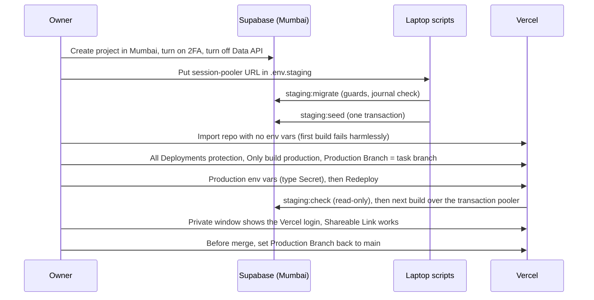
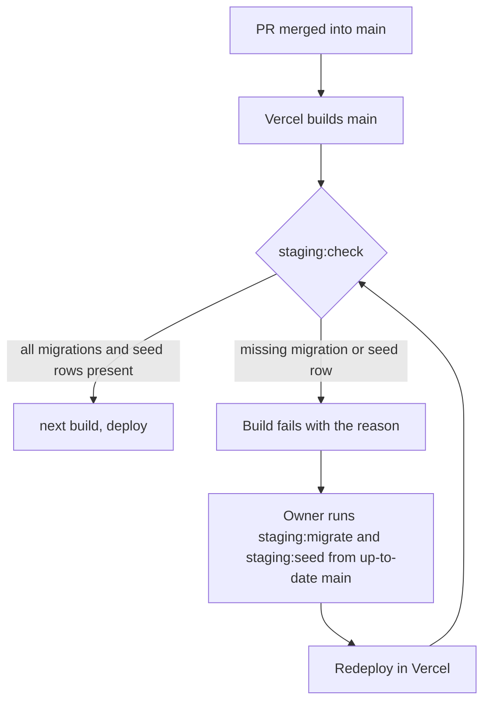

# Staging on Vercel and Supabase - Plan

## Goal Capsule

- **Objective:** the owner and a few testers can open a private copy of the website on the internet, backed by a real Postgres database in Mumbai, log in with fake SMS codes, and check each merged change there before any customer sees the site, while nobody else can open it or read its login codes.
- **Means:** the Vercel Hobby production deployment of `main` in its own project, with Supabase Free Postgres, migrated and seeded only from the owner's laptop by our scripts (KTD1, KTD4, KTD5).
- **Authority:** `CLAUDE.md` first, then this plan, then the research it cites. The owner's decisions (Key Decisions) are settled.
- **Stop conditions:**
  - Stop and ask the owner before any step that creates an account, connects a service, changes a dashboard setting, costs money or deploys.
  - Stop if a settled decision proves impossible (for example, Vercel removes All Deployments protection from Hobby).
  - Stop if any step would put a secret into git, a log, or this chat.
- **Execution profile:** Claude builds U1 to U6 on the task branch and checks them locally. The owner does every account, dashboard and secret step in `document/operations/staging.md`. U7 runs together, one owner-approved step at a time.
- **Shipping:** Claude commits on `20_staging_deploy`, runs the reviews, opens the pull request after the owner says yes, and stops. The owner merges.

---

## Product Contract

### Summary

Staging is a private, always-on copy of the site: Vercel builds `main` into the project's production deployment, its functions run in Mumbai, and its data lives in a Supabase Free project in Mumbai. Vercel Authentication guards every deployment. Login codes still come from the fake SMS provider, and testers read them in Supabase's table editor. Three small scripts migrate, seed and check the staging database from the owner's laptop, and the Vercel build refuses to start when the database is behind `main`. A test proves on real Postgres that one slot is never overbooked.

### Problem Frame

Everything so far runs only on the owner's laptop, against PGlite, a Postgres that runs one query at a time inside Node. Three things can't be checked there: the site on real hosting (secure cookies, the visitor's IP behind Vercel, Mumbai latency), the database on real Postgres (connection pooling, concurrent writes), and the owner's own review of merged work on a phone. Tasks 14, 15, 16, 17 and 22 each left notes that only a staging site can close. Staging must not become a public site: it shows sample-free but unfinished pages, and its fake SMS provider stores testers' numbers and full login codes.

### Key Decisions

- **Vercel Hobby (free) for staging.** (session-settled: user-directed — chosen over Vercel Pro (paid): the owner accepts that Hobby's terms allow only non-commercial use, so Vercel may pause the project, and on Hobby Vercel may use the code to train its AI.) Governs R1, R3.
- **Supabase Free for the staging database.** (session-settled: user-approved — chosen over Supabase Pro (paid): it pauses after 7 days of low activity; the data stays and the owner restores it from the dashboard.) Governs R1, R7.
- **The owner creates both accounts and does every dashboard step himself.** (session-settled: user-directed — chosen over Claude walking through sign-up: Claude can't log in for him, and secrets must never pass through the chat.) Governs R6, R14.
- **Testers read their fake login codes in Supabase's table editor.** (session-settled: user-approved — chosen over an owner-only outbox page or fixed test numbers: no new code near login and no page that shows codes.) Governs R11.
- **Staging settings live in `.env.staging`, not `.env.local`.** (session-settled: user-approved — chosen over `.env.local`, the owner's earlier default: Next.js loads `.env.local` for local runs, which would then reach staging.) Governs R6, R10.
- **Claude is denied reading or editing `.env.staging`** in `.claude/settings.json`. (session-settled: user-approved — chosen over relying on Claude not opening it.) Governs R6.

### Requirements

**Staging site**

- R1. Staging runs the code on `main` as the Vercel production deployment of its own project, with `APP_ENV=staging`, Supabase Postgres in Mumbai and the fake SMS provider.
- R2. Staging's functions run in Mumbai (`bom1`).

**Privacy and protection**

- R3. Only the owner, signed in to Vercel, and people holding the one Shareable Link can open any staging deployment, including its production domain.
- R5. Nobody can read staging's tables over the internet: Supabase's Data API is off, so login codes, sessions and testers' numbers are reachable only through the database itself.
- R6. No secret (database password, `BETTER_AUTH_SECRET`) is ever committed, printed by our scripts, or written into the chat.

**Database**

- R7. Before staging's first build reads the database, it has every migration on `main` and the seed data: the garage, its slot rules and the vehicle catalogue.
- R8. The staging database is migrated and seeded only from a checkout whose migrations folder and seed data files match `origin/main`, and an attempt from any other state is refused.
- R9. A staging build fails, with a message naming the problem, when the database is missing a migration or a seed row, or when a seeded row differs from `main`'s seed data; it never builds pages from a database that isn't what `main` expects.
- R10. Local runs (`npm run dev`, `npm run check`, `npm run test:e2e`) never connect to staging.

**Testers and the owner**

- R11. A tester gets past Vercel's protection with the Shareable Link and logs in with a fake code read in Supabase's table editor .
- R12. The owner gets the owner role on staging by logging in with `OWNER_PHONE_NUMBER`.
- R13. On staging, the per-IP login limit counts each visitor's real IP, and a forged `X-Forwarded-For` header doesn't change it.

**Proof**

- R14. A test run against staging proves that many reservations made at the same moment on one slot never pass its capacity, and that the test can catch overbooking.

**Teaching and operation**

- R15. A runbook gives the owner click-by-click steps for setup, for each later merge, and for undoing everything (rotating secrets, revoking the link, deleting the projects), plus a table of symptoms, causes and fixes.

### Scope Boundaries

- Not in this task: a custom domain (task 46), real SMS, WhatsApp or email (tasks 44, 45), photo storage (task 30), Vercel Cron (later tasks), monitoring and backups (task 46).
- Considered and not built:
  - An owner-only outbox page on staging. It can't bootstrap: reading it needs a login, which needs a code. Revisit if testers multiply beyond what the table editor serves.
  - Fixed test phone numbers with a known code. Task 15 rejected this as a backdoor; it would also have to be fenced off from production forever.
  - Migrating from the Vercel build or GitHub Actions. Supabase Free's direct connection is IPv6-only and both are IPv4-only; the session pooler would work, but every merged branch would then migrate a shared database unattended, which is the trap in `document/solutions/workflow-issues/parallel-branches-same-migration-number-regenerate-not-rename.md`. Revisit at task 46 with a CI pipeline.
  - Row-level security on every table. With the Data API off, nothing reads through Supabase's API. Revisit if a later task turns the Data API on.
  - A Postgres advisory lock around migrate and seed. One person runs them from one laptop, and an overlapping second run fails loudly on a duplicate object or key. Revisit if migrations move to CI (task 46).
  - An `X-Robots-Tag: noindex` header on staging. Vercel Authentication on All Deployments shows crawlers a login page, so no staging page can be indexed; a leaked Shareable Link is revoked, not indexed. Revisit if staging is ever opened to the public.
  - Supabase's Vercel Marketplace integration. It bills through Vercel and adds 13 environment variables, some `NEXT_PUBLIC_*`, while the app reads only `DATABASE_URL`.

### Deferred to Follow-Up Work

- Tasks 25 and 27 reuse U5's race harness for cancel and reschedule (task.md backlog, task 22).
- Task 46 moves staging's lessons to production: Pro plans, a domain, migrations in CI.

---

## Planning Contract

### Key Technical Decisions

- KTD1. **Staging is the production deployment of `main`; previews are off.** In the Vercel project, Ignored Build Step is "Only build production", and the Preview environment gets no `APP_ENV` or `DATABASE_URL`, so a stray preview build fails at `serverEnv()` ("local on Vercel") instead of reaching the database. Three sessions push branches to this repo, and Hobby builds one at a time. A `vercel.json` `git.deploymentEnabled` map isn't used: it applies only to commits that contain it, and it would block this task's own branch. While task 20 runs, the project's Production Branch is temporarily `20_staging_deploy`, because `main` doesn't yet have U1's connection settings. U7 switches it back to `main` before the owner merges. Governs R1, R10.
- KTD2. **Vercel Authentication, scope "All Deployments".** "Standard Protection", the default, leaves production domains public, and staging is a production deployment. All Deployments with Vercel Authentication is free on Hobby (Vercel docs, from 2026-09-09). Testers use the one Shareable Link Hobby allows per account. The link is a bearer token: anyone holding it gets in, and revoking it locks out everyone at once. Setup order closes the gap between import and protection: the repository is imported with no environment variables, so the first build fails harmlessly; then two-factor login on the Vercel account, protection, Ignored Build Step and environment variables are set (the region comes from `vercel.json`, KTD9); only then is the first real deploy made. Governs R3.
- KTD3. **Two connection strings, each for one job.** The app and the Vercel build use Supabase's transaction pooler (port 6543): postgres.js gets `prepare: false` (transaction mode can't keep prepared statements), `ssl: "require"`, at most 3 connections and a 10-second idle timeout, well inside Free's 200 pooler clients. Our scripts use the session pooler (port 5432 on the pooler host), which works over IPv4 and keeps session features. drizzle-kit is never pointed at 6543. Governs R1, R7.
- KTD4. **Staging settings live in `.env.staging`, never `.env.local`, under their own names.** Next.js loads `.env.local` for `next dev`, `next build` and `next start`, and `chooseDatabase` uses postgres.js whenever `DATABASE_URL` is set, so `.env.local` would point `npm run dev` and `npm run test:e2e` at staging. `.env.staging` is already git-ignored (`.env.*`). Only the staging scripts load it, with Node 24's `process.loadEnvFile`. They read `STAGING_DATABASE_URL`, a name the app never reads, so even a mistaken load can't redirect the app. The owner chose this over `.env.local` (Key Decisions). Governs R6, R10.
- KTD5. **Our own scripts migrate, seed and check, run with `tsx`.** `npm run staging:migrate`, `staging:seed` and `staging:check` (in `scripts/staging/`). They use drizzle-orm's postgres-js migrator, not the drizzle-kit CLI, because a bad URL there prints the password, and ours reuses the URL-safe `postgresClient` error. `tsx` becomes a pinned dev dependency. A `tsconfig.scripts.json`, used only by the scripts, maps `@/*` and maps `server-only` to Next's own empty stub by file path (`./node_modules/next/dist/compiled/server-only/empty.js`: `paths` targets are files, not package names), and the scripts run as `tsx --tsconfig tsconfig.scripts.json`; the main `tsconfig.json`, which Turbopack reads, is untouched. Governs R7, R8.
- KTD6. **The scripts refuse what would silently damage the shared database.** Before writing anything, `staging:migrate` and `staging:seed`:
  1. Refuse a URL on port 6543.
  2. Refuse unless `src/server/db/migrations/` and the seed data files match `origin/main` exactly, after a fresh fetch.
  3. After migrating, compare every applied row in `drizzle.__drizzle_migrations` with the journal (count and hashes), and fail loudly on any difference. drizzle's migrator only applies journal entries newer than the newest applied one and checks no hashes, so a migration merged out of order would otherwise be skipped forever.
  Governs R8.
- KTD7. **One seed entry point, in one transaction.** `seedAll(db)` in `src/server/db/seed.ts` runs `seedGarage`, `seedSlotRules` and `seedVehicleCatalogue` in one transaction. `createDatabase` (PGlite) and `staging:seed` both call it, so new rows reach both the same way, and a failed staging seed leaves nothing half-written. The seed only inserts missing rows, so a correction to an existing row (a catalogue fix, a new slot capacity) would never reach staging: `staging:seed` and `staging:check` compare each stored garage, slot-rules and catalogue row with the seed data and report every row that differs, by id, without changing it. Such a correction reaches staging through a new data migration, never by editing rows by hand. A half-seeded catalogue matters because `readVehicleCatalogue()` caches an empty result for up to 30 days. Governs R7.
- KTD8. **The Vercel build checks the database first.** `vercel.json` sets the build command to `staging:check` then `next build`. `staging:check` is read-only and runs only when `APP_ENV=staging`: every migration in the journal is applied with a matching hash, and the garage, slot rules and catalogue rows exist. Otherwise it exits non-zero with one plain sentence naming what's missing. A merged migration that nobody applied would otherwise pass the build and fail at request time. Governs R9.
- KTD9. **Mumbai via `vercel.json`, the only place the region is set.** `"regions": ["bom1"]` keeps the region in the repo, where review sees it; Hobby allows one function region, and the dashboard needs no region click. Builds themselves run in Vercel's US region, so prerender queries cross to Mumbai: slower builds, accepted. Governs R2.
- KTD10. **Testers read codes in Supabase's table editor.** The fake provider already writes each message to `dev_messages`. The owner opens Table Editor, picks `dev_messages`, sorts by `created_at`, and reads the newest code for the tester's number. This needs no new code near login and no web page that shows codes, and Supabase login with two-factor authentication guards it. Testers use made-up numbers: rows are kept 48 hours, and pruning runs only on the next write. Governs R11.
- KTD11. **The race test is opt-in, staging-only and self-cleaning.** A Vitest file with its own config (`vitest.staging.config.mts`), excluded from `npm run check`, run by `npm run staging:race-test`. It refuses to run unless `STAGING_DATABASE_URL` is set and the database holds the staging garage. It fires many `reserveSlot` calls at once on the bare database (lesson: `document/solutions/conventions/pglite-parallel-tests-bare-database-not-transaction-per-call.md`), over a pool with one connection per call, at most 10 calls (Supabase's session pooler gives each client its own server connection, and Free's pool holds about 15, shared with the app), at a slot far from any real booking, under a fixed clock. It deletes only its own `slot_counters` rows and never touches `slot_rules` (the unit test's `beforeEach` would wipe staging). A negative control, a deliberate read-then-write version, must overbook in the same harness: that proves the calls really overlapped. Governs R14.
- KTD12. **No Better Auth URL settings.** Our calls go straight to `auth.api` from Server Actions, which skips Better Auth's origin check, and Next's own Server Action origin check works on a `vercel.app` domain. `useSecureCookies` already turns on for staging. The client IP comes from `x-vercel-forwarded-for`, which Vercel sets and a client can't forge. U7 checks both on the live site. Governs R12, R13.

### High-Level Technical Design

Setup order: no secret leaves the owner's machine except into Vercel and Supabase, and staging is protected before it first serves a page.

Every later merge into `main`:

### Assumptions

- The owner's laptop can reach Supabase's session pooler (IPv4). If even that fails, the runbook's symptom table points to the network as the cause.
- Vercel's All Deployments protection stays free on Hobby. If it doesn't, the stop condition applies.
- A Supabase project paused for inactivity makes builds fail at `staging:check`. That is the intended signal: the runbook says to restore the project in the dashboard.
- About 5 pages are prerendered, so the build runs one worker and opens one pool.

### System-Wide Impact

- Every pull request any session merges into `main` deploys to staging. A merge that adds a migration makes the next staging build fail at `staging:check` until someone runs `staging:migrate`; the runbook and a `CLAUDE.md` rule say who and when.
- `src/server/db/seed.ts` gains `seedAll`, which every local database also uses: a later task that adds seed data adds it there once.
- `npm run check` and `npm run test:e2e` must keep working with no `.env.staging` and must never read one.

### Sequencing

U1 and U2 come first and are independent. U3 needs U2. U4 needs U3's journal check. U5 needs U1 and U2. U6 documents U1 to U5. U7 runs last, with the owner, after `npm run check` and `npm run test:e2e` pass.

---

## Implementation Units

### U1. Postgres client ready for Supabase's pooler

- **Goal:** the app's postgres.js connection works through Supabase's transaction pooler.
- **Requirements:** R1; KTD3.
- **Dependencies:** none.
- **Files:** `src/server/db/index.ts`, `src/server/db/index.test.ts` (create it if no test covers `postgresClient` yet).
- **Approach:**
  1. Pass `prepare: false`, `ssl: "require"`, `max: 3` and a 10-second `idle_timeout` where `createDatabase` builds the postgres.js client, replacing the "Task 20 tunes this" comment with the reason for each.
  2. Export `postgresClient(url, options, variableName)`: it keeps the fixed error for an unreadable URL, now naming the variable it was given (`DATABASE_URL` from `createDatabase`, `STAGING_DATABASE_URL` from the scripts).
- **Patterns to follow:** `postgresClient` in `src/server/db/index.ts`; `CLAUDE.md` "Database".
- **Test scenarios:**
  - A postgres config yields a client whose options have prepared statements off, SSL required, at most 3 connections and the idle timeout.
  - An unencoded password still gives the fixed message without the URL, naming the variable passed in.
- **Verification:** the client options are pinned by a test; nothing else about local PGlite changes.

### U2. Script foundation: loading staging settings safely

- **Goal:** scripts can open the staging database from `.env.staging` without loading anything into the app's environment or printing a secret.
- **Requirements:** R6, R10; KTD4, KTD5, KTD6 (step 1).
- **Dependencies:** none.
- **Files:**
  - `package.json`, `package-lock.json` (pinned `tsx`, its own commit)
  - `tsconfig.scripts.json`
  - `scripts/staging/connect.ts`, `scripts/staging/connect.test.ts`
  - `.env.example` (documents `STAGING_DATABASE_URL` with a fake value)
  - `vitest.config.mts` (adds `scripts/**/*.test.ts` to the Node test files)
- **Approach:**
  1. `connect.ts` loads `.env.staging` with `process.loadEnvFile` when the file exists, reads `STAGING_DATABASE_URL`, refuses port 6543 and any non-Postgres URL, and opens a postgres.js client through the URL-safe `postgresClient`.
  2. Every error names a variable and never its value.
- **Patterns to follow:** `serverEnv()` in `src/server/env.ts` (messages name variables, not values).
- **Test scenarios:**
  - A missing `STAGING_DATABASE_URL` fails with a message naming the variable and the file.
  - A URL on port 6543 is refused, with the session pooler named as the fix.
  - A URL with an unencoded password is refused without the password appearing in the message.
  - Loading the settings never sets `DATABASE_URL` or `APP_ENV`.
- **Verification:** the tests pass with no `.env.staging` present, and `npm run check` still passes.

### U3. `staging:migrate` and `staging:seed`

- **Goal:** the owner brings the staging database up to `main` with two commands that refuse anything unsafe.
- **Requirements:** R7, R8; KTD5, KTD6, KTD7.
- **Dependencies:** U2.
- **Files:**
  - `scripts/staging/migrate.ts`, `scripts/staging/seed.ts`, `scripts/staging/guards.ts`, `scripts/staging/guards.test.ts`
  - `src/server/db/seed.ts` (`seedAll`), `src/server/db/index.ts` (calls `seedAll`)
  - `src/server/db/database.test.ts` (or the existing seed test)
  - `package.json` (scripts)
- **Approach:**
  1. `guards.ts` holds the checks from KTD6 (the `origin/main` comparison of the migrations folder and seed data, and the journal-versus-applied comparison) and KTD7's seed comparison.
  2. `migrate.ts`: guards, drizzle-orm migrator, journal check, a one-line summary ("applied 2, already had 4").
  3. `seed.ts` (script): guards, `seedAll` in one transaction, a summary of rows added, then the seed comparison, which lists every stored row that differs from the seed data.
  4. `createDatabase` calls `seedAll` instead of the three seed functions.
- **Patterns to follow:** `seedGarage`, `seedSlotRules`, `seedVehicleCatalogue` (insert only missing rows); PGlite test setup in `CLAUDE.md` "Database".
- **Test scenarios** (against PGlite in memory, with the git comparison faked):
  - On an empty database, migrate applies every journal entry and the check passes.
  - Run twice, migrate changes nothing the second time and reports zero applied.
  - With a migrations folder that differs from `origin/main`, migrate refuses before connecting.
  - With an applied row whose hash differs from the journal, the check fails and names the migration.
  - With the journal holding an entry older than the newest applied row and not applied (the out-of-order case), the check fails.
  - `seedAll` on an empty database adds the garage, slot rules and catalogue; run again it adds nothing.
  - A failure inside `seedAll` leaves no garage row (one transaction).
  - A fresh local PGlite still gets the same seed data through `createDatabase`.
  - With a stored slot-rules row whose capacity differs from the seed data, the seed adds nothing and reports that row by id as different.
- **Verification:** both scripts run against a local PGlite-backed test without touching any network database; `npm run check` passes.

### U4. The build's database check and region

- **Goal:** a staging build refuses to build pages from a database that isn't what `main` expects, and runs in Mumbai.
- **Requirements:** R2, R6, R9; KTD7, KTD8, KTD9.
- **Dependencies:** U3 (journal check).
- **Files:**
  - `scripts/staging/check.ts`, `scripts/staging/check.test.ts`
  - `vercel.json` (build command, `regions`)
  - `package.json` (script)
- **Approach:**
  1. `check.ts` does nothing and exits 0 unless `APP_ENV=staging`. On staging it opens `DATABASE_URL`, the transaction pooler, through `createDatabase({ driver: "postgres", url })`, so it inherits `postgresClient`'s fixed message and U1's pooler options, and it prints only its own sentence and a Postgres error code, never an error object. It runs read-only: the journal check, a check that the garage, slot rules and at least one catalogue model exist, and the seed comparison (KTD7). It exits non-zero with one sentence naming what's missing and the runbook section that fixes it.
  2. `vercel.json` runs the check before `next build` and sets `bom1`.
- **Patterns to follow:** `serverEnv()` messages (name the variable, never its value).
- **Test scenarios:**
  - Without `APP_ENV=staging`, the check exits 0 without connecting.
  - On a migrated, seeded database, it exits 0.
  - With a migration missing, it exits non-zero naming the migration.
  - With an empty vehicle catalogue, it exits non-zero naming the catalogue.
  - With a stored catalogue model whose price group differs from the seed data, it exits non-zero naming the model.
  - An unencoded password in `DATABASE_URL` fails with the fixed message, and the password appears nowhere in the output.
- **Verification:** `npm run build` locally (no `APP_ENV`) behaves as before; `npm run test:e2e` passes unchanged.

### U5. Proof on real Postgres: one slot is never overbooked

- **Goal:** a repeatable test shows that concurrent reservations on staging never pass a slot's capacity, and that it would catch a bug that does.
- **Requirements:** R14; KTD11.
- **Dependencies:** U1, U2.
- **Files:** `src/server/dal/slots.postgres.test.ts`, `vitest.staging.config.mts`, `vitest.config.mts` (exclude the file), `package.json` (`staging:race-test`).
- **Approach:**
  1. Refuse to run without `STAGING_DATABASE_URL` and without the staging garage row present.
  2. Use a pool of 10 connections, warm every one (failing with a plain message naming the pooler's pool size if one can't be checked out), and fix the clock so a chosen slot far from real bookings is inside the booking window.
  3. Fire the calls with `Promise.all` on the bare database, then delete only that slot's counter rows.
- **Execution note:** run the negative control first and see it overbook; a race test that has never failed proves nothing.
- **Patterns to follow:** the "five reservations at once" test in `src/server/dal/slots.test.ts`, but not its `beforeEach`.
- **Test scenarios:**
  - 10 simultaneous reservations on a fresh slot with capacity 2: exactly 2 succeed, 8 answer "full", and the counter reads 2.
  - The same on a slot that already has 1 reserved: exactly 1 more succeeds.
  - The negative control (read, then write) under the same load ends with more than 2 reserved.
  - Run against a database without the staging garage, the test refuses before writing.
  - After the run, no counter row for the test's slot remains.
- **Verification:** `npm run check` never runs it; run by hand on staging in U7, it passes, and the negative control overbooks.

### U6. The staging runbook and repo docs

- **Goal:** the owner can set staging up, keep it in step with `main`, and take it down, without asking anyone.
- **Requirements:** R15; KTD1, KTD2, KTD3, KTD4, KTD10.
- **Dependencies:** U1 to U5 (it documents their commands).
- **Files:** `document/operations/staging.md`, `CLAUDE.md`, `readme.md`, `document/task/task.md`, `.env.example`.
- **Approach:** the runbook has these sections, each as numbered clicks with the exact dashboard labels:
  1. Supabase: create the project in Mumbai, turn on two-factor login, turn off the Data API, copy both pooler URLs (percent-encoding the password), and fill in `.env.staging`.
  2. Laptop: `staging:migrate` and `staging:seed` from an up-to-date `main` (during task 20: the task branch, whose migrations equal `main`'s).
  3. Vercel: turn on two-factor login for the account first; import the repository with no variables, then set protection to All Deployments, Ignored Build Step, Production Branch (the region comes from `vercel.json`), and the Production variables (type Secret): `APP_ENV`, `DATABASE_URL`, `BETTER_AUTH_SECRET` (generated on the laptop with `openssl rand -base64 32`), `OWNER_PHONE_NUMBER`, `SMS_PROVIDER` (`fake`, the default). Then redeploy.
  4. Testers: the Shareable Link and reading codes in the table editor.
  5. After each merge: what a failed `staging:check` means, and the fix. Migrations change tables in two steps (add the new column or table first, drop the old one in a later migration), because the previous deployment keeps serving against the migrated database until the next build. A seed-data correction ships as a data migration.
  6. A symptom, cause and fix table: build fails at `staging:check`, project paused, 6543 versus 5432, an unencoded password, a missing setting named by `serverEnv()`, a stray preview, "max clients reached in Session mode" (the pooler's pool size).
  7. Undo: rotate the database password and `BETTER_AUTH_SECRET`, revoke the link, delete the Vercel and Supabase projects.
  8. Changes made in Supabase's console reach pages only after a redeploy (`cacheLife("max")`).
  Plus a short "Staging" section in `CLAUDE.md` (KTD1, KTD4, KTD6 as rules) and a pointer in `readme.md`.
- **Test expectation:** none, documentation only. U7 walks every step once, and the runbook is corrected wherever the dashboards differ.
- **Verification:** each command named in the runbook exists in `package.json`; every variable named is in `.env.example`.

### U7. Go live, with the owner, one approved step at a time

- **Goal:** staging is up, protected and checked, and the Production Branch points back at `main` before the merge.
- **Requirements:** R1 to R14 (live checks).
- **Dependencies:** U1 to U6 committed; `npm run check` and `npm run test:e2e` pass.
- **Files:** `document/operations/staging.md` (corrections), `document/learning/20_staging_deploy.md`.
- **Approach:** Claude asks before each step and the owner performs it. The order is the runbook's, then these checks, each recorded in the learning doc with what was seen:
  1. A private browser window gets Vercel's login page on the production domain and on a deployment URL.
  2. The Shareable Link opens the site.
  3. A made-up number logs in with the code from the table editor.
  4. The owner's number gets the owner role on `/account`.
  5. The `login_attempts` row shows a real IP, unchanged when the request carries a forged `X-Forwarded-For`.
  6. Vercel's account shows two-factor login on.
  7. The project's REST address (`https://<project>.supabase.co/rest/v1/`) answers that the Data API is off.
  8. `staging:race-test` passes, and its negative control overbooks.
  9. The Production Branch is set back to `main`, and after that deployment the Shareable Link still opens the site.
- **Test expectation:** none beyond the checklist, which is this unit's verification.
- **Verification:** every checklist item is recorded as seen, or as failed with its fix.

---

## Verification Contract

| Gate | Command or check | When |
| --- | --- | --- |
| Lint, types, unit tests | `npm run check` (exit code captured, not piped) | Before every commit called done |
| Browser tests, local | `npm run test:e2e` on port 3210, with no `.env.staging` effect on it | Before the pull request |
| Design | `npm run test:design` isn't needed: no token, `type-*`, `ui/` or `site/` change | n/a |
| Staging scripts | `staging:migrate`, `staging:seed`, `staging:check` against staging, owner-approved | U7 |
| Race proof | `npm run staging:race-test` against staging, negative control first | U7 |
| Live checklist | U7's nine checks | U7 |
| Reviews | `ce-code-review`, then the `code-reviewer` agent | Before the pull request |

---

## Definition of Done

- Every unit's verification holds, and U7's checklist is recorded in the learning doc.
- The Production Branch is `main` again, and staging still builds from it once the pull request merges (checked right after the merge).
- `npm run check` and `npm run test:e2e` pass; neither touched staging.
- No secret in git, in a log the scripts print, or in this chat. `git log -p` for the branch contains no Supabase password or `BETTER_AUTH_SECRET`.
- The runbook matches what the dashboards really showed.
- No abandoned experiment code is left in the diff.
- task.md, the learning doc, `CLAUDE.md`, `readme.md` and `.env.example` are updated.

---

## Risks

| Risk | Effect | Mitigation |
| --- | --- | --- |
| Vercel pauses the Hobby project for commercial use | Staging goes offline | Accepted by the owner; task 46 moves to Pro |
| Supabase pauses after 7 days idle | Builds fail at `staging:check`, pages error | Runbook: restore in the dashboard; the failure is visible |
| The Shareable Link leaks | Anyone with it gets in | Revoke and reissue in one click; testers use made-up numbers |
| A merged migration isn't applied | Build fails at `staging:check` | Runbook step after each merge |
| Build queries cross US to Mumbai | Slower builds | Accepted; few prerendered pages |
| Dashboard labels differ from the runbook | Owner gets stuck | U7 walks every step and corrects the runbook |

---

## Sources

- Repo: `src/server/db/index.ts` (`createDatabase`, `postgresClient`), `src/server/db/seed.ts`, `src/server/env.ts`, `src/server/auth/login.ts` (`clientIpKey`), `src/server/dal/slots.test.ts` (parallel test and its `beforeEach`), `next.config.ts`, `.gitignore` (`.env.*`).
- Lessons: `document/solutions/workflow-issues/parallel-branches-same-migration-number-regenerate-not-rename.md`, `document/solutions/conventions/pglite-parallel-tests-bare-database-not-transaction-per-call.md`, `document/solutions/conventions/better-auth-phone-login-only-from-server-actions.md`, `document/solutions/conventions/nextjs-16-dev-server-is-not-one-process-use-cache-probe.md`.
- Vercel: [Deployment Protection](https://vercel.com/docs/deployment-protection), [Methods to protect deployments](https://vercel.com/docs/deployment-protection/methods-to-protect-deployments), [Hobby plan](https://vercel.com/docs/plans/hobby), [Fair use guidelines](https://vercel.com/docs/limits/fair-use-guidelines).
- Supabase: [Project pausing](https://supabase.com/docs/guides/platform/free-project-pausing), [Pricing](https://supabase.com/pricing).
