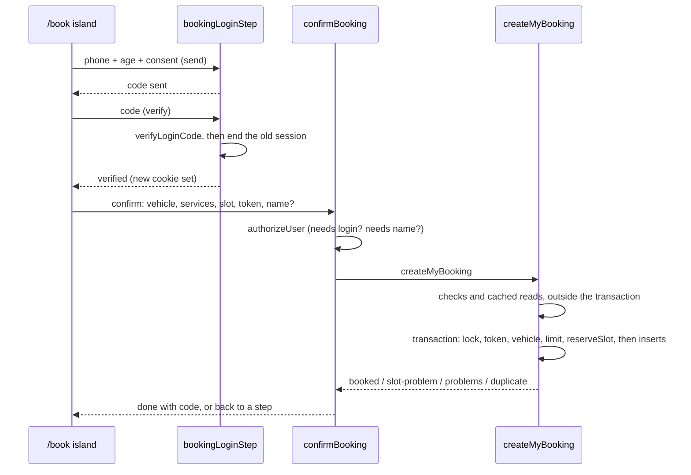
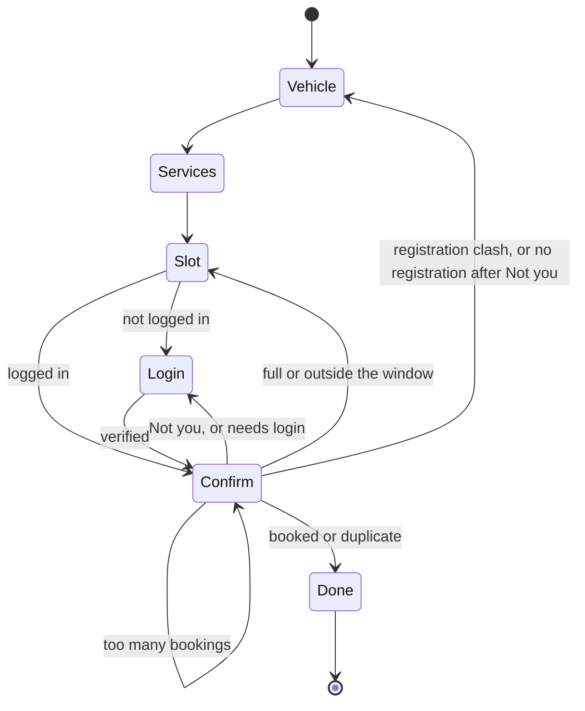

# Booking Flow - Plan

## Goal Capsule

- **Objective:** A customer can book a real time slot at the garage from their phone in a couple of minutes. They see the price the garage set for their exact vehicle (or "price after inspection"), end with a booking code, and the garage is never booked past its capacity.
- **Means:** two pull requests (KTD1). Task 23 builds the booking engine: rules in `src/domain/bookings.ts`, three tables, one data-access save that reserves the slot and writes the booking in one transaction, and the login change that ends an old session. Task 47 (`47_book_wizard`) builds the `/book` page on top of it (KTD5–KTD9).
- **Authority:**
  1. The owner's choices in this session (Key Decisions below).
  2. The master plan (see origin): task 23 "`/book` wizard with inline OTP, prices worked out on the server; Playwright e2e test", and the data rules (paise, IST, booking items snapshot their prices, atomic slot update).
  3. The task 23 steps and backlog notes in `document/task/task.md` (from tasks 12, 14, 15, 16, 17, 19, 21 and 22).
  4. `CLAUDE.md`: Booking slots, Customer data, Login and sessions, Roles and access, Database, Languages, design system and site shell.
  5. This plan.

  These lessons in `document/solutions/` apply:
  - `conventions/better-auth-phone-login-only-from-server-actions.md`: nothing about the booking goes inside Better Auth's verify callback;
  - `conventions/react-19-form-islands-hydration-action-activity.md`: the wizard needs JavaScript and starts fresh on each visit;
  - `conventions/pglite-parallel-tests-bare-database-not-transaction-per-call.md`: capacity races run on the bare test database, rollback is tested apart;
  - `conventions/nextjs-16-catch-only-expected-request-api-errors.md`: catch only the expected error;
  - `conventions/playwright-networkidle-hangs-after-second-page-load.md`: `expectNoErrors` only on a test's first page load;
  - `conventions/privacy-notice-retention-from-delete-code-not-expiry.md`: "how long" comes from the code that deletes rows;
  - `workflow-issues/parallel-branches-same-migration-number-regenerate-not-rename.md`: generate the migration after task 18 merges;
  - `workflow-issues/full-check-times-out-under-parallel-session-load.md` and `conventions/run-commands-before-documenting-output.md`.
- **Execution profile:**
  - Units run in order. U1 waits for task 18 to be merged into `main`. U2 is written test-first. In U4, write the ownership and capacity tests first and mutation-check them.
  - U8 and U9 change how the app looks: build them with the `ui-engineer` agent.
  - Run `npm run check` after each unit, `npm run test:e2e` at U5 (task 23's privacy change) and U10, and `npm run test:design` only if a `site/` component changes (U6).
  - Three sessions share the repo. Stage files by name. Merge `origin/main` before `db:generate` (U3) and again before the reviews.
- **Stop conditions:** stop and ask the owner when:
  - task 18's merged API differs from what this plan assumes in a way that changes a table or a KTD (U1);
  - the change needs more than one new migration in task 23, or any migration in task 47;
  - a step would add a Better Auth Route Handler or browser client, a global install, or `npx playwright install`;
  - `/` stops building as `○ /en`, or `/book` loses its prerendered shell;
  - either pull request's hand-written diff heads past about 2,500 lines.
- **Who finishes:** `ce-work` builds and commits on the task branch, then stops. The main session writes the learning doc, runs `ce-code-review`, `code-reviewer` and the compound step, and asks the owner before pushing and opening each pull request. Task 47 starts on its own branch only after task 23 is merged.

---

## Product Contract

### Summary

A `/book` page walks a customer through four steps: their vehicle, services or a package, a free slot, then logging in with a phone code if needed and confirming. The booking is saved with the slot's place, the prices the server worked out, and a copy of the vehicle, and the customer gets a short booking code. The "Book" buttons stop going to WhatsApp and open `/book`.

### Problem Frame

Today every "Book" button opens WhatsApp, and the garage writes each booking down by hand. The pieces for online booking exist but aren't joined: the slot engine (task 22) counts places but nothing books them, customers can save vehicles (task 21), and task 18 adds services and the `priceFor` rule. Until a booking is a saved row that holds a place, the garage can't see its day (task 26), customers can't see or cancel their bookings (task 25), and nothing can send reminders (task 35).

### Requirements

**The booking engine (task 23)**

- R1. A booking saves one vehicle, one slot, and one package or one or more services, for the logged-in customer only.
- R2. The slot's place is taken in the same transaction as the booking. If any part fails, neither is saved; a full slot is a returned answer, never an error.
- R3. Each line's price is worked out on the server from the garage's real prices and saved with the booking. A line with no fixed price (after inspection, or no price set yet) saves no amount, and the booking is then marked as an estimate.
- R4. The booking keeps a copy of the vehicle (type, model, fuel, price group, registration), so later changes to the vehicle or the catalogue never change it.
- R5. Each booking gets a short code that is unique and easy to read aloud.
- R6. A booking starts with the status "booked" and a first history entry saying who made it and when.
- R7. Sending the same confirm twice (a double tap, or a retry after "no connection") makes one booking, not two.
- R8. A customer can hold at most 3 bookings for slots that haven't started yet. The number is a setting in the domain rules, so the owner can change it.
- R9. When a different number logs in on a phone that is already logged in, the old login stops working.
- R10. The privacy notice lists bookings (what is kept, why, who handles it, how long), and its version moves.

**The `/book` page (task 47)**

- R11. Step 1: a logged-in customer picks a saved vehicle or adds one. Anyone else picks type, brand, model and fuel and types a registration number. A vehicle added here is saved to the account at confirm.
- R12. Step 2: the services and packages offered for that vehicle, each with its price, "price after inspection" or "price confirmed at the garage". When no line has an amount, the total shows no amount, only "Price confirmed at the garage". When some lines do, it shows "Estimate: ₹X" plus "the rest confirmed at the garage". The confirm and done screens use the same wording. Changing the vehicle drops choices it isn't offered for, and says so.
- R13. Step 3: the free slots from the live slot list, grouped by day.
- R14. Step 4: a visitor who isn't logged in gets the same phone, code and consent step as `/login`, inside the page, and keeps every choice. A logged-in customer sees "Booking as +91 …" with "Not you?", which logs out in place and shows the phone step.
- R15. Confirm shows a summary. A customer with no name gives it here before the booking is saved.
- R16. When confirm answers "full", "outside the window" or "registration already saved", the page goes back to the step that needs changing, with fresh slots or the customer's saved vehicles, and keeps the rest. "Too many bookings" stays on confirm and says how to reach the garage.
- R17. After a booking, the page shows the code (with a line asking the customer to note or screenshot it), the vehicle, the slot, the lines and the total, and how to reach the garage.
- R18. The page needs JavaScript. Without it, it says so and shows the garage's phone and WhatsApp.
- R19. The phone action bar is hidden on `/book`, with no empty gap where it was.
- R20. "Book a service" and the phone bar's "Book" open `/book`. The FAQ's "How do I book?" and the terms' booking text describe online booking.

### Key Decisions

- **Logging in is the last step.** A visitor sees prices and slots before giving a number. (session-settled: user-approved — chosen over logging in first: fewer people give up before seeing a price.) Governs R14.
- **A vehicle added while booking is saved to the account.** (session-settled: user-approved.) Governs R11.
- **The slot isn't held while the customer logs in.** If it fills meanwhile, they pick another. (session-settled: user-approved — chosen over a timed hold: holds need expiry and clean-up.) Governs R16.
- **Services without a fixed price can be booked; the total is an estimate, paid at the garage.** (session-settled: user-approved.) Governs R3, R12.
- **The page needs JavaScript.** (session-settled: user-approved — chosen over a form that posts without JavaScript: about twice the work.) Governs R18.
- **A different number logging in ends the old login; the phone bar is hidden on `/book`.** (session-settled: user-approved.) Governs R9, R14, R19.
- **A new booking starts as "booked" and holds its place at once.** The garage confirms or changes it in tasks 26–27. (session-settled: user-approved.) Governs R2, R6.
- **The name is asked on the confirm screen, not in the login step.** Asking it only of new numbers would show which numbers have an account, and the server knows a name is missing only after the code is checked. Governs R15.
- **Only real prices are saved, never the sample prices `npm run dev` shows.** The owner's rule of 2026-10-29: a made-up price never reaches a customer. Until task 39 adds prices, every line is "price confirmed at the garage". Governs R3, R12.
- **One package or several services, never both, at least one.** A package already bundles services; mixing them makes "what am I paying for" unclear. Governs R1.
- **At most 3 future bookings per customer.** One login can't fill the calendar, and someone who booked the wrong time can still rebook before task 25 adds cancelling. (session-settled: user-directed — chosen over one future booking per vehicle, both limits, and no limit: the per-vehicle rule left customers stuck and didn't stop a login filling every slot.) Governs R8.
- **Until task 25, the confirmation screen is the only place the code shows.** It also shows Call and WhatsApp for a lost code. Governs R17.

### Success Criteria

- A new customer on a phone goes from `/` to a booking code without leaving `/book`, and the browser test proves it on a production build.
- Two customers booking the last place: exactly one gets it. PGlite runs the two saves one after the other, so this test checks the answers; the race itself is proven by task 22's `reserveSlot` test on the bare database and by task 20's Postgres test.
- A booking's saved lines and vehicle copy don't change when the garage later changes a price or the customer removes the vehicle.

### Scope Boundaries

- Pickup and drop (task 24), coupons (task 38), my bookings, cancel and reschedule (task 25), the garage's board (tasks 26–27), messages to the customer (task 35).
- No note or photo with a booking. A "describe the problem" field is the estimate request's job (task 32).
- No check that the price shown matches the price saved. There's no payment in version 1, both come from the same rule, and the confirmation shows what was saved. Would change if a price could move between the two (task 39 editing prices during a booking).
- No retry when a new booking code clashes with an existing one. About 887 million codes against a few thousand bookings a year; a clash rolls the booking back and the customer's retry draws a new code. Would change if a clash is ever logged.
- No limit of one future booking per vehicle. The per-customer limit (R8) covers abuse, and the garage sees a double-booked car on its board (task 26).
- No timed slot hold, and the phone bar doesn't hide when a field has focus on other pages. Would change if the owner reports people losing slots during login.
- The package's "what's included" list isn't copied onto the booking. The service id finds it, and its contents don't affect the price.
- Wizard steps don't go into the browser history. The page's own Back buttons move between steps.

#### Deferred to Follow-Up Work

- Task 47 `47_book_wizard`: units U6–U10 of this plan, as the second pull request.

### Open Questions

- Non-blocking, for the owner before production (task 46): the draft models, fuels and price groups in `vehicle-seed-data.ts` show publicly on `/book`, as on `/services`. The task 17 gate applies.
- Non-blocking: capacity 2 per slot is still a placeholder (`ownerSlotRules` in `src/server/db/seed-data.ts`), and so is the limit of 3 future bookings per customer (R8).

---

## Planning Contract

### Key Technical Decisions

- KTD1. **Two tasks, two pull requests.** Task 23 is the engine (U1–U5, about 1,700 lines). Task 47 is the page (U6–U10, about 2,100 lines). Task 21 alone came to about 3,600 lines; one pull request for both would be hard to review. The engine is fully tested through its data-access tests, so task 23 is useful on its own. (session-settled: user-approved — chosen over one pull request: the owner confirmed "probably two pull requests" in the scope check.)
- KTD2. **The booking is saved in its own request, after the code is checked.** A login made inside a Server Action is invisible to the rest of that request: `getCurrentUser()` reads `headers()`, which Next.js doesn't update when an action sets a cookie (`node_modules/next/dist/server/async-storage/request-store.js`), and it is wrapped in `cache()`. So the code-check action only answers "verified", and "Confirm booking" is the next request, which carries the new cookie. This also fits R15: the name is asked on that screen.
- KTD3. **One save function owns the whole booking.** `createMyBooking(input, clock)` in `src/server/dal/bookings.ts`:
  1. `authorizeUser()` on its first line;
  2. checks the input with `checkBookingInput`;
  3. reads the catalogue, services and prices (cached), and the customer's saved vehicle if one was picked;
  4. builds the lines with `priceFor`;
  5. only then opens the transaction, and inside it, in this order:
     1. takes `pg_advisory_xact_lock` on the customer's id, as `decideAndRecordAttempt` does, so two confirms from one customer run one after the other;
     2. looks up a booking by `(user_id, request_token)`: found means `duplicate` with its code (KTD5);
     3. resolves the vehicle (KTD4): the saved one by id and user, or the typed plate matched against the customer's vehicles;
     4. counts the customer's `booked` bookings whose slot hasn't started: at the limit means `too-many-bookings` (R8);
     5. `reserveSlot(tx)`, returning at once if it isn't ok;
     6. inserts the vehicle if it's new, the booking, its items and its first event.

  Every check that can refuse is a read before `reserveSlot`, so after a successful reserve the only answer is `booked`. A write that fails after it (an unexpected conflict) throws and rolls everything back, the slot's place included. Nothing catches it. This keeps `CLAUDE.md`'s "reserve before the transaction's other writes": the checks before it only read. No cached read, `getDatabase()` or session read happens while the transaction is open (`CLAUDE.md`, Booking slots). Answers are a result union (`booked`, `problems`, `slot-problem`, `registration-duplicate`, `too-many-bookings`, `duplicate` with the existing code), never thrown.
- KTD4. **The vehicle insert takes the transaction.** `addMyVehicle` reads the session, the catalogue and the database itself, so it can't run inside the booking's transaction. Split its insert into `insertVehicleRow(tx, userId, checked)`, used by both `addMyVehicle` and `createMyBooking`. A typed registration the customer already saved with the same model and fuel reuses that vehicle. With a different model or fuel it is `registration-duplicate`: the answer names the saved vehicle's model and carries the customer's saved vehicles (KTD10), so step 1 can offer it.
- KTD5. **The request token stops double bookings.** The page makes one random token per run of the wizard and posts it with confirm. Under the per-customer lock, the transaction looks the token up before any other check (KTD3 step 5.2). A match answers `duplicate` with that booking's code, so the page shows the same confirmation. This holds even when the first booking took the slot's last place or the customer's last allowed booking. The unique `(user_id, request_token)` stays as a backstop the lock should never let fire; if it does, the insert throws and rolls back. Nothing catches `23505`.
- KTD6. **The booking code.** Six characters from an alphabet without look-alikes (`ABCDEFGHJKMNPQRSTUVWXYZ23456789`), shown as `K7Q-4MX`, made by a pure function that takes a random source, so tests can fix it. Unique column, with no retry: a clash throws and rolls back (Scope Boundaries). No brand prefix: the brand name lives only in `messages/en.json`.
- KTD7. **Tables (one migration, `0006_bookings` once task 18's `0005` is on `main`).**
  - `bookings`: id (uuid), code (unique), `user_id` (restrict: no code deletes users; task 43 decides), `vehicle_id` (nullable, `on delete set null`), the vehicle copy (kind, `model_id` restrict, fuel, `category_id` restrict, `registration_number`), `starts_at`, status (enum `booking_status`, `booked` only for now), `is_estimate`, `total_paise` (nullable: the sum of priced lines), `request_token`, `created_at`.
  - `booking_items`: id, `booking_id` (cascade), `service_id` (restrict, as task 18's schema comment expects), `service_kind`, the name copy (`LocalizedText` jsonb), `price_status` (`price`, `on-inspection`, `no-price`), `price_paise` (nullable, checked positive), position.
  - `booking_events`: id, `booking_id` (cascade), kind (`booked`), `actor_user_id` (restrict), `created_at`.
  - Indexes: `bookings (starts_at)` for the slot-counter check, `bookings (user_id, starts_at)` for R8.

  The enum follows task 18's pattern (`pgEnum(... as const satisfies readonly X[])` plus a test that keeps database and domain in step).
- KTD8. **Ending the old login lives in the login service.** After `verifyLoginCode` succeeds, if the request carried a session token that differs from the new one, that session row is deleted. Never before verifying, so a wrong code keeps the old login, and never by passing Better Auth's `updatePhoneNumber`, which would move the new number onto the logged-in user. `/login` gets the same safety net for a leftover cookie. The old token comes only from a cookie whose signature checks out, and the delete runs inside `withoutDetails`, so a database error never carries the token into a log (`CLAUDE.md`, Login and sessions). The exact call (Better Auth's `revokeSession` or a data-access delete by token) is decided in U4 by which one works without the old session's own headers.
- KTD9. **The page is built ahead of time; one `<Suspense>` holds everything per request.** `src/app/[locale]/(book)/book/page.tsx` reads the catalogue, services, real prices and garage (all cached), so its shell is static. One server component inside `<Suspense>` reads the session, the customer's vehicles, the profile and the live slots (after `await io()`), and renders the wizard island with them as props: dates as ISO strings, never `Date` objects. Its fallback has the island's height.
- KTD10. **The wizard trusts its own "verified" state across the login.** After the code check, Next.js re-renders the page in the same response with the old headers, so the `<Suspense>` part still says "logged out". The island isn't keyed by the user's id (a key that flips would remount it and lose every choice). It is wrapped in `FreshOnEachVisit` and resets on purpose:
  - a fresh visit starts empty;
  - "Not you?" keeps the vehicle's type, model and fuel as a typed vehicle and asks for its registration again. It keeps the services (same price group, so still valid), and clears the saved-vehicle list, the "Booking as" number and the name;
  - confirm answering "needs login" goes back to the phone step.

  After a new number verifies, a vehicle without its registration sends the customer to step 1 with a message. Saved vehicles and whether a name is missing come from the latest server answer, never from the first render's props: the confirm action reads them after `authorizeUser()` and returns them with every non-booked answer. The confirm action catches only `AccessDeniedError` from `authorizeUser()` and answers "needs login"; it never calls `requireUser`, whose redirect would drop the wizard.
- KTD11. **The page's own route group hides the phone bar.** `/book` moves to `src/app/[locale]/(book)/` with a layout that renders `SiteChrome` with `actionBar={false}`. `SiteChrome` then skips the bar and its spacer. The bar's scroll padding in `globals.css` (`html { scroll-padding-bottom }` and `--stage-height`) applies only while the bar is on the page, keyed off the bar's own marker with `:has()`, so no gap is left. This keeps every page prerendered: nothing reads the URL on the server. Rejected: a client island reading `usePathname` (it suspends under Cache Components) and a CSS-only hide (the spacer would stay).
- KTD12. **The booking's actions live in `src/server/actions/booking.ts`, and its state in `src/lib/booking-form.ts`.**
  - `bookingLoginStep` wraps `requestLoginCode` and `verifyLoginCode` like `loginStep` but returns state instead of redirecting. Its phone-step handling (kept fields, rate-limit text) is extracted from `src/server/actions/login.ts`, not copied.
  - `confirmBooking` reads only the named fields, saves the name first if one was needed (`saveMyName`), then calls `createMyBooking`.
  - `notMe` signs out in place.
  - The login form's steps (`PhoneStep`, `CodeStep`) are exported from `src/components/account/login-form.tsx` with their labels, so `/book` reuses them, consent boxes and notice included.

### High-Level Technical Design

The confirm path across the two requests:

The wizard's steps:

### Size Budget

Hand-written lines, tests and docs included; the generated migration snapshot is excluded.

| Unit | Code | Tests | Total |
| --- | --- | --- | --- |
| U1 merge task 18, recheck | 0 | 0 | 0 |
| U2 booking rules | 180 | 260 | 440 |
| U3 tables and migration | 110 | 90 | 200 |
| U4 save, vehicle split, old login | 300 | 520 | 820 |
| U5 privacy notice and docs | 120 | 40 | 160 |
| **Task 23** | | | **about 1,620** |
| U6 phone bar and route group | 70 | 80 | 150 |
| U7 actions and state | 230 | 320 | 550 |
| U8 the wizard island | 520 | 330 | 850 |
| U9 page, live link, text | 160 | 120 | 280 |
| U10 browser tests and docs | 60 | 220 | 280 |
| **Task 47** | | | **about 2,110** |

Each task's learning doc (about 150 lines) comes on top.

### Deferred to Implementation

- The exact call that deletes the old session (KTD8).
- Whether the wizard's step components live in one file or several under `src/components/booking/`.
- The Server Action API that makes the slot list re-read after a "full" answer (`refresh` from `next/cache` or a returned fresh list); read `node_modules/next/dist/docs/` first.

### Risks

- **Task 18 isn't merged.** U1 rechecks `priceFor`, `PriceResult`, `readServicePrices` and the table names. Its stop condition covers a change.
- **Parallel browser tests share 2 places per slot.** Each booking test picks its slot from its own random offset, and "full" is proven in integration tests, not in the browser.
- **PGlite can't prove the real row race.** Task 20's staging Postgres test covers `reserveSlot`. The booking's own checks (the token, R8) run under the per-customer lock, so two confirms from one customer can't both pass them; task 20's test should cover that lock too.

### System-Wide Impact

- The login service gains the old-session clean-up, which `/login` uses too (KTD8).
- `addMyVehicle` changes shape inside (KTD4); task 21's tests must still pass unchanged.
- `SiteChrome` gains a prop, and `globals.css`'s scroll padding becomes conditional (KTD11).
- `LOGIN_NOTICE_VERSION` moves, so everyone logging in after task 23 agrees to the new notice.

---

## Implementation Units

### U1. Merge task 18 and recheck its API

- **Goal:** start task 23 on top of task 18's services and prices.
- **Requirements:** R3, R12.
- **Dependencies:** task 18 merged into `main`.
- **Files:** none changed by hand. Read `src/domain/services.ts`, `src/server/dal/services.ts`, `src/server/db/schema.ts`, `src/content/sample-prices.ts`.
- **Approach:**
  1. Merge `origin/main` into `23_booking_flow`, then `npm install`.
  2. Confirm `priceFor(service, prices, vehicle)`, `PriceResult`'s four statuses, `readServices()`, `readServicePrices()` and the `services` table's text id match KTD3 and KTD7.
  3. Note the latest migration number (expected `0005`).
- **Test expectation:** none -- no code changes; `npm run check` passes after the merge.
- **Verification:** `npm run check` passes on the merged branch; any API difference is written into this plan before U2.

### U2. Booking rules in the domain

- **Goal:** pure rules for what a booking may contain and what it costs.
- **Requirements:** R1, R3, R5, R7, R8.
- **Dependencies:** U1.
- **Files:** `src/domain/bookings.ts`, `src/domain/bookings.test.ts`.
- **Approach:**
  - `checkBookingInput`: a vehicle (a saved id or model, fuel and registration), one package or 1–10 services, a slot start, a token. Returns problem codes like task 21's rules.
  - `buildBookingLines(services, prices, vehicle, chosenIds)`: one line per choice from `priceFor`, `not-offered` as a problem, and the totals (`totalPaise` of priced lines, `isEstimate`).
  - `makeBookingCode(random)` and `formatBookingCode` (KTD6).
  - `MAX_FUTURE_BOOKINGS = 3` (R8), with the owner's note beside it.
  - `BOOKING_STATUSES`, `BOOKING_EVENT_KINDS`, `LINE_PRICE_STATUSES` as `as const` lists for the enums.
- **Execution note:** write it test-first.
- **Patterns to follow:** `src/domain/customer-vehicles.ts` (problem codes), `src/domain/slots.ts`, task 18's `src/domain/services.ts`.
- **Test scenarios:**
  - Two services, both priced for a petrol hatchback: two lines, total is their sum, not an estimate.
  - One priced service and one `on-inspection` service: the total counts only the priced line, and the booking is an estimate.
  - With no real prices (empty list), every line is `no-price` and the total is null.
  - A package plus a service: problem `package-with-services`.
  - No services: problem `nothing-chosen`. Eleven services: `too-many`. The same id twice counts once.
  - An unknown service id, or one hidden: `unknown-service`. A two-wheeler package on a car: `not-offered`.
  - A token that isn't a uuid: `bad-token`.
  - `makeBookingCode` with a fixed random source gives a known code; every character is in the alphabet; `formatBookingCode("K7Q4MX")` is `K7Q-4MX`.
- **Verification:** all scenarios pass; no Next.js, React or database import in the file.

### U3. The booking tables and their migration

- **Goal:** `bookings`, `booking_items` and `booking_events` as in KTD7.
- **Requirements:** R1, R2, R4, R5, R6, R7.
- **Dependencies:** U1, U2.
- **Files:** `src/server/db/schema.ts`, `src/server/db/migrations/0006_bookings.sql` and `meta/` (generated), `src/server/db/bookings-tables.test.ts`, `src/app/[locale]/(site)/privacy/coverage.test.ts` (the new tables listed), `messages/en.json` (a first draft of `PrivacyPage.items.bookings`, so the coverage test passes now; U5 finishes the wording).
- **Approach:** merge `origin/main` right before `npm run db:generate -- --name=bookings`. Enums from U2's lists. One migration only.
- **Patterns to follow:** `customer_vehicles` and task 18's `services` tables; `src/server/db/customer-vehicles-table.test.ts`.
- **Test scenarios:**
  - Two bookings with one code: the second insert is refused.
  - One user, one token, twice: the second is refused. Two users with the same token: both saved.
  - Removing a vehicle sets `vehicle_id` to null and keeps the booking's vehicle copy.
  - Deleting a booking removes its items and events. Deleting a service or model a booking points to is refused.
  - A `price_paise` of 0 or below is refused.
  - The enum values match the domain lists.
- **Verification:** `database.test.ts` migration checks pass; only one new `.sql` file.

### U4. The booking save, the vehicle split and ending the old login

- **Goal:** `createMyBooking` (KTD3–KTD6), `insertVehicleRow` (KTD4), and the old-session clean-up (KTD8).
- **Requirements:** R1–R9.
- **Dependencies:** U2, U3.
- **Files:** `src/server/dal/bookings.ts`, `src/server/dal/bookings.test.ts`, `src/server/dal/customer-vehicles.ts` (split), `src/server/dal/customer-vehicles.test.ts` (unchanged scenarios still pass), `src/server/auth/login.ts`, `src/server/auth/login.test.ts`, `src/server/dal/vehicles.ts` (the saved vehicle's price group, read by the customer's id and the vehicle id).
- **Approach:**
  - Follow KTD3's order exactly, including the lock and the token lookup before any other check.
  - The saved-vehicle read joins `vehicle_models` for `category_id`, so a model hidden later still prices.
  - R8 counts the customer's `booked` bookings with `starts_at` after now, inside the transaction, before `reserveSlot`.
  - A shared `isUuid` moves out of `customer-vehicles.ts` for both files.
- **Execution note:** write the ownership, capacity and rollback tests first; mutation-check them once: drop `authorizeUser()`, drop `user_id` from the saved-vehicle `WHERE`, write the booking before `reserveSlot`, move the token lookup after `reserveSlot`. Each must fail a test. Record the results in the learning doc.
- **Patterns to follow:** `src/server/dal/customer-vehicles.ts`, `src/server/dal/slots.ts`, `decideAndRecordAttempt` in `src/server/dal/login-codes.ts` for a transaction's shape.
- **Test scenarios:**
  - Logged out: `AccessDeniedError` before `getDatabase` is called.
  - A saved vehicle and two services: booked; the counter for that slot is 1; the booking's items carry the prices; one `booked` event with the user as actor.
  - A new typed vehicle: booked, and the vehicle is now in `listMyVehicles()`.
  - Customer A books with customer B's saved vehicle id: `not-found`, and nothing is written.
  - A typed plate A already saved with the same model and fuel: booked with the saved vehicle, no new vehicle row. With a different model: `registration-duplicate` naming the saved model, nothing written, counter unchanged.
  - The slot is full: `slot-problem: full`, no booking, no vehicle row, counter unchanged.
  - A slot outside the window or not on the grid: `slot-problem`, nothing written.
  - A customer with 3 future bookings books a fourth: `too-many-bookings`, counter unchanged. A booking whose slot has passed doesn't count.
  - The same token twice: the second answer is `duplicate` with the first booking's code; one booking; counter 1.
  - The same token twice when the first booking took the slot's last place: still `duplicate`, not `full`.
  - Two customers book the last place, one after the other: one `booked`, one `full` (the race itself: task 22's test).
  - A transaction that reserves and then fails on purpose: counter unchanged (rollback).
  - After any mix of the above, every slot's counter equals its `booked` bookings.
  - Login: customer A is logged in, B's number verifies: A's old token no longer reads a session, and the new session belongs to B's user, not A's. A wrong code keeps A logged in. The same number verifying again leaves one working session.
- **Verification:** all scenarios pass; task 21's vehicle tests pass unchanged.

### U5. The privacy notice and task 23's docs

- **Goal:** bookings in the privacy notice (R10), and the repo's docs say how bookings work.
- **Requirements:** R10.
- **Dependencies:** U3, U4.
- **Files:** `messages/en.json` (`PrivacyPage.items.bookings`), `src/app/[locale]/(site)/privacy/page.tsx`, `src/app/[locale]/(site)/privacy/coverage.test.ts`, `src/domain/consent.ts`, `src/domain/consent.test.ts`, `CLAUDE.md` (a "Bookings" block and the repo map), `readme.md`, `document/task/task.md` (task 47 row and steps).
- **Approach:**
  - The notice says what's kept (the vehicle copy, the slot, the lines, the history), why (to run the booking and keep the garage's records), who handles it (the garage, and the database host), and how long: kept, because nothing deletes bookings yet (task 43 adds that).
  - The statements that stop being true are reworded too: `PrivacyPage.items.vehicles.howLong` (a removed vehicle's details stay in the bookings made with it) and `withdraw.body` (deleting a login waits until its bookings are handled, task 43). The notice's opening sentence mentions booking.
  - Move `LOGIN_NOTICE_VERSION` to the day of the change and re-pin the fingerprint.
  - Add task 47's row and steps to `task.md`.
- **Test scenarios:**
  - `coverage.test.ts` lists every column of the three tables against a notice item.
  - The vehicles item says a removed vehicle's details stay in its bookings.
  - `consent.test.ts` passes with the new version and fingerprint.
  - `/privacy` shows the new item and the new date.
- **Verification:** `npm run check` and `npm run test:e2e` pass (the e2e info-pages checks read the notice).

### U6. `/book`'s route group and the shell without the phone bar

- **Goal:** pages in `(book)` get the shell without the phone action bar and without its gap (KTD11).
- **Requirements:** R19.
- **Dependencies:** task 23 merged.
- **Files:** `src/app/[locale]/(book)/layout.tsx`, `src/components/site/site-chrome.tsx`, `src/components/site/site-chrome.test.tsx`, `src/app/globals.css`, `src/app/[locale]/dev/design/page.tsx` (a note on the no-bar shell), `design-system/go-mechanic/MASTER.md` ("Site shell").
- **Patterns to follow:** `src/app/[locale]/(site)/layout.tsx`.
- **Test scenarios:**
  - `SiteChrome` with `actionBar={false}` renders no action bar and no spacer; the default still renders both.
  - On a phone viewport, a `(book)` page's last content sits at the bottom with no spacer (checked in U10's browser test).
- **Verification:** `npm run check` and `npm run test:design` pass; `/` still builds as `○ /en`.

### U7. The booking actions and their state

- **Goal:** `bookingLoginStep`, `confirmBooking` and `notMe` (KTD12), returning typed state.
- **Requirements:** R11, R14–R17.
- **Dependencies:** U6 (none in code; ordering only).
- **Files:** `src/server/actions/booking.ts`, `src/server/actions/booking.test.ts`, `src/lib/booking-form.ts`, `src/server/actions/login.ts` (shared phone-step helper), `src/server/actions/login.test.ts`.
- **Approach:**
  - The locale is bound first and checked with `checkedLocale`.
  - `confirmBooking` catches only `AccessDeniedError`, which becomes `needs-login` (KTD10). A missing name with no posted name becomes `needs-name`. Each non-ok answer names the step to go back to, and once logged in it carries the customer's saved vehicles and whether a name is missing (KTD10). Slot answers carry a fresh slot list.
  - Text comes from a new `Booking` namespace, through `getTranslations({ locale, namespace })`.
- **Patterns to follow:** `src/server/actions/account.ts`, `src/server/actions/login.ts`, `src/lib/account-forms.ts`.
- **Test scenarios:**
  - The phone step: a valid number and both boxes sends a code; a missing box keeps what was typed and shows its error; rate limits answer as on `/login`.
  - A correct code answers `verified` and never redirects; a wrong code keeps the phone and counts down tries.
  - Confirm logged out: `needs-login`. Logged in without a name and none posted: `needs-name`. With a posted name: saves the name, then the booking.
  - Confirm with posted `userId`, `price` or `vehicleKind` fields: they are ignored.
  - Confirm answering `full`: back to the slot step with a fresh slot list, the other choices kept in the state.
  - Confirm answering `registration-duplicate` after an inline login: the state carries the customer's saved vehicles, including the clashing one.
  - Confirm with an unknown locale: refused before anything else.
  - `notMe`: the session is gone; the answer goes back to the phone step.
- **Verification:** all scenarios pass; `/login`'s tests pass unchanged.

### U8. The wizard island

- **Goal:** the four steps, the confirm screen and the done screen, as one client island (R11–R18).
- **Requirements:** R11–R18.
- **Dependencies:** U7.
- **Files:** `src/components/booking/booking-wizard.tsx` and its step parts, `src/components/booking/booking-wizard.test.tsx`, `src/components/account/login-form.tsx` (export `PhoneStep` and `CodeStep`), `src/components/account/login-form.test.tsx`.
- **Approach:**
  - Built with `ui-engineer`, on `Section`, `ChoiceGroup`, `CheckboxField`, `VehiclePicker`, `NativeSelect` and `Button`.
  - Every label comes in as a prop.
  - Prices shown are worked out in the browser with `priceFor` from the props (the same pure rule the server uses) and formatted with `formatRupees`. Slot times use `formatTime` in India time.
  - Reset rules as in KTD10. Controlled fields read their pre-hydration value in the first render, as `VehiclePicker` does.
  - The token is made once per mount.
  - Step chrome: "Step n of 4" and the step's name as the step's heading, which takes focus only after a step change. Back and Continue sit at the bottom of each step. Continue is disabled until the step is valid, with the reason in text beside it. A one-line running total shows under steps 2 and 3. The confirm summary has a "Change" link per section that returns to that step.
  - Step 2: a dropped choice (a package replacing services, a service replacing the package, or a vehicle change) shows a short note in a live region. Unticked services are disabled once 10 are chosen, with a note.
  - Step 3: a row of day pills (the first open day selected, closed days disabled and marked "Closed"), with that day's time pills below. When no day in the window has a free slot, the step shows Call and WhatsApp and no Continue.
- **Patterns to follow:** `src/components/account/vehicle-form.tsx`, `form-parts.tsx`, `login-form.tsx`.
- **Test scenarios:**
  - Logged out: step 1 shows the picker and registration field; logged in with vehicles: the saved vehicles first, then "another vehicle".
  - Picking a car shows only car services and packages; switching to a two-wheeler drops chosen car-only services.
  - A package then a service: the package is unchosen, and the note says so.
  - With no prices, each line reads "price confirmed at the garage" and the total shows no amount, only "Price confirmed at the garage". With one priced line, the total reads "Estimate: ₹X" plus the rest confirmed at the garage.
  - Slots: a closed day is disabled and marked "Closed"; a slot with 0 remaining isn't offered; with every slot full, the step shows Call and WhatsApp and no Continue.
  - After `verified`, the choices are all still there and the confirm screen shows.
  - `needs-name` shows the name field on the confirm screen and keeps the summary.
  - `full` goes back to the slot step with the message; the vehicle and services stay chosen.
  - `registration-duplicate` goes back to step 1, which now lists the saved vehicle named in the message.
  - "Not you?" keeps the typed type, model and fuel and the services, asks for the registration again, and shows the phone step. After a new number verifies, none of the first customer's registrations or number show.
  - Done shows the code formatted `K7Q-4MX` with the note-it-down line, the slot, the lines and Call and WhatsApp.
  - A failed call ("no connection") keeps everything and shows the connection message.
- **Verification:** all scenarios pass; lint finds no typed text in JSX.

### U9. The `/book` page, the live link and the text that changes

- **Goal:** the page (KTD9), `bookPage.live`, and the FAQ and terms text (R20).
- **Requirements:** R12, R13, R18, R20.
- **Dependencies:** U8.
- **Files:** `src/app/[locale]/(book)/book/page.tsx`, `src/app/[locale]/(book)/book/booking-loader.tsx`, `src/app/[locale]/(book)/book/page.test.tsx`, `src/components/site/navigation.ts`, `src/components/site/navigation.test.ts`, `messages/en.json` (`Booking`, `FaqPage.items.howToBook`, `TermsPage.booking`), `src/content/faq.ts` if the "tomorrow up to 7 days" sample becomes a real answer.
- **Approach:**
  - `generateMetadata` is static with a title and description. The page is public, so it is indexable, unlike `/account`.
  - `bookPage.live` flips in the same commit as the page.
  - If `TermsPage` or `FaqPage` wording sits inside the consent fingerprint, move `LOGIN_NOTICE_VERSION` again.
  - A `<noscript>` block says the page needs JavaScript and shows Call and WhatsApp.
- **Test scenarios:**
  - The page renders its heading and the noscript text with the session read mocked.
  - The loader passes slots as ISO strings and the user's vehicles only when logged in.
  - `navigation.test.ts`: `bookPage` is live and its `page.tsx` exists.
  - The header's "Book a service" and the action bar's "Book" now link to `/book`.
- **Verification:** `npm run build` shows `/book` with a prerendered shell and `/` as `○ /en`; the SEO hook's review passes.

### U10. Browser tests and task 47's docs

- **Goal:** prove the whole flow on a production build, and document it.
- **Requirements:** R11–R20, and the Success Criteria.
- **Dependencies:** U9.
- **Files:** `e2e/booking.spec.ts`, `e2e/helpers.ts` (an inline-login helper and a slot picker by random offset), `CLAUDE.md`, `readme.md`, `document/task/task.md`.
- **Approach:** phone viewport and `reducedMotion: "reduce"`, as in `e2e/account.spec.ts`. Fresh numbers and random plates; `expectNoErrors` only on the first load.
- **Test scenarios:**
  - A visitor goes from `/` through "Book", picks a car, two services, a slot, logs in inline, gives a name, confirms, and sees a code. Their `/account` then lists the new vehicle.
  - A logged-in customer with a saved vehicle books without the login step and sees "Booking as +91 …".
  - Double-tapping confirm makes one booking (the done screen shows one code; a second confirm with the same token shows the same code).
  - On `/book` the phone bar isn't there, and nothing covers the wizard's buttons.
  - With JavaScript off, `/book` shows the noscript text with the garage's phone.
- **Verification:** `npm run check`, `npm run test:e2e` and `npm run test:design` pass.

---

## Verification Contract

| Gate | Command or check | When |
| --- | --- | --- |
| Lint, types, unit and integration tests | `npm run check` | after each unit; before every commit called done |
| Browser tests on a production build | `npm run test:e2e` | U5, U10, and before each pull request |
| Design catalogue | `npm run test:design` | U6, U10 |
| Static pages | `npm run build` shows `○ /en`, and `/book` with a prerendered shell | U6, U9 |
| Migration | merge `origin/main`, then `npm run db:generate -- --name=bookings`; `database.test.ts` passes | U3, and again if `main` gains a migration |
| Local database after a regenerated migration | stop `npm run dev`, then `npm run db:reset` | only after a regeneration |
| Ownership, capacity and rollback proof | U4's mutation checks each fail a test | U4 |
| SEO | `seo-reviewer` in the foreground when the Stop hook asks | after page changes |

Under load from the other sessions, a timeout alone is not a failure: rerun the failing part alone before changing anything.

---

## Definition of Done

- **Task 23:** U1–U5's scenarios exist and pass. `npm run check` and `npm run test:e2e` pass. Exactly one new migration, generated after the latest `origin/main` merge. No data-access function takes a user id. Nothing about a booking runs inside a Better Auth callback or inside a transaction's cached reads. The privacy notice lists bookings and its version moved. Task 47 is in `task.md`.
- **Task 47:** U6–U10's scenarios exist and pass. `npm run check`, `npm run test:design` and `npm run test:e2e` pass. `/` is `○ /en`; `/book` keeps a prerendered shell. No migration. Text only in `messages/en.json`. `bookPage` is live.
- **Both:** `CLAUDE.md`, `readme.md` and `task.md` are updated. No leftover code from abandoned approaches. The learning doc, `ce-code-review`, `code-reviewer` and the compound step follow `CLAUDE.md` steps 8–10. Pushing and pull requests wait for the owner.
