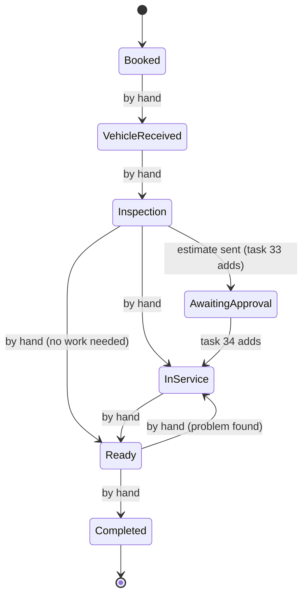

# Job Timeline Engine - Plan

## Goal Capsule

- **Objective:** a customer can follow the work on their vehicle step by step (Booked → Vehicle received → Inspection → Awaiting approval → In service → Ready → Completed), with the notes and photos the garage adds. A mechanic can update only the jobs assigned to them; managers and the owner can update any job. This task builds everything except the pages, so tasks 25 (the customer's booking page) and 26 (the mechanic's phone view under `/admin`) only have to call it.
- **Means:** a `job_status` column and an assigned mechanic on `bookings`, job updates stored as `booking_events` rows, photo sets that belong to a job, pure rules in `src/domain/jobs.ts`, a jobs data-access file, and a `JobTimeline` component with a `/dev/design` sample (KTD1–KTD10).
- **Authority:**
  - The master plan: row 31 ("Mechanic job updates; customer timeline").
  - features.md, items 15, 23 and 34.
  - `CLAUDE.md`: Database, Roles and access, Customer data, Bookings, Booking slots, Photos, Languages, and the privacy-notice rule.
  - The owner's decision of 2026-11-19: engine now, no pages.
  - This plan.
  - Lessons that apply (`document/solutions/`):
    - `conventions/idempotent-save-answer-duplicate-before-refusals-that-can-change.md`
    - `conventions/pglite-parallel-tests-bare-database-not-transaction-per-call.md`
    - `conventions/signed-upload-links-keep-pending-rows-until-links-expire.md`
    - `conventions/privacy-notice-retention-from-delete-code-not-expiry.md`
    - `conventions/nextjs-16-dev-server-is-not-one-process-use-cache-probe.md`
    - `conventions/run-commands-before-documenting-output.md`
    - `workflow-issues/parallel-branches-same-migration-number-regenerate-not-rename.md`
    - `workflow-issues/full-check-times-out-under-parallel-session-load.md`
- **Stop conditions:**
  - a paid service, or a new npm package (none planned);
  - creating `/admin`, a customer booking page, or Server Actions for these pages (tasks 25, 26);
  - changing `src/lib/access-routes.ts`, `src/server/dal/bookings.ts` (`createMyBooking`), `src/components/booking/` or navigation (other sessions' tasks).
- **Who finishes:** Session 2 on branch `31_job_timeline`. Commit and stop. Push and open the pull request only after the owner says yes.

---

## Product Contract

### Summary

Once a customer's vehicle reaches the garage, staff move the job through its steps. At any step they can add a note or photos, which the customer sees. Each update is one entry in the booking's history. The customer's read returns their own booking's steps and updates, with short-lived photo links. Staff reads return a job without the customer's phone number unless the reader may contact customers. Saving an update closes its photo set, so those photos are kept for a year after it. Assigning a mechanic is task 27's job; tests set the column directly.

### Problem Frame

Bookings stop at "booked" today. Nothing records the work, and the photo storage from task 30 only knows customers' own sets. The pages that would show progress (25, 26) aren't started, and the statuses and assignment they need were planned for task 27. The owner chose to build the engine first so those pages can be thin.

### Requirements

- **R1.** A job moves through Booked → Vehicle received → Inspection → Awaiting approval → In service → Ready → Completed. Only the moves in KTD2 are allowed. "Completed" is final.
- **R2.** Staff with `jobs.update` can add an update to a job: a step change, a note, photos, or any mix of these, but at least one. A mechanic can update only the bookings assigned to them. A reader with `bookings.manage` can update any booking.
- **R3.** Each update keeps who made it and when. A second send of the same update makes no second entry and answers with the first one.
- **R4.** Photos added by staff belong to the job and to its customer. The customer and the assigned mechanic can see them, and so can anyone with `photos.view`. A mechanic loses that access, and access to the job itself, when the job is reassigned or completed. Deleting the customer's photos (`deletePhotosOfUser`) covers job photos too.
- **R5.** Photos in a job update are kept for a year after that update. The set is closed when the update is saved, so how long the job stays open doesn't matter. A job set never attached to an update is kept 30 days, like any open set.
- **R6.** A customer can read the timeline of their own booking only. Another customer's booking and a missing one get the same "not found".
- **R7.** Staff reads never select a customer's phone number unless the reader has `customers.contact`.
- **R8.** A `JobTimeline` component shows the steps (done, current, still to come) and the updates, with India dates and times. Its text comes from messages, and it has a `/dev/design` sample.
- **R9.** The privacy notice says what is stored (job progress, notes, photos, the assigned mechanic), who sees it, and how long it is kept. `LOGIN_NOTICE_VERSION` moves.

### Key Decisions

- **Engine now, no pages** (session-settled: user-directed — chosen over skipping to task 37 or pausing Session 2: the pages wait for tasks 25 and 26). Governs R2, R6, R8.
- **"Awaiting approval" is set only by sending an estimate (task 33), never by hand.** Without an estimate the customer would have nothing to approve. Governs R1.
- **Notes are for the customer.** There are no staff-only notes in version 1. Task 26's form must say so. Governs R2, R8.

### Scope Boundaries

- Considered and not built:
  - **A limit on how many photo sets staff open per job.** Staff are trusted, and every set still holds at most 6 photos. Build one if a staff account is ever misused.
  - **Undoing a step.** Only Ready → In service goes back. If the owner wants more, it's one row in the transition table.
  - **Showing the mechanic's name to the customer.** The timeline says "the garage", so no staff name reaches customers.
- Not this task:
  - the pages and Server Actions (25, 26);
  - assigning a mechanic, confirming, cancelling and rescheduling (27);
  - sending estimates (33);
  - sending notifications (35);
  - deleting a booking or a customer (43).

### Deferred to Follow-Up Work

These are backlog lines in `task.md`.

- **Task 26:**
  - the mechanic's jobs list and job page;
  - the update form, with `PhotoUploader` wired to the job photo functions;
  - its Server Actions, each calling `requireUser` first.
- **Task 25:** the customer's booking page shows `JobTimeline` from `readMyJobTimeline`.
- **Task 27:**
  - sets `assigned_mechanic_id`, and checks the person assigned has `jobs.update`;
  - adds booked → confirmed to the booking status if it wants it;
  - refuses to cancel a booking whose job has started;
  - `updateJob` must refuse a cancelled booking.
- **Task 33:** adds the estimate rows to KTD2's table (inspection or in-service → awaiting-approval) and the "how" that keeps them off-limits by hand.
- **Task 34:** adds the moves out of awaiting-approval: approved → in-service, rejected → ready or another step the owner picks.
- **Task 35:** queue a customer notification where `updateJob` marks the spot.
- **Task 43:** deleting a booking deletes its job photos first. `photo_sets.booking_id` refuses the delete otherwise.

---

## Planning Contract

### Key Technical Decisions

- **KTD1. Job progress gets its own column, `bookings.job_status`. It is null until the vehicle arrives, which the timeline shows as "Booked".**
  - `bookings.status` stays the booking's own lifecycle: booked now, with confirmed and cancelled to come in tasks 25 and 27.
  - `createMyBooking` filters on `status = 'booked'` in its duplicate check and its future-bookings count. With one shared column, both filters would break, and that code belongs to another session.
  - The enum is `job_status`: `vehicle-received`, `inspection`, `awaiting-approval`, `in-service`, `ready`, `completed`. `JOB_STATUSES` in `src/domain/jobs.ts` holds the same list, and a test keeps the two in step, as `bookings-tables.test.ts` does for bookings.
- **KTD2. The moves are a data table in the domain, read through `canMoveJob(from, to)`. Every move in it is made by hand.**
  - (not started) → vehicle-received
  - vehicle-received → inspection
  - inspection → in-service
  - inspection → ready (no work needed: the vehicle goes back as it is)
  - in-service → ready
  - ready → in-service
  - ready → completed
  - `awaiting-approval` is in the enum, because the order of enum values is stored, but no move reaches it yet. Task 33 adds the estimate rows (inspection or in-service → awaiting-approval) and the "how" that keeps them off-limits by hand. Task 34 adds the moves out of it, a rejected estimate included. Each one is a row, not new code.
- **KTD3. An update is a `booking_events` row of a new kind, `job-update`.** New nullable columns:
  - `job_status` (the step it moved to);
  - `note` (text);
  - `photo_set_id` (unique, `on delete set null`, so the photo cleanup is never blocked);
  - `had_photos` (boolean, not null, default false): set when the event is written with a set and never cleared, so the row stays valid after the cleanup nulls `photo_set_id`;
  - `request_token` (uuid), unique with `actor_user_id`.
  - Two CHECKs, both written against `kind::text`, never the enum value: drizzle's migrator runs every pending migration in one transaction, and Postgres refuses an enum value added in a transaction that hasn't committed yet.
    - A `job-update` row has a step, a note or `had_photos`.
    - A `booked` row has no step, note, set, photos flag or token.
- **KTD4. Who may update:**
  - `authorize("jobs.update")` comes first, before the input check and any database call.
  - `can(user.role, "bookings.manage")` means any booking. Otherwise the booking query also needs `assigned_mechanic_id = user.id`.
  - No role is ever compared.
  - A booking that isn't there and one that isn't yours get the same `not-found`.
- **KTD5. The order inside `updateJob`, from the idempotency lesson:**
  1. Before the transaction: `authorize`, then the input check.
  2. In one transaction:
     - lock the booking row with `select … for update`, filtered by id and, for a mechanic, by assignment and not completed;
     - if no row comes back, answer `not-found`;
     - look up the token for this actor on this booking (both must match), which answers `duplicate` with the first update;
     - refuse a `completed` job (`job-closed`, which only a manager or the owner can get, since a mechanic's lock filter leaves completed jobs out);
     - refuse a move `canMoveJob` doesn't allow (`move-not-allowed`);
     - check the photo set (KTD6), else `photos-not-found`;
     - write the event (with `had_photos`) and the new `job_status`;
     - close the update's set (`closed_at = now`), which starts its one-year clock;
     - mark the task 35 spot with a comment.
  - The lookup matches the booking as well as the actor, so a token first used on another booking never returns that booking's update. The unique constraint stays per actor, so reusing a token on a second booking throws instead.
  - A retry after reassignment answers `not-found`, because the lock filter goes first. That is chosen on purpose: the mechanic no longer sees the job, so they must not see its update either. The test says so.
- **KTD6. Job photo sets are customer sets that also carry `photo_sets.booking_id` (fk `restrict`, indexed).**
  - `user_id` is the booking's customer, so viewing, `deletePhotosOfUser` and the cascade keep working.
  - `booking_id` makes the set the job's.
  - New `startJobPhotoUpload({ bookingId, setId?, count })` and `finishJobPhotoUpload(photoIds)` in `src/server/dal/photos.ts`. They use KTD4's check and share the place-counting, the link handshake and the JPEG check with the customer functions, through private helpers.
  - The customer path changes in three ways:
    - its "new sets today" count ignores job sets;
    - `startPhotoUpload` and `finishPhotoUpload` refuse a job set;
    - `createMyEstimateRequest` refuses one.
  - An update's set must be the booking's job set, not yet used by an event, and not closed. Pending photos follow task 32's rule.
  - On a completed job, the job photo functions answer `job-closed` to a reader with `bookings.manage` and `not-found` to a mechanic.
- **KTD7. A third viewer in `photoViewUrls`:**
  - The new rule: a reader with `jobs.update` whose set's `booking_id` points to a not-completed booking assigned to them.
  - The existing rules stay: the set's customer, and `photos.view`.
  - The check runs on each request, so reassignment ends access at once.
  - A private `viewLinksFor(setIds)` helper serves the reads that already checked access.
- **KTD8. Reads:**
  - `readMyJobTimeline(bookingId)` (`authorizeUser`, filtered by user id): the booking code, vehicle, slot, `job_status`, and the job updates oldest first. No actor name, and the `booked` event is left out, because Booked is the first step. Each update carries:
    - `movedTo`: the step it moved to, or null;
    - `stepAfter`: the job's step once the update was applied, carried forward from earlier updates, or null for not started;
    - its note, photo links and time.
  - `readJob(bookingId)` and `listMyAssignedJobs()` (staff, KTD4's check, a mechanic only on not-completed jobs):
    - `readJob` gives the vehicle, the lines, the customer's name, `job_status` and the same updates with photo links;
    - `listMyAssignedJobs` gives each job's code, vehicle, slot and `job_status`;
    - the phone number is selected only when `can(role, "customers.contact")`;
    - `listMyAssignedJobs` covers the reader's assigned, not-completed jobs, ordered by slot.
  - All reads are live: no `'use cache'`.
- **KTD9. A note is at most 1000 characters after trimming.** It is cleaned like an estimate request's description: `normalizeDescription` moves to a shared helper, and task 32's file imports it.
- **KTD10. `JobTimeline` is an async Server Component in `src/components/jobs/`.**
  - It takes the timeline data as a prop and reads `getTranslations("JobTimeline")`.
  - It shows the step list and each update's note and photos (plain `` with alt text from messages).
  - A note is plain React text with `whitespace-pre-line` for its line breaks, never `dangerouslySetInnerHTML`.
  - It formats with `formatDate`/`formatTime` in India time.
  - The `/dev/design` sample shows several states from typed sample data.

### High-Level Technical Design

### Risks

- **The migration runs `ALTER TYPE … ADD VALUE`, the first in this repo.** Postgres can't use a new enum value inside the transaction that added it, and drizzle's migrator runs every pending migration in one transaction. So nothing in the migration may cast `'job-update'` to the enum: the CHECKs compare `kind::text` (KTD3). U2's test migrates a fresh PGlite from zero and writes a `job-update` row to prove it.
- **Another session's migration lands first.** Merge `origin/main` right before `db:generate`. If another branch took `0010`, regenerate, never rename.
- **The race between two status changes.** PGlite can't prove it, so the test's comment says so, and task 20 checks it on Postgres. The learning doc records a mutation check: drop the `for update` and say what fails.
- **One mechanic per job.** `assigned_mechanic_id` is a single column. If the garage ever splits a job between two mechanics, that needs a join table and new filters.

---

## Implementation Units

### U1. Job rules

- **Goal:** the pure rules for statuses, moves and update input.
- **Requirements:** R1, R2, R3 (token shape), KTD2, KTD9.
- **Dependencies:** none.
- **Files:**
  - `src/domain/jobs.ts`, `src/domain/jobs.test.ts`;
  - `src/domain/typed-text.ts` (the moved `normalizeDescription`) and its test;
  - `src/domain/estimate-requests.ts` (import it from there).
- **Approach:**
  - `JOB_STATUSES`, `JOB_STEPS` (`booked` plus the statuses, for display), `JOB_UPDATE_RULES` (`noteMaxLength` 1000), `canMoveJob`.
  - `checkJobUpdateInput({ bookingId, toStatus, note, photoSetId, requestToken })` returns problem codes tagged by field, like task 32:
    - `nothing-to-update`, `note-too-long`, `status-unknown`, `bad-request`.
    - A booking id, token or set id that isn't a uuid is `bad-request`. Whether a set exists, is the job's and is unused is checked in the transaction (KTD5).
- **Test scenarios:**
  - Every move in KTD2 is allowed.
  - A skipped step (vehicle-received → ready) is refused.
  - Any move from completed is refused.
  - No move reaches awaiting-approval.
  - The same status twice is refused.
  - A note only, photos only, or a status only each pass; all three blank give `nothing-to-update`.
  - A note of 1000 emoji passes; 1001 characters is too long.
  - `\r\n` and NUL are cleaned.
  - A non-uuid booking id, token or set id gives `bad-request`.
  - The estimate description tests still pass with the moved helper.
- **Verification:** the domain tests pass. No Next.js or database imports.

### U2. Tables and migration

- **Goal:** the columns from KTD1, KTD3 and KTD6, and migration `0010_job_timeline`.
- **Requirements:** R1–R5.
- **Dependencies:** U1.
- **Files:**
  - `src/server/db/schema.ts`;
  - `src/server/db/migrations/0010_job_timeline.sql`, with `meta/`;
  - `src/server/db/job-timeline-tables.test.ts`;
  - `src/domain/bookings.ts` (`BOOKING_EVENT_KINDS` gains `job-update`);
  - `src/server/db/bookings-tables.test.ts` and `src/domain/bookings.test.ts`, only where they pin the kinds list.
- **Approach:**
  1. Edit the schema.
  2. Merge `origin/main`.
  3. Run `npm run db:generate -- --name=job_timeline`.
  4. Check the SQL by eye.
  - `assigned_mechanic_id` is a text fk to users, `on delete set null`, indexed.
- **Test scenarios:**
  - The `job_status` enum matches `JOB_STATUSES`.
  - The event kinds match.
  - A fresh PGlite migrates from zero through `0010` in one run and accepts a `job-update` row.
  - A `job-update` with nothing in it is refused by the CHECK.
  - A photos-only `job-update` keeps its row, with `photo_set_id` null, after its set is deleted.
  - A `booked` row with a note is refused.
  - One actor can't use one token twice; two actors can.
  - Two events can't point to one set.
  - Deleting a set nulls `photo_set_id`.
  - Deleting a booking that has a job set is refused.
  - Deleting the assigned mechanic's user nulls the assignment.
- **Verification:** the table tests pass on a fresh PGlite. `db:generate` shows no further changes.

### U3. Job photos

- **Goal:** KTD6 and KTD7.
- **Requirements:** R4, R5.
- **Dependencies:** U2.
- **Files:**
  - `src/server/dal/photos.ts` and `src/server/dal/photos.test.ts`;
  - `src/server/dal/estimate-requests.ts` and its test (refuse job sets).
- **Approach:**
  - Pull the shared steps out of `startPhotoUpload` and `finishPhotoUpload` into private helpers, without changing customer behaviour.
  - Add the two job functions and the third view rule.
  - `viewLinksFor` is exported for data-access code only, like `insertVehicleRow`, with a comment.
- **Test scenarios:**
  - Logged out gives `AccessDeniedError`, and so does a customer, before `getDatabase` is called.
  - A mechanic not assigned gets `not-found`.
  - The assigned mechanic gets a set owned by the booking's customer, with `booking_id` set.
  - A manager on any booking succeeds.
  - On a completed job, a manager gets `job-closed` and the assigned mechanic gets `not-found`.
  - A customer can't add photos to, finish, or attach to an estimate request a job set.
  - A job set doesn't count toward the customer's 5 sets a day.
  - The customer and the assigned mechanic can view a job set. A reassigned mechanic, another mechanic, and the assigned mechanic once the job is completed get `not-found`.
  - `deleteOldPhotos` removes an expired job set that an event points to; the event stays.
  - All existing photo tests still pass.
- **Verification:** the photo and estimate tests pass.

### U4. Job update and reads

- **Goal:** `src/server/dal/jobs.ts` with `updateJob`, `readJob`, `listMyAssignedJobs` and `readMyJobTimeline`.
- **Requirements:** R1–R7, KTD4, KTD5, KTD8.
- **Dependencies:** U1, U3.
- **Files:** `src/server/dal/jobs.ts` and `src/server/dal/jobs.test.ts`.
- **Approach:**
  - Follow `createMyEstimateRequest`'s order and result unions; catch nothing.
  - Read the booking with assignment (and not completed) in the `WHERE` for mechanics.
  - Close the update's set in the same transaction as the event.
  - Photo links come from `viewLinksFor`, after the function's own check.
- **Execution note:** after the tests pass, break the assignment filter and the order on purpose. A test must fail each time. Record this in the learning doc.
- **Test scenarios:**
  - Access:
    - logged out, and a customer, get `AccessDeniedError` before the database;
    - a mechanic on another mechanic's job and on a missing id gets the same `not-found`;
    - a manager updates an unassigned job.
  - Moves:
    - each by-hand move works and writes one event and the new `job_status`;
    - `move-not-allowed` leaves the row unchanged;
    - a manager gets `job-closed` after completed, and the mechanic gets `not-found`;
    - awaiting-approval can't be set.
  - Idempotency:
    - the same token twice gives `duplicate` with the first event, even though the status has moved;
    - a token from booking X sent with booking Y never returns X's event;
    - after reassignment, the retry gets `not-found` (KTD5).
  - Photos:
    - an update with the job's set links it, sets `had_photos` and closes the set;
    - a used set, another booking's set or a customer set gives `photos-not-found`;
    - other sets of the same job stay open.
  - Reads:
    - a customer reads their own timeline oldest first, with photo links, `movedTo` and `stepAfter`, no actor and no `booked` entry;
    - another customer gets `not-found`;
    - the assigned mechanic's `readJob` has the updates and photo links but no phone number;
    - a manager's has the phone number;
    - a mechanic's `readJob` on a completed job gets `not-found`;
    - `listMyAssignedJobs` leaves out completed jobs and other mechanics' jobs.
- **Verification:** the jobs tests pass, and the mutation checks fail as expected.

### U5. `JobTimeline` component

- **Goal:** R8.
- **Requirements:** R8, KTD10.
- **Dependencies:** U4 (the timeline type).
- **Files:**
  - `src/components/jobs/job-timeline.tsx` and `job-timeline.test.tsx`;
  - `messages/en.json`, a new `JobTimeline` namespace;
  - `src/app/[locale]/dev/design/page.tsx`, a "Job timeline" block with a sample.
- **Approach:**
  - The step list is `JOB_STEPS` in order. Awaiting approval appears only when it is the current step or some update moved to it.
  - A step before the current one is done, the current one is current, and a later one is to come. Each is marked in words, not by colour alone. A job sent back from Ready to In service shows Ready as to come.
  - Below the list are the updates, newest first, so a phone shows the latest without scrolling. Each one shows:
    - its India date and time;
    - a heading from messages: "Moved to <step>" when `movedTo` is set, otherwise "Update during <step>" (from `stepAfter`);
    - its note;
    - its photos.
  - With no updates, a line from messages says notes and photos will appear here.
  - Photos use PhotoUploader's grid: 4:3 `rounded-xl` tiles, two columns on phones and three from `sm`, with width and height set so nothing shifts. A photo that fails to load keeps its box and alt text.
- **Test scenarios:**
  - A not-started job shows Booked current and the rest to come, plus the empty-updates line.
  - An in-service job that skipped awaiting approval has no such step, and the earlier steps are done.
  - A job that went through awaiting approval shows it as done.
  - A job sent back from Ready shows Ready as to come.
  - A completed job shows every step done.
  - "Moved to" and "Update during" headings come from `movedTo` and `stepAfter`.
  - A note with line breaks keeps them; a note containing `<script>` shows as text.
  - The time shows in India time from a UTC instant.
  - Photo alt text comes from messages.
  - The `/dev/design` block shows the not-started, in-progress and completed states.
- **Verification:** the component tests pass. The design suite passes on port 3001 (a temporary config, deleted after; never port 3000).

### U6. Privacy notice and docs

- **Goal:** R9, plus the repo docs.
- **Requirements:** R9.
- **Dependencies:** U2–U4.
- **Files:**
  - `messages/en.json` (`PrivacyPage.items.bookings` and `items.photos`);
  - `src/domain/consent.ts` and `src/domain/consent.test.ts`;
  - `src/app/[locale]/(site)/privacy/coverage.test.ts` and the privacy `page.test.tsx` if needed;
  - `CLAUDE.md` (a "Jobs" block and repo-map entries);
  - `document/task/task.md` (the backlog lines in "Deferred to Follow-Up Work").
- **Approach:**
  - Write the retention from the code that deletes rows: job progress and notes stay as long as the booking (nothing deletes bookings yet); photos in a job update are kept a year after the update; job photos never attached to an update are kept 30 days. The assigned mechanic sees the job and its photos only until it is completed.
  - Move `LOGIN_NOTICE_VERSION` to the next free value after `origin/main`'s at that moment.
- **Test scenarios:**
  - `coverage.test.ts` lists the new columns.
  - The consent fingerprint test passes with the new version.
- **Verification:** `npm run check` passes.

---

## Assumptions

- The owner accepts the moves in KTD2: Inspection → Ready when no work is needed, and Ready → In service as the only way back.
- A mechanic loses access to a job, and its photos, once it's completed. Managers and the owner keep it.
- A page open more than 5 minutes needs a refresh to show photos (view links last 5 minutes).
- Notes are shown to the customer (Key Decisions).
- The customer sees "the garage", not the mechanic's name.

## Verification Contract

- `npm run check` passes. Timeouts alone under load are machine load: rerun, never raise a limit.
- `npm run test:e2e` passes: no page changes, but `server-boundary.spec.ts` must still pass.
- The design suite passes on port 3001 through a temporary config.
- The seo-reviewer runs if the hook asks (`/dev/design` only).

## Definition of Done

- U1–U6 are done, and their tests pass.
- The mutation checks are recorded in the learning doc.
- Migration `0010` is the last on top of `origin/main`.
- `CLAUDE.md`, `task.md` and the learning doc are updated.
- `ce-code-review` and `code-reviewer` have run, and their must-fixes are fixed.
- No leftover experimental code.
