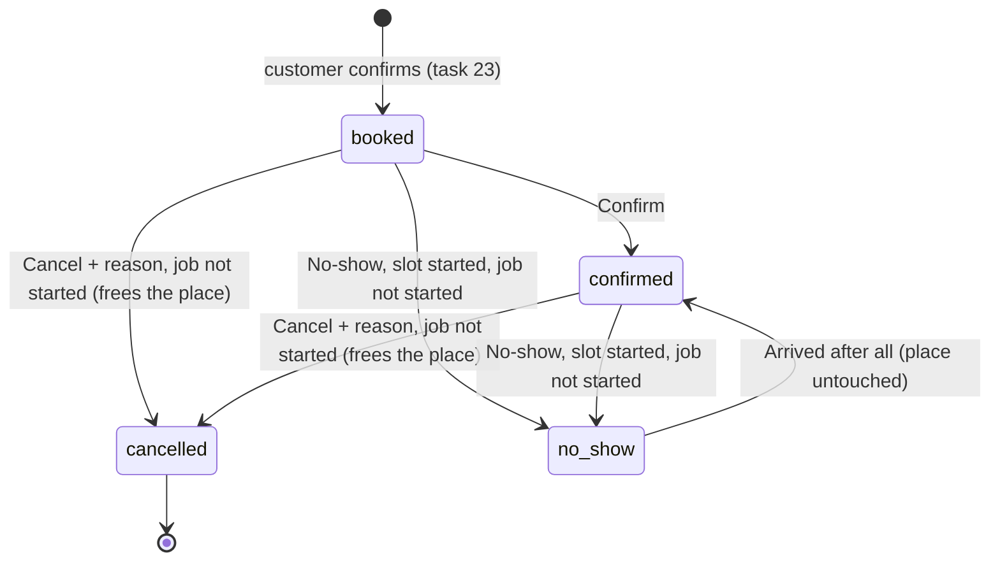

# Booking Management - Plan

## Goal Capsule

- **Objective:** From the bookings board on a phone, the garage's owner and manager confirm a booking, cancel it with a reason, mark a no-show (and undo it when the customer turns up late), move it to another free time, and choose the mechanic who does the job. Free places, the customer's booking limits and the mechanics' job access stay correct after every change.
- **Means:** booking statuses with one table of allowed changes in `src/domain/` (KTD1), history rows in `booking_events` (KTD2), staff writes in the data-access layer that lock the booking row before any slot change (KTD4), a staff booking window threaded through the slot engine (KTD7), and plain Server Action forms on the board (KTD8).
- **Authority:** `CLAUDE.md` (binding) > this plan's Requirements > its KTDs > unit Approach text. The owner's choices of 2026-11-20 (the statuses, staff reschedule from today onward, assignment now, a 60-day staff range, "Arrived after all", a reminder to call the customer) are settled.
- **Stop conditions:**
  - Stop and ask at the KTD12 checkpoint (after U6), where the recommended split moves U7 and U8 into a new task.
  - Stop if any staff write would need a session read, `getDatabase()`, `readGarage()` or `readAvailableSlots()` inside its transaction.
  - Stop if a change to the slot engine changes what a customer can book (U7 must leave every customer test passing unchanged).
- **Execution profile:** one branch, `27_booking_management`, small commits per unit, `npm run check` after each unit, `npm run test:e2e` at U6 (and again after U8 if it stays in this task).
- **Finishing:** the main session commits on the task branch, then runs the learning doc, `ce-code-review`, `code-reviewer` and compound, and opens the pull request. The owner merges it.

---

## Product Contract

### Summary

Staff get a "Manage" panel on each booking card of `/admin/bookings`: Confirm, Cancel (with a reason), No-show, Arrived after all, Reschedule and Assign mechanic. Each card shows the booking's status, its mechanic and its job step, and cancelled bookings are hidden until staff ask to see them. Behind the panel, new statuses and history rows keep the slot counters, the customer's booking limit and the mechanics' access in step.

### Problem Frame

Task 26 gave staff a read-only board: every booking stays "booked" forever. The garage can't record that it has checked a booking, can't free a place when a customer cancels by phone, can't mark someone who never came, can't move a visit, and can't hand a job to a mechanic, so task 31's mechanic job updates have nobody to reach. The owner runs the garage from a phone, without a developer.

### Requirements

**Statuses**

- R1. A booking is `booked` (place held) from the moment the customer confirms it, until staff change it to `confirmed`, `cancelled` or `no-show`.
- R2. The allowed changes are exactly:
  - booked → confirmed (Confirm);
  - booked or confirmed → cancelled (Cancel), only while the job hasn't started;
  - booked or confirmed → no-show (No-show), only once the slot's time has started and the job hasn't started;
  - no-show → confirmed (Arrived after all).
  Cancelled is final. Every other change is refused with an answer, not an error.
- R3. Cancelling frees the booking's place in its slot; no-show and "Arrived after all" leave the place taken (a no-show never gave it back).
- R4. A cancel needs a reason of 3 to 200 characters. Staff on the board see it; the customer never does.

**Reschedule**

- R5. Staff move a booked or confirmed booking whose job hasn't started to any free slot from now up to 60 days ahead, on the garage's open days, never over a full slot and never on a closed date. The customer's 7-day window doesn't apply to staff.
- R6. A move keeps the booking's code, vehicle, lines, prices, pickup and status; only the time changes, and the old place is freed in the same save. Moving to the slot it already has is refused.

**Mechanics**

- R7. Staff assign, change or remove the mechanic of a booked or confirmed booking until its job is completed. The list holds every user whose role may update jobs but may not manage bookings, by name only. With nobody on it the board says "No mechanics yet" and shows no form.
- R8. A mechanic works on a job only while it's assigned to them, not completed, and the booking is booked or confirmed. Reassigning, cancelling or a no-show ends their access at once; "Arrived after all" gives it back.

**Effects elsewhere**

- R9. Job updates and job photo uploads refuse a cancelled or no-show booking for every role.
- R10. A cancelled or no-show booking no longer counts toward the customer's limit of future bookings and no longer blocks booking the same vehicle into the same slot; a confirmed one still does.

**The board**

- R11. Each booking card shows its status, its mechanic (or "Unassigned") and its job step; a cancelled card also shows its reason.
- R12. Cancelled bookings are hidden by default; a "Show cancelled (N)" link shows them, and the day links, the date form and every action keep that choice. The day's count counts only bookings that aren't cancelled.
- R13. After a cancel or a reschedule the board says which booking changed and reminds staff to call or WhatsApp the customer, because the customer hears nothing from the site until tasks 25 and 35.
- R14. Every action works without JavaScript. A double tap or a retry after a lost answer changes nothing twice and shows the same success.
- R15. Every staff word, status, reason and mechanic name renders only after the permission check, as on task 26's board.

**Privacy**

- R16. The privacy notice says the garage records status changes, reschedules, mechanic assignments, who made each and when, and a cancel reason for the garage only, kept as long as the booking; `LOGIN_NOTICE_VERSION` moves.

### Key Decisions

- **Booked until staff Confirm; the place is held from the start** (session-settled: user-directed — chosen over a booking that is final at once: the garage wants to check each booking). Governs R1, R2.
- **Cancelled with a reason, and No-show** (session-settled: user-directed — chosen over Cancelled only: a no-show must not free a place or look like a cancel). Governs R2, R3, R4.
- **Staff reschedule from today onward, never over full, 60 days ahead** (session-settled: user-directed — chosen over the customer's 7-day window, and over 30 days or a year: 60 is the furthest a customer setting can reach, and task 50 reuses it). Governs R5.
- **Build assignment now, with an empty list until task 29** (session-settled: user-directed — chosen over waiting for task 29: task 31's job access needs an assignment to exist). Governs R7.
- **No-show can be undone with "Arrived after all"** (session-settled: user-directed — chosen over a final no-show: a late customer's job could otherwise never start). Governs R2, R8.
- **Remind staff to call the customer after a cancel or reschedule** (session-settled: user-directed — chosen over no reminder: the customer has no bookings page or messages until tasks 25 and 35). Governs R13.
- **A reschedule keeps the status** (assumed default; the owner may change it): staff move a booking after talking to the customer, so a confirmed booking stays confirmed and a booked one isn't confirmed by the move. Governs R6.
- **Started jobs: refuse cancel, reschedule and no-show, allow assign** (assumed default; cancel was settled with the statuses): the vehicle has arrived, and handing a job over mid-way is the main reason to reassign. Governs R2, R5, R7.
- **Passed slots: cancel, confirm and reschedule stay allowed** (assumed default): a customer may phone the day after to cancel or rebook. Governs R2, R5.
- **Cancelled bookings hidden by default** (assumed default), with their count in the link. Governs R12.

### Scope Boundaries

- Customers cancelling or rescheduling their own bookings: task 25.
- Messages to the customer about any change: task 35 (each staff save leaves a comment where its notification will be queued).
- Phone and walk-in bookings: task 50, which reuses the staff window (KTD7).
- The estimate inbox: task 51.
- Not built: undoing a cancel. Re-taking the place can fail (full or past), and the customer can book again; reconsider if staff cancel by mistake often.
- Not built: a separate permission for assigning. `bookings.manage` already says "confirm, cancel, reschedule and assign" (`src/domain/permissions.ts`).
- Not built: a page per booking (`/admin/bookings/[id]`). A `<details>` panel on the card needs no new route or gate; reconsider if the panel gets crowded.

### Deferred to Follow-Up Work

- Task 25: a customer retrying Confirm after staff cancelled that booking gets "You already have this booking" for the cancelled one (the request-token lookup has no status filter). The window is seconds; task 25 can show the saved status in that answer.
- Task 29: staff users need a name, since the mechanic list shows names only ("Mechanic without a name" until then).
- Backlog, if the KTD12 split is taken: U7 and U8 become task 52 (`52_staff_reschedule`), before task 50.

---

## Planning Contract

### Key Technical Decisions

- KTD1. **One pure table of status changes.** `src/domain/bookings.ts` gets the four statuses, two named sets and a `canChangeStatus` check, copying `JOB_MOVES` and `canMoveJob` (`src/domain/jobs.ts`).
  - `PLACE_HOLDING` = booked, confirmed, no-show: what the slot counters count.
  - `ACTIVE` = booked, confirmed: what can be moved or assigned, what blocks a customer's same-slot booking and counts toward their limit, and what a mechanic may work on.
  - The check takes the current and new status plus two facts read from the locked row (job started, slot started) and returns `ok` or a problem: `not-allowed`, `job-started`, `too-early`. Two sets, not one, because a no-show holds a place but isn't active.
- KTD2. **History in `booking_events`, the current state on `bookings`.** `bookings.status` and `bookings.assigned_mechanic_id` hold the current state; each change adds one event row with its actor, time and request token, as `updateJob` does. Three new event kinds:
  - `status-change`, with `new_status` and, for a cancel only, `reason`;
  - `rescheduled`, with `moved_from` and `moved_to`;
  - `assigned`, with `mechanic_id` (null when nobody is assigned).
  The reason gets its own column because `booking_events.note` is documented as text for the customer. Customer reads already filter on `kind = 'job-update'`, so none of these reach a customer.
- KTD3. **The migration compares new enum values as text.** Every CHECK that names a new `booking_status` value or event kind compares `status::text` / `kind::text`, and a test migrates a fresh database and writes each new value (`document/solutions/conventions/drizzle-migration-new-enum-value-compare-as-text.md`). A new CHECK keeps the five new columns null on every other kind. `0011_reviews.sql` (task 37) is already on `main`: merge `origin/main` before `npm run db:generate`, so this migration is `0012`. If another branch takes `0012` first, regenerate, never rename (`document/solutions/workflow-issues/parallel-branches-same-migration-number-regenerate-not-rename.md`).
- KTD4. **Every staff write keeps one order.** `authorize("bookings.manage")` on the first line, the input check, the reads that open their own database (the clock, the mechanic's user row is read inside), then one transaction:
  1. lock the booking row (`for update`) and read its status, slot and job step only from it;
  2. look up the request token on this booking and actor. A hit whose saved event matches the request (same kind and the same `new_status`, `mechanic_id` or `moved_to`) answers `duplicate` with the booking as it now is. A hit that doesn't match is a form resent from an old page with a different choice, and answers `stale` with nothing written;
  3. `not-found` when the lock found no row;
  4. the refusals (KTD1's check, `same-slot`, the slot engine's answers, `not-a-mechanic`, `unchanged`);
  5. `releaseSlot` or `moveSlot`, returning a non-ok answer before any write;
  6. the booking update and the event row.
  This follows the idempotent-save lesson (`document/solutions/conventions/idempotent-save-answer-duplicate-before-refusals-that-can-change.md`) and the slot rules in `CLAUDE.md`. The writes live in a new `src/server/dal/staff-booking-changes.ts`, beside the staff read; `bookings.ts` stays the customer's save only.
- KTD5. **Mechanics are worked out in code, not SQL.** `listMechanics()` reads users (a SQL pre-filter on the stored role is allowed) and keeps those where `effectiveRole(row.role, row.phoneNumber, serverEnv().ownerPhoneNumber)` may `jobs.update` but not `bookings.manage`. The assign save re-checks the chosen user the same way inside its transaction; the form's list is no guarantee. Names only, never phone numbers.
- KTD6. **Mechanic access follows the booking's status.** `jobsOf` (`src/server/dal/job-access.ts`) adds "status is active" to the mechanic branch, and `assigned_mechanic_id` stays as history after a cancel or no-show, so "Arrived after all" restores access without a reassignment. `updateJob` and `startJobPhotoUpload` select the status in their lock and answer a new `booking-closed` after the token lookup (`startJobPhotoUpload` beside its `job-closed` check), so managers and owners are refused too. `finishJobPhotoUpload` has no lock or token: its query adds "the booking is active" for every role, so photos of a cancelled or no-show job come back not stored.
- KTD7. **A staff window through the slot engine.** `src/domain/slots.ts` gets a window type (first and last India date), `customerWindow(rules, now)` (today's `bookingWindow`) and `staffWindow(now)` = today to today + `STAFF_BOOKING_DAYS` (60), always with "the slot hasn't started". `readSchedule`, `checkSlotRequest`, `availableSlots`, `reserveSlot` and `moveSlot` take the window, defaulting to the customer's, so every customer path is unchanged. `readSchedule` loads closed dates for the window it's given; a bypass of the window check alone would accept festival closures past day 7. `STAFF_BOOKING_DAYS` must stay at or below `BOARD_RANGE_DAYS` (a test pins it), or a moved booking lands on a day the board can't open. (session-settled: user-directed — chosen over 30 days or a year, governs R5.)
- KTD8. **Plain Server Action forms, results through the URL.**
  - The board stays a Server Component. Each action is a `<form action={action.bind(null, locale, bookingId, boardView)}>`, as `admin-bar.tsx` already does for Log out (`node_modules/next/dist/docs/01-app/02-guides/forms.md`: bound arguments work in Server Components, are encrypted and need no JavaScript). `boardView` is the day and the cancelled filter, checked again on the server.
  - Each form carries a fresh request token (`randomUUID()` per render) in a hidden field.
  - The action calls `requirePermission(locale, "bookings.manage")`, reads only its own fields with `formText`, calls the data-access function, and returns `redirect(...)` outside any `try` to the board with a fixed `notice` code, the booking code and a `#booking-<id>` fragment so the page lands on that card. A `duplicate` answer redirects with the same notice as the first success.
  - The gate shows a notice only when its code is known and the booking code matches a booking in that day's `listBookingsOn` result (cancelled ones included, whatever the filter). It renders that booking's own formatted code, never the query value. For a cancel or a move the notice names the customer and, with `customers.contact`, carries tap-to-call and WhatsApp links taken from that booking, because the cancelled card itself is hidden by default (R12, R13).
  - No typed text (the reason), name or phone number ever goes in a URL.
  - No client island and no `Admin` namespace in `clientNamespaces`.
- KTD9. **One "Manage" panel per card.** A native `<details>` on each card holds that booking's allowed actions only (computed with KTD1's check and the card's facts).
  - The summary is at least 44px tall, shows an open/closed chevron, and is named for its booking ("Manage booking K7Q-4MX"). Every field id and label in a panel is suffixed with the booking id, so repeated forms never share an id.
  - Confirm is the one blue button; Cancel is `destructive` with a labelled reason Textarea whose `minLength`/`maxLength` match `checkCancelInput`; the rest are `outline`.
  - Assign is a labelled native select with the current mechanic chosen, a "Nobody" option, and the current mechanic listed even when they're no longer in `listMechanics()`. "No mechanics yet" replaces the form only when the list is empty and nobody is assigned.
  - The reschedule picker is a GET form inside the panel: a date field (today to today + `STAFF_BOOKING_DAYS`) with hidden `date`, `cancelled` and `move` fields and a "Show times" button. The reloaded panel shows that day's free slots as 44px `ChoiceGroup` pills with their time and places left, then a "Move booking" button; a day with none says "No free times that day".
  - The panel renders `open` when `move` names its booking or the notice is a refusal for it.
- KTD13. **One notice block under the heading.** Success uses `role="status"`, a refusal `role="alert"` with a destructive heading line; both start with an icon plus text (colour is never the only signal), name the booking by code and, for a refusal, say what to do next. The day links and the date form drop the notice. A refused reason also shows under the reason field when its panel reopens.
- KTD10. **The staff reads grow.** `listBookingsOn` also returns each booking's job step, mechanic name and latest cancel reason, and keeps its access rules (phone and pickup address only with `customers.contact`). A new `readStaffSlotsOn(date)` (`authorize("bookings.manage")`, live, after `io()` in the gate) returns that day's slots in the staff window with places left; `readAvailableSlots` stays the customer's.
- KTD11. **Unexpected errors carry no details.** Each action runs its data-access call inside a staff variant of `bookingWithoutDetails` (`src/server/auth/errors.ts`): a failed event insert's error carries the reason in its values. A request token reused on another booking throws (unique on actor and token); fresh tokens per render prevent it, and the error is never logged.
- KTD12. **Size checkpoint after U6, with a recommended split.** The full scope is about 4,000 changed lines with tests, past the 2,500-line stop line. U1 to U6 (statuses, guards, assignment, the board, privacy) are a complete task on their own, about 2,600 lines. U7 and U8 (the staff window and reschedule) are about 1,300 lines that task 50 also needs. At the end of U6, report the real size and recommend moving U7 and U8 to a new task 52, unless the owner prefers one pull request. If split, the `rescheduled` kind and its columns stay in U2's migration (no second migration for task 52), U6's notice leaves reschedules out, and task 52 adds that wording, moves `LOGIN_NOTICE_VERSION` again, and carries R5, R6 and the reschedule half of R13.

### High-Level Technical Design

The status machine (R2, R3). Reschedule and assign don't change the status.



One staff action, end to end (KTD4, KTD8):

```mermaid
sequenceDiagram
  participant S as Staff phone
  participant A as Server Action
  participant D as staff-booking-changes.ts
  participant DB as Database
  S->>A: POST form (bound locale, booking id, board view; token, fields)
  A->>A: requirePermission("bookings.manage")
  A->>D: change(bookingId, input, token)
  D->>D: authorize, check input
  D->>DB: begin; lock booking row for update
  D->>DB: token on this booking and actor?
  alt token found
    D-->>A: duplicate
  else
    D->>D: refusals (status table, slot, mechanic)
    D->>DB: releaseSlot / moveSlot (non-ok: return before writes)
    D->>DB: update booking; insert event; commit
    D-->>A: done
  end
  A-->>S: redirect to /admin/bookings?date=...&notice=...&code=...
```

### Assumptions

- Every `bookings.manage` holder also holds `customers.contact` today, but the board checks the permission rather than assuming it (R13's phone links come from the booking the notice names, KTD8).
- PGlite can't prove a real row race; the lock tests prove order on the bare database and task 20 checks the race on Postgres (`document/solutions/conventions/pglite-parallel-tests-bare-database-not-transaction-per-call.md`).

### Sources

- `src/server/dal/jobs.ts` (`updateJob`): the lock, token and refusal order to copy. `src/server/dal/job-access.ts` (`jobRowFilter`, `jobsOf`).
- `src/server/dal/slots.ts` and `src/domain/slots.ts`: `readSchedule` loads closed dates only inside `bookingWindow`; `moveSlot` treats the same slot as an ok no-op.
- `src/server/dal/bookings.ts`: the two `status = 'booked'` filters (the same-slot check and the future-bookings count); `bookings.test.ts`'s `afterEach` counter check.
- `src/server/db/schema.ts`: `booking_events` and its CHECKs (`booking_events_booked_is_plain`), `bookings.assigned_mechanic_id`.
- `src/app/[locale]/(site)/privacy/coverage.test.ts`, `src/domain/consent.ts`, `document/solutions/conventions/privacy-notice-retention-from-delete-code-not-expiry.md`.
- Plans: `document/plans/2026-11-19-1840-feat-admin-bookings-board-plan.md` (task 26), `document/plans/2026-11-19-1833-feat-job-timeline-engine-plan.md` (task 31).

---

## Implementation Units

### U1. Statuses and their allowed changes

- **Goal:** the statuses, the two sets and the change table as pure, tested domain code.
- **Requirements:** R1, R2, R3, R4.
- **Dependencies:** none.
- **Files:** `src/domain/bookings.ts`, `src/domain/bookings.test.ts`.
- **Approach:**
  1. `BOOKING_STATUSES` gains confirmed, cancelled, no-show; `BOOKING_EVENT_KINDS` gains status-change, rescheduled, assigned (KTD2).
  2. `PLACE_HOLDING`, `ACTIVE` and `canChangeStatus` per KTD1, with a comment on why the sets differ.
  3. `checkCancelInput(reason)`: `normalizeTypedText`, then 3 to 200 characters by `typedLength` (`src/domain/typed-text.ts`), problems as codes.
- **Execution note:** test-first; the table test pins every allowed and refused pair.
- **Patterns to follow:** `JOB_MOVES`, `canMoveJob` and `checkJobUpdateInput` in `src/domain/jobs.ts`.
- **Test scenarios:**
  - Each of the six allowed changes is `ok` with a not-started job and a started slot where needed.
  - Every other pair is `not-allowed` (cancelled → anything, no-show → cancelled, confirmed → booked, any status → itself).
  - Cancel with a started job is `job-started`; no-show with a started job is `job-started`.
  - No-show before the slot starts is `too-early`.
  - "Arrived after all" (no-show → confirmed) is `ok` whatever the slot time (a no-show's job can't have started: no-show needs a job that hasn't started, and U3 makes `updateJob` refuse no-show bookings).
  - `PLACE_HOLDING` and `ACTIVE` are pinned exactly.
  - Reasons: two characters refused, three accepted, 200 accepted, 201 refused, spaces and new lines cleaned before counting.
- **Verification:** the domain tests pass, and the schema test that compares the enum with the domain list fails until U2 (expected).

### U2. The migration

- **Goal:** the database holds the new statuses, event kinds and columns, with CHECKs that work in one migration transaction.
- **Requirements:** R2, R4, R6, R7, R16.
- **Dependencies:** U1.
- **Files:** `src/server/db/schema.ts`, `src/server/db/migrations/0012_*.sql` and `meta/`, `src/server/db/bookings-tables.test.ts` (or a new `booking-management-tables.test.ts`), `src/app/[locale]/(site)/privacy/coverage.test.ts`.
- **Approach:**
  1. Merge `origin/main` first, then edit the schema and run `npm run db:generate -- --name=booking_management` (KTD3).
  2. Enum values from U1; `booking_events` gains `new_status`, `reason`, `moved_from`, `moved_to`, `mechanic_id` (users, `set null`).
  3. CHECKs, all comparing as text:
     - a status change has a new status and a token, no note, photos or job step;
     - a reason exists exactly when the new status is cancelled;
     - a reschedule has both times, and they differ;
     - an assignment has a token;
     - every other kind leaves the five new columns null.
  4. List the new columns in `coverage.test.ts` (the notice text itself is U6).
  5. Run `npm run db:reset` locally (with `npm run dev` stopped) after generating, so the local database takes the new migration.
- **Patterns to follow:** `booking_events_booked_is_plain` and `job_update_has_content` in `schema.ts`; `job-timeline-tables.test.ts`'s fresh-database test.
- **Test scenarios:**
  - A fresh, migrated database accepts a booking in each new status and an event of each new kind.
  - A cancel event without a reason is refused; a confirm event with a reason is refused.
  - A reschedule event with equal times is refused.
  - A `job-update` row with a `reason` is refused.
  - The enum lists match the domain lists.
- **Verification:** `npm run check` passes, and the generated SQL compares every new value as text.

### U3. Guards in the customer save and the job engine

- **Goal:** cancelled and no-show bookings stop counting for customers and stop being work for mechanics.
- **Requirements:** R8, R9, R10.
- **Dependencies:** U1, U2.
- **Files:** `src/server/dal/bookings.ts`, `src/server/dal/bookings.test.ts`, `src/server/dal/job-access.ts`, `src/server/dal/jobs.ts`, `src/server/dal/jobs.test.ts`, `src/server/dal/photos.ts`, `src/server/dal/photos.test.ts` (or the job-photo test file).
- **Approach:**
  1. `createMyBooking`'s same-slot check and future-bookings count use `ACTIVE` instead of `booked`.
  2. `bookings.test.ts`'s `afterEach` check compares the counters with `PLACE_HOLDING` bookings.
  3. `jobsOf` and `updateJob` and the two job-photo functions per KTD6; the new answer is added to their result types.
- **Patterns to follow:** `job-closed` in `updateJob` (placed after the token lookup).
- **Test scenarios:**
  - A customer with three future bookings, one of them cancelled, can book a fourth; with one no-show in the past nothing changes; with one confirmed they're still at the limit.
  - A cancelled booking in a slot doesn't block booking the same vehicle into that slot again; a confirmed one answers `duplicate`.
  - A mechanic's assigned job that is cancelled leaves `listMyAssignedJobs`, and `readJob` and `updateJob` answer `not-found`; after "Arrived after all" it's back.
  - A manager's update on a cancelled booking answers `booking-closed`; the same request token sent before the cancel answers `duplicate`.
  - Starting a job photo upload on a no-show booking answers `booking-closed` for a manager and `not-found` for the mechanic; finishing an upload already started on it comes back not stored for both.
- **Verification:** every existing booking and job test still passes, with the counter check now using `PLACE_HOLDING`.

### U4. Staff status changes and assignment

- **Goal:** the data-access functions behind Confirm, Cancel, No-show, Arrived after all and Assign.
- **Requirements:** R1, R2, R3, R4, R7, R14.
- **Dependencies:** U1, U2, U3.
- **Files:** `src/server/dal/staff-booking-changes.ts`, `src/server/dal/staff-booking-changes.test.ts`, `src/server/dal/users.ts` (or `staff-users.ts`) with `listMechanics()` and its test, `src/server/dal/staff-bookings.ts` and its test (KTD10's extra fields).
- **Approach:**
  1. `changeBookingStatus({ bookingId, to, reason?, requestToken }, clock)` per KTD4: KTD1's check with "job started" (`job_status` not null) and "slot started" (`starts_at <= now`) from the locked row; a cancel calls `releaseSlot` before its writes.
  2. `assignMechanic({ bookingId, mechanicId | null, requestToken })` per KTD4 and KTD5: refuse a non-active booking (`not-allowed`), a completed job (`job-closed`), a user who isn't a mechanic (`not-a-mechanic`), and the same mechanic again (`unchanged`, no event).
  3. Answers are a union with `status` (`changed`, `duplicate`, `not-found`, and the refusals), carrying the booking code for the notice.
  4. A comment in each transaction marks where task 35 queues the customer's message.
  5. `listBookingsOn` adds the job step, the mechanic's name and the latest cancel reason.
- **Execution note:** write the "logged out, wrong role, allowed" trio and the duplicate tests first.
- **Patterns to follow:** `updateJob` (`src/server/dal/jobs.ts`), `staff-bookings.test.ts` (PGlite setup, the `can` spy reset in `beforeEach`). Test bookings that will be cancelled need their `slot_counters` row, or `releaseSlot` throws.
- **Test scenarios:**
  - Logged out and customer: `AccessDeniedError` before `getDatabase` is called, for every function.
  - Confirm a booked booking: status confirmed, one event with the actor; the counter unchanged.
  - Cancel with a reason: status cancelled, the counter one lower, the event holds the reason.
  - Cancel a booking whose job started: `job-started`, nothing written, the counter unchanged.
  - No-show before the slot: `too-early`; after it: status no-show, the counter unchanged.
  - Arrived after all: no-show back to confirmed, the counter unchanged.
  - The same token twice: the second answers `duplicate`, one event, the counter freed once.
  - The same token with a different choice (another mechanic, or confirm after a cancel's token): `stale`, nothing written.
  - Two cancels with different tokens on one bare database: one `changed`, one `not-allowed`, the counter freed once.
  - A reason that fails `checkCancelInput`: problems returned, no transaction opened.
  - An id that isn't a uuid, or another day's missing booking: `not-found` without a query or after the lock.
  - Assign a mechanic, change them, set nobody: each writes one event; the old mechanic's `jobsOf` no longer finds the job.
  - Assign a manager, a customer or a user whose number is the owner's: `not-a-mechanic`.
  - `listMechanics` returns names of mechanics only, never a phone number, and nobody when there are no mechanics.
  - `listBookingsOn` returns the reason and the mechanic's name; phone and address still need `customers.contact`.
- **Verification:** each save's mutation check fails a test: move the token lookup below the refusals, drop `for update`, or write before `releaseSlot`.

### U5. The board's actions, statuses and filter

- **Goal:** staff use U4 from the board on a phone, without JavaScript.
- **Requirements:** R11, R12, R13, R14, R15.
- **Dependencies:** U4.
- **Files:** `src/server/actions/admin-bookings.ts`, `src/server/actions/admin-bookings.test.ts`, `src/server/auth/errors.ts` (KTD11), `src/components/admin/bookings-board.tsx`, `src/components/admin/booking-manage-panel.tsx` (new, a Server Component), their tests, `src/app/[locale]/admin/bookings/bookings-gate.tsx`, `src/app/[locale]/admin/bookings/page.test.tsx`, `src/domain/board-dates.ts` (reading `cancelled` and `notice` next to `date`) and its test, `messages/en.json` (`Admin.bookings`).
- **Approach:**
  1. Actions per KTD8: `changeStatusFromBoard`, `assignFromBoard`; each redirects to the board view it was given, with `notice` and the booking code.
  2. The gate reads the filter and notice from the query, generates a token per form and passes `listMechanics()` and `can(role, "customers.contact")` to the board.
  3. The card: a status badge (booked `outline`, confirmed `success`, no-show `secondary`, cancelled `destructive`), the mechanic or "Unassigned", the job step, the reason on a cancelled card, and the Manage panel per KTD9 (KTD1's check decides which buttons show).
  4. The header count and the "Show cancelled (N)" / "Hide cancelled" link per R12, the link in its own row whenever N > 0 (also on a day whose only bookings are cancelled, where the empty line says there are none to show); the day links and date form keep the filter.
  5. Notices per KTD8 and KTD13: confirmed, cancelled, marked no-show, arrived, assigned (a duplicate shows the same one), and refusals ("This booking changed; it's now …" for `not-allowed` and `stale`), each from a fixed code. After a cancel the notice adds R13's reminder with the customer's name and call links.
- **Patterns to follow:** `admin-bar.tsx`'s Log out form, `bookings-board.tsx`'s GET date form, `checkedLocale` and `formText` in `src/server/actions/form-input.ts`, the redirect rule in `CLAUDE.md` ("Login and sessions").
- **Test scenarios:**
  - An action logged out redirects to `/login?session=ended`; as a customer it shows the 404; neither calls the data-access function.
  - An action passes only the bound booking id and its own fields: a posted `userId`, `status` or `bookingId` field does nothing.
  - A cancel with a refused reason redirects with the reason notice and never puts the reason in the URL.
  - The redirect keeps the day and the filter, and an unknown `notice` value shows nothing.
  - A known notice with a booking code that isn't on the shown day shows nothing.
  - After a cancel, with the filter off, the notice names the customer and has tap-to-call and WhatsApp links (only with `customers.contact`).
  - A day whose only booking is cancelled shows the empty line and "Show cancelled (1)".
  - Two cards on one day have no repeated field ids, and each summary names its booking code.
  - A booked card shows Confirm, Cancel and (after its slot) No-show; a cancelled card shows no actions and its reason; a no-show card shows only "Arrived after all".
  - A started job's card offers no Cancel and no No-show.
  - With no mechanics the panel says "No mechanics yet" and has no assign form.
  - By default a cancelled booking isn't listed and the link says "Show cancelled (1)"; with the filter on it's listed, and the count excludes it.
  - Every form has a request token, and two renders give different tokens.
  - The board still has no `₹`, and no staff word reaches a client component.
- **Verification:** `npm run check` passes, and the board on `npm run dev` works with JavaScript turned off.

### U6. Privacy notice, browser tests and docs

- **Goal:** the notice, the browser checks and the repo's rules match what U1 to U5 built.
- **Requirements:** R14, R15, R16.
- **Dependencies:** U5.
- **Files:** `messages/en.json` (`PrivacyPage`), `src/domain/consent.ts`, `src/domain/consent.test.ts`, `e2e/admin.spec.ts`, `CLAUDE.md`, `readme.md` if it lists staff features.
- **Approach:**
  1. Notice per R16, and fix the backlog's "The garage" against "the garage's owner and managers" wording in "Your bookings" in the same change; move `LOGIN_NOTICE_VERSION` and re-pin `consent.test.ts`.
  2. Extend the serial `e2e/admin.spec.ts` (one owner login per run): book as a customer, confirm on the board, cancel with a reason, see the badge disappear behind the filter and come back with "Show cancelled (1)", and check the customer's raw `/admin` HTML still holds no staff word or reason.
  3. `CLAUDE.md`: repo-map rows for the new files and a "Booking management" block (statuses and sets, the write order, the board's forms, mechanic access).
  4. KTD12's checkpoint: report the size and ask about the split.
- **Test scenarios:**
  - The e2e flow above passes without JavaScript-only steps (forms submit through Playwright as a real form post).
  - `consent.test.ts` pins the new notice copy.
- **Verification:** `npm run check` and `npm run test:e2e` pass.

### U7. A staff window in the slot engine

- **Goal:** the slot engine answers for staff from now to 60 days ahead, closed dates included, with customers unchanged.
- **Requirements:** R5.
- **Dependencies:** U6 (and the KTD12 decision).
- **Files:** `src/domain/slots.ts`, `src/domain/slots.test.ts`, `src/server/dal/slots.ts`, `src/server/dal/slots.test.ts`, `src/server/dal/staff-slots.ts` (or in `slots.ts`: `readStaffSlotsOn`) and its test, `src/domain/board-dates.test.ts` (the `STAFF_BOOKING_DAYS` ≤ `BOARD_RANGE_DAYS` pin).
- **Approach:** KTD7, then KTD10's `readStaffSlotsOn`. The customer window stays every function's default, so no customer caller changes.
- **Execution note:** run the existing slot tests unchanged after threading the window, before writing any staff test; they are the proof that customers see no change.
- **Test scenarios:**
  - The customer window refuses today and day 8 as before.
  - The staff window accepts a later slot today, refuses a slot that has started, accepts day 60 and refuses day 61.
  - A closed date on day 20 is refused in the staff window (`closed-date`), proving `readSchedule` loaded it.
  - `moveSlot` with the staff window to a full slot answers `full` and leaves both counters as they were.
  - `readStaffSlotsOn` refuses a customer, lists a day's free slots with places left, and leaves out full and started ones.
- **Verification:** every existing slot and booking test passes unchanged.

### U8. Reschedule

- **Goal:** staff move a booking to another free time from its card.
- **Requirements:** R5, R6, R13, R14.
- **Dependencies:** U7.
- **Files:** `src/server/dal/staff-booking-changes.ts` and its test, `src/server/actions/admin-bookings.ts` and its test, `src/components/admin/booking-manage-panel.tsx` and its test, `src/app/[locale]/admin/bookings/bookings-gate.tsx` and its test, `messages/en.json`, `e2e/admin.spec.ts`, `CLAUDE.md`.
- **Approach:**
  1. `rescheduleBooking({ bookingId, startsAt, requestToken }, clock)` per KTD4: active status and a not-started job (KTD1's sets), `same-slot`, then `vehicle-busy` when the same customer's same vehicle already has an active booking in the new slot (the customer save's same-slot rule), all before `moveSlot` with the staff window, the slot engine's non-ok answer returned before any write, then `starts_at` and a `rescheduled` event.
  2. The picker per KTD9: the gate reads `move` and `to` (a uuid on the shown day and a date in the staff window, else ignored) and calls `readStaffSlotsOn(to)`.
  3. The action redirects to the new day with the `moved` notice and R13's reminder; a refusal goes back to the picker with its notice.
- **Test scenarios:**
  - Move a confirmed booking to a free slot on day 30: it stays confirmed, the old counter drops, the new one rises, one event with both times.
  - Move to a full slot: `full`, nothing changes.
  - Move to the current slot: `same-slot`, no event.
  - Move into a slot where the same vehicle already has an active booking: `vehicle-busy`, nothing changes.
  - The panel reopens on the moved card's picker after choosing a day, with the board's day and filter kept.
  - Move a booking whose job started, or a cancelled one: refused.
  - The same token twice: `duplicate`, one move.
  - A cancel and a reschedule on one booking, one after the other on the bare database: the cancel frees the new slot, not the old one.
  - The picker for a day with no free slots says so; a `move` id that isn't on the shown day is ignored.
  - e2e: move the booked test booking to another day and find it there.
- **Verification:** `npm run check` and `npm run test:e2e` pass.

---

## Verification Contract

| Gate | When | What proves it |
| --- | --- | --- |
| `npm run check` (lint, `next typegen`, `tsc`, Vitest) | after every unit | all pass; run through `fnm exec --using=24 --` |
| `npm run test:e2e` | U6, and U8 if built here | `e2e/admin.spec.ts` covers confirm, cancel, the filter and the customer HTML scan |
| `npm run test:design` | only if a `ui/` or `site/` component changes | not expected: the board uses existing Badge and Button variants |
| Mutation checks | U4, U8 | moving the token lookup, dropping `for update` or writing before the slot change fails a test |
| Customer behaviour unchanged | U3, U7 | existing booking and slot tests pass with only the counter check widened |
| Without JavaScript | U5 | the board's actions work on `npm run dev` with JavaScript off |
| SEO hook | when page files change | `seo-reviewer` on `/admin/bookings`; staff pages stay noindex |

## Definition of Done

- Every unit built in this task passes its tests and `npm run check`; `npm run test:e2e` passes at the end.
- The KTD12 checkpoint was raised with the owner and their answer recorded in `document/task/task.md` (task 52 added if the split is taken).
- The migration is the newest number on `main` at merge time, regenerated if another branch took it first, and every new value is compared as text.
- The privacy notice, `LOGIN_NOTICE_VERSION` and `consent.test.ts` moved together.
- `CLAUDE.md` describes the statuses, the write order and the board's forms; the learning doc `document/learning/27_booking_management.md` exists and is linked in `task.md`.
- No abandoned code from approaches that didn't work stays in the diff.
- `ce-code-review` and `code-reviewer` ran, their must-fixes are fixed, and the compound question was answered.
