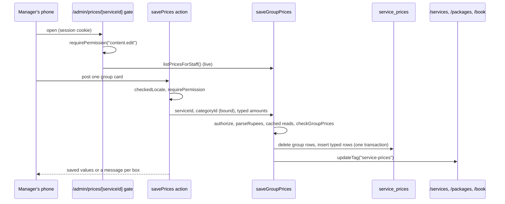

# Staff Price Editor - Plan

## Goal Capsule

- **Objective:** managers and the owner type the garage's real prices into `/admin/prices`, and a save shows at once on `/services`, `/services/<id>`, `/packages` and in new bookings. Today every live page says "call for a price" and every booking is saved without one.
- **Means:** a rupee parser and price checks in `src/domain/`, a live staff read and a save in `src/server/dal/services.ts`, a Server Action, two staff pages (the list and one service), one form per price group, the `fromPrice()` fuel fix, and an e2e project that runs the price spec after every other spec (KTD1–KTD9).
- **Authority:**
  - the master plan, row 39;
  - the owner's decisions of 2026-11-20 (Key Decisions);
  - `CLAUDE.md`: Staff area, Roles and access, Services and prices, Database, Customer data (form islands), Languages;
  - the lessons in `document/solutions/`: React 19 form islands, idempotent saves, `t.raw` templates, the Next.js 16 dev server, the parallel-session full check, Playwright `networkidle`.
- **Stop conditions:**
  - a schema change or a migration (none planned; if one becomes needed, stop and say why);
  - a new npm package (none planned);
  - storing who changed a price (personal data: the privacy notice would have to change);
  - editing services, packages, brands or models (split off by the owner).
- **Who finishes:** Session 2, on branch `39_catalogue_admin`. Commit and stop. Push and open the pull request only after the owner says yes.

---

## Product Contract

### Summary

The staff area gets a "Prices" section. It lists every service and package the site shows, with how many price groups have a price. Opening one shows a card per price group of the service's vehicle kinds (Hatchback, Sedan, SUV or MUV for a car service; Scooter, Motorcycle, Premium motorcycle for a two-wheeler one). Each card has the group's price, which covers every fuel, and, folded under "Different price for one fuel", a box for each fuel that group's models run on. Saving a card replaces that group's prices for that service and is live at once. Blank boxes mean "no price". A service the garage prices after an inspection shows that and takes no prices.

### Problem Frame

Task 18 built the price table and every page that reads it, but the table is empty: there's no way to fill it. So the live site says "Call or WhatsApp us for a price" everywhere, and task 23's bookings save every line without a price. The owner wants to type prices on a phone and see them live.

### Requirements

- **R1.** Managers and the owner (`content.edit`) can open `/admin/prices` and set or clear each listed service's and package's price for each price group of its vehicle kinds. Mechanics and customers can't open it or post to it.
- **R2.** A group's price covers every fuel. An optional price for one fuel replaces it for that fuel. Only fuels that the service covers and that the group's listed models run on can be priced.
- **R3.** A save is live at once on `/services`, `/services/<id>`, `/packages` and `/book`, and in new bookings' saved prices.
- **R4.** The public price tables show the price group names on the live site once a service has real prices.
- **R5.** A service priced after an inspection takes no prices; the editor says so.
- **R6.** Amounts are whole rupees, typed with or without commas or a leading `₹`, from ₹1 to ₹10,00,000. Anything else gets a message next to its box, and nothing in that card is saved.
- **R7.** "From ₹…" counts only the fuels the service page shows for each group, so it is never lower than any price on the page.

### Key Decisions

- **Prices only in task 39** (session-settled: user-directed, chosen over prices plus services, or everything in one task: the 15-minute review rule). Services and packages editing, and brands and models with the "models approved" switch, are backlog lines. Governs R1.
- **A price per group, plus an optional price for one fuel** (session-settled: user-directed, chosen over group only, or a box for every group and fuel). Governs R2.
- **Managers and the owner** (session-settled: user-directed, chosen over owner only). Governs R1.
- **Live at once, group names shown** (session-settled: user-directed, chosen over "From" only, or a draft with a Publish button). Governs R3, R4.

### Scope Boundaries

Considered and not built:

- **A conflict check between two staff editing the same card.** One form per group (KTD3) keeps a clash to one card, the lock in KTD2 makes the last save win cleanly, and the answer shows what was saved.
- **An "unsaved changes" marker on other cards.** Each card saves alone; a manager who types in two cards and saves one sees only that card's saved line. Revisit if staff report lost edits. Revisit if the garage has more than one person editing prices.
- **A record of who changed a price.** It would be personal data and would move the privacy notice. Revisit with the audit log (task 29).
- **A Clear button per card.** The boxes show the saved values, so emptying one is deliberate, and the answer lists what is now saved.
- **Paise in amounts.** Garage prices are whole rupees; refusing "1500.50" also catches "1.500" typed for fifteen hundred.
- **Devanagari digits.** English-only for now; the Hindi task can widen the parser.

Not this task:

- editing services and packages, brands and models, the "models approved" switch (the two backlog lines from 2026-11-20);
- `PriceFinder` on the live site (stays behind `showSamples()` until the models are approved);
- the price on each line of the staff bookings board (a backlog line; Session 1 is changing that board in task 27);
- renaming `Nav.prices` ("Packages") to "Prices" and `Packages.seePackages` (KTD8).

---

## Planning Contract

### Key Technical Decisions

- **KTD1. Domain rules in `src/domain/`.** `parseRupees(typed)` gives paise or a problem (`blank`, `not-a-number`, `not-whole`, `too-small`, `too-large`). `PRICE_RULES` holds the ₹10,00,000 limit. `groupFuels(catalogue, categoryId, service)` moves from `service-prices.tsx` to `src/domain/services.ts`, so the editor, the price table and `fromPrice()` use one rule (R2, R7). `checkGroupPrices(service, category, catalogue, entries)` refuses an unlisted service, an on-inspection one, a group of another kind, and a fuel outside `groupFuels`.
- **KTD2. The save replaces one group's rows.** `saveGroupPrices(serviceId, categoryId, entries)`:
  1. `authorize("content.edit")`;
  2. the input check;
  3. the cached reads (`readServices()`, `readVehicleCatalogue()`) before the transaction, as `createMyBooking` does;
  4. `checkGroupPrices`;
  5. one transaction that first takes `pg_advisory_xact_lock` on `service-price:<serviceId>:<categoryId>` (as `createMyBooking` locks the customer), then deletes the service's rows for that group and inserts the typed ones;
  6. `updateTag(SERVICE_PRICES_TAG)`.

  The lock is what makes "last save wins" true on Postgres: without it, two overlapping saves of one card (a double tap, or two editors) both delete, and the second insert hits the unique constraint and throws. PGlite runs one transaction at a time, so its tests can't show the race; task 20's Postgres check can (a backlog line). With the lock, saving the same values twice gives the same rows and the same answer, so no request token is needed (the idempotent-save lesson: a set-to-value save is its own duplicate answer). Nothing points at `service_prices.id`, so replacing rows is safe. A row for a fuel that has dropped out of `groupFuels` is removed on the group's next save.
- **KTD3. One form per price group,** posted to the same action with the service and group bound by the page (not read from the form). Each card is a small group with one blue Save button. A clash between two editors stays inside one card.
- **KTD4. The form needs JavaScript, like the other gated forms.** It renders inside a `<Suspense>` gate (KTD6), and streamed content only appears once React's script swaps it in, so a no-JavaScript form isn't possible here. The island uses `useActionState` with `submitterWithFallback` (the "no connection" message), as `NameForm` and `VehicleForm` do. The fuel boxes sit inside a native `
`, so nothing changes structure while hydrating. `FreshOnEachVisit` wraps it (a shared staff phone), and it remounts after each answer with the saved values.
- **KTD5. The editor reads live.** `listPricesForStaff()` (`authorize("content.edit")`, uncached) gives the current rows; the services and the catalogue come from the cached reads. CLAUDE.md "Staff area": staff reads are live.
- **KTD6. Pages follow task 26.** `/admin/prices` and `/admin/prices/[serviceId]` are non-async pages whose gates call `requirePermission(locale, "content.edit")` inside `<Suspense>`, with `AdminLoading` as the fallback. The service page reads `params` inside the gate and builds nothing ahead of time (no `generateStaticParams`: a database read there hangs `next dev`). An unknown or hidden id (service or package) is the site's 404, after the permission check.
- **KTD7. Group names need no code change.** `ServicePrices` already shows them whenever a service has prices. Only its comment changes (R4).
- **KTD8. The menu keeps "Packages".** The link goes to `/packages`, which is still the packages page, and a label that depends on data would put a price read into the shell that `global-not-found.tsx` also renders. Two specs find the link by that label. The rename moves from task 39's steps to a backlog line with this reason, and the hand-over asks the owner whether "Packages" is fine as the menu label.
- **KTD9. The price e2e runs last.** All specs share one `next start` and one in-memory database, in parallel. `playwright.config.ts` gets two projects:
  - `site`: `testIgnore: ["**/e2e/dev/**", "**/prices.spec.ts"]` (a project's `testIgnore` replaces the top-level one, so the dev-only pattern is repeated);
  - `prices`: `testMatch: "**/prices.spec.ts"`, with `dependencies: ["site"]`.

  Without this, a saved price breaks `services.spec.ts` (`₹`, `byType`, `callForPrice`) and `booking.spec.ts` (`noTotal`) depending on order, and clearing it afterwards doesn't fix the race. The price spec logs in as the test owner again (2 of the 5 codes an hour). `services.spec.ts`'s scan stays as it is: it runs first, on a build with no prices.

### High-Level Technical Design

### Risks

- **The group names and fuels are drafts.** The six price groups and the models' fuels are the draft catalogue the owner hasn't checked. Live prices make them public. The owner chose to show them; the learning doc and the hand-over message ask the owner to check the names and fuels in `src/server/db/vehicle-seed-data.ts`.
- **Hiding models later can hide saved prices.** `groupFuels` follows the listed models, so a group whose models are all hidden drops out of the public table and of "From ₹…" while its rows stay. The editor shows the group's "Not offered" note, and the group's next save removes stale rows. The split catalogue task should say so.
- **The first real price turns off every sample under `npm run dev`** (`selectPrices` is all or nothing). Say so in the learning doc.
- **A price changed during a booking:** the wizard shows the old amount and the server saves the new one. Accepted; written down in CLAUDE.md.
- **`updateTag` on a prerendered page in `next start`.** The price spec checks that `/services/<id>` still answers with `x-nextjs-prerender` after a save, rather than assuming it.
- **Parallel sessions.** `admin-navigation.ts`, `messages/en.json` (`Admin`), `playwright.config.ts` and `e2e/admin.spec.ts` may change on other branches. Keep the additions small and in their own lines.

---

## Implementation Units

### U1. Domain: rupees, group fuels, group checks, `fromPrice`

- **Goal:** the pure rules every other unit uses.
- **Requirements:** R2, R5, R6, R7; KTD1.
- **Dependencies:** none.
- **Files:** `src/domain/money.ts`, `src/domain/money.test.ts`, `src/domain/services.ts`, `src/domain/services.test.ts`, `src/components/site/service-prices.tsx` (imports the moved `groupFuels`), and the `fromPrice` callers with their tests: `src/app/[locale]/(site)/services/page.tsx`, `src/app/[locale]/(site)/packages/page.tsx`, `src/app/[locale]/dev/design/page.tsx`.
- **Approach:**
  1. `parseRupees` trims, drops one leading `₹`, removes commas between digits, and accepts ASCII digits only.
  2. `groupFuels` moves unchanged and is exported.
  3. `checkGroupPrices` returns field-keyed problems: `"group"` or a fuel.
  4. `fromPrice(service, prices, catalogue)` walks `groupFuels` per group. `/services` adds the cached `readVehicleCatalogue()` read; `/packages` reads it always, not only for the price finder; `/dev/design` already has it. Both pages stay prerendered (cached reads), and their page tests mock the vehicles read.
- **Patterns to follow:** `checkServices` problem codes; `checkReviewInput` field-keyed results.
- **Test scenarios:**
  - "1500", "1,500", "₹1,500", " ₹ 1,23,456 " give 150000 and 12345600 paise.
  - "", "  " give `blank`; "abc", "15OO", "1,5,0,0x", "-500" give `not-a-number`; "1500.50" and "1.500" give `not-whole`; "0" gives `too-small`; "1000001" gives `too-large`; "1000000" passes.
  - `groupFuels` for hatchback and periodic service gives the fuels the hatchback models run on that the service covers, in FUELS order.
  - `checkGroupPrices` refuses an on-inspection service, a scooter group on a car service, a fuel the service doesn't cover (electric on `car-basic`), and a fuel no model in the group runs on (CNG for scooters on `two-wheeler-basic`: the package covers CNG, no scooter runs on it). It passes a group price alone, a fuel price alone, and both.
  - `fromPrice` on `two-wheeler-basic`: an every-fuel row of ₹500 for premium motorcycles (all petrol) plus a CNG row of ₹400 for that group gives ₹500, not ₹400.
- **Verification:** the domain tests pass, and the price table's existing tests still pass after the move.

### U2. Data access: live staff read and the group save

- **Goal:** the only code that writes prices.
- **Requirements:** R1, R2, R3, R5; KTD2, KTD5.
- **Dependencies:** U1.
- **Files:** `src/server/dal/services.ts`, `src/server/dal/services.test.ts` (or a new `service-prices-admin.test.ts` next to it).
- **Approach:** `listPricesForStaff()` and `saveGroupPrices(serviceId, categoryId, entries)` as in KTD2 and KTD5. The answers are `saved` (with the rows now stored for the group), `not-found` (unknown, hidden or bad id), `on-inspection`, or `problems`. `updateTag` runs only after `saved`. Update the file's header comment.
- **Patterns to follow:** `src/server/dal/reviews.ts` staff functions and `finishChange`; `saveGarage` in `garage.ts`; `reviews.test.ts` setup (PGlite in `beforeAll`, mocked session and `next/cache`).
- **Test scenarios:**
  - Logged out, a customer and a mechanic: both functions throw `AccessDeniedError`, and `getDatabase` is never called.
  - A manager saves hatchback ₹1,500 and diesel ₹1,800 on periodic service. `readServicePrices()` then holds both rows, `priceFor` gives ₹1,800 for a diesel hatchback and ₹1,500 for a petrol one, and `updateTag("service-prices")` was called once.
  - Saving the same card again gives `saved` and the same two rows.
  - Saving with the group box blank and diesel kept leaves only the diesel row. Saving all blank leaves no rows for that group, and other groups' rows stay.
  - An on-inspection service gives `on-inspection`; an unknown id, a hidden service and `"1; drop"` give `not-found`; a scooter CNG price on `two-wheeler-basic` gives `problems`. None of them writes or calls `updateTag`.
  - Another service's rows for the same group are untouched.
- **Verification:** the data-access tests pass on PGlite, and breaking the `authorize` line or the `service_id` filter on purpose makes a test fail (record the check in the learning doc).

### U3. Server Action and form state

- **Goal:** turn a posted card into a save and an answer.
- **Requirements:** R1, R6; KTD3, KTD4.
- **Dependencies:** U2.
- **Files:** `src/lib/price-form.ts`, `src/lib/price-form.test.ts`, `src/server/actions/prices.ts`, `src/server/actions/prices.test.ts`.
- **Approach:** `savePrices(locale, serviceId, categoryId, previous, formData)`:
  1. `checkedLocale`;
  2. `requirePermission(checked, "content.edit")`;
  3. read the group box and one box per fuel with `formText` (`readPriceForm`);
  4. call `saveGroupPrices`;
  5. map the problem codes to `AdminPrices.errors.*`, one per box.

  The state is `{ submission, values, errors, saved }`. `values` are the typed text after an error, and the saved amounts (plain digits with commas, no `₹`) after a save.
- **Patterns to follow:** `src/server/actions/reviews.ts` (bound arguments after the locale, type-guarded); `src/lib/review-form.ts`.
- **Test scenarios:**
  - An unknown locale is refused first.
  - Logged out: a redirect to `/login?session=ended`. A mechanic: the 404. Both happen before the data-access call.
  - A posted `serviceId`, `categoryId` or `role` field is ignored.
  - "1.500" in the diesel box gives the `not-whole` message on that box only, keeps the typed values, and saves nothing.
  - A save answers `saved` with the formatted values, and `submission` goes up.
  - `on-inspection` and `not-found` give one form-level message.
- **Verification:** the action and form-state tests pass.

### U4. Staff pages and the editor island

- **Goal:** what a manager sees and uses on a phone.
- **Requirements:** R1, R2, R5; KTD3, KTD4, KTD6.
- **Dependencies:** U3.
- **Files:**
  - pages: `src/app/[locale]/admin/prices/page.tsx`, `prices-gate.tsx`, `page.test.tsx`; `src/app/[locale]/admin/prices/[serviceId]/page.tsx`, `service-prices-gate.tsx`, `page.test.tsx`;
  - components: `src/components/admin/price-list.tsx`, `price-group-form.tsx` (client), and their tests;
  - navigation: `src/components/admin/admin-navigation.ts`, `admin-navigation.test.ts`, `admin-overview.tsx` (its test if the descriptions are listed);
  - `messages/en.json`: `Admin.nav.prices`, `Admin.overview.pricesDescription`, and a new `AdminPrices` namespace;
  - `e2e/admin.spec.ts` (`STAFF_WORDS` and the customer's raw-HTML check gain `/admin/prices` and `AdminPrices`).
- **Approach:**
  - The list groups services, then packages (each package names its vehicle kind). Each row is a 44px link with "3 of 3 groups priced", "No prices yet" or "Priced after inspection".
  - The service page shows its name and a back link. For an on-inspection service, it shows a note and no forms. Otherwise it shows one `PriceGroupForm` per group of the service's kinds, in catalogue order. A group whose `groupFuels` is empty gets a one-line "Not offered for this service" note instead of a form (the public table leaves it out too).
  - Each form is a `<section>` named by its group heading (`aria-labelledby`) and has:
    - the group box (`inputMode="numeric"`, the `₹` as a visible prefix, a hint "Covers every fuel. Leave blank for no price.");
    - when `groupFuels` has two or more fuels, a `
` "Different price for one fuel" holding one box per fuel, open when one is filled. Its `
` is a 44px target with the focus ring. Its hint says only fuels this group's listed models run on are shown, and other fuels use the group price;
    - one Save button whose accessible name includes the group ("Save Hatchback prices", a `t.raw` template filled by the island).
  - Labels come as props from the gate (`t.raw` for any template the island fills). The gate binds `locale`, `serviceId` and `categoryId`.
  - After an error answer, focus moves to the first `aria-invalid` box, as `VehicleForm` does. A failed call shows the "no connection" message in the card and keeps the typed values.
  - After a save, a `role="status"` line reads "Saved. Live on the site now." and lists each fuel the card offers with its price or "no price". When the card is all blank, it says the group has no prices and the site asks visitors to call.
- **Patterns to follow:**
  - `src/app/[locale]/admin/bookings/` (page, gate, test);
  - `src/components/account/vehicle-form.tsx`, `name-form.tsx` and `form-parts.tsx` (`FreshOnEachVisit`, `SubmitButton`, `ids()`);
  - the review form's tests (hydration and `Activity`).
- **Test scenarios:**
  - Both pages, prerendered, show only `Admin.loading`, with none of the `AdminPrices` words.
  - Logged out redirects; a customer and a mechanic get the 404; a manager and the owner see the list.
  - The service page for `car-basic` shows the three car groups. For `two-wheeler-basic` it shows the two-wheeler groups. For `denting-painting` it shows the inspection note and no form. An unknown id gives the 404 after the permission check.
  - The form posts the group box and one box per fuel, and shows saved values as defaults.
  - An error answer shows its message under the right box, with `aria-invalid` and `aria-describedby`, and keeps the other boxes' text.
  - The `
` is open when a fuel box holds a value. A premium-motorcycle card on `two-wheeler-basic` (petrol only) has no fold. A group with no offered fuel shows the note and no form.
  - Each Save button's accessible name contains its group's name.
  - After an error, focus is on the first invalid box. A rejected call shows the "no connection" message and keeps the text.
  - The saved line lists "Petrol: no price" and "Diesel: ₹1,800" after a diesel-only save.
  - Rendered from the server and hydrated, the form keeps a typed amount and logs no errors.
  - Hidden by `<Activity>` and shown again, it starts from the saved values.
  - The staff bar shows "Prices" for a manager and the owner, not for a mechanic.
- **Verification:** the unit tests pass, and the page works on a 390px-wide screen under `npm run dev` on port 3001 (opened in the browser).

### U5. Public pages, comments and the e2e project

- **Goal:** prove R3 and R4 on the production build, and tidy the promises other files made to task 39.
- **Requirements:** R3, R4, R7; KTD7, KTD9.
- **Dependencies:** U4.
- **Files:**
  - `playwright.config.ts`, `e2e/prices.spec.ts`;
  - comments that become false: `src/components/site/service-prices.tsx` ("task 39 decides about the live site") and `src/server/dal/services.ts` ("Writes come later"). Other "task 39" comments stay; `bookings-board.tsx` is left alone (task 27 is changing it).
- **Approach:**
  - The spec logs in as `TEST_OWNER_NUMBER` and opens Prices, then Periodic service. It saves Hatchback ₹1,500 and, under the fold, Diesel ₹1,800.
  - It then checks the public pages with a fresh, logged-out context:
    - `/services/periodic-service` shows "Hatchback", "₹1,500" and "₹1,800", and still sends `x-nextjs-prerender`;
    - `/services` shows "From ₹1,500" on the periodic service tile.
  - It clears both boxes, saves, and checks the page says to call again.
  - A customer's raw HTML for `/admin/prices` holds no `AdminPrices` words.
- **Patterns to follow:** `e2e/admin.spec.ts` (serial, phone viewport, `reducedMotion: "reduce"`); `expectNoErrors` on the first load only (the `networkidle` lesson).
- **Test scenarios:** as listed under Approach. `npm run test:e2e` runs the `site` project first, then `prices`.
- **Verification:** `npm run test:e2e` passes, and the run prints the `prices` project after the others.

### U6. Docs

- **Goal:** the rules future sessions need.
- **Requirements:** all.
- **Dependencies:** U1–U5.
- **Files:** `CLAUDE.md` (a "Prices (task 39)" section; the repo map rows for `admin/prices`, `src/components/admin/`, `src/domain/money.ts`, `src/server/actions/prices.ts`, `src/lib/price-form.ts`, `e2e/prices.spec.ts` and the projects in `playwright.config.ts`; the "Services and prices" lines that said task 39 decides), `document/task/task.md` (task 39's steps: move the rename step to a backlog line per KTD8; backlog lines for prices on the bookings board and for task 20's Postgres check of two saves of one card at once), `document/learning/39_catalogue_admin.md`.
- **Approach:** CLAUDE.md says:
  - only `saveGroupPrices` writes prices;
  - the price e2e runs in the last project, and any new spec that saves shared data joins it;
  - amounts are whole rupees through `parseRupees`;
  - a price changed during a booking is saved at the new amount.
- **Test expectation:** none (docs only).
- **Verification:** the code reviewer finds the repo map and the tracker in step.

---

## Assumptions

- The editor lists exactly what the site lists (`readServices()`, listed only), packages included.
- The ₹10,00,000 limit per price is high enough for a car garage's single service; the owner can ask to raise it.
- The fuel folds stay closed until used, so a phone shows the group boxes first.
- Packages get prices per group like services. Publicly they show only "From ₹…" on `/packages`, since they have no page of their own.

## Verification Contract

- `npm run check` passes. Timeouts that come only from machine load get a rerun; never raise the time limits.
- `npm run test:e2e` passes, with the `prices` project running last.
- No `/dev/design` sample is needed: nothing in `site/` or `ui/` changes shape. If one does, the design suite runs on port 3001 through a temporary config.
- The SEO review runs for the changed public pages (`/services`, `/services/<id>`, `/packages`).

## Definition of Done

- U1–U6 are done and their tests pass.
- The mutation checks are recorded.
- No migration and no new package.
- `CLAUDE.md`, `task.md` and the learning doc are updated.
- Both reviews have run, and their must-fixes are fixed.
- The hand-over asks the owner to check the price group names and fuels.
