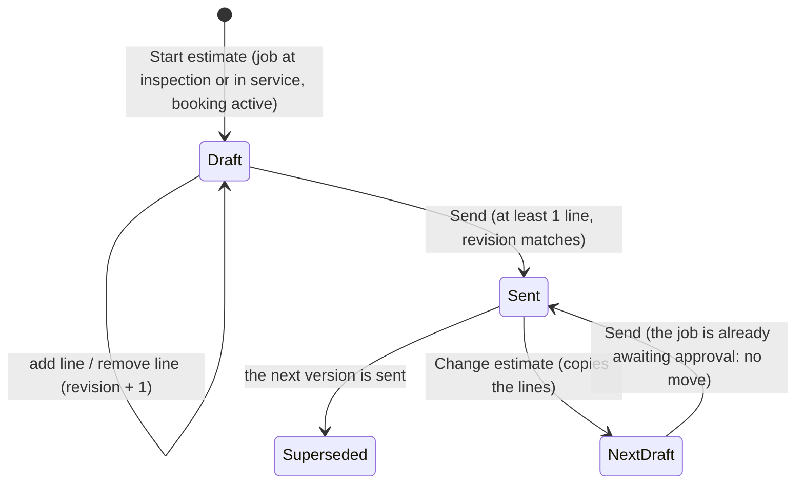
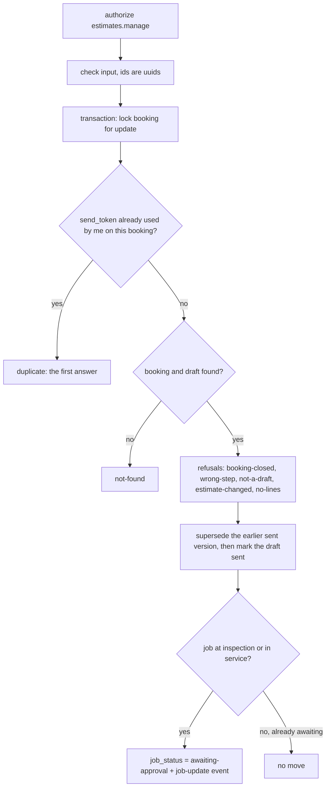

# Estimate Builder - Plan

## Goal Capsule

- **Objective:** When an inspection finds work, the garage's owner or manager writes a priced list of parts and labour for that job on a phone, marks each line needed or optional, and sends it, so the job shows it is waiting for the customer's approval. Once sent, the list can't change under the customer; a corrected list goes out as a new version and the old one stays on record.
- **Means:** new estimate tables beside the booking (KTD2), staff writes that lock the booking row and answer retries before any refusal (KTD5), a separate "by estimate" move into `awaiting-approval` (KTD3), plain Server Action forms on a new staff page (KTD7), and a small Job step form on the board so a job can reach inspection at all (KTD8).
- **Authority:** `CLAUDE.md` (binding) > this plan's Requirements > its KTDs > unit Approach text. The owner's choices of 2026-11-21 and 2026-11-22 (Key Decisions below) are settled.
- **Stop conditions:**
  - Stop and ask at the size checkpoint after U4 (KTD11).
  - Stop if any estimate write would need a session read, `getDatabase()` or a cached read inside its transaction.
  - Stop if anything would let `updateJob` (a mechanic's job update) move a job to `awaiting-approval`.
- **Execution profile:** one branch, `33_estimate_builder`, small commits per unit, `npm run check` after each unit, `npm run test:e2e` at U6.
- **Finishing:** the main session commits on the task branch, then runs the learning doc, `ce-code-review`, `code-reviewer` and compound, and opens the pull request. The owner merges it.

---

## Product Contract

### Summary

A new staff page, `/admin/bookings/<bookingId>/estimate`, opened from each card's Manage panel while the job is at inspection, in service or awaiting approval (or once an estimate exists). Staff start an estimate, add part and labour lines (a description, an amount in rupees, needed or optional), remove lines, see the totals with "Prices include taxes", and send it. Sending locks the lines and moves the job to "Waiting for the customer's approval". "Change estimate" copies a sent version into a new draft. The Manage panel also gets a Job step form so staff can move a job from not started to inspection and on.

### Problem Frame

Task 31 built the job steps, and `awaiting-approval` sits in them, but nothing can reach it: the garage has no way to put a priced list in front of the customer. No screen moves a job either: task 31's engine has no caller, so no job ever reaches inspection. Task 34 needs a sent, locked, versioned estimate to let customers approve or reject each line.

### Requirements

**Estimates and lines**

- R1. An estimate belongs to one booking. A booking has numbered versions (1, 2, ...); at most one version is a draft at a time.
- R2. A line has a kind (part or labour), a description (1 to 120 characters), an amount in whole rupees from ₹1 to ₹10,00,000 (task 39's `PRICE_RULES`), and is marked needed or optional.
- R3. A line may start from one of the garage's services: a blank amount takes that service's real price for the booked vehicle, and a blank description takes the service's name. With no real price, the amount must be typed.
- R4. Staff add and remove lines on a draft only. There is no in-place edit: a wrong line is removed and added again.
- R5. The page shows the total of needed lines, the total of optional lines and the total of everything, with one line saying "Prices include taxes" (KD3).

**Sending and versions**

- R6. Staff send a draft that has at least one line. Sending locks the version: no line of a sent version is ever added, removed or changed.
- R7. A send while the job is at inspection or in service moves the job to awaiting approval and records that move in the job's history. A send while the job is already awaiting approval moves nothing.
- R8. A send is refused when the draft changed since the page that sent it was shown (another staff member added or removed a line), so no one sends lines they haven't seen.
- R9. "Change estimate" on a sent version starts the next version as a draft holding a copy of its lines. The earlier sent version stays the current one until the new one is sent; then it is marked superseded. Every version, sent or superseded, stays on record with who sent it and when.
- R10. Editing and sending are allowed only while the booking is booked or confirmed and the job is at inspection, in service or awaiting approval. In any other state the page shows the versions read-only.

**Who and how**

- R11. Only staff with `estimates.manage` (manager, owner) see the page and its link, and only they write. Mechanics don't build estimates in this task.
- R12. A double tap or a retry of any estimate action never changes anything twice and gets the same answer as the first try.
- R13. Customers see nothing new in this task. The job-history row from R7 exists, but no customer page shows the job timeline before task 25.

**Job steps on the board**

- R14. Each card's Manage panel (staff with `bookings.manage`) offers the job's next steps as buttons, from not started through vehicle received, inspection, in service and ready, using task 31's rules. It never offers awaiting approval (only sending gets there) and never offers completed (KD5).

**Privacy**

- R15. The privacy notice says the garage keeps the estimates it writes for a customer's job (lines, amounts, versions, who sent them), why, who sees them, and that they're kept with the booking. `LOGIN_NOTICE_VERSION` moves.

### Key Decisions

- KD1. Estimates for booked jobs only; answers to free estimate requests from `/estimate` move to task 51. Governs R1, R10. (session-settled: user-directed — chosen over both jobs and requests now, or requests only: keeps the task reviewable)
- KD2. Each line is needed or optional; task 34 decides what a rejected needed line does. Governs R2. (session-settled: user-directed — chosen over all lines equal: lets the garage flag safety work)
- KD3. Amounts are what the customer pays, with "Prices include taxes"; no GST breakdown in version 1. Governs R2, R5. (session-settled: user-directed — chosen over no tax wording and "taxes extra")
- KD4. A small Job step control on the board, so a job can reach inspection and the builder can be used and tested in a browser. Governs R14. (session-settled: user-directed — chosen over building the mechanic's job page first, or no browser path: smallest way to reach the builder)
- KD5. The Job step control stops at Ready. `CLAUDE.md` "Reviews" says the staff reviews page must ship no later than the first screen that moves a job to completed, and none exists. Governs R14.
- KD6. Only managers and the owner write estimates, as the permission table already says. Governs R11. (session-settled: user-approved — chosen over letting the assigned mechanic draft: mechanics would see prices and the table would change)
- KD7. The customer's view of an estimate arrives with approve and reject in task 34. Governs R13. (session-settled: user-approved — chosen over a read-only customer page now, which task 34 would replace)

### Scope Boundaries

- Customer approval, rejection and phone approvals (task 34); moves out of `awaiting-approval` (task 34).
- Notifications when an estimate is sent (task 35).
- Answers to free estimate requests and closing their photo sets (task 51).
- The mechanic's own job pages (backlog).
- Considered and not built:
  - Quantities and unit prices: a line's amount is its total ("4 x spark plug" goes in the description). Revisit if the owner asks for per-unit pricing.
  - Discounts, negative lines and free (₹0) lines: the amount must be greater than zero. Revisit if the owner wants "free check" lines.
  - Editing a line in place: remove and add again keeps every form a single post with no unsaved rows to lose.
  - Keeping typed values after a refused add (an unreadable amount): plain posts redirect with a fixed notice code and the form starts empty. The form has four fields; revisit if staff find it painful.
  - Reordering lines: lines show in the order they were added.
  - A cap on lines per version: only managers and the owner add lines, and amounts are capped per line, so a long list harms nothing. Revisit if a page grows unwieldy.
  - Prefilling lines from the booked services: staff choose the lines after inspection, and R3 already lets any line start from a service. Revisit if the owner asks.
  - A recorded history row for a later version's send: the version row's `sent_at` and `sent_by` are the record (KTD4).

### Deferred to Follow-Up Work

- Task 34: show the current sent version to the customer, approve or reject each line, record phone approvals, and add the moves out of `awaiting-approval` (a rejected estimate included). Until then a sent job stays at awaiting approval, and cancel is refused because the job has started.
- Task 25: the customer's booking page shows `JobTimeline`, whose "Awaiting your approval" step needs task 34's estimate view; ship 34 first or explain the step.
- Task 34: once a job can leave awaiting approval (for example back to in service), a later version sent from in service moves it back; R7 already decides by step.
- Tasks 25 and 52: if either ever allows cancelling or moving a started job, decide what happens to an open estimate.
- Task 51: answering free estimate requests (moved from task 33), closing a request's photo set when the garage answers, and refusing uploads to a set a request already uses.
- The staff reviews page (backlog, task 37): needed before any screen offers "Completed"; then add it to the Job step control.

---

## Planning Contract

### Key Technical Decisions

- KTD1. **Pure rules in `src/domain/estimates.ts`.** `ESTIMATE_RULES` (description length 120), `ESTIMATE_LINE_KINDS`, `checkEstimateLineInput`, `estimateTotals`, and `canEditEstimate(bookingStatus, jobStatus)`. Amounts go through task 39's `parseRupees` and `PRICE_RULES` (`src/domain/money.ts`): whole rupees, ₹1 to ₹10,00,000, decimals refused so "1.500" is never read as ₹1.50. One parser keeps every staff screen reading typed money the same way.
- KTD2. **Two tables.**
  - `estimates`: `booking_id` (cascade), `version` (unique with `booking_id`), `created_by`, `created_at`, `create_token`, `revision` (integer, bumped by every line write), `sent_at`, `sent_by`, `send_token`, `superseded_at`.
  - `estimate_lines`: `estimate_id` (cascade), `position`, `kind`, `description`, `amount_paise`, `needed`, `service_id` (nullable, restrict), `copied_from_line_id`, `added_by`, `request_token`, `created_at`.
  - State comes from the timestamps: a draft has no `sent_at`, a sent version has `sent_at`, a superseded one also has `superseded_at`. CHECKs: `sent_at`, `sent_by` and `send_token` all set or all null; `superseded_at` only with `sent_at`; amount within `PRICE_RULES` and description length within `ESTIMATE_RULES`.
  - A partial unique index allows one draft per booking (`where sent_at is null`), another one current sent version (`where sent_at is not null and superseded_at is null`). Postgres checks these per statement and can't defer a partial index, so a send supersedes the earlier version before it marks the draft sent.
  - `copied_from_line_id` costs one column now and lets task 34 carry a line's approval or show what changed between versions; added later, old copies would stay unlinked.
  - `estimate_line_kind` is a new enum created with `CREATE TYPE`, so the CHECK lesson about added values doesn't apply. The migration adds no value to an existing enum.
- KTD3. **The move into `awaiting-approval` is a separate kind of row.** `JOB_MOVES` rows gain `how: "by-hand" | "by-estimate"`. `canMoveJob(from, to)` keeps its signature and answers only by-hand rows, so `updateJob`, the mechanic's future form and the Job step control can never reach `awaiting-approval`. `canSendEstimateFrom(step)` answers the two by-estimate rows (inspection, in service). The two existing "nothing reaches awaiting approval by hand" tests stay, reworded.
- KTD4. **History, decided by the job's step.** A send from a step where `canSendEstimateFrom` is true writes one `booking_events` row of kind `job-update` with `job_status = 'awaiting-approval'` and the send's token, in the same transaction ("Jobs": every move of `job_status` writes one). A send while the job is already awaiting approval moves nothing and writes no event: the version row is its record. Task 35 hooks its "estimate sent" message on the send itself.
- KTD5. **Every estimate write keeps the idempotent staff-save order** (`staff-booking-changes.ts`; lesson `idempotent-save-answer-duplicate-before-refusals-that-can-change.md`):
  1. `authorize("estimates.manage")`.
  2. The input check, and `isUuid` on every id.
  3. Reads that open their own connection: `readServices()` and `readServicePrices()` for R3 (task 39's real prices).
  4. One transaction that locks the booking row (`for update`).
  5. The caller's own token lookup on this booking: `duplicate` with the first answer.
  6. `not-found`. The estimate is found by its id and `booking_id` = the locked booking, a line by its id and `estimate_id` = that estimate. An id from another booking answers `not-found` (a line: `removed`) and writes nothing.
  7. The refusals.
  8. The writes.
  Tokens: `create_token` per `created_by`, `send_token` per `sent_by`, `request_token` per `added_by`, each unique. Removing a line needs no token: a line already gone from the named version answers `removed` whatever that version's state, so a retry after a send still gets the first answer. `not-a-draft` is only for a line still present on a sent version.
- KTD6. **Refusals are returned answers:** `booking-closed` (not booked or confirmed), `wrong-step` (R10), `not-a-draft` (a line write or send on a version that was sent, which binds the version id, never only the booking), `draft-exists` (Change estimate while a draft is open: the page opens it), `no-lines`, `estimate-changed` (R8: the posted revision differs), `no-price` (R3 with a blank amount and no real price), `problems` (input codes). `staffWithoutDetails` wraps the data-access calls in the actions, since a failed insert's values carry the line's description.
- KTD7. **The page is a Server Component behind a gate, with plain Server Action forms** (task 27 pattern: no client island holds staff data, works before the page's JavaScript loads).
  - `src/app/[locale]/admin/bookings/[bookingId]/estimate/page.tsx` is the prerendered shell with no `generateStaticParams`. `EstimateGate` reads `params` inside `<Suspense>` (the review page's pattern), then `requirePermission(locale, "estimates.manage")`, `await io()`, the reads, and fresh `randomUUID()` tokens.
  - Actions: `startEstimateVersion`, `addEstimateLine`, `removeEstimateLine`, `sendEstimate` in `src/server/actions/admin-estimates.ts`. Each is bound with `(locale, bookingId, estimateId?)`, reads only its own fields, and redirects back with a fixed notice code (its own closed list and parser, like `parseBoardNotice`) and an anchor. A refusal and a successful add return to `#add-line`, where the notice sits just above the add form (`role="alert"` for refusals, `role="status"` for saves). A send, Start and Change estimate return to the top. Nothing typed goes in a URL.
- KTD8. **The Job step control reuses `updateJob`.** `moveJobFromBoard(locale, bookingId, boardView, formData)` posts the chosen step and a fresh token, calls `updateJob({ bookingId, toStatus, note: "", ... })`, and redirects back to the board with a notice. The panel lists `canMoveJob(current, to)` targets except `completed` (KD5). `updateJob` already checks `jobs.update`, an active booking and the move, and writes the event.
- KTD9. **Board summary.** `listBookingsOn` adds a small estimate summary per booking: the newest version's number and whether it's a draft or sent. The card shows "Estimate draft (version N)" or "Estimate sent (version N)". The Manage panel shows the Estimate link when the viewer has `estimates.manage` (a `canEstimate` prop, like `canContact`) and either an estimate exists or `canEditEstimate` is true.
- KTD10. **Privacy.** Estimates go in the notice's existing "Your bookings" item: they're about the customer's booked job, cascade with the booking, and nothing deletes bookings yet ("kept with your booking", from the delete code). `coverage.test.ts` lists both tables under that item. `LOGIN_NOTICE_VERSION` becomes `2026-11-22` (`.2` if another task moves it the same day), with the copy and fingerprint in `consent.test.ts`.
- KTD11. **Size checkpoint after U4.** Count the hand-written lines in `src/`, `e2e/` and `messages/` (tests included; generated migration SQL and snapshots excluded) and estimate U5 and U6. If the total would pass about 2,500, stop and ask the owner whether "Change estimate" (R9) moves to a new task. Never move it without asking.

### High-Level Technical Design

An estimate version's life:

Send, in order (KTD5):

### Assumptions

- Task 39's price editor (`/admin/prices`) is on `main`, so a real price can be saved under `npm run dev` to try R3. Tests insert price rows themselves.
- Production can't start before task 44, so a job left at awaiting approval until task 34 only affects development and staging test bookings.

### Sources

- `CLAUDE.md` sections "Jobs", "Booking management", "Staff area", "Reviews", "Database", "Services and prices".
- `src/domain/jobs.ts`, `src/server/dal/jobs.ts`, `src/server/dal/staff-booking-changes.ts`, `src/server/actions/admin-bookings.ts`, `src/components/admin/booking-manage-panel.tsx`, `src/app/[locale]/(site)/account/reviews/[bookingId]/`.
- Lessons: `document/solutions/conventions/idempotent-save-answer-duplicate-before-refusals-that-can-change.md`, `drizzle-migration-new-enum-value-compare-as-text.md`, `suspense-streaming-needs-inline-script-test-no-js-by-blocking-bundles.md`, `privacy-notice-retention-from-delete-code-not-expiry.md`, `pglite-parallel-tests-bare-database-not-transaction-per-call.md`, `document/solutions/workflow-issues/parallel-branches-same-migration-number-regenerate-not-rename.md`.

---

## Implementation Units

### U1. Estimate rules and the by-estimate job move

- **Goal:** the pure rules every later unit uses.
- **Requirements:** R2, R5, R7, R10, R14.
- **Dependencies:** none. Merge `origin/main` into the branch first, so task 39's `src/domain/money.ts` is there.
- **Files:** `src/domain/estimates.ts`, `src/domain/estimates.test.ts`, `src/domain/jobs.ts`, `src/domain/jobs.test.ts`.
- **Approach:** KTD1 and KTD3. `checkEstimateLineInput` cleans the description with `normalizeTypedText` and counts it with `typedLength`.
- **Patterns to follow:** `src/domain/reviews.ts` (`REVIEW_RULES`, `checkReviewInput`), `src/domain/bookings.ts` (`canChangeStatus`'s table).
- **Test scenarios:**
  - An amount typed `"1,23,456"` becomes 12345600 paise through `parseRupees`; `"450.50"` is refused as not whole (task 39's rule).
  - `checkEstimateLineInput` refuses a blank description only when no service is chosen, a 121-character description, and an unknown kind.
  - `estimateTotals` of two needed lines and one optional line gives the needed, optional and full sums.
  - `canMoveJob` never answers true for `awaiting-approval` from any step (the reworded existing test).
  - `canSendEstimateFrom` is true for inspection and in service only.
  - `canEditEstimate` is true for booked or confirmed with inspection, in service or awaiting approval, and false for cancelled, no-show, a null step, ready and completed.
- **Verification:** `npm run check` passes.

### U2. The migration

- **Goal:** the two tables and their rules on a real Postgres.
- **Requirements:** R1, R2, R6, R9.
- **Dependencies:** U1.
- **Files:** `src/server/db/schema.ts`, `src/server/db/migrations/0013_estimate_builder.sql` and `meta/` (generated), `src/server/db/estimates-tables.test.ts`, `src/app/[locale]/(site)/privacy/coverage.test.ts`.
- **Approach:**
  1. Merge `origin/main` again if it moved since U1.
  2. Add the tables (KTD2).
  3. Run `npm run db:generate -- --name=estimate_builder`.
  4. If another branch reached `0013` first, delete ours and generate again; never rename it.
  5. List both tables in `coverage.test.ts` under the bookings item (the notice text itself changes in U6).
  6. Update the comments that still name task 33 for free requests (`schema.ts`, `src/domain/consent.ts`) to name task 51.
- **Patterns to follow:** `booking_items` (copied name and price, `position`), `src/server/db/booking-management-tables.test.ts` (fresh database, CHECK names).
- **Test scenarios:**
  - A fresh in-memory database migrates and takes a draft, a sent version and a superseded version.
  - A second draft for the same booking is refused by the partial unique index.
  - A second current sent version is refused.
  - A duplicate `(booking_id, version)` is refused.
  - `sent_at` without `sent_by` is refused; `superseded_at` without `sent_at` is refused.
  - An amount below ₹1 or above ₹10,00,000 is refused (`PRICE_RULES`); a 121-character description is refused (`ESTIMATE_RULES`).
  - Deleting the booking deletes its estimates and lines.
  - A line's `service_id` restricts deleting the service.
- **Verification:** `npm run check` passes; the migration has no `ALTER TYPE ... ADD VALUE`.

### U3. The Job step control

- **Goal:** staff move a job from not started to inspection and on, from the board.
- **Requirements:** R14.
- **Dependencies:** U1.
- **Files:** `src/server/actions/admin-bookings.ts`, `src/server/actions/admin-bookings.test.ts`, `src/components/admin/booking-manage-panel.tsx`, `src/components/admin/bookings-board.test.tsx`, `src/domain/board-dates.ts` (notice codes), `src/domain/board-dates.test.ts`, `messages/en.json`.
- **Approach:** KTD8. A small "Job step" group in the panel shows the current step, then one outline button per allowed target with an action label ("Move to Inspection"), so Confirm stays the panel's only blue button. The Estimate link sits in the same group. The panel only appears for `bookings.manage`, so mechanics never see it. Refusals from `updateJob` map to fixed notice codes.
- **Patterns to follow:** the status buttons in `booking-manage-panel.tsx` and `changeStatusFromBoard`.
- **Test scenarios:**
  - A booking not started shows "Move to Vehicle received" only.
  - At inspection the panel shows "Move to In service" and "Move to Ready".
  - At ready it shows "Move to In service" and no completed button.
  - At awaiting approval it shows no step buttons.
  - A cancelled booking shows no step buttons.
  - The action calls `updateJob` with the posted step and token and redirects with the success notice.
  - Logged out, the action redirects to `/login?session=ended`; a customer gets the 404.
  - A posted `completed` is refused before `updateJob` is called.
  - A posted `awaiting-approval` is refused by `updateJob` with no write.
  - A retried post with the same token answers duplicate (task 31's engine, checked through the action).
- **Verification:** `npm run check` passes; on `npm run dev` a test booking moves to inspection from the board.

### U4. Estimate saves and reads

- **Goal:** the data-access layer for the builder.
- **Requirements:** R1–R12.
- **Dependencies:** U1, U2.
- **Files:** `src/server/dal/estimates.ts`, `src/server/dal/estimates.test.ts`, `src/server/dal/staff-bookings.ts` and its test (the summary, KTD9).
- **Approach:**
  - `readEstimateForStaff(bookingId)`: the booking's code, vehicle copy, slot, customer name, the phone number only with `customers.contact` (like `listBookingsOn`), status and job step; every version with its lines and totals; `canEdit`.
  - `startEstimateVersion`, `addEstimateLine`, `removeEstimateLine` and `sendEstimate`, each in KTD5's order, with KTD6's answers.
  - Copy the private `lockBooking` helper or export it from `staff-booking-changes.ts`.
  - Line writes bump `revision`. Send first supersedes the earlier sent version, then marks the draft sent (KTD2), then moves the job per KTD4.
  - Leave the task 35 comment ("queue the customer's message here") inside the send's transaction.
- **Patterns to follow:** `src/server/dal/staff-booking-changes.ts` and its test (users asha, mona, manu, omar; `logIn`; mocked `getDatabase`).
- **Test scenarios:**
  - A manager starts version 1, adds two lines and sends: the job is at awaiting approval, one `job-update` event exists, and the version has `sent_at` and `sent_by`.
  - A line from a service with a real price row takes that price and the service's name; with no price row and a blank amount it answers `no-price`.
  - Change estimate copies the lines into version 2 with `copied_from_line_id`; version 1 stays current until version 2 is sent; then version 1 has `superseded_at`. Sent while the job awaits approval, version 2 moves nothing and adds no event.
  - The same token again answers `duplicate` with the first answer for start, add and send, including after the send moved the job (a retried send after its own move must not answer `wrong-step` or `not-a-draft`).
  - Removing a line twice answers `removed` both times, and a remove retried after the version was sent still answers `removed`.
  - A line id or estimate id from another booking, posted through this booking's bound ids, answers `removed` or `not-found` and changes neither booking.
  - Sending version 2 supersedes version 1 with no constraint error.
  - An add or send against version 1 after it was sent answers `not-a-draft` and writes nothing.
  - Change estimate while a draft exists answers `draft-exists` with that draft.
  - Send with the wrong revision answers `estimate-changed`; send with no lines answers `no-lines`.
  - Starting at ready or with a null step answers `wrong-step`; a cancelled booking answers `booking-closed`.
  - A mechanic and a customer get `AccessDeniedError` before `getDatabase` is called.
  - A malformed booking or estimate id answers `not-found` without a query.
  - `readEstimateForStaff` for a missing booking answers null, and selects the phone number only for a viewer with `customers.contact`.
  - The board summary shows the newest version's number and draft or sent.
- **Verification:** `npm run check` passes. Then the size checkpoint (KTD11): stop and report the count before U5.

### U5. The estimate page

- **Goal:** the builder staff use on a phone.
- **Requirements:** R2–R11.
- **Dependencies:** U3, U4.
- **Files:**
  - `src/app/[locale]/admin/bookings/[bookingId]/estimate/page.tsx`, `estimate-gate.tsx`, and their tests.
  - `src/components/admin/estimate-builder.tsx` and its test; `src/components/admin/booking-manage-panel.tsx` (the link).
  - `src/server/actions/admin-estimates.ts` and its test.
  - `src/domain/estimate-notices.ts` and its test (the closed notice list and its parser).
  - `messages/en.json` (`Admin.estimate`).
- **Approach:**
  - KTD7.
  - Always at the top: "Back to bookings" (`/admin/bookings?date=<the booking's India date>#booking-<id>`), then the booking summary.
  - States:
    - No estimate yet: a short line and "Start estimate"; no add form.
    - An empty draft: "No lines yet", the add form, Send shown disabled.
    - A draft with lines: the lines, then the notice and the add form (`#add-line`), the totals and "Prices include taxes", and "Send estimate" (the only blue button, bound with the rendered revision).
    - A sent current version with no draft: its lines read-only with the totals and "Change estimate"; earlier versions below, read-only.
    - A draft opened from a sent version shows the sent version read-only below it.
    - `canEditEstimate` false: everything read-only with a short reason (for example "Move the job back to In service to send").
  - A line is a list item: the description first, then its kind and a text marker "Needed" or "Optional" (never colour alone), then the amount on the right. Remove is a 44px outline button whose accessible name names the line. Needed lines come before optional ones, matching the totals.
  - The add form: kind and needed-or-optional as two required `ChoiceGroup`s with nothing preselected, an optional service `NativeSelect`, the description, and the amount (`inputMode="decimal"`, labelled in words, no `₹` in messages). A hint says a blank description or amount is taken from the chosen service; with no real price the `no-price` notice asks staff to type it.
  - After a send, the `sent` notice says the estimate is saved and locked and the customer isn't told yet, so staff should tell them. It shows the customer's call and WhatsApp links for viewers with `customers.contact`, as `BoardNotice` does after a cancel (the phone number is read only with that permission).
  - Amounts are shown with `formatRupees`.
  - The page sets no title. Every staff word renders inside the gate. A missing booking shows an in-page note and a link back to the board.
- **Patterns to follow:** `src/app/[locale]/admin/bookings/` (page, gate, `AdminLoading`), `review-gate.tsx` (params inside `<Suspense>`), `board-notice.tsx`.
- **Test scenarios:**
  - The gate redirects logged-out visitors to `/login?session=ended`, shows the 404 for a customer and a mechanic, and renders for a manager.
  - A draft with two lines renders each line, the three totals and "Prices include taxes".
  - A sent version renders no add or remove forms and offers "Change estimate".
  - No estimate renders only "Start estimate"; an empty draft renders Send disabled.
  - The `sent` notice shows the call links only to a viewer with `customers.contact`.
  - Every Remove button's accessible name includes its line's description.
  - A ready job's draft renders read-only with its reason.
  - Each action reads only its own fields; a posted `bookingId` or `estimateId` in the form data does nothing.
  - Each notice code renders its message; an unknown code renders nothing.
  - An unreadable amount redirects with the `amount-invalid` notice and writes nothing.
  - The board's Manage panel shows the Estimate link at inspection, in service and awaiting approval for a viewer with `estimates.manage`, and never without it.
- **Verification:** `npm run check` passes; on `npm run dev` a manager builds and sends an estimate on a phone-sized window.

### U6. Privacy notice, browser test and docs

- **Goal:** the notice, a real browser path, and the repo rules for later tasks.
- **Requirements:** R13, R15.
- **Dependencies:** U5.
- **Files:** `messages/en.json` (`PrivacyPage.items.bookings`), `src/domain/consent.ts`, `src/domain/consent.test.ts`, `e2e/admin.spec.ts`, `CLAUDE.md` (an "Estimates" block and the repo map), `document/task/task.md` (backlog lines moved to tasks 34, 25, 51).
- **Approach:**
  - KTD10.
  - The existing serial spec confirms and cancels its booking, and a started job can't be cancelled. So the customer step books a second visit (`MAX_FUTURE_BOOKINGS` is 3), and the owner, in the same login, after the existing steps:
    1. Moves the second booking's job to vehicle received, then inspection.
    2. Opens the estimate, starts it, and adds a needed part line.
    3. Adds an optional labour line with page scripts blocked (`**/_next/static/**/*.js`).
    4. Tries an unreadable amount and sees the notice.
    5. Sends, and sees "Waiting for the customer's approval" on the board.
  - Add the estimate page to the customer-HTML scan.
- **Patterns to follow:** `e2e/admin.spec.ts` (one owner login per run).
- **Test scenarios:**
  - `consent.test.ts` pins the new notice copy and fingerprint.
  - The browser path above passes.
  - A customer's raw HTML of `/admin/bookings/<id>/estimate` holds no staff words, line descriptions or amounts.
- **Verification:** `npm run check` and `npm run test:e2e` pass.

---

## Verification Contract

| Gate | Command | When |
| --- | --- | --- |
| Lint, types, unit and database tests | `npm run check` | after each unit |
| Browser tests on a production build | `npm run test:e2e` | U6, before the pull request |
| Migration written from the schema | `npm run db:generate -- --name=estimate_builder` | U2, after merging `origin/main` |
| Design samples | not needed: nothing in `ui/` or `site/` changes | — |

Run Node through `fnm exec --using=24 --`. A `check` timeout while other worktrees are busy is rerun before it is called a failure (lesson `full-check-times-out-under-parallel-session-load.md`).

---

## Definition of Done

- Every unit's verification passed, and the size checkpoint after U4 was reported.
- `canMoveJob` still never reaches `awaiting-approval`; only `sendEstimate` does.
- No line of a sent version can be changed through any data-access function (tests prove it).
- The privacy notice, `LOGIN_NOTICE_VERSION` and `consent.test.ts` agree; `coverage.test.ts` lists both tables.
- `CLAUDE.md` has an "Estimates" block; `task.md`'s backlog lines naming task 33 for free requests now name task 51.
- No abandoned code from approaches that were dropped remains in the diff.
- The learning doc, `ce-code-review`, `code-reviewer` and compound steps follow the repo workflow.
