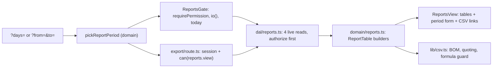

# Staff Reports - Plan

## Goal Capsule

- **Objective:** the owner and managers open `/admin/reports`, pick a period, and see how many bookings came in each day and how they ended, which services are booked most, what customers rate the garage, and how the work is spread across mechanics. They can download each table as a CSV that holds no customer's personal data.
- **Means:** a pure period reader and report builders in `src/domain/`, four live staff reads in a new `src/server/dal/reports.ts`, one staff page with a GET period form, and one Route Handler that returns a CSV per report (KTD1–KTD8).
- **Authority:**
  - the master plan, row 41;
  - the owner's decisions of 2026-11-22 (Key Decisions);
  - `CLAUDE.md`: Staff area, Booking management, Roles and access, Database, Reviews, Languages.
- **Stop conditions:** stop and ask if a report needs a new table or column (the privacy notice would move), if a CSV would need a customer's name, phone, plate or booking code, or if a Route Handler can't give a plain 404 to a customer.
- **Execution profile:** one branch (`41_admin_reports`), small commits, `npm run check` and `npm run test:e2e` before handover. Dev server on port 3001 only.
- **Who finishes:** the main session builds, reviews and opens the pull request. The owner merges it.

---

## Product Contract

### Summary

A new staff page, `/admin/reports`, shows four reports for a chosen period: bookings per day by status, top services, rating, and mechanic workload. A preset (last 7, 30 or 90 days) or a custom from/to range picks the period. Each report has a "Download CSV" link to the same table as a file. Only managers and the owner can see it (`reports.view`).

### Problem Frame

The garage takes bookings, runs jobs and collects reviews, but nothing adds them up. The owner can only page through the bookings board one day at a time. The master plan promised reports with CSV export (feature 27). Estimates don't exist yet, so the "approved estimate value" report waits for task 34.

### Requirements

**Period**

- R1. A period is either a preset of the last 7, 30 or 90 India days ending today, or a custom from/to pair of India dates (both inclusive). The default is the last 30 days.
- R2. A custom range may reach into the future (bookings sit up to 60 days ahead) and spans at most 366 days. A missing, unreadable, reversed or too-long range shows the default period with a note saying the range wasn't used.
- R3. The page always says which dates the reports cover, and every CSV link carries those resolved dates, so a download covers exactly what the screen shows.

**Reports**

- R4. **Bookings:** for each India day in the period that has bookings, the number of bookings by status (booked, confirmed, cancelled, no-show) and their total, with a totals row. A booking counts on the day of its slot.
- R5. **Top services:** each service or package booked in the period, with how many bookings include it, most booked first. Cancelled and no-show bookings are left out.
- R6. **Rating:** the published reviews written in the period: how many, the average (one decimal), and how many gave 1, 2, 3, 4 and 5 stars. Hidden reviews are left out.
- R7. **Mechanic workload:** for each mechanic with bookings in the period, the number of bookings assigned to them and how many of those jobs are completed, plus an "Unassigned" row. Cancelled and no-show bookings are left out. The workload report shows mechanics' names.
- R8. An empty period shows a short "nothing in this period" line per report instead of an empty table.
- R12. Each report says in one line what it counts (by slot day, which statuses, or reviews by the day they were written), so tables that count differently don't read as a mistake.

**CSV**

- R9. Each report downloads as a CSV of its own table, headings included, and nothing else: no customer names, phone numbers, registration numbers or booking codes. Mechanics' names appear in the workload CSV only.
- R10. A CSV opens correctly in Excel and Google Sheets with non-English text, and a cell's text can never run as a spreadsheet formula.

**Access**

- R11. Managers and the owner (`reports.view`) see the page and download the CSVs. A customer or mechanic gets the 404 page for the page and a plain 404 for a CSV. A logged-out visitor is sent to the login page.

### Key Decisions

- **Four reports now; approved estimate value waits for task 34.** Estimate tables don't exist yet. A backlog line tells task 34 to add it. Governs R4–R7. (session-settled: user-directed — chosen over waiting for tasks 33–34 to build all five together: four reports are useful today)
- **Presets plus a custom range.** Governs R1, R2. (session-settled: user-directed — chosen over presets only or month by month: the owner wants both quick buttons and any range)
- **CSV holds totals only.** Governs R9. (session-settled: user-directed — chosen over also exporting a per-booking list with customers' names and phones: no personal data leaves the app, so the privacy notice doesn't change)
- **Mechanic names in the workload report and its CSV.** Governs R7, R9. (session-settled: user-directed — chosen over names on the page only, or no per-mechanic rows: it's staff data in a staff-only report)
- **Managers and the owner.** Governs R11. (session-settled: user-directed — chosen over owner only: the existing `reports.view` permission)

### Scope Boundaries

**Non-goals, considered and not built**

- Money totals (booking value). Every booking line is "no price" until real prices are entered (task 39 just shipped the editor), and the approved value belongs to task 34. Revisit when bookings carry prices.
- A "booked on" view (counting bookings by the day they were made). The slot day answers "how busy were we". Add it if the owner asks how far ahead people book.
- Charts. Tables read well on a phone and match the CSV. A chart is a later polish.
- Caching reports. Staff reads are live by rule, and one garage's data is small.
- A per-booking CSV (rejected above).

### Deferred to Follow-Up Work

- Approved estimate value report: task 34 (backlog line in `document/task/task.md`).
- Workload shows only "Unassigned" until task 29 adds mechanics. Nothing to build here: the report fills in once mechanics exist.

---

## Planning Contract

### Key Technical Decisions

- KTD1. **A pure period reader, `src/domain/report-period.ts`.** `pickReportPeriod(query, today)` turns `?days=` or `?from=&to=` into `{ from, to, days, note }`, where the note names the reason (unreadable, reversed, or longer than 366 days) and trusts nothing, as `pickBoardDate` does (`src/domain/board-dates.ts`). If either `from` or `to` is present, the reader treats the query as a custom range. Otherwise `days` picks a preset. Anything invalid falls back to 30 days with a note. A `reportQuery(period)` helper writes the resolved `from`/`to` into every CSV link (R3). The window in instants is `indiaInstantOn(from, 0)` up to, but not including, `indiaInstantOn(addDays(to, 1), 0)`.
- KTD2. **India days are grouped in code, not with SQL `AT TIME ZONE`.** The data layer selects each booking's `starts_at` and `status` for the window. `src/domain/reports.ts` groups them by `indiaDateOf`. `src/domain/india-time.ts` already owns India time through `Intl`, and PGlite's time-zone data is untested here. One garage's bookings for at most 366 days is a few thousand rows. Task 41's step in `task.md` said "AT TIME ZONE in SQL": the step text is updated to say why we went the other way.
- KTD3. **Which bookings count.** R4 counts every status. R5 and R7 count `PLACE_HOLDING_STATUSES` minus no-show. That means `ACTIVE_STATUSES` (booked, confirmed), because a cancelled or no-show booking wasn't serviced. Cancelling doesn't clear `assigned_mechanic_id` (`src/server/dal/staff-booking-changes.ts`), so leaving cancelled bookings out keeps workload honest. "Completed" in R7 is `job_status = 'completed'`.
- KTD4. **Workload groups by the stored assignee, not by current role.** Rows aren't filtered through `isMechanic`: someone who lost the mechanic role still did those jobs, and filtering would hide them under "Unassigned". There's no SQL role filter (CLAUDE.md, Roles and access) and no `listMechanics()` call, which checks `bookings.manage`. An empty name shows `Admin.bookings.unnamedMechanic`.
- KTD5. **Four reads in `src/server/dal/reports.ts`, one per report.** Each starts with `authorize("reports.view")`, then checks its period (`parseIndiaDate` on both ends, `from <= to`), then calls `getDatabase()`. All four are live: no `'use cache'`. The CSV handler calls only the one read it needs. Top services joins `booking_items` to `services` on `service_id` and groups by `services.id`, so each row carries the service's current name. The foreign key restricts deletes, so the row always exists, listed or not. The page and the CSV get the name from the same read, and nothing else swaps it. Rating uses SQL `count` and `sum` grouped by `rating`, as `readPublishedReviews` does (`src/server/dal/reviews.ts`).
- KTD6. **One report builder for the page and the CSV.** `src/domain/reports.ts` turns each read's rows into a `ReportTable` with plain cells. A cell is an India date, a number, a one-decimal average or text, and the table carries its column keys. The page renders the table with formatting; the CSV writes the same rows. So the screen and the file can't disagree.
- KTD7. **The CSV is a Route Handler at `src/app/[locale]/admin/reports/export/route.ts`.** Its URL is `/admin/reports/export?report=bookings&from=…&to=…`.
  - No dot in the path. A `.csv` path would still run through the proxy (`csv` isn't in `src/proxy.ts`'s skip list) and break the "slugs never contain a dot" rule.
  - Under `[locale]/admin`, the proxy's 307 sends a logged-out visitor to login, and the handler gets `params.locale`, checked with `hasLocale`.
  - The handler gives every other answer itself as a plain `404` with `Cache-Control: private, no-store`: a customer, a mechanic, a leftover cookie without a session, an unknown report, a bad locale. It catches only `AccessDeniedError`, never everything.
  - It doesn't call `requirePermission`: its `notFound()` would send the HTML 404 page as the answer.
  - Reading the session (`headers()`) and the query keeps it at request time under Cache Components (`node_modules/next/dist/docs/01-app/01-getting-started/15-route-handlers.md`, "With Cache Components"). `await io()` comes before the clock read.
  - The answer is `text/csv; charset=utf-8` with `Content-Disposition: attachment; filename="<report>-<from>-to-<to>.csv"`, `Cache-Control: private, no-store` and `X-Content-Type-Options: nosniff`, as the fake photo storage's private view does (`src/server/providers/photos/fake.ts`). The brand stays out of the file name, since it lives only in messages.
- KTD8. **CSV encoding in `src/lib/csv.ts`.**
  - The file starts with a UTF-8 byte-order mark and uses CRLF line ends, which Excel needs to read non-English text.
  - Every text cell is quoted, with inner quotes doubled.
  - A text cell that starts with `=`, `+`, `-`, `@`, a tab or a carriage return gets a leading `'` (formula injection: service names and mechanics' names are typed by staff).
  - Numbers go out as plain ASCII digits and dates as `YYYY-MM-DD`.
  - Headings come from `AdminReports.csv.*` with the locale passed explicitly (`getTranslations({ locale, namespace })`).

### High-Level Technical Design

### Risks

- **Tests share one database.** Every e2e spec books on one `next start` database in parallel, so e2e checks "at least" counts and the CSV's shape, never exact totals. Exact numbers live in the PGlite data-access tests (`document/solutions/conventions/playwright-spec-that-saves-shared-data-runs-in-last-project.md` covers the related case of specs that save shared data).
- **Login budget.** The test owner number already uses 2 of its 5 codes an hour (`e2e/admin.spec.ts`, `e2e/prices.spec.ts`). The reports checks go inside `admin.spec.ts`'s existing owner test, so they don't use a third login.
- **First Route Handler that reads the session.** If an unexpected error escapes, it would leak in a 500's body only in development. Production shows Next.js's bare 500. The handler only catches `AccessDeniedError`.
- **First Route Handler inside `[locale]`.** Its layout has `generateStaticParams`. If `next build` treats a GET handler there unexpectedly, unit tests would still pass. The e2e CSV fetch in U5 is the check that catches it.
- **India midnight.** Today is read once per request (`await io()`, then `systemClock`). Bookings at 18:29:59Z and 18:30:00Z fall on different India days, and the domain tests pin that.

---

## Implementation Units

### U1. Domain: period, report tables, CSV

**Goal:** the pure pieces: read a period, build the four tables from rows, write a CSV.

**Requirements:** R1–R10, KTD1, KTD2, KTD3, KTD6, KTD8.

**Dependencies:** none.

**Files:**
- `src/domain/report-period.ts`, `src/domain/report-period.test.ts`
- `src/domain/reports.ts`, `src/domain/reports.test.ts`
- `src/lib/csv.ts`, `src/lib/csv.test.ts`

**Approach:**
1. `report-period.ts` holds `REPORT_PRESETS` (7, 30, 90), `REPORT_DEFAULT_DAYS` (30), `REPORT_MAX_DAYS` (366), `pickReportPeriod` and `reportQuery`. A preset of N days ends today and starts at `addDays(today, -(N - 1))`.
2. `reports.ts` has one builder per report taking the read's rows and the period. `bookingsTable` groups by `indiaDateOf(startsAt)` and adds a totals row. `topServicesTable` sorts by count and breaks ties by name. `ratingTable` gives five rows (5 stars down to 1, columns Stars and Reviews) plus a summary of the count and `averageRating` from `src/domain/reviews.ts`. The page shows the summary above the rows, and the CSV ends with a Total row carrying both. `workloadTable` puts the unassigned row last.
3. `csv.ts` holds `toCsv(headings, rows)` with KTD8's rules.

**Patterns to follow:** `src/domain/board-dates.ts` (a query reader that trusts nothing, with a note), `src/domain/india-time.ts`.

**Test scenarios:**
- `?days=7` on 2026-11-22 gives 2026-11-16 to 2026-11-22, with no note.
- No query gives the last 30 days, with no note.
- `?days=8` gives 30 days with a note.
- `?days` given twice (an array) gives 30 days with a note.
- `?from=2026-11-01&to=2026-11-10` gives that range.
- A `from` after `to` gives the default with the `reversed` note. An unreadable date or a missing `to` gives `unreadable`, and a span of 367 days gives `too-long`.
- A span of exactly 366 days is accepted.
- A future `to` (2027-01-10) is accepted.
- A `from` together with `days` makes a custom range: `days` is ignored.
- `reportQuery` always writes `from` and `to`, never `days`.
- `bookingsTable`: a booking at 18:29:59Z counts on the earlier India day, and one at 18:30:00Z on the next.
- `bookingsTable`: days without bookings are left out, and the totals row adds up each status.
- `bookingsTable`: an empty list gives an empty table (R8).
- `topServicesTable`: sorts by count, and breaks ties by name.
- `ratingTable`: with no reviews, the average is null and every star count is 0.
- `ratingTable`: ratings 4 and 5 give 4.5, and the rows run from 5 stars down to 1.
- `workloadTable`: an empty name becomes the unnamed-mechanic label (passed in), and the unassigned row comes last.
- `toCsv`: starts with the byte-order mark and ends each line with CRLF.
- `toCsv`: a cell holding a comma, a quote or a newline is quoted, with inner quotes doubled.
- `toCsv`: `=SUM(A1)`, `+1`, `-x` and `@a` each get a leading `'`.
- `toCsv`: Devanagari text round-trips unchanged.
- `toCsv`: numbers come out unquoted.

**Verification:** the domain tests pass, and no file imports Next.js, React or the database.

### U2. Data access: four live reads

**Goal:** the staff reads behind the reports.

**Requirements:** R4–R7, R11, KTD3, KTD4, KTD5.

**Dependencies:** U1 (the period type).

**Files:**
- `src/server/dal/reports.ts`, `src/server/dal/reports.test.ts`

**Approach:**
1. `readBookingsReport`, `readTopServicesReport`, `readRatingReport` and `readWorkloadReport` each take a period. Each runs `authorize("reports.view")` first, then the period check (answering `{ ok: false, problem: "invalid-period" }`), then `getDatabase()`.
2. Bookings: select `starts_at` and `status` in the window.
3. Top services: join `booking_items` to bookings in the window with an active status, and count distinct bookings per `service_id`. Return each service's current `services.name` (KTD5).
4. Rating: count and sum `reviews` grouped by `rating`, where `hidden_at is null` and `created_at` is in the window.
5. Workload: active bookings in the window, grouped by `assigned_mechanic_id`, with a left join to `users` for the name (an alias, as in `staff-bookings.ts`). Count all bookings, and the completed ones.

**Patterns to follow:** `src/server/dal/staff-bookings.ts` (authorize first, India-day window), `src/server/dal/reviews.ts` (aggregates), `src/server/dal/staff-bookings.test.ts` (PGlite setup with the 60-second timeouts and a `book()` helper).

**Test scenarios:**
- Logged out: `AccessDeniedError`, and `getDatabase` is not called. A customer and a mechanic get the same.
- A manager and the owner get rows.
- An invalid period answers `invalid-period` without a query.
- Bookings: a booking just outside the window on either side is left out.
- Bookings: a cancelled booking counts, under cancelled.
- Top services: a booking with two lines counts once per service.
- Top services: a cancelled booking and a no-show are left out.
- Top services: a service renamed after it was booked shows its current name.
- Rating: a hidden review is left out.
- Rating: a review written before the window is left out.
- Workload: a cancelled booking assigned to a mechanic is left out.
- Workload: a booking assigned to someone who is now a customer still counts under their name.
- Workload: completed counts `job_status = 'completed'` only.

**Verification:** `reports.test.ts` passes. Removing `authorize` or the window filter fails a test.

### U3. The reports page

**Goal:** `/admin/reports`: the period picker and four tables.

**Requirements:** R1–R8, R11, R12.

**Dependencies:** U1, U2.

**Files:**
- `src/app/[locale]/admin/reports/page.tsx`, `src/app/[locale]/admin/reports/reports-gate.tsx`, `src/app/[locale]/admin/reports/page.test.tsx`
- `src/components/admin/reports-view.tsx`, `src/components/admin/reports-view.test.tsx`
- `src/components/admin/admin-navigation.ts` (+ its test), `src/components/admin/admin-overview.tsx` (+ its test)
- `messages/en.json` (`Admin.nav.reports`, `Admin.overview.reportsDescription`, and a new `AdminReports` namespace)

**Approach:**
1. The page is non-async and wraps the gate in `<Suspense fallback={<AdminLoading />}>`.
2. The gate runs in this order:
   - `requirePermission(locale, "reports.view")`;
   - `await io()`, then today from `systemClock`;
   - `await searchParams`, then `pickReportPeriod`;
   - the four reads in parallel;
   - render `ReportsView`.
3. `ReportsView` is a Server Component:
   - a heading and the covered dates (`formatIndiaDate`);
   - the note when the range wasn't used, naming its reason and the 366-day limit;
   - the presets as links, with the current one marked by `aria-current`;
   - a GET form with two date inputs, prefilled with the resolved `from` and `to`, and a secondary button, built from `getPathname`;
   - four blocks in this order: rating, top services, workload, then bookings last (it is the one that can run to hundreds of rows);
   - each block has its heading, its one-line description (R12), a `<table>` with a caption, and a "Download CSV" link (an `<a>` to the export URL from `getPathname` plus `reportQuery`);
   - each table sits in an `overflow-x-auto` wrapper that a keyboard can scroll (`tabIndex={0}`, `role="region"`, labelled by the caption), with `<th scope="col">` headings, `<th scope="row">` for the day or name, and the totals row in a `<tfoot>`.
   - Statuses use `Admin.bookings.statuses`.
4. `adminNavItems` gets `{ href: "/admin/reports", labelKey: "reports", permission: "reports.view" }`, and the overview gets its description.

**Patterns to follow:** `src/app/[locale]/admin/bookings/` (page, gate, test), `src/components/admin/bookings-board.tsx` (GET date form, links), `src/components/admin/price-list.tsx` (task 39's newest staff list).

**Test scenarios:**
- The gate, logged out: redirect to `/login?session=ended`.
- The gate, as a customer or a mechanic: the 404, and no report read is called.
- The gate, as the owner: `ReportsView` gets the period from the query and today in India. Fake `Date` at 2026-11-21T18:30Z, which is already the 22nd in India.
- The page's prerendered shell holds no `AdminReports` words.
- `ReportsView` shows the covered dates, and the note only when there is one, with a message per reason.
- `ReportsView`: the date inputs hold the resolved `from` and `to`.
- `ReportsView`: each block shows its description, and bookings is the last block.
- `ReportsView`: each table's scroll wrapper is focusable and named by its caption, and the bookings totals row sits in `<tfoot>`.
- `ReportsView`: each preset link carries `days`, and the current preset has `aria-current="page"`.
- `ReportsView`: each CSV link carries the resolved `from` and `to` and its report name.
- `ReportsView`: an empty report shows its empty line, with no table.
- `ReportsView`: the workload table shows names, with the unnamed label for an empty one.
- Navigation: a manager and the owner see Reports, a mechanic doesn't.
- The overview lists Reports with its description.

**Verification:** the page tests pass, and opening `/admin/reports` on port 3001 as the owner shows the tables at phone width with no page-wide horizontal scroll.

### U4. The CSV Route Handler

**Goal:** `/admin/reports/export` returns one report as a CSV.

**Requirements:** R3, R9, R10, R11, KTD7, KTD8.

**Dependencies:** U1, U2.

**Files:**
- `src/app/[locale]/admin/reports/export/route.ts`, `src/app/[locale]/admin/reports/export/route.test.ts`
- `messages/en.json` (`AdminReports.csv` headings)

**Approach:**
1. Check the locale with `hasLocale`. Read `report` and the period from `request.nextUrl.searchParams` and run them through `pickReportPeriod`.
2. Ask `getCurrentUser()`, then `can(role, "reports.view")`. Without it, answer a plain 404.
3. Call the one read, build its table, then `toCsv`, and answer with KTD7's headers.
4. A period that fell back still downloads, for the fallback dates, which the file name shows.

**Patterns to follow:** `src/app/api/photos/view/route.ts` (a plain `Response` 404), `src/app/admin.webmanifest/route.ts` (messages in a handler).

**Test scenarios:**
- Logged out (no user): 404 with no body and `Cache-Control: private, no-store`. A customer and a mechanic get the same.
- An unknown `report=x`: 404. So does a bad locale.
- The owner with `report=bookings&from=2026-11-01&to=2026-11-07`: 200, `text/csv; charset=utf-8`, an attachment named `bookings-2026-11-01-to-2026-11-07.csv`, `Cache-Control: private, no-store`, `X-Content-Type-Options: nosniff`, and a body that starts with the byte-order mark and the translated headings.
- The owner, workload: the mechanic's name is in the body.
- No CSV holds a phone number pattern (`+91` or ten digits), a booking code or a plate from the test rows.
- A service named `=HYPERLINK(...)` comes out as `'=HYPERLINK(...)`.

**Verification:** the handler tests pass. Downloading from the page on port 3001 opens in a spreadsheet with the headings.

### U5. Browser test and docs

**Goal:** prove it on the production build, and write it down.

**Requirements:** R3, R9, R11.

**Dependencies:** U3, U4.

**Files:**
- `e2e/admin.spec.ts`
- `CLAUDE.md` (a "Reports (task 41)" section and the repo map rows), `readme.md` (staff area line)
- `document/task/task.md` (task 41 steps, the backlog line for task 34's estimate value report)

**Approach:**
1. In the customer part, add `/admin/reports` to the raw-HTML staff-words check, and the reports words to `STAFF_WORDS`. A customer's CSV request is a 404, and a logged-out one is a 307 to `/login`.
2. In the owner part, after the board checks:
   - open `/admin/reports` with a custom range that covers the booking the spec made;
   - see the four headings, and a bookings count of at least 1 on that day;
   - fetch the bookings CSV with the owner's cookies: 200, `text/csv`, the headings, no `+91`, and none of the spec's booking codes.

**Patterns to follow:** `e2e/admin.spec.ts` as it stands (serial, one owner login, `maxRedirects: 0`).

**Test scenarios:**
- A customer sees no staff words in `/admin/reports`'s HTML, and gets a 404 for the CSV.
- A logged-out CSV request answers 307 to `/login`.
- The owner sees the reports and downloads a CSV with no personal data.

**Verification:** `npm run test:e2e` passes, with the reports checks inside the existing owner test.

---

## Assumptions

- The CSV link is a plain `<a>` (no `download` attribute). The server's `Content-Disposition` makes it a download, and it works without the page's JavaScript.
- Reports don't need `/dev/design` samples: they use existing components and plain tables in `src/components/admin/`, which sits outside the `/dev/design` rule.
- No privacy change: no new table or column, and no personal data in a CSV beyond staff names, which staff already see on the board. `coverage.test.ts` stays as it is.

---

## Verification Contract

- `npm run check` (lint, typecheck, unit tests) passes.
- `npm run test:e2e` passes: the reports checks run inside `e2e/admin.spec.ts`'s owner test.
- A manual look at `/admin/reports` on `npm run dev -- --port 3001` at 375px and at desktop width, plus one CSV opened in a spreadsheet.
- `ce-code-review`, then the `code-reviewer` agent, with every must-fix fixed.

---

## Definition of Done

- Every unit's verification holds, and R1–R12 are met.
- The privacy notice and `LOGIN_NOTICE_VERSION` are unchanged, and `coverage.test.ts` passes untouched.
- `CLAUDE.md`, `readme.md` and `task.md` describe the reports, and the backlog has task 34's estimate value line.
- The learning doc `document/learning/41_admin_reports.md` exists and records the reviews.
- No leftover experiments or unused code in the diff.
